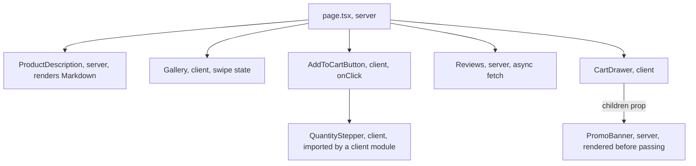

## 79.3 The App Router: routes, layouts and special files

#### Concept

The **App Router** (stable since Next.js 13.4, the default in 14) maps folders under `app/` to URL segments. A folder becomes a public route only when it contains a `page.tsx`. Other reserved file names in the same folder add behaviour to that segment:

| File | What it does |
|---|---|
| `page.tsx` | The UI for this URL; makes the segment routable |
| `layout.tsx` | Wraps this segment and all children; **persists** across navigation between children (state kept, not re-rendered) |
| `template.tsx` | Like a layout, but re-mounted on every navigation (fresh state, effects re-run) |
| `loading.tsx` | Wraps the page in a `<Suspense>` boundary with this as the fallback; enables streaming and instant navigation feedback |
| `error.tsx` | Wraps the page in an error boundary; must be a client component; receives `error` and `reset` |
| `not-found.tsx` | Rendered when `notFound()` is called in this segment |
| `global-error.tsx` | Error boundary for the root layout itself; must render its own `<html>` and `<body>` |
| `route.ts` | A **Route Handler**: an HTTP endpoint instead of a page (79.6); cannot sit next to `page.tsx` |

Folder name conventions add the rest: `[slug]` is a dynamic segment, `[...slug]` a catch-all, `[[...slug]]` an optional catch-all, `(shop)` a **route group** that organises files and layouts without appearing in the URL, `_components` a private folder that is never routed, `@cart` a **parallel route** slot rendered alongside the page, and `(.)p/[slug]` an **intercepting route** (for example, opening a product in a modal over the listing).

#### Why does it exist?

The older Pages Router (`pages/`, still supported) treated each page as one unit fetched by `getServerSideProps` or `getStaticProps`. Shared chrome such as a header with a cart count re-rendered on every navigation, data fetching could only happen at the page level, and loading and error states were hand-built per page. The App Router makes the **segment** the unit: each level of the URL can own its layout, data, loading state and error boundary, and navigation re-renders only the segments that changed.

#### Mental model

Imagine a set of nested picture frames. The outer frame (root layout) holds the site header and footer. Inside it, the `(shop)` frame holds the category sidebar. Inside that, the page is the picture. When you navigate from one product to another, only the picture is swapped; the frames stay on the wall, with any open drawer or typed search text still in place. `loading.tsx` is a placeholder card the framer slots in while the next picture is being fetched; `error.tsx` is a "sorry, this picture is damaged" card that replaces only the picture, not the frames.

#### How it works

A storefront's `app/` directory:

```text
apps/web/app/
├── layout.tsx                 root: <html>, <body>, header, Providers (79.4)
├── global-error.tsx
├── (shop)/
│   ├── layout.tsx             category nav; static
│   ├── page.tsx               home  ->  /
│   ├── c/[category]/
│   │   ├── page.tsx           /c/electric-toothbrushes  (ISR, 79.2)
│   │   └── loading.tsx
│   └── p/[slug]/
│       ├── page.tsx           /p/sonic-toothbrush
│       ├── error.tsx
│       └── not-found.tsx
├── (account)/
│   ├── layout.tsx             requires session (79.9)
│   ├── orders/page.tsx        /orders  (dynamic)
│   └── cart/page.tsx          /cart    (client-rendered cart, 79.13)
└── api/
    ├── revalidate/route.ts    POST /api/revalidate  (79.6)
    └── bff/cart/route.ts      GET  /api/bff/cart    (79.8)
```

For a request to `/p/sonic-toothbrush`, Next.js composes the segments into one React tree, in this nesting order per segment:

```text
RootLayout
  └ (shop)/layout
      └ ErrorBoundary  (p/[slug]/error.tsx)
          └ Suspense   (loading.tsx, if present)
              └ NotFoundBoundary (not-found.tsx)
                  └ page.tsx
```

**First load** returns HTML (plus the RSC payload inlined in `<script>` tags so React can hydrate without refetching). **Client-side navigation** through `<Link>` or `router.push()` does not fetch HTML. The router requests the **RSC payload** for the new URL (a request with the `RSC: 1` header and a `_rsc` query parameter), receives only the segments that differ from the current page, and patches the tree. Layouts that are shared between the old and new URL are not re-rendered on the server or remounted on the client.

**Prefetching**: in production, `<Link>` prefetches routes as the link enters the viewport. For a static route the whole RSC payload is prefetched; for a dynamic route only the part down to the nearest `loading.tsx` is prefetched, so the click shows the loading state instantly and the rest streams. Prefetched payloads live in the client-side **Router Cache** (79.7). `prefetch={false}` turns it off per link; in development nothing is prefetched, which is why production feels faster than `next dev`.

#### Practical example

The product page needs four states: found, not found, failed, and loading during navigation. With the App Router, each is a file. `notFound()` in the page renders `not-found.tsx` with a real `404` status (it runs before streaming starts). A thrown error renders `error.tsx` inside the `(shop)` layout, so the header and category navigation still work and the user can click away. Navigation from a category page shows `loading.tsx` instantly because the dynamic part was not prefetched.

#### React / Next.js example

```tsx
// apps/web/app/(shop)/p/[slug]/error.tsx  (must be a client component)
'use client';
import { useEffect } from 'react';

export default function ProductError({ error, reset }: { error: Error & { digest?: string }; reset: () => void }) {
  useEffect(() => {
    // In production, Next.js replaces server error messages with a generic one and gives a digest
    // that matches the server log line. Report the digest, never the raw server message.
    console.error('product page error', error.digest);
  }, [error]);
  return (
    <section role="alert">
      <h2>We could not load this product.</h2>
      <p>Reference: <code>{error.digest}</code></p>
      <button onClick={() => reset()}>Try again</button> {/* re-renders the segment */}
    </section>
  );
}
```

```tsx
// apps/web/app/(shop)/p/[slug]/page.tsx  (metadata excerpt, Next.js 14)
import type { Metadata } from 'next';
import { getProduct } from '@/lib/catalog.server'; // the fetch from 79.1, wrapped in React cache() (79.4, 79.7)

export async function generateMetadata({ params }: { params: { slug: string } }): Promise<Metadata> {
  const product = await getProduct(params.slug); // deduplicated with the page's own call
  return product
    ? { title: `${product.name} | Shop`, openGraph: { images: [product.imageUrl] } }
    : { title: 'Product not found' };
}
```

**Next.js 15 change**: `params` and `searchParams` are Promises. The 15 version of the signatures is `{ params }: { params: Promise<{ slug: string }> }` followed by `const { slug } = await params;`. Next.js 15 still allowed synchronous access with a deprecation warning to ease migration; Next.js 16 removed it. The official codemod (`npx @next/codemod@canary next-async-request-api .`) rewrites most call sites.

#### Backend side (NestJS)

The router's behaviour shapes your API traffic:

- **Prefetching multiplies requests.** A category page with 48 product links prefetches each product route as the user scrolls. For static or ISR product pages that is cheap (served from cache). For dynamic product pages, each prefetch is a server render, and each render calls NestJS. One page view can become 48 renders and 150 API calls.
- **`generateMetadata` and the page call the same data.** Inside one render they share the result if the fetch is identical or wrapped in `cache()` (request memoisation, 79.7). If one passes a different header or URL, NestJS sees two calls per view.
- **Error digests correlate with your logs.** Propagate an `x-request-id` from the Next.js server to NestJS on every call and log it with the digest, so "Reference: 3846270981" in a support ticket leads to the NestJS trace (Part 47 — Observability, 47.2).
- **`404` vs `500` must be distinguishable.** `notFound()` should run only when NestJS says the product does not exist (`404` with `code: 'PRODUCT_NOT_FOUND'`); any other failure should throw so the page shows the error boundary and ISR keeps the old copy.

#### Production scenario

A furniture retailer's category pages linked to dynamic product pages (they read a `region` cookie for delivery dates). After launching infinite scroll, each category visit rendered on average 31 product pages through prefetching, of which users clicked 1.4. The product render tier grew from 6 to 22 pods in a month and the catalogue API's RPS tripled.

They made product pages ISR (delivery dates moved into a small client component reading the region from a cookie in the browser), so prefetches became cache hits. The render tier went back to 6 pods; time from click to content stayed under 100 ms because the prefetched payload was already in the Router Cache.

#### Failure scenario

A team moved the site header, with its live cart count, into the root `layout.tsx` and fetched the cart there with `cookies()`. Every route in the app, including the home page and 40,000 product pages, became dynamic in the next build. Nobody read the build output. On deploy, CDN hit rate fell from 95 % to 0 % within the TTL, origin traffic went up twentyfold, and the Next.js autoscaler hit its maximum at 11:20. The rollback restored the static routes; the fix moved the cart count into a client component (79.13).

#### Edge cases & failure modes

- **`error.tsx` does not catch errors in the `layout.tsx` of the same segment**; it sits inside that layout. Errors in a layout are caught by the parent segment's `error.tsx`, and errors in the root layout only by `global-error.tsx`.
- **Layouts do not re-render on navigation**, so a layout cannot read the current pathname or search params on the server. Use a client component with `usePathname()` for "active link" styling.
- **`template.tsx` resets state on every navigation**: useful for per-page analytics, harmful if used by accident for a layout with a form.
- **Route groups with multiple root layouts** cause a full page reload when navigating between them.
- **Parallel routes need `default.tsx`** for slots that have no match on hard navigation; Next.js 16 made a missing `default` a build error.
- **Prefetching in development is off**, so performance problems from prefetch storms appear only in production.

#### How a Senior Full-Stack Engineer thinks about this

The senior uses the folder structure as the architecture diagram: route groups separate the public, cacheable storefront from the personal, dynamic account area, and each group's layout declares what it may depend on. They check that shared layouts never read request data unless every page beneath them is meant to be dynamic. They budget prefetch traffic like any other load and choose static or ISR for heavily linked pages so prefetches are free.

#### Common mistakes

- **Reading cookies in the root layout**, making the whole site dynamic.
- **Calling `notFound()` for every API error**, turning outages into `404`s that search engines de-index.
- **Showing `error.message` from server errors**, which is replaced by a generic message in production anyway; use the digest.
- **Forgetting `loading.tsx`** on dynamic routes, so clicks feel dead until the server finishes.

#### Interview questions

1. **What is the difference between `layout.tsx` and `template.tsx`?** Expected answer: layouts persist and keep state across child navigation; templates re-mount. Follow-up: where would you put a cart drawer's open state? (Layout, or a client store.)
2. **What does a client-side navigation fetch in the App Router?** Expected answer: the RSC payload for the changed segments, not HTML; shared layouts are reused.
3. **Why might `error.tsx` not catch an error thrown in a layout?** Expected answer: it is rendered inside that layout; the parent segment's boundary catches it.
4. **How does prefetching affect backend load, and how do you control it?** Expected answer: links in the viewport trigger route prefetches; dynamic routes render on the server; use static or ISR routes, `loading.tsx` boundaries, or `prefetch={false}`.

#### Practical exercise

Build the `(shop)` and `(account)` route groups from the tree above.

Acceptance criteria:

- `next build` shows all `(shop)` routes as static or SSG and all `(account)` routes as dynamic.
- A missing product returns HTTP `404` with the custom `not-found.tsx`; a NestJS `500` shows `error.tsx` with a digest that appears in the Next.js server log alongside the request id sent to NestJS.
- Navigating between two products keeps the category sidebar's scroll position and does not refetch the layout (verified in the Network panel by the `RSC` request contents).
- With production build and scrolling a category page, the Network panel shows prefetch requests answered from cache, not new renders.

## 79.4 Server components and client components: the boundary

#### Concept

In the App Router every component is a **React Server Component (RSC)** by default. Server components run only on the server, at build time or per request. They can be `async`, `await` data directly, read environment secrets and files, and import server-only libraries. Their code never reaches the browser. They cannot use state, effects, event handlers or browser APIs.

A file that starts with the directive `'use client'` defines a **client component boundary**. That module, and every module it imports, becomes part of the JavaScript bundle sent to the browser. Client components are still rendered to HTML on the server for the first load (so they are not "client-only"), then **hydrated** in the browser where they can use `useState`, `useEffect`, `onClick`, `window` and TanStack Query.

The boundary is one-directional for imports: a server component can import and render a client component; a client component cannot import a server component. It can, however, *receive* already-rendered server components as `children` or other props.

#### Why does it exist?

In a classic SSR React app, every component is shipped to the browser and hydrated, even those that only ever render static text from data. A product description rendered from Markdown pulls a 60 KB Markdown parser into the bundle just to produce HTML that was already in the page. Server components let that work happen once on the server, with only the result sent. Data fetching also moves next to the component that needs it, server-side, close to the API, with no client-server waterfall.

#### Mental model

Imagine a restaurant. Server components are the kitchen: they have the knives, the fridge and the supplier phone numbers (secrets, database, APIs), and they send out finished plates (rendered output). Customers never see the kitchen. Client components are the condiments and the bell on the table: small things that must be in the customer's hands to work. You do not send the whole kitchen to the table so the customer can add salt. And whatever you put on the plate, the customer can see: never plate the supplier invoices.

#### How it works



1. On the server, React renders the tree. Server components execute and produce output. For each client component it meets, React records a **reference** ("module `AddToCartButton`, chunk `app/p/[slug]/page-4f2a.js`, with these props") instead of running it as a server component.
2. The result is the **RSC payload**: a compact serialised description of the tree, with server output inlined and client components as references plus their serialised props.
3. For the first load, Next.js also renders the full tree, client components included, to HTML (classic SSR) and inlines the RSC payload in the page.
4. In the browser, React loads the client chunks referenced in the payload and hydrates only those parts. Server component output is plain HTML that needs no JavaScript.
5. **Props across the boundary must be serialisable by React**: strings, numbers, booleans, `null`, plain objects, arrays; recent React versions also handle `Date`, `Map`, `Set`, `BigInt` and Promises. Functions and class instances cannot cross, with one exception: **Server Actions** (functions marked `'use server'`, 79.6), which cross as references the client can call.
6. **Everything passed as a prop is in the page source.** The serialised props are visible in the HTML and in the RSC payload of every client navigation.

Which side should a component live on:

| Needs | Server component | Client component |
|---|---|---|
| Fetch data, read secrets, call internal APIs | Yes | No (call a Route Handler or API instead) |
| Large rendering libraries (Markdown, syntax highlighting, date formatting) | Yes, zero client cost | Shipped to every user |
| `useState`, `useEffect`, event handlers | No | Yes |
| Browser APIs (`window`, `localStorage`, geolocation) | No | Yes |
| React Context providers and consumers | No | Yes |
| TanStack Query, Zustand | No | Yes |

The rule seniors teach: **push `'use client'` to the leaves**. Keep pages and layouts as server components; make the smallest interactive pieces client components.

#### Practical example

On the product page, the description (Markdown), the specs table and the reviews list are server components: they only display data. The image gallery (swipe state), the quantity stepper and "Add to cart" button (state, clicks, a mutation), and the cart drawer (open state, TanStack Query for the live cart) are client components. The page passes the server-rendered promo banner into the client drawer as `children`, so the drawer can show it without the banner's code or data fetch moving into the client bundle.

#### React / Next.js example

The providers: a client component that creates TanStack Query per browser tab, and a fresh client per server request, which avoids the cross-request leak warned about in Part 78 — Client State, Data Fetching and Caching (78.9).

```tsx
// apps/web/app/providers.tsx
'use client';
import { isServer, QueryClient, QueryClientProvider } from '@tanstack/react-query';
import type { ReactNode } from 'react';

function makeQueryClient() {
  return new QueryClient({
    defaultOptions: { queries: { staleTime: 30_000 } }, // >0 so data prefetched on the server is not refetched at once
  });
}

let browserClient: QueryClient | undefined;
function getQueryClient() {
  if (isServer) return makeQueryClient();        // new per request: never share user data between requests
  return (browserClient ??= makeQueryClient());  // one per tab, survives re-renders and Suspense
}

export function Providers({ children }: { children: ReactNode }) {
  const queryClient = getQueryClient();
  return <QueryClientProvider client={queryClient}>{children}</QueryClientProvider>;
}
```

```tsx
// apps/web/app/layout.tsx  (server component; renders the client Providers around server children)
import { Providers } from './providers';
export default function RootLayout({ children }: { children: React.ReactNode }) {
  return (
    <html lang="en-IN">
      <body><Providers>{children}</Providers></body>
    </html>
  );
}
```

A server-only data module, guarded so it can never be bundled for the browser:

```ts
// apps/web/lib/catalog.server.ts
import 'server-only';                       // build error if any client component imports this file
import { cache } from 'react';
import { ProductViewSchema, type ProductView } from '@shop/contracts';

const BASE = process.env.CATALOG_API_URL!;  // not NEXT_PUBLIC_: never inlined into client bundles (76.6)

export const getProduct = cache(async (slug: string): Promise<ProductView | null> => {
  const res = await fetch(`${BASE}/v1/products/${slug}`, {
    headers: { Authorization: `Bearer ${process.env.CATALOG_SERVICE_TOKEN}` }, // service credential stays on the server
    next: { revalidate: 300, tags: [`product:${slug}`] },
    signal: AbortSignal.timeout(2_000),
  });
  if (res.status === 404) return null;
  if (!res.ok) throw new Error(`catalog ${res.status}`);
  return ProductViewSchema.parse(await res.json());
});
```

And the client leaf receives only what it needs:

```tsx
// apps/web/app/(shop)/p/[slug]/AddToCartButton.tsx
'use client';
import { useAddToCart } from '@/cart/useAddToCart'; // TanStack Query mutation with idempotency key (78.6, 79.13)

export function AddToCartButton({ sku }: { sku: string }) {   // a string, not the whole product object
  const add = useAddToCart();
  return (
    <button disabled={add.isPending}
      onClick={() => add.mutate({ sku, quantity: 1, idempotencyKey: crypto.randomUUID() })}> {/* one key per click, reused by retries (78.6) */}
      {add.isPending ? 'Adding...' : 'Add to cart'}
    </button>
  );
}
```

To prefetch personal data on the server and hand it to TanStack Query on the client, a dynamic page can `prefetchQuery` into a per-request `QueryClient` and wrap the client subtree in `<HydrationBoundary state={dehydrate(queryClient)}>`. The client's `useQuery` with the same key then starts with that data instead of a spinner. Use this for dynamic, personal pages; on static pages it would bake personal data into cached HTML.

#### Backend side (NestJS)

Server components make the Next.js server a trusted client of NestJS, which changes the API contract:

- **Service-to-service auth.** Server components can call NestJS with a service token or forward the user's session cookie (79.8). Browser-callable endpoints and server-only endpoints should be distinguishable, with internal endpoints not exposed on the public load balancer.
- **Return view models, not entities.** Whatever the server component passes to a client component is serialised into the page. If NestJS returns a `Customer` entity with `riskScore` and `internalNotes`, one careless prop leaks them. Shape responses with explicit DTOs and `ClassSerializerInterceptor` with `@Exclude()`/`@Expose()`, or zod schemas from `@shop/contracts` that strip unknown keys on both sides.
- **Smaller responses help render time.** Server components parse and render every byte NestJS returns. A 400 KB product response with every variant's every image costs 15 to 30 ms of server parse and render per view on SSR pages.

#### Production scenario

A recipe-and-grocery site rendered recipe pages as client components that pulled in a Markdown parser, a syntax highlighter for ingredient tables and a date library: 310 KB of gzipped JavaScript on a page whose interactive parts were a "save" button and an "add ingredients to cart" button. Moving the page to server components with two client leaves cut JavaScript to 128 KB, cut p75 INP on low-end Android from 380 ms to 160 ms (Part 82 — Web Performance), and made the page render on the server in 35 ms instead of hydrating 900 DOM nodes of static text.

#### Failure scenario

A developer building an account page wrote `<ProfileCard customer={customer} />`, where `ProfileCard` was a client component (it had an "edit" toggle) and `customer` was the raw NestJS response from an internal endpoint. That endpoint, meant only for staff tools, included `riskScore`, `fraudFlags` and `lastSupportNote`. Nothing showed on screen, but every field was in the RSC payload in the HTML. A customer viewing source posted a screenshot of their own "fraudFlags: [chargeback_2024]" on social media three weeks later.

The fix: a dedicated `GET /v1/me/profile` endpoint returning a `CustomerProfileView` with six fields; the client component typed its prop as that view; `import 'server-only'` on the internal client; and a test that renders the page and asserts the HTML contains none of a list of sensitive field names. React's experimental taint APIs (`experimental_taintObjectReference`, enabled in Next.js with `experimental.taint: true`) can also refuse to pass marked objects to client components, but they are a seatbelt, not a design.

#### Edge cases & failure modes

- **`'use client'` high in the tree** (on a layout to use one hook) turns every imported module below into client code and can double the bundle.
- **A shared utility module that reads server env vars**, imported by a client component, compiles with `undefined` values in the browser; `server-only` turns this into a build error.
- **Third-party components that use hooks but lack `'use client'`** fail when imported into a server component; wrap them in a one-line client module.
- **Non-serialisable props** (class instances, functions) fail at build or render time with "Only plain objects can be passed to Client Components".
- **Context does not cross into server components**: a server component cannot read a theme or cart context; pass values as props or read them from the request.
- **Prefetching personal data into a static page** with `HydrationBoundary` caches one user's data for everyone.

#### How a Senior Full-Stack Engineer thinks about this

The senior treats the boundary like an API boundary, because it is one: props are a public response body. They push `'use client'` to small leaves, pass IDs and view models rather than domain objects, and guard server modules with `server-only`. They see server components as a way to delete client JavaScript and client-server waterfalls, not as a reason to put business logic in the frontend tier: rules still live in NestJS, and server components only fetch, compose and render.

#### Common mistakes

- **Marking pages or layouts `'use client'`** out of habit from the Pages Router or Vite.
- **Passing whole API responses to client components.**
- **Fetching in a client effect** data that a server component could have fetched next to the API.
- **Creating a module-level `QueryClient` or store** used on the server, leaking data between requests.

#### Interview questions

1. **What runs where for a client component in the App Router?** Expected answer: rendered to HTML on the server for first load, then hydrated and run in the browser; its code is in the bundle. Follow-up: so why is it called a client component? (It is the part that runs on the client; server components never do.)
2. **Can a client component render a server component?** Expected answer: not by importing it, but it can receive one as `children` or a prop that the server rendered.
3. **What can and cannot be passed as props across the boundary?** Expected answer: serialisable values; no functions except Server Actions; and everything passed is visible to the user.
4. **How do you prevent server-only code from reaching the bundle?** Expected answer: `import 'server-only'`, no `NEXT_PUBLIC_` prefix for secrets, reviewing the bundle analyser.
5. **How would you combine server components with TanStack Query?** Expected answer: per-request client on the server, `prefetchQuery`, `dehydrate`, `HydrationBoundary`, same keys on the client, non-zero `staleTime`; only for dynamic pages.

#### Practical exercise

Refactor a product page that is entirely `'use client'` into server components with client leaves.

Acceptance criteria:

- The page, layout, description and reviews have no `'use client'`; only gallery, stepper, add-to-cart and cart drawer do.
- First-load JavaScript for the route, as shown in the `next build` output, falls by at least 30 %.
- `catalog.server.ts` imports `server-only`, and importing it from a client component fails the build.
- A test fetches the rendered HTML and asserts that no field outside the `ProductView` schema appears in it.
