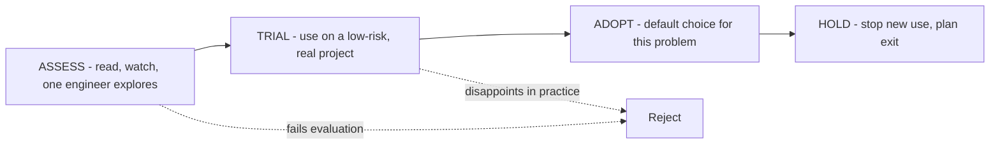

## 79.5 Evaluating and adopting new technology

#### Concept

New technology arrives constantly, and someone on your team always wants to adopt the latest thing. Evaluating technology well means having a repeatable process: explicit evaluation criteria, a proof of concept designed to answer a real question, a total-cost-of-ownership calculation that includes the costs people forget, an honest look at the exit cost (how hard is it to leave), and a staged adoption model so you can commit incrementally rather than all at once. Part 109.5 gave you build-versus-buy; this section is about how to assess a specific new technology before it becomes load-bearing.

#### Why does it exist?

Imagine adopting a new database because a benchmark showed it was fast, with no evaluation of operability, hiring, ecosystem, or exit cost. Two years later it is load-bearing, the one engineer who understood it has left, it has no managed offering on your cloud, the ecosystem of tools you rely on does not support it, and migrating off it would take a year. The benchmark was true and irrelevant; the costs that actually mattered were never evaluated. This happens constantly, because adopting technology is exciting and evaluating it is tedious.

The evaluation process exists to make the boring-but-decisive factors — operability, TCO, exit cost, team skill — as visible as the exciting one (it is fast!), so the decision accounts for the full lifetime cost of living with the technology, not just the demo.

#### Mental model

Imagine adopting a pet versus buying a toy. A toy you evaluate on whether it is fun right now. A pet you must evaluate on fifteen years of feeding, vet bills, walks, what happens when you travel, and the pain of rehoming if it does not work out. Load-bearing technology is a pet, not a toy: the purchase price (does it work in the demo) is the smallest cost. The real evaluation is the lifetime of care — operating it, hiring for it, upgrading it — and the exit cost if you need to rehome it. People who evaluate technology like a toy end up with a pet they cannot afford and cannot give away.

#### How it works

**Evaluation criteria.** A scorecard, weighted by what matters for your context:

```text
- Fit: does it solve our actual, measured problem? (not a problem we imagine)
- Operability: can we run it in production? Managed option? Observability?
- Maturity: how long has it existed? Who runs it at our scale? Breaking changes?
- Ecosystem: do our tools, ORMs, cloud, hiring pool support it?
- Team skill: can our team operate it, or is it one person's knowledge?
- Exit cost: how hard is it to leave if we must? (reversibility, Part 61)
- TCO: total cost of ownership over 3 years, not the sticker price.
- Community/vendor health: active? funded? or dying?
```

**Proof of concept, designed to answer a question.** A POC is not "let's play with it". It is an experiment designed to answer the one or two questions that would kill the adoption. If the risk is "can it handle our write volume", the POC loads it to 2x your peak write volume and measures. If the risk is "is it operable", the POC includes running it through a simulated failure and a version upgrade. A POC that does not try to kill the technology is a toy demo.

**Total cost of ownership (TCO).** The costs people forget:

| Cost category | Often forgotten? | Example |
|---|---|---|
| Licence / usage fees | No | $X/month |
| Infrastructure | Sometimes | Nodes, storage, network |
| Operational effort | YES | On-call, upgrades, patching: ~0.5 engineer |
| Training / ramp | YES | Every engineer spends days learning it |
| Integration | YES | Making it work with your existing stack |
| Migration in | Sometimes | Getting your data/code onto it |
| Exit cost | ALWAYS | What it costs to leave, years later |
| Opportunity cost | YES | What the team is NOT building while adopting this |

**Adoption stages (the tech-radar model: assess, trial, adopt, hold).** You do not go from "never used it" to "load-bearing" in one step:



- **Assess:** worth knowing about; one person explores it, no commitment.
- **Trial:** use it on a real but low-stakes project to learn its true costs, with a clear exit if it disappoints.
- **Adopt:** it has earned the default position for this class of problem.
- **Hold:** stop starting new things on it; it is on the way out.

#### Practical example

A team wants to adopt a new message broker because it benchmarks faster than their current RabbitMQ. Run through the process: the *fit* question is "is message throughput actually our problem?" — measured answer: no, RabbitMQ is at 8% of its capacity; speed is not a problem they have. That alone should stop the adoption, and does. The exciting factor (faster) was answering a question nobody asked. Had fit passed, the next killers would have been operability (no managed option on their cloud, so +0.5 engineer of ops) and exit cost (a year to migrate off). The process converts "it's faster!" into "it solves a problem we don't have, at a cost we'd pay for years" — a clear no, reached in a week instead of a two-year regret.

#### Artifact example

A technology evaluation scorecard, filled in for the message-broker question — the artifact that makes the decision legible and defensible.

```markdown
# Technology Evaluation: Adopt [NewBroker] to replace RabbitMQ?

**Question driving this:** a benchmark showed NewBroker is 3x faster.
**Real question we must answer:** is broker throughput our problem? And
if we adopt, what is the 3-year cost?

| Criterion | Weight | Score (1-5) | Notes |
|---|---|---|---|
| Fit (solves a real, measured problem) | 5 | 1 | RabbitMQ at 8% capacity. Speed is NOT our problem. |
| Operability | 4 | 2 | No managed option on our cloud. We'd self-host. |
| Maturity | 3 | 3 | ~4 years old, few at our scale. |
| Ecosystem | 3 | 2 | No first-class NestJS transport; we'd write glue. |
| Team skill | 4 | 1 | Zero in-house. One engineer interested. |
| Exit cost | 5 | 2 | ~1 year to migrate off once load-bearing. |
| 3-yr TCO vs status quo | 5 | 2 | +0.5 eng ops + training + migration. Higher, not lower. |

**POC that would change our mind:** none needed — fit already fails.
If fit passed, POC would load-test at 2x peak AND run a version upgrade
and a node-failure drill to test operability (the real risks).

**Decision: REJECT (ASSESS only).** The deciding factor is fit: it solves
a problem we do not have. We keep RabbitMQ. Revisit only if measured
broker load exceeds 50% of RabbitMQ capacity.
```

The scorecard's power is that it weights fit and exit cost highest, scores the exciting factor (speed) as irrelevant because fit fails, and records a *falsifiable* condition for revisiting (50% capacity). It turns a seductive benchmark into a defensible, boring, correct "no".

#### Real-world scenario

An engineering org adopts a "tech radar" and reviews it quarterly. Each technology sits in assess, trial, adopt, or hold. The discipline it enforces is subtle but powerful: nothing is allowed to jump from assess straight to load-bearing. A team excited about a new framework must first trial it on a low-stakes project with a defined exit. Twice in the first year, technologies that looked great in assessment disappointed in trial — the operability was worse than advertised — and were dropped at the trial stage, having cost one low-risk project instead of becoming a load-bearing regret. The radar did not slow the org down; it moved the failures to the cheap stage, which is the entire point of staged adoption.

#### Failure scenario

A staff engineer, genuinely excited, champions adopting a cutting-edge datastore after an impressive conference talk and a weekend POC that loaded a few thousand rows and felt fast. It skips trial and goes straight into a new, important service. For six months it is fine. Then the service grows, and the datastore's weaknesses — poor operability, a tiny ecosystem, one in-house expert — all surface at once, during an incident. The expert has since left. There is no managed option. Migrating off, now that it is load-bearing, is a nine-month project that consumes a team that should have been building features. The weekend POC answered "is it fun" (yes) and never asked "can we operate this for three years and leave it if we must" (no). Every cost that mattered was skipped because the exciting one was so compelling.

#### Edge cases & failure modes

- **POC that only tests the happy path.** It confirms the technology is fun, not that it is operable, scalable or leavable. Design the POC to try to kill the technology.
- **Evaluating on the sticker price, ignoring TCO.** The operational, training, integration and exit costs dwarf the licence fee and are the ones forgotten.
- **Skipping the trial stage.** Jumping from assess to load-bearing, so failures surface in production instead of in a cheap low-stakes project.
- **No exit-cost analysis.** Adopting something you can never leave, which turns every future weakness into a trap.
- **Fit never checked.** Adopting a solution to a problem you do not actually have (the "it's faster" trap when speed is not your constraint).
- **Resume-driven development.** Adopting technology because it is interesting or good for careers, not because it solves a measured problem.

#### How a Principal Engineer thinks about this

They weight *fit* and *exit cost* above everything, because a technology that does not solve a real problem is pure cost, and a technology you cannot leave turns every future weakness into a trap. They design POCs to attack the technology at its riskiest point — load, failure, upgrade, operability — rather than to enjoy it, because a POC that does not try to kill the candidate tells you nothing about living with it. They compute TCO including the costs everyone forgets (operational effort, training, exit) and they are skeptical of any evaluation dominated by a single exciting number.

Above all, they bias toward the boring, proven choice and put the burden of proof on the exception, exactly as Part 61 does — because the cost of a wrong adoption is paid for years, and the cost of sticking with the boring thing is usually just mild disappointment. They know that most "we need to adopt X" is resume-driven or hype-driven, and they are comfortable being the person who asks "what measured problem does this solve" and lets the silence answer.

#### Common mistakes

- **A POC that only proves it is fun,** never testing operability, scale, or exit.
- **Evaluating on sticker price,** ignoring the operational, training and exit costs that dominate TCO.
- **Skipping trial** and making a new technology load-bearing before learning its real costs.
- **Never checking fit,** adopting a solution to a problem you do not have.
- **Resume-driven adoption,** choosing technology for interest rather than measured need.

#### Interview questions

1. **How do you evaluate whether to adopt a new technology?**
   *Expected answer:* score it against weighted criteria (fit, operability, maturity, ecosystem, team skill, exit cost, TCO, vendor health), run a POC designed to attack its biggest risk, compute 3-year TCO including forgotten costs, and adopt in stages (assess, trial, adopt). Weight fit and exit cost highest. *Follow-up:* what costs do people most often forget in TCO.

2. **A benchmark shows a new tool is 3x faster. Walk me through your thinking.**
   *Expected answer:* first ask whether speed is a measured problem for us; if the current tool is at 8% capacity, the benchmark is true and irrelevant. Then weigh operability, exit cost and TCO, which usually dominate. Do not adopt a solution to a problem you do not have. *Why it matters:* tests resistance to the single-number trap.

3. **Why adopt technology in stages instead of committing once you've decided?**
   *Expected answer:* staged adoption (assess, trial, adopt) moves failures to the cheap stage — a trial on a low-stakes project reveals operability problems that a demo hides, before the technology becomes load-bearing and expensive to leave. *Follow-up:* what makes a good trial project.

#### Practical exercise

Pick a technology someone on your team has proposed adopting (or one you are tempted by). Build the evaluation scorecard: weight the criteria for your context, score each honestly, and especially fill in the fit, exit-cost and 3-year TCO rows with real reasoning. Then design the POC: write down the single question that, if answered "no", would kill the adoption, and how the POC would answer it.

**Acceptance criteria:** fit and exit cost are weighted among the highest; the TCO includes at least three commonly-forgotten costs (operational effort, training, exit); your POC is designed to attack the biggest risk rather than to enjoy the technology; and you reach a defensible decision with a falsifiable condition for revisiting it.
