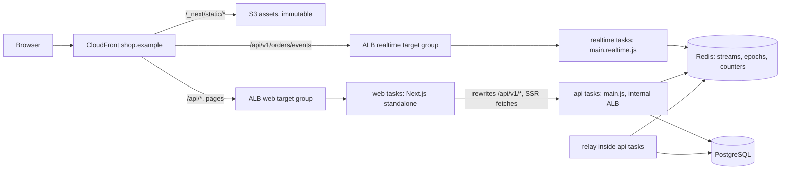

## 79.9 Tests: backend unit and integration, frontend component, one journey across both

#### Concept

The test suite follows Part 77's rule: every serious risk gets one honest test at the cheapest level that can see it (77.1), and the suite is proved by breaking the product on purpose (77.13). Live features add two kinds of risk that need care: **time** (events arrive later, out of order, twice, or not at all) and **connections** (streams drop, expire and reconnect). Most of both can be tested without a browser; one Playwright journey proves the whole path.

#### Why does it exist?

Because the bugs that matter here are sequences, and sequences are where manual testing is weakest. "An event for version 8 arrives while a note save for version 7 is in flight" is easy to describe, hard to reproduce by hand, and trivial to script with a fake event source and MSW.

#### Mental model

Imagine testing a train signalling system. You test each signal's logic on a bench, the interlocking between signals in a simulator where you can make trains arrive in any order, and you run one real train down the real line before opening it. You do not test signal timing by running real trains.

#### How it works

The plan:

| # | Risk | Level | Tool |
|---|---|---|---|
| 1 | Illegal transitions accepted | Unit | Vitest table over `canTransition` in `@shop/contracts` |
| 2 | Two concurrent transitions both succeed | API integration | Jest, Testcontainers PostgreSQL (41.7) |
| 3 | A committed change produces no event (or a rolled-back one does) | API integration | Relay test with a real PostgreSQL and Redis |
| 4 | Stream delivers other users' events; misses replay | API integration | Node `fetch` reading the SSE body |
| 5 | Stream outlives expiry or revocation | API integration | Same, with a short token and an epoch bump |
| 6 | Cache merge applies duplicates or out-of-order events | Unit | `applyOrderEvent` with a real `QueryClient` |
| 7 | Live UI shows stale data as live; no fallback | Component | Vitest, Testing Library, a fake `EventSource`, MSW |
| 8 | Note rollback erases a status that arrived meanwhile | Component | Same |
| 9 | The event contract drifts | Contract | Pact message (79.2) |
| 10 | Whole path: commit to screen, reconnect, logout everywhere | E2E | Playwright on the Compose stack (77.11) |
| 11 | Page budgets | Performance | Lighthouse CI (79.8) |
| 12 | Accessibility of every state | Accessibility | axe at four states (77.10) |

#### Practical example — the stream, tested without a browser

An SSE response is a text stream. Node's `fetch` exposes it as a `ReadableStream`, so an integration test can read events directly:

```ts
// apps/api/test/order-events.int-spec.ts  (Jest, the app booted with configureApp, Testcontainers PG and Redis)
import { bootTestApp, type TestApp } from './support/boot';

async function readEvents(res: Response, until: (events: { event: string; data: string; id?: string }[]) => boolean, ms = 5000) {
  const reader = res.body!.pipeThrough(new TextDecoderStream()).getReader();
  const events: { event: string; data: string; id?: string }[] = [];
  let buf = '';
  const deadline = Date.now() + ms;
  while (Date.now() < deadline && !until(events)) {
    const { value, done } = await reader.read();
    if (done) break;
    buf += value;
    let i: number;
    while ((i = buf.indexOf('\n\n')) >= 0) {                    // an SSE message ends with a blank line
      const block = buf.slice(0, i); buf = buf.slice(i + 2);
      const f = Object.fromEntries(block.split('\n').map((l) => [l.slice(0, l.indexOf(':')), l.slice(l.indexOf(':') + 1).trim()]));
      if (f.event || f.data) events.push({ event: f.event ?? 'message', data: f.data ?? '', id: f.id });
    }
  }
  await reader.cancel();                                         // closes the stream: exercises the server's teardown
  return events;
}

let t: TestApp;
beforeAll(async () => { t = await bootTestApp({ withRelay: true }); });
afterAll(() => t.close());

it('streams only the caller\'s events, in version order, after a commit', async () => {
  const asha = await t.seed.customerWithOrder({ status: 'PAID' });
  const ravi = await t.seed.customerWithOrder({ status: 'PAID' });
  const res = await fetch(`${t.url}/v1/orders/events`, { headers: { Cookie: `__Host-session=${asha.token}` } });
  expect(res.headers.get('content-type')).toMatch(/text\/event-stream/);

  await t.status.transition({ orderId: ravi.orderId, to: 'PACKING', source: 'warehouse' });   // someone else's
  await t.status.transition({ orderId: asha.orderId, to: 'PACKING', source: 'warehouse' });
  await t.status.transition({ orderId: asha.orderId, to: 'OUT_FOR_DELIVERY', source: 'dispatch' });

  const events = await readEvents(res, (es) => es.filter((e) => e.event === 'order').length >= 2);
  const orders = events.filter((e) => e.event === 'order').map((e) => JSON.parse(e.data));
  expect(orders.map((o) => [o.orderId, o.status])).toEqual([
    [asha.orderId, 'PACKING'], [asha.orderId, 'OUT_FOR_DELIVERY'],
  ]);                                                             // nothing of Ravi's
  expect(orders[1].version).toBeGreaterThan(orders[0].version);
});

it('replays from lastEventId and ends with reauth when the session is revoked', async () => {
  const c = await t.seed.customerWithOrder({ status: 'PAID' });
  const first = await fetch(`${t.url}/v1/orders/events`, { headers: { Cookie: `__Host-session=${c.token}` } });
  await t.status.transition({ orderId: c.orderId, to: 'PACKING', source: 'warehouse' });
  const [e1] = (await readEvents(first, (es) => es.some((e) => e.event === 'order'))).filter((e) => e.event === 'order');

  await t.status.transition({ orderId: c.orderId, to: 'OUT_FOR_DELIVERY', source: 'dispatch' });  // while disconnected
  const second = await fetch(`${t.url}/v1/orders/events?lastEventId=${e1.id}`, { headers: { Cookie: `__Host-session=${c.token}` } });
  await t.auth.logoutEverywhere(c.userId);                       // bumps auth:epoch (81.3)
  const events = await readEvents(second, (es) => es.some((e) => e.event === 'reauth'), 30_000);
  expect(events.find((e) => e.event === 'order')?.data).toContain('OUT_FOR_DELIVERY');            // replayed
  expect(JSON.parse(events.find((e) => e.event === 'reauth')!.data)).toEqual({ reason: 'REVOKED' });
}, 40_000);
```

The second test waits up to one heartbeat interval (20 s) for the revocation check; in the test configuration the heartbeat is 1 s so the test takes about 2 s.

#### React / Next.js example — the live island with a fake stream

jsdom has no `EventSource`. A small fake gives the test full control over timing:

```ts
// apps/web/src/test/fake-event-source.ts
type Listener = (e: MessageEvent<string>) => void;

export class FakeEventSource {
  static instances: FakeEventSource[] = [];
  static readonly CONNECTING = 0; static readonly OPEN = 1; static readonly CLOSED = 2;
  readyState = FakeEventSource.CONNECTING;
  onopen: (() => void) | null = null;
  onerror: (() => void) | null = null;
  private listeners = new Map<string, Listener[]>();
  constructor(public url: string) { FakeEventSource.instances.push(this); }
  addEventListener(type: string, fn: Listener) { this.listeners.set(type, [...(this.listeners.get(type) ?? []), fn]); }
  removeEventListener(type: string, fn: Listener) { this.listeners.set(type, (this.listeners.get(type) ?? []).filter((f) => f !== fn)); }
  close() { this.readyState = FakeEventSource.CLOSED; }
  // test helpers
  open() { this.readyState = FakeEventSource.OPEN; this.onopen?.(); }
  emit(type: string, data: unknown, id = `${Date.now()}-0`) {
    const e = new MessageEvent(type, { data: JSON.stringify(data), lastEventId: id });
    (this.listeners.get(type) ?? []).forEach((fn) => fn(e));
  }
  fail(permanently: boolean) { this.readyState = permanently ? FakeEventSource.CLOSED : FakeEventSource.CONNECTING; this.onerror?.(); }
}
```

```tsx
// apps/web/app/(shop)/orders/[id]/TrackingLive.test.tsx
import { act, screen, within } from '@testing-library/react';
import { http, HttpResponse, delay } from 'msw';
import { beforeEach, expect, it, vi } from 'vitest';
import { server } from '@/test/msw/server';
import { API } from '@/test/msw/checkout.handlers';
import { aTracking } from '@/test/builders';                    // parses through OrderTrackingRead (83.6)
import { renderWithProviders } from '@/test/render';
import { FakeEventSource } from '@/test/fake-event-source';
import { LiveOrdersProvider } from '@/orders/LiveOrdersProvider';
import { TrackingLive } from './TrackingLive';

vi.mock('@/api/auth-fetch', async (orig) => ({ ...(await orig<object>()), refreshOnce: vi.fn().mockResolvedValue(true) }));

beforeEach(() => { FakeEventSource.instances = []; vi.stubGlobal('EventSource', FakeEventSource); });

const initial = aTracking({ id: 'o-1', status: 'PACKING', version: 6, deliveryNote: 'Ring once' });
const renderPage = () => renderWithProviders(
  <LiveOrdersProvider enabled><TrackingLive initial={initial} live /></LiveOrdersProvider>);

it('applies newer events, ignores old ones, and announces status changes', async () => {
  renderPage();
  const es = FakeEventSource.instances[0];
  act(() => es.open());
  act(() => es.emit('order', { orderId: 'o-1', status: 'OUT_FOR_DELIVERY', version: 7, updatedAt: '2026-11-05T13:45:27Z',
    summary: 'Out for delivery. Arriving 7:25 to 7:40 pm.' }));
  expect(screen.getByRole('heading', { level: 1 })).toHaveTextContent('Out for delivery');
  expect(screen.getByRole('status')).toHaveTextContent('Arriving 7:25 to 7:40 pm');

  act(() => es.emit('order', { orderId: 'o-1', status: 'PACKING', version: 6, updatedAt: '2026-11-05T13:40:00Z' }));
  expect(screen.getByRole('heading', { level: 1 })).toHaveTextContent('Out for delivery');   // stale event ignored
  expect(FakeEventSource.instances).toHaveLength(1);                                          // one stream per tab
});

it('keeps a status that arrived during a failed note save', async () => {
  server.use(http.patch(`${API}/orders/o-1/delivery-note`, async () => { await delay(50); return HttpResponse.error(); }));
  const { user } = renderPage();
  const es = FakeEventSource.instances[0];
  act(() => es.open());
  const field = screen.getByRole('textbox', { name: 'Delivery note' });
  await user.clear(field); await user.type(field, 'Leave with security');
  await user.click(screen.getByRole('button', { name: 'Save note' }));
  act(() => es.emit('order', { orderId: 'o-1', status: 'OUT_FOR_DELIVERY', version: 7, updatedAt: '2026-11-05T13:45:27Z' }));

  expect(await screen.findByText("Couldn't save your note. Try again")).toBeVisible();
  expect(field).toHaveValue('Ring once');                                                    // note rolled back
  expect(screen.getByRole('heading', { level: 1 })).toHaveTextContent('Out for delivery');  // status kept
});

it('says honestly when live updates stop, and polls', async () => {
  let polls = 0;
  server.use(http.get(`${API}/orders/o-1/tracking`, () => { polls++; return HttpResponse.json(initial); }));
  vi.useFakeTimers({ shouldAdvanceTime: true });
  renderPage();
  for (let i = 0; i < 3; i++) {
    await act(async () => { FakeEventSource.instances.at(-1)!.fail(true); await vi.advanceTimersByTimeAsync(10_000); });
  }
  expect(within(screen.getByRole('region', { name: /out for|packing/i })).getByText(/Showing status from/)).toBeVisible();
  await act(() => vi.advanceTimersByTimeAsync(31_000));
  expect(polls).toBeGreaterThanOrEqual(1);
  vi.useRealTimers();
});
```

#### The journey across both

One Playwright test on the Compose stack (77.11), using the test-support API to move the order the way the warehouse would:

```ts
// apps/web/e2e/live-tracking.spec.ts
import { expect } from '@playwright/test';
import { test } from './fixtures';                               // 83.8: per-worker customer and storage state

test('status changes appear live, survive a disconnect, and stop at logout everywhere', async ({ page, customer, api, browser }) => {
  const orderId = await api.placeSeedOrder(customer.cartId);     // PAID
  let documents = 0;
  page.on('request', (r) => { if (r.resourceType() === 'document') documents++; });
  await page.goto(`/orders/${orderId}`);
  await expect(page.getByRole('heading', { level: 1 })).toHaveText('Order confirmed');

  await api.advance(orderId, 'PACKING');                         // POST /__e2e/orders/:id/status
  await expect(page.getByRole('heading', { level: 1 })).toHaveText('Packing your order', { timeout: 2000 }); // the freshness target

  await page.context().setOffline(true);
  await api.advance(orderId, 'OUT_FOR_DELIVERY', { eta: { from: '2026-11-05T13:55:00Z', to: '2026-11-05T14:10:00Z' } });
  await expect(page.getByText(/Showing status from/)).toBeVisible({ timeout: 15_000 });
  await page.context().setOffline(false);
  await expect(page.getByRole('heading', { level: 1 })).toHaveText('Out for delivery', { timeout: 10_000 }); // replayed
  await expect(page.getByText('Arriving 7:25 to 7:40 pm')).toBeVisible();
  expect(documents).toBe(1);                                     // no reload happened

  const other = await browser.newContext({ storageState: await page.context().storageState() });
  const otherPage = await other.newPage();
  await otherPage.goto('/account/security');
  await otherPage.getByRole('button', { name: 'Log out everywhere' }).click();
  await expect(page).toHaveURL(/\/login/, { timeout: 25_000 });  // the stream's REVOKED reauth, then a failed refresh
  await other.close();
});
```

The last part changes the identity, so this test uses its own customer (77.8's rule), not the worker's.

#### Backend side (NestJS)

The test-support module of 77.7 gains one route, guarded and absent from production like the rest:

```ts
// apps/api/src/e2e-support/e2e-support.controller.ts (addition)
@Post('orders/:id/status')
advance(@Param('id', ParseUUIDPipe) id: string,
        @Body() body: { to: OrderEvent['status']; eta?: { from: string; to: string } }) {
  return this.status.transition({                                // the real service: real transaction, real outbox
    orderId: id, to: body.to, source: 'support',
    eta: body.eta ? { from: new Date(body.eta.from), to: new Date(body.eta.to) } : null,
  });
}
```

Using the real `OrderStatusService` matters: the journey then proves the outbox, the relay, Redis and the stream, not a shortcut that writes to Redis directly.

#### Production scenario

The tracking suite: 46 unit tests (2 s), 14 API integration tests (38 s, most of it container start-up shared with other suites), 22 component tests (6 s), 2 Pact interactions, 1 Playwright journey (24 s) plus the long-session performance test (10 minutes, nightly only), axe at four states. Breaking the product on purpose (77.13) before launch: removing the version guard failed tests 6 and 7; removing ownership from the stream failed test 4; publishing in the request instead of the outbox failed test 3 (a rolled-back transaction still produced an event); removing `?lastEventId=` from the client's reopen failed test 10; removing the epoch check failed tests 5 and 10.

#### Failure scenario

The first version of the journey asserted the live update with `await page.waitForTimeout(3000)` followed by a text check, "to give the stream time". It passed for weeks. Then the relay's idle poll interval was raised from 100 ms to 1 s to save database load, freshness p95 went from 0.3 s to 1.4 s, and the test still passed because three seconds was generous. Nobody noticed that the freshness target had nearly been used up. Rewriting the assertion as a web-first `toHaveText(..., { timeout: 2000 })` made the test encode the requirement (79.1) rather than a guess, and it caught the next regression: a CloudFront cache policy change that added 1.5 s of buffering.

#### Edge cases & failure modes

- **Testing streams with fixed sleeps** hides freshness regressions; assert with the NFR as the timeout.
- **Fakes that never fail**: a fake `EventSource` must support permanent and temporary failures, or the fallback code is untested.
- **Journeys that bypass the outbox** (writing straight to Redis) prove the UI but not the system.
- **Long heartbeat intervals in tests**: make them configurable so revocation tests run in seconds.
- **Shared customers** in tests that log out everywhere (77.8).

#### How a Senior Full-Stack Engineer thinks about this

The senior turns each NFR into an assertion: the 2 s freshness target becomes a Playwright timeout, the "one stream per tab" rule becomes a count of fake instances, "never another customer's events" becomes an integration test with two customers. They test time and connections with fakes they control, and keep exactly one journey for the full path. And they treat the test-support API as part of the product, routed through the real services, because a shortcut in the test is a gap in the proof.

#### Common mistakes

- **No test for out-of-order or duplicate events.**
- **No test for the fallback path.**
- **E2E for every live behaviour**, making the suite slow and flaky.
- **Mocking the stream at the module level** so the provider's reconnection logic never runs.

#### Interview questions

1. **How do you test an SSE endpoint without a browser?** Expected answer: read the response body as a text stream with Node `fetch`, parse messages on blank lines, assert events, and cancel the reader to test teardown.
2. **How do you test a client's handling of out-of-order events?** Expected answer: a controllable fake `EventSource` emitting events in a chosen order, with a real query client, asserting the UI.
3. **What should the one end-to-end journey prove?** Expected answer: commit to screen within the freshness target, recovery after a disconnect without a reload, and the auth cut-off, through the real outbox and stream.

#### Practical exercise

Build the twelve tests in the plan.

Acceptance criteria:

- Each deliberate bug listed in the production scenario fails at least one test.
- The Playwright journey's live assertion uses the 2 s freshness target as its timeout and passes 20 times with `--repeat-each=20`.
- The fake `EventSource` covers open, events with IDs, temporary failure and permanent failure.
- The suite adds under 90 s to the pull-request pipeline, excluding the nightly long-session test.

## 79.10 Deployment: containers, CDN, environment config and a flagged rollout

#### Concept

The feature ships as three containers built once per commit (78.2): the **web** image (Next.js standalone), and one **API** image run with two entry points, **api** (request/response) and **realtime** (streams only, 79.4). CloudFront routes each path to the right origin with the right caching and timeouts. Configuration differs per environment, the image does not. And the user-visible behaviour is released by a server-evaluated flag (78.5), ramped while the SLOs are watched, with a kill switch that falls back to polling.

#### Why does it exist?

Because the stream changes the operational profile of the system. Request/response tasks scale with requests per second; stream tasks scale with open connections and memory, and they must drain slowly on deploys. Mixing them means a reconnect storm competes with checkout for CPU, and a checkout deploy drops 60,000 streams. And because a live feature can fail in ways no test predicted, it needs a way to switch off in seconds without a deploy.

#### Mental model

Imagine a restaurant that adds a phone line for order updates. You do not ask the chefs to answer it; you hire a separate person with their own headset, sized for how many calls are open, not how many dishes are cooked. And you keep a sign ready that says "Call back later, check the board" in case the phone system fails.

#### How it works



**CloudFront behaviours**, most specific first:

| Path pattern | Origin | Cache policy | Origin request policy | Timeouts |
|---|---|---|---|---|
| `/_next/static/*` | S3 (OAC) | Caching optimised, `immutable` | None | Default |
| `/api/v1/orders/events` | Realtime ALB | Caching disabled | All viewer headers except Host, all cookies, all query strings (`lastEventId`) | Origin response timeout 60 s (above the 20 s heartbeat); keep-alive 60 s |
| `/api/*` | Web ALB | Caching disabled | All cookies, headers, query strings | Response timeout 30 s |
| Default (`*`) | Web ALB | Caching disabled for personal pages; ISR pages use the origin's `s-maxage` | All cookies | 30 s |

The ALB in front of the realtime tasks has its **idle timeout** raised from the default 60 s to 120 s; heartbeats every 20 s keep connections well inside both limits. CloudFront serves HTTP/2 and HTTP/3 to browsers, so a tab's stream shares one connection with its other requests.

**Scaling and draining**:

- **api**: ECS target tracking on CPU at 55 %, 4 to 24 tasks.
- **realtime**: target tracking on a custom CloudWatch metric, `ActiveStreams` per task (published every 30 s from the connection counter), target 7,500; memory as a second policy at 70 %. 3 tasks overnight, 8 to 10 at peak.
- **Deploys for realtime**: rolling, `minimumHealthyPercent` 100 and `maximumPercent` 125, so new tasks come up before old ones stop; the target group's **deregistration delay** is 30 s; on `SIGTERM` the task sends jittered `retry` hints and completes its streams (79.4), so clients reconnect over about 10 s to the new tasks.

**Environment configuration** (78.2): the web image reads `API_INTERNAL_URL`, `PUBLIC_SENTRY_ENVIRONMENT`, `PUBLIC_FLAGS_CLIENT_KEY` and the release at runtime; the API image reads `DATABASE_URL`, `REDIS_URL`, `JWT_PUBLIC_KEY`, `AUTH_ISSUER`, `SSE_HEARTBEAT_MS` (20,000 in production, 1,000 in tests) and `RELAY_ENABLED` (true on api tasks, false on realtime tasks, so exactly one kind of task runs the relay). Secrets come from Secrets Manager into the task definitions (Part 46.11).

**Rollout order**, the expand and contract plan of Part 25 applied to this feature:

| Step | Change | Safe because |
|---|---|---|
| 1 | Migration: new columns, tables, widened status `CHECK` | Additive; old code ignores it |
| 2 | API: outbox and relay on, tracking endpoint, stream extensions; still emitting only old statuses | Nobody calls the new endpoints yet |
| 3 | Web: tracking page and `openEnum` readers, behind flag `live-tracking` off (polling page shown) | Dark launch |
| 4 | Mobile apps: release with new status labels | Old apps keep working on old statuses |
| 5 | Flag ramp: staff, then 1 %, 10 %, 50 %, 100 % of customers over 9 days | Each step gated on SLOs (below) |
| 6 | Warehouse and dispatch start sending `PACKING` and `OUT_FOR_DELIVERY` | Only after old mobile builds fall below 1 % (74.9 telemetry) |
| 7 | Old polling page removed | After 14 days at 100 % without a kill-switch use |

Each ramp step waits for 24 hours of: tracking availability SLO burn under 1x (78.8), freshness p95 under 2 s, realtime task memory under 70 %, error-tracker issues for the tracking route not above baseline (78.6).

#### Practical example — the flag and its kill switch

The flag is evaluated on the server (78.5), so the first HTML already reflects it and nothing flickers. With `live-tracking` off, `TrackingLive` gets `live={false}` and polls every 30 s through the same query; the provider never opens a stream. That fallback is the kill switch: if the realtime tier fails, turning the flag off moves every new page view to polling within the flag service's propagation time (seconds). Pages already open need nothing extra: when their stream fails, the provider has already fallen back to polling (79.6), so the flag only has to stop new streams being opened.

```ts
// apps/web/src/flags/server.ts (addition to 84.5's SAFE_DEFAULTS)
const SAFE_DEFAULTS = {
  'live-tracking': false,          // if the flag service is unreachable, poll: slower, never broken
  // ...
} as const;
```

#### Backend side (NestJS)

The realtime task publishes its connection count for autoscaling, using the counter it already keeps per user plus a per-task gauge:

```ts
// apps/api/src/orders/stream-metrics.ts (realtime tasks only)
import { Injectable, OnModuleDestroy, OnModuleInit } from '@nestjs/common';
import { CloudWatchClient, PutMetricDataCommand } from '@aws-sdk/client-cloudwatch';

@Injectable()
export class StreamMetrics implements OnModuleInit, OnModuleDestroy {
  private active = 0;
  private timer?: NodeJS.Timeout;
  private readonly cw = new CloudWatchClient({});
  opened() { this.active++; }
  closed() { this.active--; }
  onModuleInit() {
    this.timer = setInterval(() => void this.cw.send(new PutMetricDataCommand({
      Namespace: 'Shop/Realtime',
      MetricData: [{ MetricName: 'ActiveStreams', Value: this.active, Unit: 'Count',
                     Dimensions: [{ Name: 'Service', Value: 'orders-realtime' }] }],   // averaged across tasks by the policy
    })).catch(() => undefined), 30_000);
  }
  onModuleDestroy() { clearInterval(this.timer); }
}
```

The same number is exported to Prometheus as a gauge (Part 43.3) for dashboards; CloudWatch is used here only because ECS target tracking reads it natively.

#### Production scenario

The 9-day ramp went: staff (300 users) found a timezone bug in the ETA for one store with a misconfigured zone; 1 % ran a weekend peak with no SLO burn; 10 % exposed the reconnect spike on realtime deploys (fixed with jittered retry hints before 50 %); 50 % and 100 % were uneventful. At 100 %, 64,000 peak streams ran on 9 realtime tasks. The kill switch was used once in the first quarter, for 22 minutes, during a Redis maintenance event that went wrong; customers saw "checking every 30 s" banners and no errors, and the tracking availability SLO burned 0.4 % of its budget.

#### Failure scenario

On staging, the first CloudFront configuration had a single behaviour for `/api/*` pointing at the web ALB, so the stream went through the Next.js `rewrites` proxy (73.8). Events arrived in bursts every 30 to 60 seconds, the CloudFront origin response timeout fired on quiet streams, and the Next.js tasks' memory grew with every held connection. The edge case had been written down in 73.8 ("streaming responses through `rewrites` may be held"), and the architecture had been designed to avoid it; only the CDN configuration had not been written to match. A specific behaviour for `/api/v1/orders/events` straight to the realtime ALB, added to the infrastructure code with a test that curls the stream through CloudFront and checks the first `ping` arrives within 25 s, closed it.

#### Edge cases & failure modes

- **Behaviour ordering in CloudFront**: the more specific stream path must come before `/api/*`.
- **Origin response timeout below the heartbeat** cuts quiet streams.
- **ALB idle timeout** default 60 s; raise it for streams.
- **Relay running on both task types** doubles the claimers; harmless with `SKIP LOCKED` but wasteful; one flag decides.
- **Deregistration delay too long** for streams that never finish; streams end on `SIGTERM`, so 30 s is enough.
- **Kill switch untested**: rehearse it on staging monthly (Part 49.12).
- **Mobile enum order**: emitting new statuses before old apps are gone breaks them (79.2).

#### How a Senior Full-Stack Engineer thinks about this

The senior deploys one artefact per service, gives long-lived connections their own tasks and scaling metric, writes the CDN routing as code with a test that the stream actually streams, and releases the behaviour separately from the code with a flag whose off position is a working product. They sequence the rollout so every step is reversible and gated on measurements, and they rehearse the kill switch before they need it.

#### Common mistakes

- **Streams on the same tasks as request/response traffic.**
- **Scaling realtime tasks on CPU**, which stays low while memory and connections run out.
- **One CDN behaviour for all API paths.**
- **A flag whose off state is a broken page.**

#### Interview questions

1. **Why run SSE on separate tasks from the API?** Expected answer: different resource profile (connections and memory), different scaling metric, deploys and reconnect storms isolated from checkout (a bulkhead).
2. **What CDN and load balancer settings matter for SSE?** Expected answer: caching disabled, all cookies and the query string forwarded, origin response and idle timeouts above the heartbeat, a specific path behaviour that bypasses buffering proxies, HTTP/2 to browsers.
3. **How do you roll out a live feature safely?** Expected answer: additive migration, backend first, dark launch behind a server-evaluated flag with a working fallback, ramp on SLOs, emit new enum values only after old clients are gone.
4. **What metric do you autoscale stream servers on?** Expected answer: active connections per task (and memory), not CPU.

#### Practical exercise

Deploy the feature to staging behind the flag.

Acceptance criteria:

- Three services from two images, each image built once and promoted by digest.
- A CloudFront test proves the stream's first `ping` arrives within 25 s through the CDN and that `/api/v1/orders/*/tracking` is never cached.
- Realtime tasks scale out when 10,000 synthetic streams are opened (k6 or a small Node script) and scale in afterwards.
- A rolling deploy of realtime tasks drops no events (replay), and reconnections spread over at least 10 s.
- Turning `live-tracking` off makes new page views poll, with no errors, within one minute.
