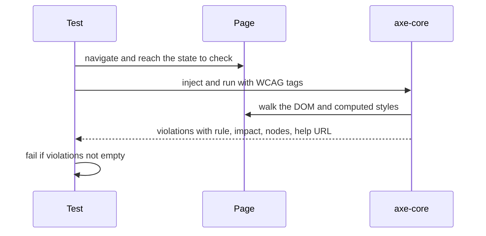

## 79.9 Visual regression testing

#### Concept

A **visual regression test** takes a screenshot of a page or component and compares it, pixel by pixel, with an approved **baseline** image. If more pixels differ than a threshold allows, the test fails and produces a diff image highlighting the change. Playwright has this built in: `await expect(page).toHaveScreenshot()`. Hosted services (Chromatic for Storybook, Percy, Applitools) add a review UI, cross-browser rendering and smarter diffing for a fee.

#### Why does it exist?

Because no other test sees CSS. A component test asserts that the "Place order" button exists and is enabled; it cannot see that a stylesheet change pushed it below the fold on a 360 px phone, or that it is now white text on a white background. Part 72.5 tells the story of a build setting that dropped checkout's CSS chunk; Part 71.4 the story of a global `!important` that moved the payment button. Both shipped with green tests.

#### Mental model

Imagine a "spot the difference" puzzle done by a machine every time someone changes the shop window. It does not know what a good window looks like; it only knows what yesterday's approved window looked like, and circles everything that changed. A person then decides whether each circle is a mistake or the new design.

#### How it works

1. **First run**: `toHaveScreenshot('checkout-payment.png')` writes the baseline into a snapshots folder next to the test, named with the project and platform (`checkout-payment-chromium-linux.png`). Baselines are committed.
2. **Later runs** render the same state and compare with `pixelmatch`. Options: `maxDiffPixels`, `maxDiffPixelRatio`, `threshold` (per-pixel colour tolerance, 0-1, default 0.2).
3. **Stabilisation**: Playwright takes screenshots until two consecutive ones match before comparing, and by default disables CSS animations and transitions (`animations: 'disabled'`) and hides the text caret.
4. **Masking**: `mask: [locator]` paints dynamic regions (a timestamp, a carousel, a map) with a solid box; `stylePath` (1.41+) injects a stylesheet just for screenshots.
5. **Updating**: an intended change is accepted with `npx playwright test --update-snapshots`, and the new PNGs are reviewed in the pull request like code.
6. **Determinism**: fonts and anti-aliasing differ between macOS, Windows and Linux, so baselines are generated and compared in one place: the official Docker image, `mcr.microsoft.com/playwright:v1.5x.0-noble` (pin the exact version matching `@playwright/test`).

#### Practical example

A storefront keeps 24 visual tests: the checkout's three steps in two viewports (375 x 812 and 1280 x 800), the order page in each status, the cart with 0, 1 and 30 items, and the error and empty states. Data comes from the e2e seed with fixed values (names, prices, a frozen clock), so screenshots are identical across runs.

#### React / Next.js example

```ts
// apps/web/e2e/visual/checkout.visual.spec.ts
import { expect } from '@playwright/test';
import { test } from '../fixtures';

test.use({ viewport: { width: 375, height: 812 } });

test('payment step @visual', async ({ page, customer }) => {
  await page.clock.setFixedTime(new Date('2026-11-05T09:30:00+05:30'));   // "Delivers tomorrow" is stable
  await page.goto('/checkout?step=payment');
  await expect(page.getByRole('button', { name: 'Place order' })).toBeEnabled();
  await page.evaluate(() => document.fonts.ready);                         // web fonts loaded (82.8)

  await expect(page).toHaveScreenshot('checkout-payment-mobile.png', {
    fullPage: true,
    mask: [page.getByTestId('promo-carousel')],                           // rotating content
    maxDiffPixelRatio: 0.002,                                             // about 800 pixels on this page
  });
});
```

```yaml
# .github/workflows/web-visual.yml (job excerpt)
visual:
  runs-on: ubuntu-latest
  container: mcr.microsoft.com/playwright:v1.50.0-noble    # same image locally: identical fonts and rendering
  steps:
    - uses: actions/checkout@v4
    - run: corepack enable && pnpm install --frozen-lockfile
    - run: pnpm --filter web exec playwright test --project=visual
    - if: failure()
      uses: actions/upload-artifact@v4
      with: { name: visual-diffs, path: apps/web/test-results }   # expected, actual and diff PNGs
```

Developers regenerate baselines with the same container: `docker run --rm -v $PWD:/work -w /work mcr.microsoft.com/playwright:v1.50.0-noble pnpm --filter web exec playwright test --project=visual --update-snapshots`.

#### Backend side (NestJS)

Screenshots are only stable if the data is. The API's e2e mode should provide:

- **Fixed seed values**: product names, prices and images that never change between runs.
- **Deterministic ordering** of lists (`ORDER BY created_at DESC, id DESC`), or rows swap places.
- **An injectable clock**: a `Clock` provider overridden in e2e so "placed 2 hours ago" and delivery dates are fixed, matching `page.clock` in the browser.
- **Stable image URLs** for seeded products, served from a local fixture bucket, not a CDN that may change compression.

```ts
// apps/api/src/common/clock.ts
import { Injectable } from '@nestjs/common';

@Injectable()
export class Clock { now(): Date { return new Date(); } }

@Injectable()
export class FixedClock extends Clock {                         // provided instead of Clock when E2E_FIXED_NOW is set
  constructor(private readonly at = new Date(process.env.E2E_FIXED_NOW ?? '2026-11-05T04:00:00Z')) { super(); }
  now(): Date { return this.at; }
}
```

#### Production scenario

The 24 visual tests take 70 s on one job. In six months they caught 11 real regressions (a z-index change hiding the coupon error behind the summary, a font fallback after a CDN change, a Tailwind upgrade changing default line heights) and produced 9 false positives, all from one rotating banner before it was masked. Baseline updates appear in about one pull request a week and take a minute to review in GitHub's image diff view.

#### Failure scenario

A team added 300 visual tests in a week, generated on developers' Macs and run on Linux CI. Every test failed on the first CI run because of font anti-aliasing. Someone raised `maxDiffPixelRatio` to 0.05 globally to "fix" it. Two months later a change made the checkout total's font 40 % lighter and moved the delivery fee line off-screen on small phones; both changes were under 5 % of pixels and passed. The recovery: regenerate all baselines in the Docker image, set the ratio back to 0.002, cut the suite to the 30 screens that matter, and mask the dynamic parts instead of loosening the threshold.

#### Edge cases & failure modes

- **Different machines, different pixels**: generate and compare in one pinned container.
- **Loose global thresholds** hide real changes; mask dynamic regions instead.
- **Web fonts not loaded** when the screenshot is taken; wait for `document.fonts.ready`.
- **Lazy images** below the fold in `fullPage` shots; scroll or use `loading="eager"` in the visual test build.
- **Too many baselines**: hundreds of near-identical screenshots that everyone updates without looking.
- **Third-party widgets** (chat, payment iframes) render differently every time; mask or block them.

#### How a Senior Full-Stack Engineer thinks about this

The senior uses visual tests for a small set of high-value screens and states, where a layout break costs money (checkout, product page, order confirmation), and never as a substitute for behaviour tests. They make determinism a backend and frontend responsibility together: seeded data, fixed clocks, stable ordering, pinned rendering environment. And they treat a snapshot update as a design review, not a chore.

#### Common mistakes

- **Baselines generated on a laptop.**
- **Raising thresholds** instead of masking.
- **Visual tests for every component in every state**, so updates become rubber stamps.
- **No artifact upload**, so the diff image is lost when CI fails.

#### Interview questions

1. **Why do visual tests fail between macOS and Linux, and how do you fix it?** Expected answer: font rendering and anti-aliasing differ; generate and compare in one pinned Docker image.
2. **How do you handle dynamic content in screenshots?** Expected answer: fixed data and clock, `mask`, a screenshot-only stylesheet; not looser thresholds.
3. **What can visual tests catch that component tests cannot?** Expected answer: CSS, layout, overlap, contrast, fonts, responsive breakpoints.
4. **What does the backend contribute to stable screenshots?** Expected answer: fixed seed data, deterministic ordering, an injectable clock, stable image URLs.

#### Practical exercise

Add visual tests for checkout and the order page.

Acceptance criteria:

- At most 12 screenshots, covering two viewports.
- Baselines generated and compared in the pinned Playwright container.
- `maxDiffPixelRatio` at or below 0.002; dynamic regions masked.
- Moving the "Place order" button by 8 px or changing the total's font weight fails the test.
- Diff images are uploaded as CI artifacts on failure.

## 79.10 Accessibility testing with axe

#### Concept

**axe-core** (Deque) is an open-source engine that checks a rendered DOM against accessibility rules derived from **WCAG** (Web Content Accessibility Guidelines): missing form labels, images without alternative text, invalid ARIA, duplicate IDs, low colour contrast, missing document language, buttons without names. It runs in the page and returns a list of **violations**, each with a rule ID, an impact (minor, moderate, serious, critical), the offending elements and a help link. It plugs into Playwright (`@axe-core/playwright`), into component tests (`vitest-axe` or `jest-axe`), into Storybook, and into browser extensions.

Automated tools find a meaningful share of accessibility issues, not all of them. Deque's own studies put it at roughly half of issues by volume on real audits; whether a heading structure makes sense, whether the focus order is logical, or whether an error message is understandable needs a person with a keyboard and a screen reader (71.9).

#### Why does it exist?

Because accessibility regressions are invisible to sighted mouse users, who are most of the team. Part 71.9 tells the story of a live order status a screen reader never announced. A missing `<label>` costs nothing to fix in the pull request and a support call, a complaint, or in many countries a legal claim, after release. An automated check in CI turns the cheap half of accessibility into a test failure.

#### Mental model

Imagine a building inspector with a checklist: ramp present, handrail height, door width, fire exit signs lit. The inspector finds every missing handrail in minutes. The checklist cannot tell whether the building is pleasant to use in a wheelchair; for that you still need someone to try it.

#### How it works



1. **Run at meaningful states**: not only after page load, but with the error messages showing, the dialog open, the menu expanded. Each state is a new DOM.
2. **Choose rules by tag**: `wcag2a`, `wcag2aa`, `wcag21a`, `wcag21aa`, `wcag22aa`, `best-practice`. Most teams enforce WCAG 2.1 or 2.2 level AA.
3. **Scope**: `.include('#checkout')` or `.exclude('#third-party-chat')` to avoid failing on code you do not own (with a ticket to the vendor).
4. **jsdom limits**: in component tests axe cannot compute colour contrast or anything layout-based, because jsdom has no rendering; `jest-axe` disables such rules or they give no results. Contrast belongs in the Playwright checks.
5. **Baselines for legacy pages**: a page with 140 existing violations cannot be fixed in one pull request. Record known violations by rule and selector, fail only on new ones, and burn the list down.

#### Practical example

Checkout gets axe checks at five states: address step empty, address step with validation errors, coupon step with a server error, payment step, and the confirmation page. The order page gets checks with the cancel dialog open and with the live status region updated. Each check takes 150-400 ms in Playwright.

#### React / Next.js example

A Playwright fixture so every test can check accessibility in one line:

```ts
// apps/web/e2e/a11y.ts  (@axe-core/playwright 4)
import AxeBuilder from '@axe-core/playwright';
import { expect, type Page } from '@playwright/test';

export async function expectNoA11yViolations(page: Page, opts: { include?: string; exclude?: string[] } = {}) {
  let builder = new AxeBuilder({ page }).withTags(['wcag2a', 'wcag2aa', 'wcag21a', 'wcag21aa', 'wcag22aa']);
  if (opts.include) builder = builder.include(opts.include);
  for (const sel of opts.exclude ?? []) builder = builder.exclude(sel);
  const { violations } = await builder.analyze();
  // A readable failure: rule, impact and the first selector of each violation
  expect(violations.map((v) => `${v.impact} ${v.id}: ${v.nodes[0]?.target.join(' ')}`)).toEqual([]);
}
```

```ts
// apps/web/e2e/checkout.a11y.spec.ts
import { test } from './fixtures';
import { expectNoA11yViolations } from './a11y';

test('address step is accessible, including its error state', async ({ page }) => {
  await page.goto('/checkout');
  await expectNoA11yViolations(page, { include: 'main' });
  await page.getByRole('button', { name: 'Save address' }).click();              // all fields invalid
  await expectNoA11yViolations(page, { include: 'main' });                        // error text contrast, aria-describedby
});
```

In component tests, `vitest-axe` checks structure (labels, roles, ARIA) quickly on every state a component can be in:

```tsx
// apps/web/src/orders/CancelOrderDialog.a11y.test.tsx
import { render } from '@testing-library/react';
import { axe } from 'vitest-axe';
import 'vitest-axe/extend-expect';                       // adds toHaveNoViolations
import { expect, it } from 'vitest';
import { CancelOrderDialog } from './CancelOrderDialog';

it('has no structural accessibility violations when showing an error', async () => {
  const { container } = render(<CancelOrderDialog open reason={null} error="This order has already shipped" onClose={() => {}} />);
  expect(await axe(container)).toHaveNoViolations();   // contrast is not checked in jsdom: Playwright covers it
});
```

Playwright 1.49+ also offers **ARIA snapshots**: `await expect(page.getByRole('main')).toMatchAriaSnapshot(...)` compares the accessibility tree (roles, names, structure) with a stored YAML description. It catches a heading that became a `div` or a button that lost its name, without pixels.

#### Backend side (NestJS)

Accessibility looks like a frontend concern, but the API decides several things a screen reader user experiences:

- **Error messages are written for people.** The problem document's `issues[].message` is shown under a field and read aloud; `"must match /^\d{6}$/"` is not a message. The API's error catalogue owns user-facing copy, or returns codes the frontend maps to copy (76.6), but never regex text.
- **Images come with alternative text.** Product and review image fields in the API include `alt` (from the catalogue's admin tool), so the frontend has something meaningful to render.
- **Language and locale**: the API returns `Content-Language` and localised copy consistently, so the page's `lang` attribute matches the text a screen reader pronounces.
- **Live status events carry a human summary** ("Out for delivery, arriving by 7:40 pm") for the status region's announcement (71.9), in addition to the machine status.

```ts
// packages/contracts/src/catalog.ts (excerpt)
export const ProductImageSchema = z.object({
  url: z.string().url(),
  width: z.number().int().positive(),
  height: z.number().int().positive(),      // dimensions prevent layout shift (82.5)
  alt: z.string().min(1).max(160),          // required: the API refuses to publish an image without it
});
```

#### Production scenario

A storefront runs 32 axe checks in Playwright (about 9 s total) and 180 `vitest-axe` checks in component tests (about 6 s). In the first month the checks failed 17 pull requests: 9 missing labels on new inputs, 4 buttons with only an icon and no name, 3 colour-contrast failures on new badges, and 1 `aria-hidden` on a focusable element. An annual manual audit by an accessibility specialist still found 23 issues the tools could not see, mostly focus order in the new mega-menu and unclear error copy.

#### Failure scenario

A payment provider's new iframe widget failed axe on every page with three serious violations. To unblock the release, someone excluded `iframe` globally from the axe checks. Six months later the team's own embedded map iframe, without a `title`, shipped on the order tracking page, and screen reader users heard only "frame". The exclusion should have been the vendor's specific selector, with a ticket, an expiry date and a test that the exclusion still matched something.

#### Edge cases & failure modes

- **Checking only the initial page**: errors, dialogs and expanded menus are where most violations live.
- **Colour contrast in jsdom** silently does nothing; run contrast checks in a real browser.
- **Global exclusions** that hide your own regressions; scope exclusions to exact third-party selectors.
- **Treating "zero violations" as accessible**: keyboard order, focus management and meaningful copy still need manual testing.
- **Legacy pages**: failing on all existing violations blocks every change; baseline and burn down.
- **Dynamic regions**: a live region announced on every SSE event floods a screen reader; test the announcement policy, not only the markup (Part 81).

#### How a Senior Full-Stack Engineer thinks about this

The senior makes accessibility a definition-of-done item with automated enforcement for what machines can check and a scheduled manual audit for what they cannot. They run axe at the states that matter, keep exclusions narrow and dated, and treat component tests that query by role as the cheapest accessibility test of all (79.3). They also push accessibility into the backend contract: human error messages, required alt text, localised copy.

#### Common mistakes

- **One axe check on page load per route** and nothing else.
- **Excluding whole element types** to pass.
- **Relying on axe for keyboard and focus behaviour.**
- **API error messages that are developer strings**, read aloud to users.

#### Interview questions

1. **What can automated accessibility tools find, and what can they not?** Expected answer: missing labels, names, ARIA errors, contrast, language; not focus order, meaningful copy or usability with a screen reader.
2. **Why does axe in jsdom miss colour contrast?** Expected answer: jsdom does no layout or rendering, so computed colours and overlaps are unavailable.
3. **How do you introduce axe to an app with hundreds of existing violations?** Expected answer: baseline existing violations, fail on new ones, burn down by priority.
4. **What does the API contribute to accessibility?** Expected answer: human-readable error messages, required alt text, consistent language, human summaries for live updates.

#### Practical exercise

Add accessibility checks to checkout and the order page.

Acceptance criteria:

- Playwright axe checks at the five checkout states and the two order-page states listed above, enforcing WCAG 2.1 AA tags.
- `vitest-axe` checks for every dialog and form component in its error state.
- Any exclusion names an exact third-party selector, links a ticket and has an expiry date checked by a test.
- The API refuses to publish a product image without `alt`, and its error messages contain no regular expressions or field-type jargon.
