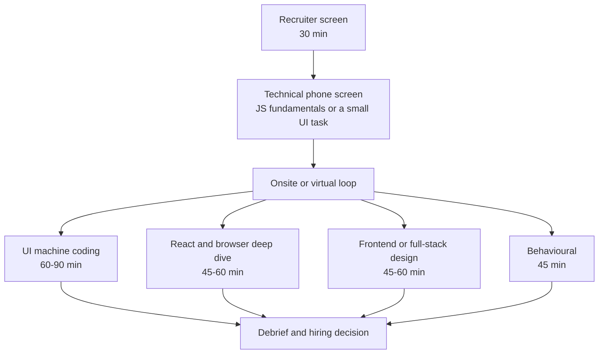

# Part 80 — Frontend and Full-Stack Interview Preparation

Part 59 prepared you for a senior backend loop and Part 68 gave you the playbook for any loop: the funnel, the coding round, the system design procedure, take-homes, offers. This Part covers the rounds those two do not: the JavaScript fundamentals round, the browser round, the React round, the UI machine-coding round, frontend system design, and the full-stack design round where the interviewer cares most about the line between the browser and your API. It also adds what the rest of the book lacks: a junior and entry-level track.

Every answer here points to the section that teaches the idea properly. Use this Part as a question bank and a method, and go back to Volume 7 (Parts 69–79), Volume 0 (Parts 0–7) and Volume 1 when an answer feels thin. A model answer you have memorised but cannot extend with one number and one failure mode is not ready.

## 80.1 How frontend and full-stack interview loops work

### 80.1.1 The rounds and what each one signals

#### Concept

A frontend or full-stack loop is built from seven kinds of round. Most companies run four or five of them in three to five hours, plus a recruiter screen at the start and a hiring-manager conversation at the end.

| Round | Typical length | What you do | The real signal |
|---|---|---|---|
| JavaScript and TypeScript fundamentals | 45–60 min | Explain and predict: closures, `this`, the event loop, promises, coercion, types | Do you have an accurate model of the language, or folklore? |
| Browser and web platform | Often folded into another round | Explain rendering, CORS, cookies, caching, security, accessibility | Can you debug what happens outside your own code? |
| UI machine coding | 60–90 min | Build a working component in a browser editor: typeahead, infinite list, form | Can you ship a small, correct, accessible feature under time pressure? |
| React (or the team's framework) | 45–60 min, or part of machine coding | Explain re-renders, effects, state placement, server components, hydration | Do you know why the framework behaves as it does, or only the API? |
| Frontend system design | 45–60 min | Design the client of a feed, a chat, a product page | Can you structure a large UI: components, state, data, performance, failure? |
| Full-stack system design | 45–60 min | Design one feature end to end: browser, BFF, API, database, cache | Can you own a contract between frontend and backend? |
| Behavioural | 45 min | Stories: design and product, a performance win, an incident | Do people want to build with you? |

Some loops replace machine coding with a take-home (Part 68, 68.4) or replace the fundamentals round with a classic algorithms round (Part 68, 68.2). Ask the recruiter which rounds you will get; it is a normal question and the answer saves you weeks.

#### Why does it exist?

A backend loop can test most of the job with a coding round and a system design. A frontend job has a different failure surface: the code runs on a slow phone you do not control, the user is a person with a keyboard, a screen reader and a flaky train connection, and the bugs are race conditions between a click, a fetch and a re-render. The rounds above exist because each one catches a different way a frontend engineer fails in production:

- The fundamentals round catches engineers who cannot explain why their `await` inside `forEach` did not wait.
- Machine coding catches engineers who can talk about React but leave a typeahead that shows results for "ap" after the user typed "apple".
- Frontend system design catches engineers who put every API response into one global store and then cannot invalidate anything.
- Full-stack design catches engineers who design a beautiful UI against an API that cannot serve it in under 2 seconds.

#### Mental model

Imagine hiring a chef. You ask them to explain why bread rises (fundamentals), you watch them cook one dish in 60 minutes in an unfamiliar kitchen (machine coding), you ask them to plan a 200-cover wedding menu (system design), and you ask how they handled a supplier who sent the wrong fish (behavioural). Each test is cheap compared with hiring the wrong chef, and no single test is enough.

#### How it works

Interviewers write evidence against a rubric for each round, then a debrief combines them (Part 87, 87.5 shows how rubrics are written from the other side of the table). Two consequences matter to you. First, a strong round cannot fully rescue a weak one, because the debrief looks for "no concerns" across signals. Second, the interviewer can only score what they saw or heard, so narrating your reasoning is not optional.

#### How a Senior Full-Stack Engineer thinks about this

They treat each round as a sample of a real day at work. In machine coding they behave as they would on a feature ticket: clarify, build the smallest working slice, then handle loading, error, empty and keyboard states. In system design they start from the user and the numbers, not from a library name. They prepare stories with numbers because "made it faster" is not evidence and "LCP from 4.1 s to 2.2 s at the 75th percentile" is.

#### Common mistakes

- Preparing only LeetCode for a loop that has no algorithms round and two UI rounds.
- Learning React APIs without the JavaScript underneath; every React question eventually becomes a closure or reference-equality question.
- Treating frontend system design as "draw the backend". The interviewer wants the client: component tree, state, cache, rendering strategy, accessibility.
- Not asking the recruiter which framework the machine-coding round allows. Many allow React, some require vanilla DOM.

### 80.1.2 What changes by level: junior, mid, senior

#### Concept

The same question is graded differently by level. "Build a typeahead" is a junior question if you only need it to work, a mid question if it must handle races and debouncing, and a senior question if you are expected to raise accessibility, caching, request cancellation and what the API should look like.

| Signal | Junior (0–2 years) | Mid (2–5 years) | Senior (5+ years) |
|---|---|---|---|
| Fundamentals | Correct basics: scope, arrays, promises, HTTP methods, status codes | Event loop order, closures in React, async error handling | Explains mechanisms and their production symptoms, reads a trace |
| Coding | A small task works; code is readable | Handles edge cases, loading and error states, uses types well | Clean structure, accessibility, cancellation, tests, says what is cut |
| React | Components, props, state, lists with keys | Effects done right, state placement, memoisation trade-offs | Server vs client components, hydration, cache invalidation, profiling |
| Design | Not usually asked; maybe "how would you structure this page" | Component tree and data flow for one feature | Full frontend or full-stack design with numbers, rollout, observability |
| Behavioural | Learning, asking for help, one project in depth | Owning a feature end to end, working with design | Influence, trade-offs with product, incidents, raising the bar for others |

Part 58 — Junior to Principal: What Is Expected at Each Level describes the same ladder for backend work; 58.1 and 58.6 transfer directly.

#### Production scenario

A mid-level candidate builds a working typeahead in 40 minutes and stops. A senior candidate builds the same thing in 35 minutes, then says: "I have not added a results cache, and I want the API to accept a `limit` so we never ship 500 results to a phone. I also need `aria-activedescendant` so a screen reader announces the highlighted option." Same code, different level, because the second candidate showed they know what production will ask next.

#### Failure scenario

A senior candidate with eight years of backend experience applies for a full-stack role, aces the system design round, and fails the machine-coding round because they spent 25 minutes setting up a state management library for a component with three pieces of state. The debrief note reads "over-engineers; did not deliver a working UI". Seniority is judged partly on knowing what not to build.

### 80.1.3 Choosing what to prepare: a decision table

Not everyone needs every round. Use the job description and the recruiter's answer to weight your time.

| You are interviewing for | Weight your preparation | Can mostly skip |
|---|---|---|
| Junior frontend or full-stack | Volume 0 fundamentals (80.8), one portfolio project, small UI tasks, Git, HTTP, basic SQL | Frontend system design at scale |
| Mid frontend (product team) | JS bank (80.2), React bank (80.4), machine coding (80.5) | Deep database internals |
| Senior frontend | All of 80.2–80.6, plus performance and accessibility stories | Low-level algorithms beyond medium difficulty |
| Full-stack at a product company | 80.2, 80.4, 80.5, 80.7, plus Part 59's API and SQL sections | Frontend system design of very large apps |
| Full-stack at a startup | Machine coding, full-stack design, one deployed project, speed | Perfect pixel styling |
| Backend engineer moving to full-stack | 80.3 browser, 80.4 React, 80.5 machine coding; you already have Part 59 | Re-learning backend design |

### 80.1.4 Preparing in four weeks and in eight weeks

#### Concept

A plan beats a pile of bookmarks. Both plans below assume about 90 minutes on weekdays and three hours on one weekend day. Keep the same log Part 68 recommends (68.9): question or problem, date, time taken, what went wrong. Anything that appears twice in "what went wrong" gets extra practice the following week.

#### How it works

**Four-week plan (you already work in frontend or full-stack):**

| Week | Fundamentals | Building | Design and stories |
|---|---|---|---|
| 1 | 80.2 JS and TS bank, out loud; the event loop exercise until you get it right twice | Typeahead (80.5.2) from a blank file, timed at 60 min | Write four STAR stories (80.9) with numbers |
| 2 | 80.3 browser bank; open DevTools on a real site for each answer | Infinite list and form (80.5.3, 80.5.4) | Frontend design framework (80.6.1); one design on paper |
| 3 | 80.4 React bank | Status stepper (80.5.5); redo the weakest problem | Two designs with a friend pushing back; one full-stack design (80.7) |
| 4 | Light review of your log | One mock machine-coding round with a peer | One mock design round; rest the day before the loop |

**Eight-week plan (moving from backend, or rusty):**

| Week | Focus | Read or redo | Output |
|---|---|---|---|
| 1 | JavaScript underneath | Part 1, Part 2, then 80.2 | Answer 80.2 Q1–Q8 aloud, recorded |
| 2 | The browser | Part 69, then 80.3 | Trace one page in the Performance panel (69.10) |
| 3 | React | Part 71, then 80.4 Q21–Q25 | Build a small order list with filters |
| 4 | Data and Next.js | Part 72, Part 73, then the rest of 80.4 | Rebuild the list with TanStack Query; add a server component page |
| 5 | Machine coding | 80.5 approach and two problems | Two timed solves; compare with the model solutions |
| 6 | Machine coding and quality | 80.5 remaining problems; Part 77 for tests | Two more timed solves; one with a component test |
| 7 | System design | 80.6, 80.7, Part 74, Part 76 | Three designs on paper; one mock with a peer |
| 8 | Mocks and stories | 80.9, 80.10 | Two full mock loops; fix the top two weaknesses; rest |

#### Common mistakes

- Reading model answers without first answering out loud. Recognition feels like knowledge; recall under pressure is the skill being tested.
- Practising machine coding in your own configured editor only. Interview editors (CodeSandbox, StackBlitz, CoderPad) have no autocomplete for your utilities and sometimes no TypeScript types. Practise there at least twice.
- Booking the top-choice company in week one.

#### Practical exercise

Fill in the plan that matches you with real dates, book one mock machine-coding round and one mock design round with real people for the last week, and start the log today. Acceptance criteria: every week has dated sessions; both mocks are booked; after week two the log names your two weakest topics and what you did about each.

