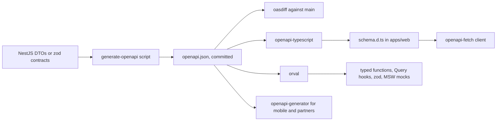

## 80.2 OpenAPI from NestJS and generated typed clients

#### Concept

**OpenAPI** is a machine-readable description of an HTTP API: paths, methods, parameters, request bodies, responses, error schemas and security schemes, in JSON or YAML. Part 18.14 showed how NestJS produces one code-first with `@nestjs/swagger`, and Part 28.7 showed how to diff it in CI. This section is about the other end: turning that document into a **typed client** the frontend actually calls, so that the browser code cannot send a request or read a field the document does not describe.

Three families of generator matter for a React app:

- **Types only**: `openapi-typescript` turns the spec into TypeScript types (`paths`, `components`). A tiny typed fetch wrapper, `openapi-fetch`, uses those types so `client.GET('/v1/orders/{id}', ...)` checks the path, parameters and response at compile time. No generated runtime code per endpoint.
- **Full SDK and hooks**: `orval` (and similar tools such as `@hey-api/openapi-ts`) generate one function per operation, and optionally TanStack Query hooks, zod schemas and MSW mock handlers, from the same spec.
- **Classic SDK generators**: `openapi-generator` (`typescript-fetch`, `typescript-axios`) produce class-based clients, common for mobile and partner SDKs (Part 18.14).

#### Why does it exist?

Hand-written API calls are transcription. Someone reads the docs or the controller and types `fetch('/v1/order/' + id)` with a typo, the wrong method, a missing header or a field name from last month. Every consumer repeats that work, and every repetition drifts. A generated client makes the spec the build dependency: if the API removes `displayId`, regenerating the client turns every use of it into a compile error in the consumer's repository, before deploy. It also gives non-TypeScript and other-repository consumers what `@shop/contracts` gives the monorepo.

#### Mental model

Imagine a restaurant that prints its menu from the kitchen's recipe system every morning. Waiters (the frontend) take orders only from the printed menu, so they never promise a dish that was dropped yesterday. **Types only** is a menu card; you still write the order slip yourself, but you cannot write a dish that is not on the card. **A full SDK** is a handheld ordering device with a button per dish, a photo, and a fake kitchen for training (the MSW mocks). Either way, if the kitchen changes a recipe, tomorrow's menu changes, and the waiter's device refuses the old dish.

#### How it works



1. **Produce the spec from the code** in a script that boots the Nest application without listening (Part 28.7 shows `scripts/generate-openapi.ts`). Commit `openapi.json` so changes appear as reviewable diffs.
2. **Make the spec honest.** Every response type declared (`@ApiOkResponse({ type: OrderSummaryDto })`), every error documented (`@ApiResponse({ status: 409, type: ProblemDto })`), `required` correct, enums named (`enumName: 'OrderStatus'` so generators emit one shared type instead of one per property), `nullable: true` where values can be `null`. The `@nestjs/swagger` CLI plugin (`"plugins": ["@nestjs/swagger"]` in `nest-cli.json`) reads TypeScript types and `class-validator` decorators, so `required` and constraints follow the DTO automatically.
3. **Generate in the consumer, pinned to a spec version.** The web app runs `openapi-typescript ./openapi.json -o src/api/schema.d.ts` against the spec of the API version it targets. In the monorepo, that is the committed file; in another repository, a spec downloaded from a release artefact, never from a running server's `/api/docs-json` (which changes under you).
4. **Check generation in CI.** Regenerate and `git diff --exit-code`, so nobody hand-edits generated code and nobody forgets to regenerate.
5. **Use the client everywhere.** A lint rule (`no-restricted-globals` for `fetch` in `src/features/**`) keeps raw `fetch` calls out of feature code.

What the spec can express and what it cannot:

| Concern | In OpenAPI 3.0 / 3.1 | Notes |
|---|---|---|
| Field names, types, required | Yes | The core of every generator |
| Nullable | 3.0: `nullable: true`; 3.1: `type: ['string', 'null']` | Generators differ; test both `null` and missing |
| Enums | Yes | Open or closed is only a convention; see 80.7 |
| Formats (`uuid`, `date-time`, `date`) | Yes | Mostly documentation; few generators validate them |
| Money as decimal string | `type: string`, `pattern` | Write the pattern; generators will not infer it |
| Error shapes per status | Yes | Only if declared on every operation |
| Headers (`ETag`, `Retry-After`) | Yes | Usually forgotten; declare the ones the UI reads |
| Default ordering, semantics | Only in `description` | Text, but reviewable and diffable |

#### Practical example

The merchant portal is a separate React app in another repository, owned by the merchant team. It shows a restaurant's orders and lets staff mark them ready. It cannot import `@shop/contracts` from the shop monorepo, and should not: it would couple its build to another team's source. Instead, the API's CI publishes `openapi.json` for each release as a versioned artefact (`orders-api-openapi@2.14.0`). The portal pins that version, generates `schema.d.ts`, and upgrades in a deliberate pull request. When the API added `estimatedReadyAt`, the portal saw it in the regenerated types the next morning; when an API pull request tried to remove `notes`, the API's own spec diff failed before the portal ever saw it.

#### React / Next.js example

Types-only generation and the `openapi-fetch` client:

```bash
# apps/web: regenerate types from the committed spec (openapi-typescript 7)
pnpm exec openapi-typescript ../api/openapi.json -o src/api/schema.d.ts
```

```ts
// apps/web/src/api/client.ts  (openapi-fetch 0.12)
import createClient, { type Middleware } from 'openapi-fetch';
import type { paths } from './schema';           // generated: every path, parameter and response type
import { toApiError } from './errors';

const contractHeaders: Middleware = {
  async onRequest({ request }) {
    request.headers.set('X-Client', 'web');
    request.headers.set('X-Client-Version', process.env.NEXT_PUBLIC_BUILD_ID ?? 'dev'); // 80.9
    return request;
  },
  async onResponse({ response }) {
    if (!response.ok) throw await toApiError(response.clone()); // one error shape, 80.6
    return response;
  },
};

export const api = createClient<paths>({ baseUrl: '/api', credentials: 'same-origin' });
api.use(contractHeaders);
```

```ts
// apps/web/src/orders/useOrder.ts
import { useQuery } from '@tanstack/react-query';
import { OrderSummarySchema } from '@shop/contracts';
import { api } from '../api/client';

export function useOrder(id: string) {
  return useQuery({
    queryKey: ['orders', id],
    queryFn: async ({ signal }) => {
      // Path and params are checked against the spec: '/v1/order/{id}' or a missing id fails to compile.
      const { data } = await api.GET('/v1/orders/{id}', { params: { path: { id } }, signal });
      return OrderSummarySchema.parse(data); // types say what the spec promises; parse proves what arrived
    },
  });
}
```

Generated types are compile-time only, which is why the last line still parses. If the web app is outside the monorepo and has no zod schemas, `orval` can generate them from the same spec:

```ts
// orval.config.ts  (orval 7)
import { defineConfig } from 'orval';

export default defineConfig({
  orders: {
    input: './openapi/orders-api-2.14.0.json',   // a pinned release artefact, not a live URL
    output: {
      target: './src/api/generated/orders.ts',
      client: 'react-query',                     // one useQuery or useMutation hook per operation
      mode: 'tags-split',                        // one file per OpenAPI tag
      mock: true,                                // MSW handlers with fake data for tests (Part 83)
      override: { mutator: { path: './src/api/http.ts', name: 'http' } }, // our fetch wrapper: headers, errors
    },
  },
  ordersZod: {
    input: './openapi/orders-api-2.14.0.json',
    output: { target: './src/api/generated/orders.zod.ts', client: 'zod' }, // runtime schemas for responses
  },
});
```

The tradeoff between the two: `openapi-typescript` with `openapi-fetch` adds about 6 KB to the bundle and nothing per endpoint, and you write your own TanStack Query hooks (Part 78's patterns, unchanged). `orval` writes the hooks for you, but generated hooks bake in query keys, options and error types you may want to control, and a 200-endpoint spec generates a lot of code. Teams with careful query-key design (78.2) often keep their own hooks and generate only types and zod schemas.

| Situation | Generate | Keep by hand |
|---|---|---|
| Web app in the API's monorepo, zod contracts already shared | Nothing for TypeScript; the spec only for other consumers | Hooks, query keys |
| Separate-repository React app, small team | Types (`openapi-typescript`) plus `openapi-fetch` | Hooks, query keys, response zod schemas for key endpoints |
| Separate-repository app with dozens of endpoints and little caching subtlety | `orval` functions, hooks, zod and MSW mocks | Query-key factory override, error mapping |
| Mobile apps, partners, other languages | `openapi-generator` SDKs from a released spec | Retry and auth policy |
| Public API with unknown consumers | A published SDK per language, semantically versioned | Nothing: the SDK is the product |

The question in every row is the same: which part of the client is pure transcription of the spec (generate it), and which part encodes decisions the spec does not know about, such as freshness, retries and how errors appear in the UI (write it by hand).

#### Backend side (NestJS)

The generated client is exactly as good as the spec. The API's responsibilities:

```ts
// apps/api/src/orders/dto/order-summary.dto.ts
import { ApiProperty, ApiPropertyOptional } from '@nestjs/swagger';

export enum OrderStatusDto { PENDING = 'PENDING', PAID = 'PAID', SHIPPED = 'SHIPPED', DELIVERED = 'DELIVERED', CANCELLED = 'CANCELLED' }

export class OrderSummaryDto {
  @ApiProperty({ format: 'uuid' }) id!: string;
  @ApiProperty({ example: 'DK-20481' }) displayId!: string;
  @ApiProperty({ enum: OrderStatusDto, enumName: 'OrderStatus', description: 'Open enum: clients must handle unknown values (80.7)' })
  status!: OrderStatusDto;
  @ApiProperty({ pattern: '^\\d+$', example: '129900', description: 'Integer minor units as a string' }) totalMinor!: string;
  @ApiProperty({ minLength: 3, maxLength: 3, example: 'INR' }) currency!: string;
  @ApiProperty({ format: 'date-time', description: 'UTC instant, ISO 8601 with offset' }) placedAt!: string;
  @ApiPropertyOptional({ type: String, format: 'date-time', nullable: true }) deliveredAt!: string | null;
  @ApiProperty({ description: 'Optimistic concurrency token (78.5)' }) version!: number;
}
```

```ts
// apps/api/src/orders/orders.controller.ts (excerpt)
@ApiTags('orders')
@Controller('v1/orders')
export class OrdersController {
  @Get(':id')
  @ApiOkResponse({ type: OrderSummaryDto, headers: { ETag: { schema: { type: 'string' } } } })
  @ApiNotFoundResponse({ type: ProblemDto, description: 'NOT_FOUND' })              // ProblemDto: 80.6
  @ApiResponse({ status: 429, type: ProblemDto, headers: { 'Retry-After': { schema: { type: 'integer' } } } })
  get(@Param('id', new ParseUUIDPipe()) id: string) { return this.orders.get(id); }
}
```

Rules that keep the generated client trustworthy:

- **One response DTO per shape**, never `Object` or `any`, which generate `{}` or `unknown` and silently disable type checking in every consumer.
- **`nullable` and `required` deliberately.** `deliveredAt` above is required and nullable: always present, sometimes `null`. That is easier for clients than "sometimes missing".
- **`enumName` on every enum**, so `OrderStatus` is one named schema in `components.schemas`, reused by every operation and generator.
- **Errors declared per operation**, with the problem schema from 80.6, so generated clients type the error branch too.
- **Stable `operationId`s.** Generators name functions after them (`ordersControllerGet` by default from `@nestjs/swagger`). Set `operationIdFactory` in `SwaggerModule.createDocument` options, for example `(controllerKey, methodKey) => methodKey`, or a rename in the controller renames every consumer's function.

If the API validates with zod (the `ZodValidationPipe` path from 76.12) rather than `class-validator` DTOs, `@nestjs/swagger` cannot see the schemas. 80.3 shows how to emit OpenAPI from the zod contracts instead, so there is still one source of truth.

#### Production scenario

An e-commerce company had four frontends calling the same NestJS API: web, admin, merchant portal and a support console. Before generation, a quarterly audit found 61 distinct hand-written request helpers, 9 of which called endpoints that no longer existed (they returned `404`, caught and swallowed). After adopting a committed spec with `openapi-typescript` and `openapi-fetch` in all four, plus `operationIdFactory` for stable names, regeneration on API upgrade took under a minute per app. In the first quarter the compile step flagged 17 uses of deprecated fields and 3 calls to removed endpoints, all fixed before deploy.

#### Failure scenario

A team generated their client in the web app's `postinstall` script, fetching the spec from the staging API's `/api/docs-json`. On Monday the API team deployed a staging branch that renamed a query parameter. The web team's next CI run regenerated the client from staging, type-checked against it, and shipped to production, where the API still had the old parameter name. Order search silently ignored its filter for 40 minutes; customers saw every order instead of the ones they searched for.

Generation is a dependency like any other: pin it to a reviewed spec version, commit the output or the spec, and never generate from a live server during a build.

#### Edge cases & failure modes

- **`additionalProperties: false` in generated runtime validators** turns every new response field into a parse failure. Configure the generator or post-process schemas to allow unknown keys on responses.
- **Polymorphic responses** (`oneOf` with a `discriminator`) generate poorly in many tools. Prefer a `type` field and separate schemas the generator understands, and test the output.
- **Global prefix and versioning** missing from generated paths: generate from an app configured exactly like `main.ts` (`setGlobalPrefix`, `enableVersioning`).
- **Huge specs** (500+ operations) make `orval` output slow to type-check; split by tag or generate only the operations a frontend uses.
- **Date formats** generated as `Date` by some generators while JSON carries strings: the type says `Date`, the value is a string. Keep `string` types and convert explicitly (80.7).
- **Swagger UI in production** exposing every internal endpoint; gate it (Part 18.14).

#### How a Senior Full-Stack Engineer thinks about this

The senior sees the spec as the published artefact of the API, not documentation: it is versioned, reviewed in pull requests, diffed in CI, and consumed by pinned generators. They prefer the smallest generator that removes transcription (types plus a typed fetch) and keep control of caching and query keys in hand-written hooks. They insist that types and runtime validation are separate jobs: generated types say what was promised; zod says what arrived. And they keep one source of truth: either DTOs or zod schemas produce the spec, never both by hand.

#### Common mistakes

- **Generating from a live server** instead of a committed or released spec.
- **Undeclared error responses**, so every generated client types errors as `unknown`.
- **`any` or `Object` response types** that generate empty schemas.
- **Default `operationId`s** that change when a controller method is renamed.
- **Trusting generated types as runtime guarantees.**

#### Interview questions

1. **What is the difference between `openapi-typescript` with `openapi-fetch` and a full SDK generator like `orval`?** Expected answer: types-only plus a tiny typed fetch versus generated functions and hooks per operation; bundle size, control over query keys and caching, regeneration noise. Follow-up: when would you pick each?
2. **Why should a generated client be pinned to a spec version?** Expected answer: regenerating from a moving target changes behaviour with no reviewable diff; production may run a different API version than staging.
3. **Do generated types make runtime validation unnecessary?** Expected answer: no; they are erased at runtime and describe the promise, not the response. Parse at the network boundary.
4. **What makes an OpenAPI spec bad for code generation?** Expected answer: untyped responses, missing errors, unnamed inline enums, unstable `operationId`s, wrong `required` and `nullable`, missing global prefix.
5. **How does a separate-repository frontend consume the API contract safely?** Expected answer: versioned spec artefacts, pinned generation, deliberate upgrade PRs, and a consumer contract test (80.10).

#### Practical exercise

Generate a client for the orders API in the web app with `openapi-typescript` and `openapi-fetch`, and migrate three hand-written calls to it.

Acceptance criteria:

- `openapi.json` is generated by a script, committed, and regenerating it in CI with no code change produces no diff.
- `src/api/schema.d.ts` is regenerated in CI and `git diff --exit-code` passes.
- Calling `api.GET('/v1/orders/{id}')` without `params.path.id`, or with a path that does not exist in the spec, fails `tsc`.
- The `404` and `429` responses of `GET /v1/orders/{id}` are typed with the problem schema in `schema.d.ts`.
- Renaming the controller method does not change the generated operation name.
