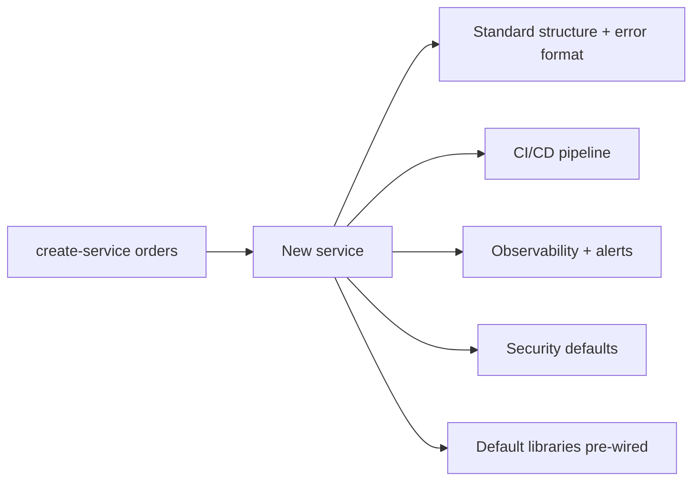

## 80.2 Paved roads and golden paths

#### Concept

A paved road (also called a golden path) is the well-supported, opinionated, default way to do a common thing — create a service, add a queue consumer, expose an API — where all the hard decisions have been made for you and all the standard pieces come pre-wired. A team on the paved road gets observability, CI/CD, security defaults, the standard error format and the standard libraries for free, just by starting from the template. The road is paved, so travelling it is smooth; going off-road is allowed but you do the paving yourself. This is the single most powerful governance mechanism, because it achieves consistency through convenience rather than coercion.

#### Why does it exist?

Imagine every team, starting a new service, having to decide from scratch: which logging library, how to structure config, how to wire up health checks, how to set up the CI pipeline, which error format, how to add tracing. Each team spends a week or two on this undifferentiated setup, each makes slightly different choices, and the result is forty services that are each subtly unique and collectively impossible to operate consistently. Multiply by forty teams and you have wasted months of engineering on solved problems and produced an inconsistent estate.

The paved road exists to make all of that a non-decision. The team runs one command, gets a service with everything wired correctly, and starts on their actual problem the same day. Consistency is a side effect of the convenience, not a burden imposed on top of it.

#### Mental model

Imagine a city that wants everyone to use public transit. It could ban cars (coercion — resented, routed around). Or it could build transit so good — frequent, clean, cheap, going everywhere you need — that taking it is simply easier than driving. The second city gets high transit use with no bans, because the good option is the easy option. A paved road is that excellent transit system: so convenient that teams choose it freely, and the consistency the org wants emerges from the free choices of teams who found the paved road easier than paving their own.

#### How it works

A paved road has layers, and the more layers you pave, the more value it delivers:

```text
1. Service template:   `create-service orders` scaffolds a full service with
                       structure, config, health checks, error format, tests.
2. Default libraries:  the blessed logging, HTTP client, resilience, auth
                       libraries, pre-wired and version-managed centrally.
3. CI/CD pipeline:     the standard pipeline (lint, test, build, deploy)
                       generated with the service, no setup.
4. Observability:      metrics, structured logs, tracing, dashboards and the
                       standard alerts, wired by default.
5. Security defaults:  authn/authz middleware, secret management, dependency
                       scanning, all on by default.
6. Runtime/deploy:     the standard way to deploy, scale, and roll back.
```

The key properties that make a paved road work:

- **Opinionated.** It makes choices for you. A paved road with options is not paved; it is a fork in a dirt track.
- **Complete for the common case.** A team using it should need zero additional setup for a standard service.
- **Maintained as a product.** Someone owns it, improves it, and keeps it current (see Part 82 on platform-as-product). An abandoned paved road becomes a legacy trap.
- **Off-road is allowed.** Teams with genuinely different needs can leave the road, but they take on the cost of paving themselves. The road is the default, not a mandate.



#### Practical example

A platform team builds a `create-service` CLI. An engineer runs `create-service inventory-pricing`, answers three prompts (team name, does it need a database, does it need a queue consumer), and gets a NestJS service with: the standard module structure, config loaded from the environment the standard way, a `/health` and `/ready` endpoint wired to Terminus, the standard error filter producing the org's error format, structured JSON logging with trace IDs, a CI pipeline that lints, tests and deploys, a dashboard with the standard metrics, and the three standard alerts. The engineer writes their first real endpoint within an hour. Compare to the pre-paved-road world where this setup took a week and every service did it slightly differently. The paved road converted a week of inconsistent setup into an hour of consistent setup, forty times over.

#### Artifact example

The contents of a paved-road service template, shown as the manifest of what a team gets for free — this is what makes the road worth taking.

```markdown
# What `create-service` gives you (paved road v3)

## Structure & conventions
- NestJS 10 module layout: controller / service / repository / dto / entity
- Standard error filter -> org error format (see §53.3)
- Config from env via @nestjs/config with a validated schema
- OpenAPI spec generated from controllers (contract-first, §53.6)

## Reliability (on by default)
- @nestjs/terminus /health and /ready
- Resilience library: timeouts, retry-with-backoff, circuit breaker
- Graceful shutdown wired (drains in-flight requests)

## Observability (on by default)
- OpenTelemetry tracing with propagated trace IDs
- Structured JSON logs (level, trace_id, service, msg)
- Prometheus metrics endpoint + a default Grafana dashboard
- Standard alerts: error-rate, p99 latency, saturation

## CI/CD (generated)
- GitHub Actions: lint, typecheck, test, build, deploy
- Dependency + container scanning in the pipeline
- Fitness functions run on every PR (§53.5)

## Security (on by default)
- Auth guard wired; endpoints are authenticated unless explicitly @Public()
- Secrets from the secret manager, never in env files or code
- Sensible CORS, security headers

## You write
- Your endpoints. Your domain logic. That's it.
```

The manifest is the sales pitch for the road: a team sees that everything tedious and standard is handled, so taking the road is obviously easier than paving their own. The last line — "you write your endpoints, your domain logic, that's it" — is the whole value proposition. Consistency comes for free because the easy path is the consistent path.

#### Real-world scenario

A company with a mature paved road ships a security fix — a patch to the auth library and a new security header — by releasing a new template version and a library update. Because every service on the paved road uses the central library and template, the fix propagates to the whole estate through a routine dependency bump, and the fitness functions flag any service that has drifted. A company *without* a paved road faces the same security fix as forty separate tickets, forty teams each implementing it slightly differently, weeks of coordination, and no guarantee of completeness. The paved road turned an estate-wide security fix from a multi-week coordination program into a library release. That leverage — fix once, propagate everywhere — is why paved roads are the highest-value governance investment an org can make.

#### Failure scenario

A platform team builds a paved road, celebrates its launch, and then moves on to other work. The road is not maintained as a product. Eighteen months later, the template still scaffolds NestJS 8 (two majors behind), the default libraries have known vulnerabilities, the CI pipeline uses a deprecated action, and the observability wiring points at a monitoring system the company migrated away from. New teams who use the template inherit all of this rot on day one and spend their first week *removing* the paved road's broken defaults — the road now makes things harder, not easier. Teams start avoiding it, paving their own again, and the consistency it once provided fragments. The paved road did not fail because the idea was wrong; it failed because an unmaintained paved road is worse than none, actively spreading rot to every new service. A paved road is a product with an owner and a roadmap, or it is a trap.

#### Edge cases & failure modes

- **Unmaintained road.** Falls behind on versions, security and integrations, and actively spreads rot to new services.
- **Not opinionated enough.** A template full of choices and TODOs is not a paved road; the team still has to make all the decisions.
- **Incomplete for the common case.** The road covers 70% of setup, so every team still does the remaining tedious 30% differently.
- **Mandated, not made attractive.** Forcing teams onto a road they find worse than their own produces resentment and gaming; the road must be genuinely easier.
- **No off-road option.** Teams with real, different needs are forced onto a road that does not fit, so they fight the template or fork it badly.
- **One road for incompatible needs.** Trying to pave one road for web services, data pipelines and ML workloads; each needs its own paved road.

#### How a Principal Engineer thinks about this

They see the paved road as the highest-leverage governance investment available, because it achieves consistency through convenience — teams choose it freely because it is easier, so there is nothing to enforce. They insist the road be *opinionated and complete* for the common case, because a road with options or gaps is just a slightly nicer dirt track that still leaves teams making and diverging on decisions. They treat the road as a product with an owner, a roadmap and a maintenance commitment, because they know an abandoned paved road rots into a trap that spreads vulnerabilities to every new service.

They also preserve the off-road option deliberately, because a mandate breeds resentment and gaming, whereas a genuinely-better default earns voluntary adoption — and the small number of teams with real, different needs should be able to leave the road and pay for their own paving rather than fight a template that does not fit. The principal's measure of success is not "everyone is forced onto the road" but "the road is so good that leaving it is a deliberate, rare, justified choice".

#### Common mistakes

- **Building the road and abandoning it,** letting it rot into a trap.
- **Making the road full of options and TODOs** instead of opinionated and complete.
- **Mandating the road instead of making it the easiest choice,** which breeds gaming.
- **Paving only part of the common case,** so teams still diverge on the unpaved remainder.
- **Trying to serve incompatible workloads with one road** instead of several purpose-built ones.

#### Interview questions

1. **What is a paved road and why is it more effective than mandates for achieving consistency?**
   *Expected answer:* a paved road is the opinionated, complete, well-supported default way to do a common thing (create a service, add a consumer), with all standard pieces pre-wired; it beats mandates because it achieves consistency through convenience — teams choose it freely because it is easier — so there is nothing to enforce or route around. *Follow-up:* what makes a paved road attractive enough to be chosen.

2. **Why is an unmaintained paved road worse than no paved road?**
   *Expected answer:* because new teams adopt it on day one and inherit its rot — outdated versions, vulnerable libraries, broken integrations — spending their first week removing broken defaults; the road actively spreads problems to the whole estate. A paved road must be owned and maintained as a product. *Why it matters:* tests whether they understand platform-as-product, not platform-as-project.

3. **A paved road gives you estate-wide leverage. Give an example.**
   *Expected answer:* a security fix (patch the central auth library + update the template) propagates to every service on the road through a routine dependency bump, with fitness functions catching drift — turning a forty-ticket coordination program into a library release. *Why it matters:* tests whether they see the compounding value of shared infrastructure.

#### Practical exercise

Design the manifest for a paved road for your org's most common service type. List everything a team should get for free when they create a new service: structure, reliability, observability, CI/CD, security. Then honestly assess your current reality: for each item, is it paved (automatic) or does each team do it themselves? Identify the three highest-leverage items to pave first.

**Acceptance criteria:** your manifest is opinionated (makes specific choices, not "pick a logging library") and complete enough that a team using it would need zero additional setup for a standard service; and you can name three currently-unpaved items whose paving would save the most repeated, divergent effort across teams.
