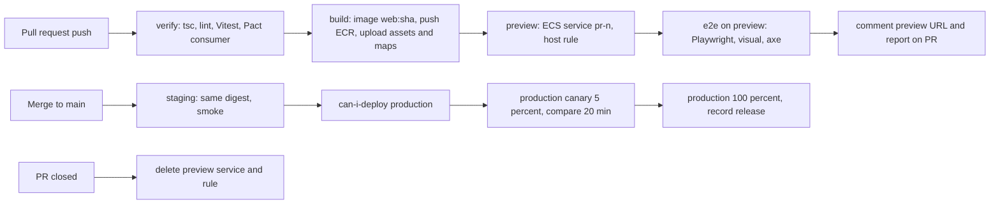

## 80.10 Incident story: a deploy that broke checkout only for users with a cached old bundle

This incident is a composite of several real ones. Every mechanism in it appears earlier in this volume; the incident is what happens when three small gaps line up.

#### What happened

On a Friday evening, about 11 % of checkout attempts failed with "We couldn't place your order. Please try again." for 85 minutes. Retrying did not help. Reloading the page did. New visitors were unaffected, so the team's own checks, run in fresh browsers, all passed.

```text
18:05  Web release web@9c1e deploys: checkout sends deliverySlotId instead of deliveryWindow (behind no flag;
       the API had accepted both for 3 weeks, per 80.9's expand step).
18:06  Version dashboard (X-Client-Version at the API) shows 100 % of traffic on web@9c1e within a minute.
18:20  API release removes deliveryWindow support (the contract step), justified by the dashboard.
18:21  Users whose tabs loaded checkout before 18:05 (open tabs, home-screen web apps, bfcache restores)
       press "Place order". Old bundle sends deliveryWindow -> 400 VALIDATION_FAILED, issue path "deliverySlotId".
18:21  The old form has no deliverySlotId field. applyServerErrors maps nothing; the root error shows a generic message.
       The user retries: same 400, same message. Some reload and succeed; most give up.
18:40  RUM journey SLI (84.8) slow-burn ticket opens: checkout_failed_system at 2.3 %, 5x budget rate.
18:52  Support reports "order button broken" from 9 customers; on-call cannot reproduce in a fresh browser.
19:15  An engineer notices the error tracker issue "400 VALIDATION_FAILED deliverySlotId" is tagged
       release web@4d2a, the PREVIOUS release. The alert rule only watched the latest release.
19:28  Trace for one failure (84.7) shows the request body with deliveryWindow; the cause is clear.
19:40  API hotfix restores deliveryWindow (expand again); failures stop.
19:46  Incident closed. 1,930 failed attempts, about 640 customers, an estimated 4 % of the evening's checkout revenue.
```

#### Why it happened

Three gaps, each harmless alone:

1. **The version telemetry measured the wrong client.** The browser sent `X-Client-Version: web@4d2a`. The BFF forwarded the request to NestJS and, in its shared fetch helper, set `X-Client-Version` to its own build ID, which became `web@9c1e` the moment the new BFF tasks took over. The API's dashboard therefore showed the BFF's version, not the bundle running in users' browsers. The old-bundle tail of 80.4 (25 % at 5 minutes, 9 % at 1 hour) was invisible.
2. **The contract step was gated by time and a dashboard, not by a contract test of deployed releases.** The web pipeline ran Pact's `record-deployment` but not `record-release` (76.10), so the broker believed only `web@9c1e` was in use, and the API's verification of `deployedOrReleased` pacts passed.
3. **The client had no treatment for "your client is too old".** A `400 VALIDATION_FAILED` on a field the form does not have is, by definition, version skew. The error mapper (76.6) treated it as a generic failure; a `CLIENT_OUTDATED` signal (80.4) would have reloaded the page with the draft saved.

And one detection gap: the error-tracker alert rule filtered on the newest release, on the reasoning that old releases' errors are old news. After a deploy, the newest problems often live in the old release.

#### Detection, mitigation and what changed

The fastest signal existed: RUM's journey SLI moved within 20 minutes, but as a slow-burn ticket, because 11 % of checkout traffic at that hour burned the budget at 5x, under the 14.4x page threshold. Diagnosis was slow because the on-call reproduced in fresh browsers, which by construction ran the new bundle. The trace (80.7) and the release tag on the error event (80.6) together pointed at the cause in two minutes once someone looked at them.

The actions, each mapped to a section of this volume:

| Action | Prevents | Section |
|---|---|---|
| BFF forwards the browser's `X-Client-Version` unchanged and sends its own as `X-Bff-Version` | Wrong version telemetry | 76.9 |
| Contract steps require browser-version traffic below 0.1 % for 7 days, read from RUM, not the API | Premature removal | 76.9, 84.8 |
| Web pipeline runs `record-release` per build and `record-support-ended` from telemetry | Pact blind to old tabs | 76.10 |
| Client maps `VALIDATION_FAILED` with an unknown field path to the reload treatment, and the API sends `CLIENT_OUTDATED` for removed fields during a grace period | Dead-end retries | 76.6, 84.4 |
| Error-tracker alerts on new issues in any release seen in the last 7 days | Missed old-release errors | 80.6 |
| Checkout journey SLO gets a page-level alert at 3x burn during peak hours | Slow detection | 80.8 |
| On-call runbook: "reproduce with an old build" using a pinned preview URL of the previous release | Unreproducible bugs | 80.11 |

#### How a Senior Full-Stack Engineer thinks about this

The senior reads this incident as one lesson: **the frontend version that matters is the one running in the browser, and it is always older than you think.** Every mechanism that decides compatibility (telemetry, contract tests, deploy gates, alerts, reproduction) must see browser versions, including old ones. They also notice that nothing here was exotic: an expand-and-contract migration done in the right order, a BFF helper with a sensible default, an alert rule that looked reasonable. Incidents at this level come from the gaps between correct parts, which is why the fix list touches the BFF, the API, the pipeline, the error tracker, RUM and the runbook.

#### Interview questions

1. **Why could the team not reproduce the bug?** Expected answer: fresh browsers load the new bundle; the bug only existed in old bundles still running in tabs.
2. **What was wrong with the version dashboard?** Expected answer: the BFF overwrote the browser's version header with its own, so the API saw the BFF's version.
3. **Which contract-testing step would have caught it?** Expected answer: recording each web release in the broker so `deployedOrReleased` verification includes builds still open in tabs.
4. **How should a client react to a validation error on a field it does not have?** Expected answer: treat it as version skew: save the draft and reload, ideally triggered by an explicit `CLIENT_OUTDATED` from the API.

#### Practical exercise

Run this incident as a game day (Part 49.12) on staging.

Acceptance criteria:

- Open checkout in a browser on build N, deploy build N+1 with a renamed request field, then deploy an API that removes the old field.
- Before the fixes, the old tab fails as described; after the fixes, the old tab reloads with its draft and the order succeeds.
- The version dashboard shows the old browser build's traffic during the exercise.
- The error tracker alerts on the old release's new issue within 5 minutes.

## 80.11 Worked example: a GitHub Actions pipeline with preview environments

This example assembles the Part into one pipeline for the storefront (Next.js 14 standalone on ECS behind CloudFront, assets on S3), reusing the test layers of Part 79 and the backend pipeline of Part 47.11.

#### Requirements

- **Build once**: one image per commit, identified by its digest; the same image runs in preview, staging and production (80.2).
- **Preview per pull request** at `https://pr-<n>.preview.shop.example`, ready within 10 minutes of a push, deleted when the pull request closes.
- **Tests at every gate**: static and component tests before building; Playwright journeys, visual and accessibility checks against the preview (75.7-83.10); Pact gates before production (76.10).
- **Assets before HTML, never delete** (80.3); maps uploaded privately (80.6).
- **Production by canary**: 5 % for 20 minutes with automated comparison, then 100 % (80.5); rollback in under 5 minutes.
- **No long-lived cloud keys**: GitHub's OIDC token assumes AWS roles per environment.
- **Bookkeeping**: Sentry release deploys, Pact `record-deployment` and `record-release`, and the advertised web version (76.9) updated on production go-live.

#### The pipeline



#### The pull-request workflow

```yaml
# .github/workflows/web-pr.yml
name: web-pr
on:
  pull_request:
    paths: ['apps/web/**', 'packages/**', 'pnpm-lock.yaml']
permissions: { id-token: write, contents: read, pull-requests: write }
concurrency: { group: web-pr-${{ github.event.number }}, cancel-in-progress: true }   # a new push cancels the old run
env:
  SHA: ${{ github.event.pull_request.head.sha }}
  PREVIEW_HOST: pr-${{ github.event.number }}.preview.shop.example
jobs:
  verify:
    runs-on: ubuntu-latest
    steps:
      - uses: actions/checkout@v4
      - uses: pnpm/action-setup@v4
      - uses: actions/setup-node@v4
        with: { node-version: 20, cache: pnpm }
      - run: pnpm install --frozen-lockfile
      - run: pnpm turbo run typecheck lint test --filter=web...        # unit, component, MSW (83.2-83.6)
      - run: pnpm --filter web test:pact && pnpm pact-broker publish apps/web/pacts --consumer-app-version "$SHA" --branch "${{ github.head_ref }}"
        env: { PACT_BROKER_BASE_URL: "${{ vars.PACT_BROKER_URL }}", PACT_BROKER_TOKEN: "${{ secrets.PACT_BROKER_TOKEN }}" }

  build:
    needs: verify
    runs-on: ubuntu-latest
    outputs: { digest: "${{ steps.push.outputs.digest }}" }
    steps:
      - uses: actions/checkout@v4
      - uses: aws-actions/configure-aws-credentials@v4
        with: { role-to-assume: "${{ vars.AWS_BUILD_ROLE }}", aws-region: ap-south-1 }   # OIDC, no stored keys
      - uses: aws-actions/amazon-ecr-login@v2
      - uses: docker/setup-buildx-action@v3
      - id: push
        uses: docker/build-push-action@v6
        with:
          file: apps/web/Dockerfile
          push: true
          tags: ${{ vars.ECR_REPO }}/web:${{ env.SHA }}
          build-args: GIT_SHA=${{ env.SHA }}
          secrets: sentry_auth_token=${{ secrets.SENTRY_AUTH_TOKEN }}   # maps uploaded inside the build, then deleted
          cache-from: type=gha
          cache-to: type=gha,mode=max
      - run: GIT_SHA="$SHA" ASSET_BUCKET="${{ vars.ASSET_BUCKET }}" ci/publish-web-assets.sh   # 84.3: assets first, no deletes

  preview:
    needs: build
    runs-on: ubuntu-latest
    environment: { name: preview, url: "https://${{ env.PREVIEW_HOST }}" }
    steps:
      - uses: actions/checkout@v4
      - uses: aws-actions/configure-aws-credentials@v4
        with: { role-to-assume: "${{ vars.AWS_PREVIEW_ROLE }}", aws-region: ap-south-1 }
      - run: ci/preview-up.sh "${{ github.event.number }}" "${{ vars.ECR_REPO }}/web@${{ needs.build.outputs.digest }}"
      - run: ci/wait-healthy.sh "https://$PREVIEW_HOST/api/health" 300

  e2e:
    needs: preview
    runs-on: ubuntu-latest
    container: mcr.microsoft.com/playwright:v1.50.0-noble              # same image as the visual baselines (83.9)
    env:
      E2E_BASE_URL: https://${{ env.PREVIEW_HOST }}
      E2E_API_URL: ${{ vars.PREVIEW_API_URL }}                         # shared preview API with E2E support, synthetic data only
      E2E_SECRET: ${{ secrets.PREVIEW_E2E_SECRET }}
    steps:
      - uses: actions/checkout@v4
      - run: corepack enable && pnpm install --frozen-lockfile
      - run: pnpm --filter web exec playwright test --project=chromium --project=visual
      - if: always()
        uses: actions/upload-artifact@v4
        with: { name: playwright-report, path: apps/web/playwright-report, retention-days: 14 }

  comment:
    needs: [preview, e2e]
    if: always() && needs.preview.result == 'success'
    runs-on: ubuntu-latest
    steps:
      - run: |
          gh pr comment ${{ github.event.number }} --repo ${{ github.repository }} --body \
          "Preview: https://${PREVIEW_HOST} (web@${SHA::7}). E2E: ${{ needs.e2e.result }}. Report: ${{ github.server_url }}/${{ github.repository }}/actions/runs/${{ github.run_id }}"
        env: { GH_TOKEN: "${{ github.token }}" }
```

What `ci/preview-up.sh` does, in four AWS CLI calls: register a task definition revision for `web-preview` with the image digest and the preview environment's configuration (80.2: `PUBLIC_SENTRY_ENVIRONMENT=preview`, the preview API's internal URL, a preview `BFF_KEY` from Secrets Manager); create or update an ECS service `web-pr-<n>` with one Fargate task (0.5 vCPU, 1 GB); create a target group and an ALB listener rule matching `Host: pr-<n>.preview.shop.example`; and print the URL. A wildcard DNS record and certificate for `*.preview.shop.example` mean no DNS work per pull request. Previews run on Fargate Spot and cost about 0.6 dollars per pull request-day.

The teardown workflow runs on `pull_request: types: [closed]` and deletes the service, the listener rule and the target group. A nightly job deletes any preview service whose pull request is closed, in case a teardown failed.

Previews are behind the company's SSO at the ALB (an `authenticate-oidc` listener action) so unreleased features are not public, and they send `X-Robots-Tag: noindex` so search engines never index them.

#### The main-branch workflow

```yaml
# .github/workflows/web-deploy.yml (jobs excerpt)
on: { push: { branches: [main], paths: ['apps/web/**', 'packages/**'] } }
concurrency: { group: web-deploy, cancel-in-progress: false }      # never cancel a production deploy halfway
jobs:
  staging:
    runs-on: ubuntu-latest
    environment: staging
    steps:
      - uses: actions/checkout@v4
      - uses: aws-actions/configure-aws-credentials@v4
        with: { role-to-assume: "${{ vars.AWS_STAGING_ROLE }}", aws-region: ap-south-1 }
      - run: ci/ecs-deploy.sh web-staging "$(ci/digest-for.sh web "$GITHUB_SHA")"   # the PR build's digest: no rebuild
      - run: ci/smoke.sh https://staging.shop.example                            # headers, env name, release, health

  production:
    needs: staging
    runs-on: ubuntu-latest
    environment: production                                         # required reviewers and a deploy window
    steps:
      - uses: actions/checkout@v4
      - run: pnpm dlx @pact-foundation/pact-cli pact-broker can-i-deploy --pacticipant web --version "$GITHUB_SHA" --to-environment production
      - uses: aws-actions/configure-aws-credentials@v4
        with: { role-to-assume: "${{ vars.AWS_PROD_ROLE }}", aws-region: ap-south-1 }
      - run: ci/ecs-canary.sh web-prod "$(ci/digest-for.sh web "$GITHUB_SHA")" --weight 5 --hold 20m   # sticky ALB weights
      - run: ci/compare-canary.sh --window 20m --max-error-ratio 1.5 --max-inp-regression 0.10 --min-checkout-success 0.99
      - run: ci/ecs-canary.sh web-prod --promote                     # 100 %, old task set drained, kept 1 hour for rollback
      - run: |
          npx @sentry/cli releases deploys "web@${GITHUB_SHA}" new -e production
          pnpm dlx @pact-foundation/pact-cli pact-broker record-deployment --pacticipant web --version "$GITHUB_SHA" --environment production
          pnpm dlx @pact-foundation/pact-cli pact-broker record-release --pacticipant web --version "$GITHUB_SHA" --environment production
          aws ssm put-parameter --name /shop/prod/latest-web-release --value "web@${GITHUB_SHA}" --overwrite   # X-App-Version (80.9)
```

`ci/compare-canary.sh` queries the RUM counters (80.8) and the error tracker's release stats for the canary and the control task sets in the same 20-minute window. If the canary's error-session rate is more than 1.5 times the control's, p75 INP is more than 10 % worse, or checkout journey success drops below 99 %, it exits non-zero; the next step never runs, and an `if: failure()` step sets the canary weight back to 0. The old task set stays registered for an hour after promotion, so a rollback is a listener-weight change (under a minute), not a new deployment.

#### Numbers

- Pull request to preview URL: median 7 min 40 s (verify 2 min 10 s, build with cache 3 min 30 s, preview up and healthy 2 min).
- E2E on preview: 26 journeys, 24 visual and 32 accessibility checks in 4 min 50 s.
- Merge to production at 100 %: median 34 minutes, of which 20 are the canary hold.
- Rollback during the canary: 40 s; after promotion, within the first hour: 55 s; later: a normal deploy of the previous digest, about 4 minutes.
- Cost: about 14 runner-minutes per pull request push, 6 per production deploy, and about 90 dollars a month of preview Fargate Spot capacity for roughly 150 pull request-days.

#### Failure drills

| Drill | Expected behaviour |
|---|---|
| A pull request breaks a Pact interaction | `verify` passes; the API's verification flags it; `can-i-deploy` blocks production |
| A canary raises INP by 25 % on Android | `compare-canary.sh` fails; weight returns to 0; the release never reaches 100 % |
| A deploy step deletes old assets by mistake | The asset-retention smoke check (a chunk from three builds ago returns `200`) fails in staging |
| Preview teardown fails | The nightly sweeper removes the orphaned service |
| A runner leaks the AWS role session | It expires in one hour and can only deploy the preview environment |
| The error tracker is down during deploy | The canary comparison falls back to RUM counters; the deploy can still be judged |

#### How a Senior Full-Stack Engineer thinks about this

The senior builds the pipeline around one artefact and one question per stage: does the code compile and behave (verify), does it work as a whole (preview with e2e), does it keep every deployed consumer working (Pact gate), and do real users get a better or at least not worse experience (canary comparison)? They make previews cheap enough to be the default way of reviewing frontend changes, keep cloud access short-lived and scoped per environment, and treat the bookkeeping steps (release records, deployed versions, the advertised web version) as part of the deploy, because the next incident's diagnosis depends on them.

#### Practical exercise

Build this pipeline for the monorepo of Part 72.

Acceptance criteria:

- Every pull request gets a preview URL within 10 minutes, behind SSO, with `noindex`, and it disappears within 10 minutes of closing.
- The production image digest equals the preview and staging digest for the same commit.
- Assets are published before HTML and never deleted by the pipeline; source maps never appear on the CDN.
- A deliberately slowed canary (an artificial 300 ms main-thread task on button clicks) is rolled back automatically.
- After a production deploy, the error tracker shows the deploy, Pact shows the version as deployed and released, and the API advertises the new web release.

## Senior Checklist — Part 80

- [ ] I understand the concept
- [ ] I can explain it simply
- [ ] I can implement it
- [ ] I understand its failure modes
- [ ] I understand its scaling limitations
- [ ] I understand its security implications
- [ ] I understand its operational implications
- [ ] I can choose between alternatives
- [ ] I can explain the tradeoffs
- [ ] I can answer senior-level interview questions
- [ ] I can choose between S3 and CloudFront, a Node server for SSR, serverless adapters and a managed platform, with real cost numbers
- [ ] I can serve a client-routed SPA from a private bucket without turning missing assets into HTML
- [ ] I build one artefact per commit and configure it at runtime, and I know when Next.js freezes `process.env` into prerendered HTML
- [ ] I publish assets before HTML, never delete on deploy, and keep old assets for the measured tail of old tabs
- [ ] I can recognise version-skew errors by signature and turn them into one guarded reload with drafts saved
- [ ] I can update and, if needed, kill a service worker safely
- [ ] I can run canaries with sticky sessions, server-evaluated flags and kill switches, and I know rollback does not reach open tabs
- [ ] I can set up error tracking with releases, debug IDs, private source maps, scrubbing and alerts on change
- [ ] I can follow one trace from a browser click through the BFF and NestJS to PostgreSQL, with CORS and sampling right
- [ ] I can define frontend SLIs as good/total ratios measured in the browser, with SLOs, error budgets and burn-rate alerts
- [ ] I can place each security header in exactly one layer and roll out CSP through report-only
- [ ] I can build a GitHub Actions pipeline with previews per pull request, OIDC to AWS, Pact gates and an automated canary

## Part 80 — Key Takeaways

- A frontend deploy never fully ends: old code keeps running in tabs, caches and service workers, so every deploy must work for them too.
- Host with the least server that meets the requirement: static where you can, SSR where SEO, first-paint personalisation or a BFF need it.
- Build once, promote the same bytes, and configure at runtime; `NEXT_PUBLIC_` and static prerendering are how runtime values get frozen by accident.
- Publish by adding files, never replacing them: assets first, HTML last, no deletes, retention measured against real old-tab tails.
- Version-skew errors have signatures; recognise them and reload once, safely, instead of showing an error.
- Separate deploy from release: canaries for platform risk, flags for product risk, kill switches for third parties.
- Rollback moves the pointer, not the users; plan how open tabs on a bad build are reached.
- Error tracking is only useful with one release identity, private source maps from the deployed build, scrubbing and alerts on change.
- One trace ID from the click to the database turns a cross-team argument into a five-minute diagnosis.
- Frontend SLOs must be measured on the user's side of the screen; backend SLOs cannot see client failures.
- Each security header has one owning layer; a CDN that overrides an application's CSP can take the whole site down.
- The browser version, not the server's, decides compatibility; telemetry, contract tests and alerts must see old builds.
