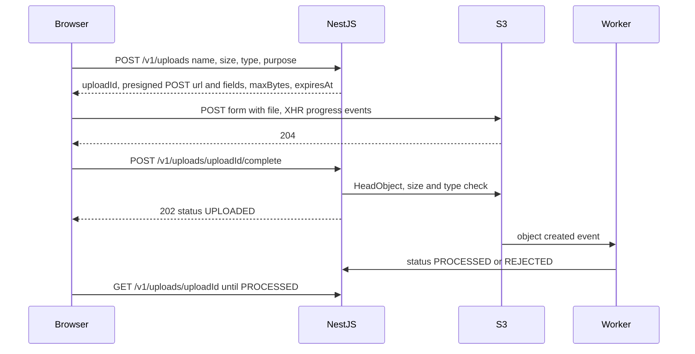
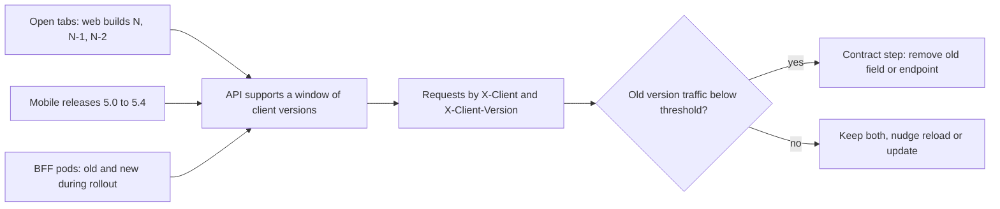

## 80.8 Uploads and downloads from the browser

#### Concept

Part 36 — File Storage and Uploads built the server side: object storage, presigned `PUT` and `POST`, multipart uploads, the `files` table with its status machine, scanning and CDN delivery. This section is the contract between that machinery and a browser: which endpoints the page calls in which order, what each returns, how the page shows progress, how it resumes after a dropped connection, and how a download reaches the user with the right file name and permissions.

An upload from the browser is never one request. It is a small **protocol**: ask the API for permission, send the bytes somewhere (usually straight to S3, not through NestJS), tell the API you finished, and wait until the file is processed. Each step is a contract with its own failure modes.

#### Why does it exist?

Because the naive version, `<input type="file">` posted as `multipart/form-data` to a NestJS endpoint, has three problems at real sizes. The API pod becomes a byte pipe, holding a connection and memory for the whole upload (Part 36.5). The user sees no progress for a 300 MB video and assumes the page froze. And when a phone on a train loses signal at 80 %, the upload starts again from zero. Direct-to-storage uploads, progress events and resumable protocols fix those, but only if the browser and the API agree on every step.

#### Mental model

Imagine sending a large parcel through a courier depot. You do not carry it to the head office. You ask the head office for a shipping label (the presigned URL, valid for 15 minutes and for one size of parcel). You drop the parcel at the depot yourself (the upload to S3). For a very heavy load you split it into numbered boxes, and if your van breaks down you only resend the boxes the depot has not signed for (multipart and resume). Then you phone the head office to say "delivered" (the complete call), and they inspect it before it goes on the shelf (scanning and processing).

#### How it works



1. **Initiate.** The page sends file metadata. The API checks the user may upload for that purpose (product photo, prescription, invoice), validates declared size and type, inserts a `files` row with status `PENDING`, and returns a presigned **POST** with a `content-length-range` condition, because a presigned POST is the only way to cap size on a browser upload (36.7).
2. **Upload with progress.** `fetch` has no upload progress events. Use `XMLHttpRequest` and its `upload.onprogress` event, which reports `loaded` and `total` bytes. Cancel with `xhr.abort()`, wired to an `AbortSignal` so it fits the rest of the code.
3. **Complete.** The page tells the API the upload finished. The API does not trust that: it checks the object exists and matches the declared size with `HeadObject`, then moves the row to `UPLOADED`.
4. **Wait for processing.** Scanning and thumbnails take seconds. The page polls `GET /v1/uploads/{id}` with backoff, or receives a push event (78.8), until the status is `PROCESSED` or `REJECTED`.
5. **Resume large files.** Above roughly 100 MB, use S3 multipart upload: the API returns presigned URLs per part (8 to 16 MB each). The browser uploads 3 to 4 parts in parallel, reads each part's `ETag` response header (the bucket's CORS must expose it, 36.6), and records finished parts in IndexedDB keyed by a file fingerprint (name, size, `lastModified`). After a reload, it asks the API which parts S3 already has (the API calls `ListParts`) and uploads only the rest. The **tus** protocol and its `tus-js-client` library offer the same resume semantics against a tus server, if you prefer a standard over S3-specific code.

Downloads are simpler, but the contract still matters:

| Download | Mechanism | Contract detail |
|---|---|---|
| Public images, product media | CDN URL in the response | Immutable versioned keys, long `Cache-Control` (36.9) |
| Private file, small or large | `GET /v1/files/{id}/download` returns `302` to a presigned `GET` | API checks ownership first; presign with `ResponseContentDisposition` for the file name |
| Generated export (CSV of 200,000 orders) | Long-running job, then a presigned link | `202` plus a job resource (Part 18.16); never generate in the request |
| Inline viewing (PDF invoice in a tab) | Same as private, with `inline` disposition | Correct `Content-Type`; `nosniff` |

The browser's `download` attribute on `<a>` is ignored for cross-origin URLs, so the file name must come from the `Content-Disposition` header that S3 returns, which the presigned URL controls. Non-ASCII names need the `filename*=UTF-8''...` form (RFC 6266). Avoid downloading large files through `fetch` into a `Blob` and `URL.createObjectURL`: the whole file sits in the tab's memory, and a 600 MB export crashes mobile browsers.

#### Practical example

A pharmacy app asks customers to upload a prescription photo (2 to 12 MB from a phone camera) before checkout. The page requests an upload slot for `purpose: 'PRESCRIPTION'`, shows a progress bar during the direct upload, calls complete, and then shows "Checking your prescription..." while a worker scans the file and a pharmacist's queue picks it up. Checkout is allowed once the file is `PROCESSED`. A pharmacist later downloads it through a `302` to a presigned URL valid for 60 seconds, logged with their user ID.

#### React / Next.js example

The upload contract in `@shop/contracts` and a progress-aware uploader:

```ts
// packages/contracts/src/uploads.ts
import { z } from 'zod';

export const UploadPurposeSchema = z.enum(['PRESCRIPTION', 'PRODUCT_PHOTO', 'RETURN_EVIDENCE']);
export const InitiateUploadRequestSchema = z.object({
  purpose: UploadPurposeSchema,
  fileName: z.string().min(1).max(200),
  contentType: z.enum(['image/jpeg', 'image/png', 'image/heic', 'application/pdf']),
  sizeBytes: z.number().int().positive().max(20 * 1024 * 1024),
});
export const InitiateUploadResponseSchema = z.object({
  uploadId: z.string().uuid(),
  url: z.string().url(),
  fields: z.record(z.string()),                         // presigned POST form fields, sent as-is
  expiresAt: z.string().datetime({ offset: true }),
});
export const UploadStatusSchema = z.object({
  uploadId: z.string().uuid(),
  status: z.string(),                                   // open: PENDING, UPLOADED, SCANNING, PROCESSED, REJECTED
  rejectionCode: z.string().nullable(),
});
```

```ts
// apps/web/src/uploads/uploadWithProgress.ts
export function postFormWithProgress(url: string, form: FormData, onProgress: (pct: number) => void, signal?: AbortSignal): Promise<void> {
  return new Promise((resolve, reject) => {
    const xhr = new XMLHttpRequest();
    xhr.open('POST', url);
    xhr.upload.onprogress = (e) => { if (e.lengthComputable) onProgress(Math.round((e.loaded / e.total) * 100)); };
    xhr.onload = () => (xhr.status >= 200 && xhr.status < 300 ? resolve() : reject(new Error(`storage ${xhr.status}`)));
    xhr.onerror = () => reject(new TypeError('network'));        // same shape as a failed fetch
    xhr.onabort = () => reject(new DOMException('Aborted', 'AbortError'));
    signal?.addEventListener('abort', () => xhr.abort(), { once: true });
    xhr.send(form);
  });
}

export async function uploadPrescription(file: File, onProgress: (pct: number) => void, signal?: AbortSignal) {
  const slot = await api.initiateUpload({ purpose: 'PRESCRIPTION', fileName: file.name, contentType: file.type as 'image/jpeg', sizeBytes: file.size });
  const form = new FormData();
  Object.entries(slot.fields).forEach(([k, v]) => form.append(k, v));  // policy fields first
  form.append('file', file);                                            // S3 requires the file as the last field
  await postFormWithProgress(slot.url, form, onProgress, signal);
  await api.completeUpload(slot.uploadId);                               // the API verifies with HeadObject
  return slot.uploadId;                                                  // the caller polls status until PROCESSED
}
```

`api.initiateUpload` and `api.completeUpload` are thin wrappers over the generated client (80.2) that parse with the schemas above. Validate size and type on the client before initiating, for fast feedback, knowing the presigned policy is the real limit.

#### Backend side (NestJS)

The NestJS endpoints follow Part 36.14; the contract-specific rules are:

- **Return everything the browser needs in one response**: URL, fields, expiry and the upload ID. The browser should never construct S3 keys.
- **Make complete idempotent.** A retried complete on an `UPLOADED` row returns the same `202`; on a missing object it returns `409 UPLOAD_NOT_FOUND`, not `500`.
- **Expire abandoned slots.** A `PENDING` row older than its `expiresAt` becomes `EXPIRED`, and an S3 lifecycle rule aborts incomplete multipart uploads after a day, or orphaned parts cost storage forever (36.10).
- **CORS on the bucket**, not just the API: `AllowedOrigins` for the web origin, `AllowedMethods: ["POST", "PUT"]`, `ExposeHeaders: ["ETag"]` for multipart.
- **Downloads authorise, then redirect.** `GET /v1/files/{id}/download` checks ownership against the `files` row, then returns `302` to a 60-second presigned `GET` signed with `ResponseContentDisposition: 'attachment; filename="prescription.jpg"'`. Never cache that redirect (`Cache-Control: private, no-store`).

#### Production scenario

A second-hand marketplace let sellers upload up to 10 photos per listing. Uploads went through NestJS as multipart form data; at the evening peak, 18 % of API memory was upload buffers and p99 latency for unrelated endpoints rose to 2.3 s. Moving to presigned POST with XHR progress removed upload traffic from the API entirely (about 1.4 TB a day), p99 for other endpoints returned to 180 ms, and listing completion rose 6 % once sellers could see per-photo progress.

#### Failure scenario

A video-review feature accepted clips up to 500 MB through a single presigned PUT. On mobile networks, 31 % of uploads over 200 MB failed and restarted from zero; some users tried four times and gave up. Support tickets said "upload stuck at 87 %". The team switched to multipart with 16 MB parts, three in parallel, progress stored in IndexedDB and `ListParts`-based resume. Completion for large clips rose from 69 % to 96 %. The first rollout still failed for every user: the bucket's CORS configuration did not expose `ETag`, so the browser could read no part ETags and `CompleteMultipartUpload` was impossible. It was caught in the canary within 20 minutes.

#### Edge cases & failure modes

- **Presigned URL expired** because the user picked a file, then went for coffee: initiate when the upload starts, not when the dialog opens, and re-initiate on `403` from storage.
- **`file.type` is empty or wrong** for some formats (HEIC on older browsers); the server's scan decides the real type.
- **Tab closed after upload, before complete**: the object exists, the row is `PENDING`. A storage event or sweeper should reconcile it (36.8).
- **Double complete** from a retry: idempotent by status.
- **Download links shared** in chats: short expiry, and authorisation at the redirect, not in the link.
- **Corporate proxies** that block direct S3 hosts; offer a fallback through a CloudFront distribution on your own domain.

#### How a Senior Full-Stack Engineer thinks about this

The senior keeps bytes away from the API, treats every upload as a small protocol with explicit states, and designs each step to be retried safely. They choose the simplest mechanism that fits the file sizes and networks they actually see: presigned POST for photos and documents, multipart with resume only when large files on mobile justify the code. They make progress and processing states visible to the user, because an upload with no feedback is indistinguishable from a broken page.

#### Common mistakes

- **Streaming large uploads through NestJS.**
- **Using `fetch` and showing a spinner** instead of progress for large files.
- **Trusting the client's "complete"** without checking the object.
- **Forgetting bucket CORS and `ExposeHeaders: ETag`.**
- **Downloading big files into a `Blob`** instead of letting the browser stream them.

#### Interview questions

1. **Walk through a browser upload of a 10 MB photo with a size limit.** Expected answer: initiate, presigned POST with `content-length-range`, XHR with progress, complete with `HeadObject`, poll processing status. Follow-up: why not a presigned PUT? (Cannot cap size, only fix it.)
2. **How do you resume a 400 MB upload after the tab reloads?** Expected answer: multipart, part URLs, record finished parts locally, `ListParts` on resume, upload missing parts, then complete.
3. **How do you give a private file a correct download name?** Expected answer: authorise, redirect to a short-lived presigned GET with `ResponseContentDisposition`; `download` attribute does not work cross-origin.
4. **What happens if the complete call is never made?** Expected answer: orphaned object and a `PENDING` row; reconcile with storage events or a sweeper, and lifecycle rules for incomplete multipart uploads.

#### Practical exercise

Build the prescription upload end to end.

Acceptance criteria:

- The API never receives file bytes; the Network panel shows the upload going to the storage host.
- A progress bar updates at least every 500 ms on a throttled "Slow 4G" profile, and Cancel aborts the request.
- A file above 20 MB is rejected by storage even if the client-side check is removed.
- Complete is idempotent, and calling it for an object that does not exist returns `409 UPLOAD_NOT_FOUND`.
- A private download arrives with the original file name, and the presigned link stops working after 60 seconds.

## 80.9 Versioning and rollout with a frontend in the loop

#### Concept

Part 28 — Backward Compatibility covered versioning from the API's side: URI and header versions, the N-1 rule, mixed-version windows during rolling deploys, and mobile clients (28.2 to 28.6). With a frontend in the loop, the window is wider and stranger than a rolling deploy:

- **Open tabs** run the JavaScript bundle they loaded, sometimes for days. A dispatcher or an admin may never reload.
- **Mobile and web release on different schedules.** The web may be on today's build while 20 % of Android users are on a release from three months ago.
- **Caches hold old responses and pages**: ISR pages (79.2), persisted query caches (78.10), service workers.
- **Feature flags** mean two users on the same build see different UIs and may call the API in different ways.

Versioning with a frontend in the loop is the practice of knowing which client versions exist, keeping the API compatible with all of them, telling old clients when they must reload or update, and rolling out changes in an order that never leaves a client calling something that is not there.

#### Why does it exist?

Because "we deployed the web and the API together" is a statement about servers, not about users. During every deploy, and for days after, some users run the previous frontend. An API change that is correct for the new frontend can break the old one, and a frontend change that is correct for the new API can break against an old BFF pod or a cached response. Without measurement, nobody knows how long the old versions live, so removals are guesses.

#### Mental model

Imagine a city changing which side of the road the buses stop on. You cannot move every bus stop and every timetable overnight, because some buses are mid-route and some drivers are on holiday with old maps. So you put up the new stops next to the old ones, run both for a while, count how many buses still use the old stops, and only remove them when the count reaches zero. For drivers who never update their map, you put a sign at the old stop: "This stop has moved. Please collect a new map."

#### How it works



The mechanisms, in the order a team usually adopts them:

1. **Identify every request.** The web sends `X-Client: web` and `X-Client-Version: <build id>` (80.2's middleware); mobile sends its app version; the BFF sends its own build. The API records them as metric labels with bounded cardinality (the last 20 builds, others bucketed as `old`).
2. **Advertise the current version.** Responses carry `X-App-Version: <latest web build>` (or the web polls a small `/version.json`). When a tab sees a newer version, it switches client-side navigations to full page loads at the next route change, and after a threshold (for example, 30 minutes older) shows a non-blocking "A new version is available. Reload" bar. That pulls the tail of old tabs in from days to hours.
3. **Deprecate in the protocol.** Deprecated endpoints and fields are marked in OpenAPI (`deprecated: true`) and, at runtime, endpoints send the `Deprecation` header (RFC 9745) and a `Sunset` header (RFC 8594) with the removal date. The web logs both in development and reports them in telemetry, so a team learns they depend on something scheduled for removal.
4. **Enforce a minimum only when you must.** When a removal is unavoidable (a security fix, a legal change), the API rejects clients below a minimum with a problem document, `code: 'CLIENT_OUTDATED'`, and the clients' classifier (80.6) turns that into "Please reload" on web or "Please update" on mobile. This is a last resort, not a release habit.
5. **Order the deploys.** The expand and contract rule from Part 28, applied to who ships first:

| Change | Ship first | Then | Remove old after |
|---|---|---|---|
| New optional response field | API | Clients start reading it | Not applicable |
| New request field | API accepts it (optional) | Clients send it | API may require it when old clients are gone |
| New response enum value | Clients with a fallback (80.7) | API emits it | Not applicable |
| Renamed response field | API sends both | Clients read the new name | Old-name usage at zero by version metrics |
| Removed endpoint | Clients stop calling it | API returns `410 Gone` with a problem body | Then delete |
| Changed meaning | A new field or endpoint; never change meaning in place | Clients migrate | As for a rename |

6. **Flags agree on both ends.** A feature flag that changes how the UI calls the API must be evaluated the same way by the UI and the API: one flag service, one sticky bucketing key (the user ID), and an API that accepts both the old and the new call for as long as the flag is not at 100 % plus the old-tab window. OpenFeature (`@openfeature/web-sdk` and `@openfeature/server-sdk`) gives both sides one evaluation API over whatever provider you use.

Next.js adds two specifics. Server Action IDs change between builds, so an old tab posting to an action that the new build no longer has gets an error ("Failed to find Server Action. This request might be from an older or newer deployment."); treat that like `CLIENT_OUTDATED` and reload. And the `deploymentId` option in `next.config.js` lets a platform route an old tab's requests to the matching deployment (skew protection, as Vercel offers); self-hosted, you keep old static assets and short rollout windows (79.11).

#### Practical example

The web team ships a new checkout behind a flag at 10 % of users. The new checkout calls `POST /v1/orders` with `deliverySlotId`; the old one sends `deliveryWindow`. The API accepts both for the whole rollout. At 100 %, the API's version metrics show `deliveryWindow` requests falling: 4 % after one day (open tabs and the 10-day-old mobile release), 0.3 % after a week, 0 from web after nine days. The mobile app takes six more weeks. Only then does the API stop accepting `deliveryWindow`, and it does so with `400 CLIENT_OUTDATED`, not a validation error.

#### React / Next.js example

The reload nudge, driven by a response header:

```ts
// apps/web/src/version/useVersionCheck.ts
'use client';
import { useEffect, useState } from 'react';

const BUILD = process.env.NEXT_PUBLIC_BUILD_ID!;
let latestSeen: { version: string; at: number } | null = null;

// Called from the API client's onResponse middleware (80.2) for every response.
export function noteServerVersion(res: Response) {
  const v = res.headers.get('X-App-Version');                   // exposed via CORS if cross-origin
  if (v && v !== BUILD && latestSeen?.version !== v) latestSeen = { version: v, at: Date.now() };
}

export function useVersionCheck(nudgeAfterMs = 30 * 60_000) {
  const [stale, setStale] = useState(false);
  useEffect(() => {
    const id = setInterval(() => setStale(!!latestSeen && Date.now() - latestSeen.at > nudgeAfterMs), 60_000);
    return () => clearInterval(id);
  }, [nudgeAfterMs]);
  return stale;  // the layout renders a "New version available. Reload" bar; route changes become full loads
}
```

The API client also treats `code === 'CLIENT_OUTDATED'` and the Server Action skew error as a reason to reload immediately after saving any form draft locally (78.10).

#### Backend side (NestJS)

One interceptor records versions, advertises the current one, and enforces minimums from configuration:

```ts
// apps/api/src/common/client-version.interceptor.ts
import { CallHandler, ExecutionContext, Injectable, NestInterceptor } from '@nestjs/common';
import { ConfigService } from '@nestjs/config';
import type { Request, Response } from 'express';
import { Counter } from 'prom-client';
import { ClientOutdatedError } from './errors';                   // DomainError: 400, code CLIENT_OUTDATED

const requests = new Counter({ name: 'api_requests_by_client_total', help: 'Requests by client and version', labelNames: ['client', 'version'] });

@Injectable()
export class ClientVersionInterceptor implements NestInterceptor {
  constructor(private readonly config: ConfigService) {}

  intercept(ctx: ExecutionContext, next: CallHandler) {
    const req = ctx.switchToHttp().getRequest<Request>();
    const res = ctx.switchToHttp().getResponse<Response>();
    const client = String(req.headers['x-client'] ?? 'unknown');
    const version = String(req.headers['x-client-version'] ?? 'unknown');
    const known: string[] = this.config.get('RECENT_WEB_BUILDS', '').split(',');   // bounded label values
    requests.inc({ client, version: client === 'web' && !known.includes(version) ? 'old' : version });

    const blocked: string[] = this.config.get('BLOCKED_CLIENT_VERSIONS', '').split(',').filter(Boolean);
    if (blocked.includes(`${client}@${version}`)) throw new ClientOutdatedError(client, version);

    res.setHeader('X-App-Version', this.config.get('LATEST_WEB_BUILD', ''));
    return next.handle();
  }
}
```

Deprecated endpoints add `Deprecation` and `Sunset` headers with a small decorator-plus-interceptor or directly with `@Header('Sunset', 'Sat, 31 Jan 2027 00:00:00 GMT')`, and are marked `deprecated: true` in OpenAPI through `@ApiOperation({ deprecated: true })`. CORS `exposedHeaders` must include `X-App-Version`, `Deprecation` and `Sunset` for a cross-origin web app to read them.

#### Production scenario

A B2B ordering portal measured its version tail for the first time. 48 hours after each web deploy, 3.1 % of requests still came from the previous build and 0.6 % from builds older than that, mostly from warehouse terminals that were never closed. One terminal was on a build 41 days old. After adding the `X-App-Version` reload nudge and switching to full page loads on route change when stale, the 48-hour tail fell to 0.4 %, and the oldest active build was 3 days old. Removals that used to wait "a month to be safe" now waited a measured week.

#### Failure scenario

A team rolled out a redesigned "Edit delivery address" flow behind a flag evaluated in the browser with a client-side SDK. The API checked the same flag through its own SDK, keyed on the session ID instead of the user ID. For users whose two evaluations disagreed, the UI sent the new payload to an API that expected the old one, and 9 % of address edits failed with `400 VALIDATION_FAILED` for two days. Nobody noticed in testing, where both flags were forced on. The fix: one bucketing key (user ID) on both sides, an API that accepts both payloads for the flag's whole lifetime, and a dashboard of flag-variant mismatches.

#### Edge cases & failure modes

- **Persisted client caches** (78.10) restore data in an old shape after an app update; version the persisted cache key with the contract version and drop it on mismatch.
- **Service workers** can serve an old bundle indefinitely; Part 84 covers update flows.
- **ISR pages rendered with the old contract** keep calling removed endpoints from their client islands until revalidated.
- **High-cardinality version labels** (one per commit) can blow up a metrics backend; bound them.
- **Forced reloads that lose user input**: save drafts before reloading.
- **Clock-based sunsets** that nobody watches: alert two weeks before a `Sunset` date while traffic still uses the endpoint.

#### How a Senior Full-Stack Engineer thinks about this

The senior thinks in **version populations**, not deploys: at any time there is a distribution of client versions, and every change must work across it. They measure that distribution, shrink its tail with reload nudges and update prompts, and only remove things when the numbers say nobody depends on them. They evaluate flags consistently on both ends and keep the API tolerant of every variant still in use. And they keep the hard cut, `CLIENT_OUTDATED`, for emergencies.

#### Common mistakes

- **Removing a field the day after the web deploy**, forgetting open tabs and mobile.
- **No client version in requests**, so removals are guesses.
- **Flags evaluated differently** by the UI and the API.
- **Forced upgrades as a routine release tool.**
- **Treating Next.js Server Action skew errors as generic failures.**

#### Interview questions

1. **How long must the API support an old web build?** Expected answer: as long as measured traffic says it is in use; shrink the window with reload nudges, full loads on navigation and short rollouts. Follow-up: and mobile? (Months; a minimum-version gate only for emergencies.)
2. **In what order do you deploy a renamed response field across web, mobile and API?** Expected answer: API sends both, clients migrate, measure old usage to zero per client version, remove.
3. **How do feature flags interact with API contracts?** Expected answer: the API must accept every variant's calls while any client can send them; evaluate flags with one key on both sides.
4. **What do the `Deprecation` and `Sunset` headers do?** Expected answer: signal at runtime that an endpoint is deprecated and when it will be removed, so clients can report and migrate.
5. **What happens to an open Next.js tab after a deploy that removes a Server Action?** Expected answer: the action request fails because its ID is unknown; detect it and reload, keep old assets and short rollouts, or use skew protection.

#### Practical exercise

Add version telemetry and a reload nudge to the web app and API.

Acceptance criteria:

- A Grafana panel shows requests by client and version, with old web builds bucketed.
- A tab left open across a deploy shows the reload bar within 31 minutes, and the next route change is a full page load.
- An endpoint marked deprecated returns `Deprecation` and `Sunset` headers, and the web reports them in telemetry.
- Adding `web@<build>` to `BLOCKED_CLIENT_VERSIONS` makes that build show "Please reload" without losing a half-filled form.
