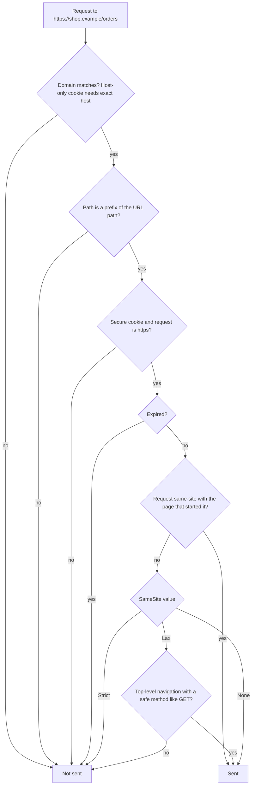

## 81.2 Session cookies done right: attributes, prefixes, scope and size

#### Concept

A cookie is a name and a value plus a set of **attributes** that tell the browser when to send it back. Part 44.2 listed the flags and the attack each blocks; Part 75.8 placed cookies among the other browser storage options. This section is the browser's side of the rules: exactly when a browser attaches a cookie, which attribute combinations it refuses, how prefixes make some mistakes impossible, and why a cookie that is 200 bytes too big can take a site down.

A **session cookie done right** for a first-party web app looks like this:

```text
Set-Cookie: __Host-session=eyJhbGciOi...; Path=/; Secure; HttpOnly; SameSite=Lax; Max-Age=840
```

Every part of that line is a decision: the `__Host-` prefix, no `Domain` attribute, `Path=/`, `Secure`, `HttpOnly`, `SameSite=Lax`, and a lifetime slightly shorter than the token inside it.

#### Why does it exist?

Cookies are older than most of the web's security model. Their defaults were designed for convenience in 1994: sent on every request to the domain, from any page, over any scheme, readable by any script. Every attribute added since then (`Secure` and `HttpOnly` early on, `SameSite` in 2016, prefixes in 2016, `Partitioned` in 2023) is an opt-in to a safer behaviour. Getting a session cookie right means opting into all the safe behaviours your app can tolerate, because the browser will not do it for you consistently: Chrome treats a cookie without `SameSite` as `Lax`, but Firefox and Safari do not, so the same `Set-Cookie` line behaves differently across browsers unless you are explicit.

#### Mental model

Imagine a wristband at a music festival. The band's colour says which areas you may enter (`Path`, `Domain`), the "staff only, cannot be removed" clasp means nobody can slip it off your wrist (`HttpOnly`), it only works inside the fenced grounds (`Secure`), and the guards at each gate check whether you walked in from inside the festival or from the car park (`SameSite`). The prefix is a band printed by the festival itself, which a stall vendor inside the grounds cannot counterfeit.

#### How it works

When the browser builds a request, it decides for each stored cookie whether to attach it:



The attributes, one at a time:

1. **`Secure`**: sent only over HTTPS, and (in modern browsers) cannot be set by an `http://` page. Without it, any hop on an open Wi-Fi network sees the cookie on the first plain-HTTP request before the HSTS redirect.
2. **`HttpOnly`**: invisible to `document.cookie` and to the Cookie Store API. It is still sent with requests, which is the point.
3. **`SameSite`** compares the **site** of the request's target with the site of the page that initiated it. A *site* is the scheme plus the **registrable domain** (eTLD+1): `https://shop.example`, `https://api.shop.example` and `https://blog.shop.example` are all the same site; `https://shop.example` and `https://shop-payments.example` are not. The registrable domain comes from the **Public Suffix List**, which is why `alice.github.io` and `bob.github.io` are different sites. `Strict` sends only on same-site requests. `Lax` also sends on cross-site **top-level navigations** with safe methods (a user clicking a link from Gmail). `None` sends everywhere and requires `Secure`.
4. **`Domain`**: omit it and the cookie is **host-only**, sent to `shop.example` and nothing else. Set `Domain=shop.example` and it is sent to every subdomain too. Setting it widens scope; it never narrows it.
5. **`Path`**: the cookie is sent only to URLs under that path. Use it to keep a cookie off requests that do not need it (a refresh token scoped to `/api/auth`), not as a security boundary between pages on the same origin.
6. **`Max-Age` / `Expires`**: with neither, it is a "session cookie" deleted when the browser session ends, though "continue where you left off" in Chrome and Firefox restores those cookies too. Browsers following RFC 6265bis cap lifetimes at 400 days.
7. **Prefixes** are enforced by the browser at set time. A cookie named `__Secure-x` is rejected unless it has `Secure` and comes from HTTPS. A cookie named `__Host-x` is rejected unless it has `Secure`, `Path=/` and **no** `Domain`. That last rule means no subdomain can ever set or overwrite a `__Host-` cookie for your host, which closes the cookie-injection attacks that break naive CSRF tokens (81.6).
8. **`Partitioned`** (CHIPS) is for third-party contexts: an embedded widget's cookie is keyed by the top-level site, so the same widget on two sites gets two separate cookie jars. A first-party session cookie does not need it.

Size is the attribute nobody sets and everybody hits:

| Limit | Value | What happens past it |
|---|---|---|
| One cookie, name plus value | 4,096 bytes in all major browsers | The browser silently ignores the `Set-Cookie` |
| Cookies per domain | about 180 in Chrome, similar elsewhere | The oldest are evicted, possibly the session |
| Node.js total request header size | 16 KB by default (`--max-http-header-size`) | `431 Request Header Fields Too Large` |
| nginx `large_client_header_buffers` | 4 buffers of 8 KB by default | `400 Request Header Or Cookie Too Large` |
| Every request to the domain | Cookie bytes sent each time | Slower uploads on mobile, larger CDN logs |

A 15-minute RS256 access token with `sub`, `sid`, `roles`, `iss`, `aud`, `iat`, `exp` and a `kid` header is about 700 to 900 bytes. Add a list of 60 permission strings and it passes 3 KB. This is why the session cookie should carry identity and coarse roles only; fine-grained permissions come from `/v1/me` (81.5) or are checked on the server.

The recommended settings for this volume's stack:

| Cookie | Name | `Path` | `SameSite` | `HttpOnly` | Lifetime | Why |
|---|---|---|---|---|---|---|
| Access token (JWT) | `__Host-session` | `/` | `Lax` | Yes | 14 min (token lasts 15) | Sent on page loads and same-origin API calls; Lax keeps links from emails working |
| Refresh token (opaque) | `__Secure-refresh` | `/api/auth` | `Lax` | Yes | 14 days, rotated | Sent only to the refresh and logout handlers; `__Host-` is impossible because of `Path` |
| CSRF token | `__Host-csrf` | `/` | `Strict` | No (the page must read it) | Same as session | Signed double-submit (81.6) |
| A/B bucket, consent | plain names | `/` | `Lax` | No | Months | Not credentials; still `Secure` |

Why `Lax` and not `Strict` for the session? With `Strict`, a user who clicks an order-shipped link in their email lands on `/orders/ord_42` **without** the cookie, because the navigation started on another site. The page renders as logged out; a reload (now same-site) suddenly shows them logged in. Users read that as a bug. `Lax` sends the cookie on that navigation, and the remaining CSRF exposure (top-level `GET`s) is closed by never changing state on `GET`. Banks and admin consoles often accept the `Strict` behaviour on purpose; a storefront usually should not.

#### Practical example

A retailer runs `shop.example` (Next.js), `api.shop.example` (NestJS), `blog.shop.example` (a hosted CMS run by a marketing agency) and `help.shop.example` (a SaaS help desk on a CNAME). With `Domain=shop.example` on the session cookie, every page view on the blog and the help desk carries the user's session to servers the retailer does not run. Their access logs, their analytics and any XSS on their pages now see a live credential.

With the BFF and `rewrites` (79.8), the browser only ever talks to `shop.example` for the app, so the session cookie can be host-only: `__Host-session`, no `Domain`. The blog and help desk never see it, and a compromised subdomain cannot overwrite it either.

#### React / Next.js example

One module owns every auth cookie, so names, paths and options cannot drift between the login action, the refresh handler, middleware and logout:

```ts
// apps/web/lib/auth-cookies.ts
import 'server-only';

export const SESSION_COOKIE = '__Host-session';
export const REFRESH_COOKIE = '__Secure-refresh';
export const REFRESH_PATH = '/api/auth';
const SKEW_SEC = 60;                                   // the cookie dies a minute before the JWT inside it

// Structural type: matches both cookies() in Route Handlers and Server Actions, and NextResponse.cookies.
type CookieJar = { set(name: string, value: string, options: Record<string, unknown>): unknown };
type Tokens = { accessToken: string; accessExpiresIn: number; refreshToken: string; refreshExpiresIn: number };

export function setAuthCookies(jar: CookieJar, t: Tokens): void {
  jar.set(SESSION_COOKIE, t.accessToken, {
    httpOnly: true, secure: true, sameSite: 'lax', path: '/',
    maxAge: Math.max(t.accessExpiresIn - SKEW_SEC, 0),
  });
  jar.set(REFRESH_COOKIE, t.refreshToken, {
    httpOnly: true, secure: true, sameSite: 'lax', path: REFRESH_PATH,
    maxAge: t.refreshExpiresIn,
  });
}

export function clearAuthCookies(jar: CookieJar): void {
  // Deleting means setting the same name, path and flags with Max-Age 0; a different Path creates a second cookie.
  jar.set(SESSION_COOKIE, '', { httpOnly: true, secure: true, sameSite: 'lax', path: '/', maxAge: 0 });
  jar.set(REFRESH_COOKIE, '', { httpOnly: true, secure: true, sameSite: 'lax', path: REFRESH_PATH, maxAge: 0 });
}
```

The `jar` parameter accepts both `cookies()` from `next/headers` (in Server Actions and Route Handlers, where it is writable) and `response.cookies` on a `NextResponse` (in middleware and Route Handlers). Server components cannot set cookies at all in the App Router, because the response headers have already been sent by the time they stream; that single fact shapes the refresh design in 81.3.

In local development over `http://localhost`, Chrome and Firefox treat `localhost` as a secure context and accept `Secure` and `__Host-` cookies; Safari historically did not. Run the dev server with HTTPS (`next dev --experimental-https` in Next.js 14 and later) so development matches production instead of adding an "if dev, drop Secure" branch that eventually ships.

#### Backend side (NestJS)

NestJS does not set browser cookies in this design (the BFF does, 81.10), but it reads them on proxied API calls and must handle them correctly:

```ts
// apps/api/src/main.ts  (excerpt)
import { NestFactory } from '@nestjs/core';
import type { NestExpressApplication } from '@nestjs/platform-express';
import cookieParser from 'cookie-parser';
import { AppModule } from './app.module';

async function bootstrap() {
  const app = await NestFactory.create<NestExpressApplication>(AppModule);
  app.use(cookieParser());                 // populates req.cookies for the JwtStrategy extractor (81.1)
  app.set('trust proxy', 1);               // exactly one hop: the Next.js tier or the load balancer (79.8)
  await app.listen(3000);
}
bootstrap();
```

And a guard rail that stops a growing token from silently breaking logins:

```ts
// apps/api/src/auth/token-size.ts
import { Logger } from '@nestjs/common';

const log = new Logger('TokenSize');
const WARN_BYTES = 2_048;                  // half the browser's 4 KB cookie limit
const FAIL_BYTES = 3_800;                  // leave room for the name and attributes

export function assertCookieSafe(token: string, userId: string): void {
  const bytes = Buffer.byteLength(token, 'utf8');
  if (bytes > FAIL_BYTES) throw new Error(`Access token too large for a cookie: ${bytes} bytes`);
  if (bytes > WARN_BYTES) log.warn({ userId, bytes }, 'access token approaching cookie size limit');
}
```

Call it from the token issuer, and add a unit test that issues a token for the user with the most roles in a production snapshot. Other API-side rules:

- **Never mutate on `GET`.** `SameSite=Lax` sends cookies on cross-site top-level `GET`s; `GET /v1/orders/42/cancel` would be CSRF-able (44.22).
- **Send `Cache-Control: private, no-store`** on every response that depends on the cookie, so a CDN never caches one user's page for another (81.9).
- **Do not set `Domain`** on any cookie unless you have written down which subdomains need it and who runs them.

#### Production scenario

A B2B ordering portal added fine-grained permissions to its JWT: one string per permission, such as `orders:approve:region:north`. Enterprise customers with many regions reached 140 permissions. Their access token grew to 5.1 KB. Chrome dropped the `Set-Cookie` silently, so those users logged in, were redirected to the dashboard, and arrived logged out. The redirect loop affected 0.4 % of users, all of them the largest accounts. Separately, users whose token was 3.9 KB hit nginx's 8 KB per-line header buffer once the analytics and consent cookies were added, and got `400 Request Header Or Cookie Too Large` on every page.

The fix took the permissions out of the token. The JWT carried `sub`, `sid`, `tenant` and two coarse roles (about 820 bytes); NestJS loaded permissions per request from Redis with a 60-second local cache (about 0.3 ms on a hit). The token-size check above went into CI with a fixture of the largest real role set.

#### Failure scenario

At 16:05 a security researcher emailed: the retailer's session cookie was visible to `promo.shop.example`, a campaign microsite built by an agency on a third-party page builder. The page builder's analytics script logged full request headers for "debugging". The cookie had been set with `Domain=shop.example` two years earlier so that a now-retired `account.shop.example` could read it.

The response was a rotation and a design change. All sessions were revoked (the refresh-family revoke in 44.3 made that one SQL statement), the cookie was renamed to `__Host-session`, which the browser refuses to accept with a `Domain` attribute, and a CI check was added that fails if any `Set-Cookie` in the auth code contains `Domain=`. The rename itself mattered: an old `session` cookie with `Domain` and a new host-only `session` cookie can coexist in the browser, and which one the server reads first depends on ordering it does not control. A new name makes the old cookie irrelevant; the logout handler also clears the legacy name for one release.

#### Edge cases & failure modes

- **Two cookies with the same name** but different `Path` or `Domain` are both sent; servers usually read the first, which may be the stale one. Clear with exactly the same attributes you set.
- **The 400-day cap**: a "remember me for 2 years" cookie silently becomes 400 days in Chrome.
- **`SameSite=None` without `Secure`** is rejected outright by modern browsers.
- **Schemeful same-site**: `http://shop.example` and `https://shop.example` are different sites in modern browsers; a mixed-scheme redirect can strip `Lax` and `Strict` cookies.
- **Lax-allowing-unsafe**: Chrome sends cookies that have *no* `SameSite` attribute on top-level cross-site `POST`s for two minutes after they are set, to keep old single-sign-on flows working. Always set `SameSite` explicitly.
- **Redirect chains** that start on another site count as cross-site, so `Strict` cookies are withheld even on later same-site hops in the chain.
- **Third-party cookie blocking** in Safari and Firefox (and in Chrome for users who opt in) breaks any design where your session cookie must be sent from inside someone else's page; that is what `Partitioned` and the Storage Access API are for.
- **Cookies are per host, not per port**: `localhost:3000` and `localhost:4000` share cookies, which confuses local multi-app setups.

#### How a Senior Full-Stack Engineer thinks about this

The senior treats the `Set-Cookie` line as security-critical configuration with one owner and one module, never as something each handler writes by hand. They default to `__Host-`, host-only, `Path=/`, `Secure`, `HttpOnly`, explicit `SameSite`, and widen only with a written reason. They keep tokens small because cookie bytes are paid on every request and failure past 4 KB is silent. They choose `Lax` for storefronts and `Strict` for back-office tools, and they know exactly which user journeys each choice breaks: email links for `Strict`, nothing important for `Lax` as long as `GET` is safe.

#### Common mistakes

- **`Domain=example.com` "to be safe"**, which shares the session with every subdomain and every vendor on a CNAME.
- **Leaving `SameSite` unset** and relying on Chrome's default, which other browsers do not apply.
- **Clearing a cookie with a different `Path`** than it was set with, so logout appears to work and the old cookie stays.
- **Putting permissions or profile data in the JWT** until the cookie passes 4 KB.
- **Disabling `Secure` in development** with a flag that later ships to staging or production.
- **Expecting a server component to set a cookie**, which the App Router does not allow.

#### Interview questions

1. **What does the `__Host-` prefix guarantee?** Expected answer: the browser only accepts the cookie if it is `Secure`, has `Path=/` and no `Domain`, so it is host-only and no subdomain can set or overwrite it. Why it matters: it prevents cookie tossing and makes misconfiguration impossible. Follow-up: why can a refresh cookie scoped to `/api/auth` not use it? (`__Host-` requires `Path=/`; use `__Secure-`.)
2. **What is the difference between same-site and same-origin?** Expected answer: origin is scheme, host and port; site is scheme plus registrable domain. Subdomains are same-site but cross-origin. Follow-up: why does that matter for CSRF? (An attacker on a sibling subdomain is same-site, so `SameSite` does not stop them.)
3. **`Lax` or `Strict` for a storefront session cookie?** Expected answer: `Lax`, because `Strict` drops the cookie on navigations from other sites, such as email links; keep `GET` side-effect-free. `Strict` suits admin tools.
4. **A user logs in successfully but arrives logged out. What do you check?** Expected answer: the `Set-Cookie` in the Network panel (DevTools shows blocked cookies with a reason), cookie size over 4 KB, `Secure` on HTTP, prefix rule violations, `SameSite=None` without `Secure`, a redirect across schemes, or a second cookie with the same name.
5. **How do cookie sizes cause outages?** Expected answer: silent drop over 4 KB per cookie; server header limits (Node 16 KB, nginx 8 KB buffers) return 400 or 431 when the total grows.

#### Practical exercise

Build `lib/auth-cookies.ts` and a test page that sets each cookie.

Acceptance criteria:

- The Application panel shows `__Host-session` as host-only with `Path=/`, and `__Secure-refresh` with `Path=/api/auth`.
- A request from the browser to `/orders` carries only `__Host-session`; a request to `/api/auth/refresh` carries both.
- Trying to set `__Host-session` with `Domain=shop.example` is rejected by the browser (visible as a blocked cookie in DevTools).
- Logout removes both cookies, verified by an empty cookie list for the host.
- A unit test fails when an access token for the largest production role set exceeds 2 KB.
