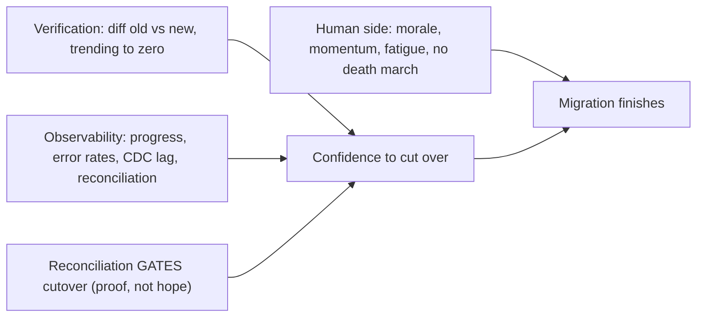

## 81.7 Worked example: PHP monolith on MySQL to NestJS services on PostgreSQL

This section brings the whole Part together in one eighteen-month migration: moving an order system from a PHP monolith on MySQL to NestJS services on PostgreSQL. It exercises every tool in this Part — run as a program, decomposed by data ownership, migrated with the right strategies, data moved with backfill + CDC + reconciliation, and the old system actually turned off. It also contains the incident story the outline asks for: the migration that silently lost 0.3% of refunds, and how reconciliation caught it.

#### The situation

OrderCo runs its whole order system as a PHP monolith on a single large MySQL database. It is 400,000 lines of PHP, deploys are scary, and the team wants to move to NestJS services on PostgreSQL to enable independent deploys, better tooling, and the type safety the rest of the company has. The migration is expected to take eighteen months. A principal engineer leads it. Here is how it runs, compressed.

#### Run as a program (81.2)

A single program owner (the principal) holds the whole thing. The inventory lists all 140 endpoints, 12 background jobs, 34 tables, and 43 external/internal callers. A dashboard shows completion (not volume) and the headline "legacy monolith: STILL RUNNING, scheduled deletion month 18". Milestones have dates. A weekly update goes to all stakeholders and the exec sponsor, with the countdown to deletion. This is what keeps the migration from stalling at 80%.

#### Strategy: strangler + parallel run (81.3)

The overall strategy is strangler: a routing facade (an Nginx/NestJS gateway) sits in front and routes each endpoint to either the PHP monolith or the new NestJS service, reversible per endpoint. For the money-critical parts — refund and payment calculations — a parallel run is layered on: the new service computes the result, the old monolith's result is served, and the two are diffed and logged until they match. For shared logic used by many internal callers, branch-by-abstraction.

#### Decomposition by data ownership (81.4)

The monolith's 34 tables are assigned to bounded contexts: orders, payments, inventory, notifications. The orders service is extracted first (the hard, pathfinding first service, three months) and becomes the sole owner of the order tables. Temporary shared-database bridges (the orders service reading the products and users tables directly) are created with end dates. Every other reader of the order tables is cut over to the orders service API. The data-ownership map governs this.

#### Data migration: backfill + CDC + reconciliation (81.5)

Order data moves from MySQL to PostgreSQL: a batched, idempotent, throttled backfill of the historical rows (several days), CDC via Debezium reading the MySQL binlog streaming ongoing changes to PostgreSQL during the backfill, and reconciliation (row counts, value checksums, field-level sampling) gating every cutover. This is where the incident happens.

#### The incident: 0.3% of refunds silently lost

```markdown
# Incident retro (blameless): refund data divergence caught by reconciliation

## What happened
During the refunds cutover prep, the reconciliation report showed row counts
matching between MySQL and PostgreSQL, but the VALUE CHECKSUM over refund
amounts was off — PostgreSQL's total was lower than MySQL's by an amount that
worked out to ~0.3% of refunds being wrong or missing.

## Why (root cause)
The refund sync used application-level DUAL WRITES during an early phase of
the migration (before CDC was in place for that table). About 0.3% of the
time, the write to PostgreSQL failed (a transient timeout) after the MySQL
write succeeded, and the error handler just logged and continued. Each
failure was one refund that existed in MySQL but not PostgreSQL — a silent,
gradual divergence (the classic dual-write problem, Part 79.4).

## How it was caught
The value-checksum reconciliation check. Row counts ALONE would have missed
it in some cases, and even where counts differed, it was the checksum that
quantified the money impact and flagged it as critical. This is exactly why
we reconcile on value, not just count (54.5).

## Why it did NOT become a customer incident
Because reconciliation GATES cutover. We had not cut refunds over to
PostgreSQL yet — MySQL was still the served source of truth. The divergence
was caught in a report, affecting ZERO customers.

## Fix
1. Replaced the refund dual-writes with CDC (captures every committed change
   from the binlog; cannot miss a committed write).
2. Backfilled the missing 0.3% of refunds from MySQL into PostgreSQL.
3. Re-ran reconciliation until the value checksum matched to the cent.
4. Only then cut refunds over.

## Lesson
Dual writes silently diverge; reconciliation on VALUE (not just count) is what
stands between a silent data-loss migration and a safe one. Had we cut over on
test confidence or row-count-only reconciliation, 0.3% of refunds would have
shipped wrong to production — a financial incident requiring mass corrections.
```

This is the migration that "silently lost 0.3% of refunds" — except reconciliation caught it before cutover, so it lost nothing that reached a customer. The difference between a catastrophe and a non-event was a single reconciliation check on value rather than count, run as a gate before cutover. That is the entire lesson of 81.5 made concrete.

#### Turning the monolith off (81.6)

With all contexts extracted and data migrated, the final act: usage telemetry shows the remaining callers of the PHP monolith declining to 7, then to 2 orphans. Deprecation notices go out. Two brownouts flush out the laggards. The orphaned callers are escalated with the deletion date; one is claimed and migrated, one is turned off with a rollback ready and nobody screams. At month 18, on schedule, the PHP monolith is powered off and its code deleted. The migration is *done* — not 95% done, not "the monolith returns 410", but deleted. OrderCo now pays for one system, deploys independently per service, and has the type safety and tooling it wanted.

#### Why this migration succeeded

Trace it against the Part. It was run as a *program* with a single owner, a complete inventory, a completion-focused dashboard, and a relentless weekly cadence — so it never stalled. It used the right *strategy per component* — strangler for routing, parallel run for money math — so the blast radius always matched the stakes. It decomposed by *data ownership* with temporary, dated bridges — so it never became a distributed monolith. It moved data with *backfill + CDC + reconciliation* — so it never silently lost data, and the one divergence that occurred was caught in a report affecting zero customers. And it *actually turned the old system off* — telemetry, brownouts, orphan handling, a scheduled deletion date — so it delivered its full value instead of becoming the 80%-done-forever tax. Every one of those was a deliberate choice by the principal, and skipping any one of them is how the many migrations that stall or cause incidents go wrong.

#### Practical exercise

Plan a real or hypothetical platform migration end to end using every tool in this Part. Produce: the program setup (owner, inventory, completion-focused dashboard, cadence), the strategy choice per major component (justified by blast radius), the data-ownership decomposition plan, the data-migration plan (backfill + sync + multi-dimensional reconciliation), and the deprecation-and-deletion plan (telemetry, brownouts, orphan handling, deletion date). Define done as the old system deleted.

**Acceptance criteria:** the plan measures completion (old system running: yes/no) not volume; assigns different migration strategies to components by blast radius with parallel run for anything correctness-critical; decomposes by data ownership with time-boxed bridges; reconciles data on value (not just count) as a cutover gate; and ends with a scheduled deletion of the old system, with a plan for the orphaned last callers. A reader can see that this migration is designed to finish and to never silently lose data.

## 81.8 Migration verification, observability, and the human side

#### Concept

Two aspects of large migrations that determine success as much as the technical plan. **Migration verification and observability** is how you continuously prove the migration is working and catch problems early — comparison dashboards, diffing old versus new outputs, metrics that show the migration's health, and the reconciliation that gates each cutover (81.5). **The human side** is managing the people through a long migration — keeping morale up during the unglamorous grind, maintaining momentum when the migration competes with features, and handling the organisational fatigue that sets in during a multi-year effort. A migration that is technically sound but loses the people (burnout, lost momentum, fatigue) stalls as surely as one with a bad plan.

#### Why does it exist?

Imagine a migration running without verification — you cut over and *hope* the new system is correct, discovering problems only when customers complain. Or imagine a migration with no observability — you cannot tell whether it is healthy, how far along it is, or whether the new path is working under real traffic. Verification and observability exist because a migration touches live, important systems, and you must *know*, continuously and with evidence, that it is working — not hope, not assume, but prove via diffs, metrics, and reconciliation.

The human side exists because large migrations are long, unglamorous grinds that compete with exciting feature work for people's energy and attention over months or years. The engineers doing the migration can burn out on the tedium; the organisation can lose patience and momentum; fatigue sets in as the migration drags. A migration that ignores the human side loses the very people it depends on, and a demoralised team or a fatigued organisation stalls a technically-sound migration. The human side exists because migrations are run by people over a long time, and sustaining those people is as essential as the technical plan.

#### Mental model

For verification, imagine a parallel flight test of a new aircraft. You do not just build the new plane and put passengers on it; you fly it alongside proven conditions, instrument everything, and compare its behaviour to the expected, catching problems in telemetry before they endanger anyone. Migration verification is the parallel flight test: run the new system, instrument it, compare its outputs to the old (diffing), and prove it is correct via telemetry and reconciliation before you trust it with real traffic.

For the human side, imagine a long expedition — a months-long trek. The route (technical plan) matters, but so does keeping the team's morale up through the tedious middle stretches, maintaining momentum when energy flags, and managing the fatigue of a long journey. An expedition leader who only plans the route and ignores the team's morale finds the team exhausted and demoralised halfway, and the expedition stalls. A long migration is an expedition, and leading the people through it is as essential as the route.

#### How it works

**Verification and observability:**

```text
- Diffing old vs new: during parallel run (54.3), compare the two systems'
  outputs on the same inputs. Any diff is investigated. Catches correctness
  bugs (the 0.3% refunds, 54.7) before cutover, affecting zero customers.
- Comparison dashboards: show the diff rate over time. Trending to zero = the
  new system matches = confidence to cut over.
- Migration-health metrics: progress (completion, not volume — 54.1), error
  rates on the new path, latency comparison, CDC lag (54.5), reconciliation status.
- Reconciliation as a cutover GATE (54.5): data cutover requires reconciliation
  (multi-dimensional, value checksums) to pass. Proof, not hope.
- Canary observability: as you ramp (54.6), watch the new path's metrics at each
  step; a regression means roll back (kill switch) before going further.
```

The principle: you must be able to *prove*, continuously, that the migration is working — via diffs that trend to zero, metrics that show health, and reconciliation that gates cutover. A migration you cannot observe is a migration you cannot trust.

**The human side:**

```text
- Morale through the grind: the migration's unglamorous middle is where morale
  sags. Celebrate milestones (completion milestones, 54.2), rotate people through
  the tedious parts, and make the progress visible (the dashboard) so people see
  they're advancing.
- Momentum vs features: the migration constantly competes with feature work. The
  program owner (54.2) defends the migration's resourcing and keeps it visible
  (the cadence) so it isn't quietly deprioritised.
- Organisational fatigue: in a multi-year migration, patience wears thin ("are we
  STILL doing this?"). Combat it by showing progress against completion, delivering
  incremental value where possible, and holding the deletion date (54.1) as the
  visible finish line.
- Avoid the death march: a migration driven by overwork is unsustainable; pace it,
  and protect the team (Part 116.5).
```



#### Artifact example

A migration verification dashboard and a human-side health note — the artifacts that prove the migration works and keep the people with it.

```markdown
# Migration verification dashboard: order system (parallel run phase)

## Output diffing (old vs new, same inputs)
- Refund calculation: 0 diffs over last 7 days (was 0.3% — fixed, 54.7). READY.
- Order totals: 0 diffs. READY.
- Status transitions: 2 diffs/day — investigating (edge case in cancellations).
  NOT YET ready to cut over status handling.

## Data reconciliation (gates data cutover, 54.5)
- Row counts match. Value checksums match to the cent. 100k sample: 0 field diffs.
- CDC lag: 0.4s. DATA CUTOVER: CLEARED.

## New-path health (canary at 10%)
- Error rate: 0.02% (vs 0.02% old — equivalent). Latency: p99 better. HEALTHY.

## Progress (completion, not volume, 54.1)
- Legacy system: STILL RUNNING. Deletion: T-112 days. Callers remaining: 7.

---
# Human-side health note (for the program owner)
- Team morale: dipping — we're in the unglamorous middle. ACTION: celebrated the
  50% milestone publicly; rotating the two engineers off the tedious backfill
  verification next sprint.
- Momentum: a feature push threatened to pull 1 engineer off. Held the line
  (reframed: the migration enables the features). 
- Org fatigue: "are we still doing this?" surfaced in a review. ACTION: shared the
  deletion countdown and the incidents the migration has already prevented.
- Pace: sustainable, no death march. Watching for burnout on the 2 core engineers.
```

The dashboard's power is that it *proves* the migration is working — output diffs trending to zero (per sub-system, so you cut over each only when its diffs are zero), reconciliation gating data cutover, canary health — rather than hoping. And the human-side note treats morale, momentum, fatigue, and pace as first-class risks to actively manage, because a migration that loses its people stalls regardless of how good the verification looks. Together they address the two things beyond the technical plan that determine whether a long migration finishes: continuous proof that it works, and sustained people to carry it.

#### Real-world scenario

A principal engineer running a long migration treats verification and the human side as seriously as the technical plan. On verification: she runs output diffing throughout the parallel-run phase, cutting over each sub-system only when its diff rate reaches zero, and she gates every data cutover on multi-dimensional reconciliation — so she *proves* correctness rather than hoping, and the one real bug (a refund-calculation edge case) is caught in a diff affecting zero customers. On the human side: she notices morale dipping during the unglamorous middle, so she celebrates the completion milestones publicly and rotates engineers off the most tedious work; when a feature push threatens the migration's resourcing, she defends it by reframing it as what enables the features; and when organisational fatigue surfaces ("are we still doing this?"), she combats it by showing the deletion countdown and the incidents already prevented. The migration finishes on schedule, because it was both continuously proven correct and carried by a team whose morale and momentum she actively sustained. A peer running a comparable migration with a sound technical plan but no verification discipline (cutting over on hope) and no attention to the human side (letting morale and momentum erode) sees it stall — a correctness bug reaches production, and the demoralised, fatigued team loses momentum. The technical plans were comparable; the difference was verification and the human side, which determine whether a long migration actually finishes.

#### How a Senior Backend Engineer thinks about this

They treat verification as non-negotiable: they prove the migration is working continuously — via output diffing that must trend to zero before cutover, migration-health metrics, and reconciliation that gates every data cutover — because they know that a migration touches live important systems and must be *proven* correct, not hoped correct, and that the cost of a correctness bug reaching production (data corruption, a breach of trust) is far higher than the cost of the verification. They observe the migration thoroughly (progress by completion, error rates, CDC lag) because a migration they cannot see is a migration they cannot trust or steer.

They also treat the human side as a first-class risk, because they understand that a long migration is a grind carried by people over months or years, and that a demoralised team, lost momentum, or organisational fatigue will stall a technically-sound migration as surely as a bad plan. So they actively manage morale (celebrate milestones, rotate the tedious work), defend momentum (protect resourcing against feature pulls, keep the cadence), combat fatigue (show progress and the finish line), and avoid the death march (sustainable pace, protect the team). The senior engineer knows that finishing a large migration — the whole challenge of this Part — requires three things together: a sound plan, continuous proof it is working, and sustained people to carry it to completion, and that neglecting either of the latter two is how good plans still fail.

#### Common mistakes

- **Cutting over on hope** instead of proving correctness via diffing and reconciliation.
- **No output diffing during parallel run,** so correctness bugs reach production instead of being caught in a diff.
- **No migration observability,** so you cannot tell if it is healthy or how far along (by completion).
- **Ignoring team morale through the grind,** so the engineers burn out on the tedium and the migration stalls.
- **Not defending the migration's momentum,** letting it be quietly deprioritised for features.
- **Running a death march,** an unsustainable pace that burns out the team before the finish.

#### Interview questions

1. **How do you prove a migration is working, rather than hoping?**
   *Expected answer:* output diffing during parallel run (compare old vs new on the same inputs; cut over each sub-system only when its diff rate reaches zero), migration-health observability (progress by completion, error rates, latency comparison, CDC lag), and reconciliation that gates every data cutover (multi-dimensional, value checksums). A migration you cannot observe or verify is one you cannot trust. *Why it matters:* verification catches correctness bugs before they reach customers.

2. **Why is the human side as important as the technical plan in a large migration?**
   *Expected answer:* a long migration is an unglamorous grind carried by people over months or years, competing with exciting feature work; if morale erodes (burnout on tedium), momentum is lost (deprioritised for features), or organisational fatigue sets in ("are we still doing this?"), the migration stalls regardless of how sound the technical plan is. You must actively manage morale, momentum, fatigue, and pace. *Why it matters:* tests whether they see migrations as human efforts, not just technical ones.

3. **How do you sustain momentum and morale through the unglamorous middle of a multi-year migration?**
   *Expected answer:* celebrate completion milestones publicly, rotate people off the most tedious work, make progress visible (the completion dashboard), defend the migration's resourcing against feature pulls (reframe it as enabling features), combat organisational fatigue by showing the deletion countdown and the value already delivered (incidents prevented), and keep a sustainable pace (no death march). *Why it matters:* tests the human-leadership side of long migrations.

#### Practical exercise

For a migration you are planning or running, design its verification and observability: how you will diff old versus new outputs during parallel run, the migration-health metrics you will track, and how reconciliation will gate each cutover. Then write a human-side plan: how you will sustain morale through the grind, defend momentum against feature competition, combat organisational fatigue, and keep a sustainable pace.

**Acceptance criteria:** your verification proves correctness (output diffing that must trend to zero before cutover, reconciliation gating data cutover) rather than relying on hope; your observability covers progress by completion, new-path health, and sync lag; and your human-side plan actively manages morale (milestone celebration, rotating tedious work), momentum (defending resourcing), fatigue (showing progress and the finish line), and pace (no death march) — demonstrating that you treat finishing a migration as requiring a sound plan, continuous proof, and sustained people together.

## 81.9 A quick-reference for large migrations

A compact reference distilling the Part into the checks that matter most when you plan or run a large migration.

#### The migration checklist

```text
[ ] Am I measuring COMPLETION (is the old system still running?), not volume?
[ ] Is there a scheduled DELETION DATE for the old system, worked backward from?
[ ] Is it run as a PROGRAM — single owner, full inventory, dashboard, cadence?
[ ] Is the STRATEGY matched to blast radius per component? (Parallel run for
    correctness-critical; strangler for live systems; big bang only low-risk.)
[ ] For a monolith split: decomposed by DATA OWNERSHIP, with the shared-database
    phase time-boxed? (Else a distributed monolith.)
[ ] For data: backfill (idempotent, keyset) + CDC + RECONCILIATION on VALUE
    (not just row count), gating cutover?
[ ] Is there a KILL SWITCH and rollback point for every step? Blast radius controlled?
[ ] Am I PROVING it works (output diffing, reconciliation), not hoping?
[ ] Is the old system actually being TURNED OFF — telemetry, deprecation,
    brownouts, orphan handling — and DELETED (not just "returns 410")?
[ ] Am I managing the HUMAN side — morale, momentum, fatigue, sustainable pace?
```

#### The enduring principle

The whole Part reduces to one hard truth: **a migration delivers its value only at 100%, when the old system is off — so finishing, not starting, is the goal.** Large migrations fail by stalling at 80% done forever, as the easy work completes and the unglamorous, political last 20% gets deferred. Everything in this Part serves finishing: measure completion not volume, schedule the deletion date, run it as a program, match the strategy to blast radius, decompose by data ownership, prove correctness with reconciliation, control risk with kill switches, actually turn the old system off, and sustain the people through the grind. When you run a migration, hold the deletion of the old system as the definition of done, and relentlessly drive the last 20% that everyone wants to skip — because that is where migrations go to die, and finishing them is where a principal earns their keep.

Return to this reference when planning or running a large migration; the reasoning behind each line is in the sections above.

## Senior Checklist — Part 81

- [ ] I understand the concept
- [ ] I can explain it simply
- [ ] I can implement it
- [ ] I understand its failure modes
- [ ] I understand its scaling limitations
- [ ] I understand its security implications
- [ ] I understand its operational implications
- [ ] I can choose between alternatives
- [ ] I can explain the tradeoffs
- [ ] I can answer senior-level interview questions
- [ ] I understand why migrations stall at 80% and I measure completion (old system off), not volume
- [ ] I run a large migration as a program: single owner, full inventory, dashboard, cadence
- [ ] I choose the migration strategy per component by blast radius and reversibility, and mix strategies
- [ ] I use parallel run for correctness-critical migrations rather than trusting test confidence
- [ ] I decompose monoliths by data ownership and never leave a permanent shared-database phase
- [ ] I migrate data with backfill + CDC + multi-dimensional reconciliation, and reconcile on value, not just count
- [ ] I keep a kill switch and rollback point for every migration step
- [ ] I control blast radius with gradual ramps and per-tenant/per-region rollout
- [ ] I use telemetry, deprecation notices and brownouts to actually turn the old system off
- [ ] I define done as the old system deleted, and I schedule its deletion date early

## Part 81 — Key Takeaways

- Large migrations fail by stalling at 80% done forever, not by exploding; the easy 80% completes fast and the hard, political, unglamorous last 20% gets deferred, leaving two systems running permanently — full cost, no benefit.
- A migration delivers its value only at 100%, when the old system is off; measure completion (is the old system still running) not volume, and schedule the deletion date early to force the last 20%.
- Run a large migration as a program: a single accountable owner, a complete inventory, dated milestones, a live dashboard, and a relentless communication cadence — the technical plan is rarely what fails.
- Choose the migration strategy per component by blast radius and reversibility — big bang only for low-risk reversible cases, strangler for live systems, parallel run for correctness-critical ones, branch-by-abstraction for shared components — and mix them in one migration.
- Monolith decomposition is a data problem, not a code problem; split data ownership so each service owns its tables, and never let the temporary shared-database phase become permanent, or you build a distributed monolith that is worse than the original.
- Migrate data at scale with a batched idempotent backfill plus CDC for ongoing changes plus reconciliation to prove correctness; reconcile on value (checksums), not just row counts, especially for money.
- Dual writes silently diverge; prefer CDC, and use reconciliation as the backstop that catches divergence before cutover, affecting zero customers instead of becoming a data-loss incident.
- Keep a kill switch and a rollback point for every step, control blast radius with gradual ramps and per-tenant/per-region rollout, and never take a step you cannot undo.
- Actually turn the old system off: instrument usage telemetry from the start to find the real callers, use deprecation notices and escalating brownouts to evict them, and handle orphaned last callers with escalation and a rollback-ready shutdown.
- Define done as the old system deleted and the code gone, never as "mostly migrated" or "returns 410", because a system still running is still the 80%-done-forever tax in disguise.
- Resist the big-bang temptation that platform migrations (database engine, cloud, framework) create; their company-wide blast radius demands gradual, reversible strategies, not a confidence-based cutover.
