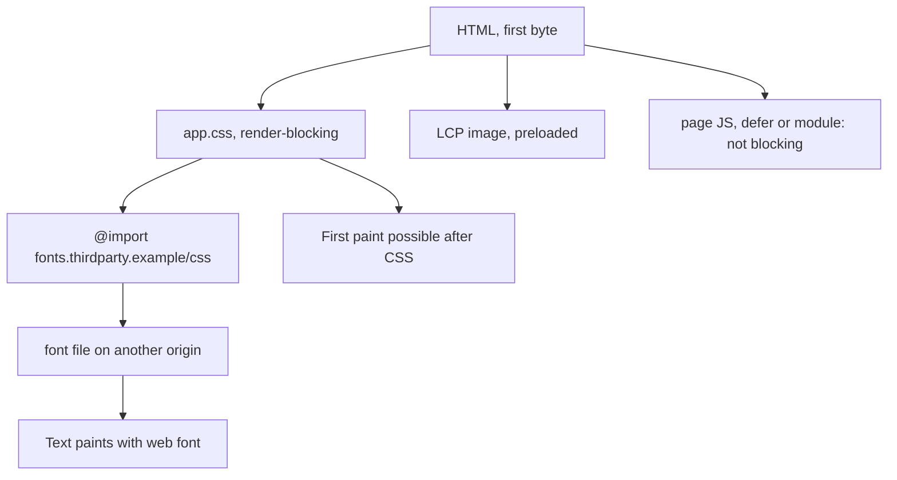

## 82.5 CLS in the field: shifts the lab never sees

#### Concept

Part 75.5 explained what a layout shift is, how each shift is scored (impact fraction multiplied by distance fraction) and how CLS takes the worst **session window** of shifts. It fixed the classic load-time causes: images without dimensions, late fonts, and banners inserted above content. This section is about the gap between lab CLS and field CLS. A Lighthouse run sees only the first few seconds of one page load with no scrolling, no clicks and no consent banner decisions. Real users scroll, open drawers, wait for recommendations, return with the back button, and keep tabs open for an hour. Field CLS is usually higher than lab CLS, and the difference is where most remaining problems live.

#### Why does it exist?

Teams fix load-time shifts, see a lab CLS of 0.00, and stop. Meanwhile CrUX reports 0.18, because shifts happen after load: a "Customers also bought" row that arrives 3 s after the page and pushes the reviews down, an infinite list whose skeletons are shorter than the real cards, a toast that pushes the header, a sticky "Download our app" bar. Understanding *when* shifts happen and *which ones count* is how you close that gap.

#### Mental model

Imagine reading a newspaper while someone keeps sliding new clippings into the middle of the page. If you asked them to add something (you turned the page, clicked "show more"), you expect movement and do not mind. If they add it while you are reading, you lose your place. CLS counts only the unrequested slides, and only the worst burst of them.

#### How it works

1. Every visible element that changes its start position between frames creates a `layout-shift` entry.
2. A shift within **500 ms after a discrete user input** (click, tap, key press) has `hadRecentInput: true` and does not count. Expanding an accordion the user clicked is fine. Scrolling is not a discrete input, so content that loads *during* scroll and shifts the page counts.
3. Changes made with CSS `transform` (animations, slides) do not move layout positions and do not create shifts.
4. Shifts are grouped into session windows (gaps under 1 s, windows up to 5 s); CLS is the largest window's sum, over the whole time the page is open.
5. `web-vitals` reports CLS when the page is hidden, with attribution for the largest shift: `largestShiftTarget`, `largestShiftTime` and `loadState`.

Typical field-only causes, and where the fix belongs:

| Cause | When it happens | Fix | Owner |
|---|---|---|---|
| Late recommendation or promo row inserted above existing content | 1 to 5 s after load | Reserve the slot with a fixed `min-height`, or render below the fold, or stream it in a reserved `<Suspense>` fallback of the same height | Frontend and API (slot exists or not, known at render) |
| Skeleton shorter than real content in infinite lists | During scroll | Skeleton heights from the same layout as real cards; append below the viewport only | Frontend |
| Cookie consent or app banner pushing content | After load | Overlay with `position: fixed`, never push the document | Frontend, consent vendor config |
| Ads and third-party embeds resizing | Any time | Fixed-size containers per ad slot, `overflow: hidden` | Frontend, ad ops |
| Font swap with very different metrics | First second | `next/font` fallback adjustment, `size-adjust` (82.8) | Frontend |
| Content that depends on client-only data (cart count, login state) changing header height | After hydration | Same height in both states; server-render the session view (81.1) | Frontend and BFF |
| bfcache restore not available | Back navigation | Make pages bfcache-eligible (82.9); a restored page does not shift | Both |

#### Practical example

A product page has lab CLS 0.01 and field CLS p75 of 0.16 on mobile. Attribution: `largestShiftTarget: 'section.reviews'`, `largestShiftTime` around 2,900 ms, `loadState: 'complete'`. The reviews section moves down when a "Frequently bought together" block, fetched by a client component from `/api/bff/bundles/:productId`, renders above it. Most users have not scrolled yet, so the shift is "unexpected". The bundle block appears on 60% of products, so a fixed placeholder would leave a gap on the other 40%.

The fix comes from the API: the product response gains `hasBundles: boolean` (cheap to compute from the same query), the server renders a placeholder of the right height only when it is true, and the bundle content streams into it. Field CLS p75 drops to 0.03.

#### React / Next.js example

```tsx
// apps/web/app/p/[slug]/page.tsx  (excerpt, server component)
import { Suspense } from 'react';
import { BundlesSection, BundlesSkeleton } from './Bundles';

export default async function ProductPage({ params }: { params: { slug: string } }) {
  const product = await getProduct(params.slug);           // includes hasBundles
  return (
    <>
      <ProductHero product={product} />
      {product.hasBundles && (
        // Skeleton and real section share the same CSS min-height: no shift when content arrives.
        <Suspense fallback={<BundlesSkeleton />}>
          <BundlesSection productId={product.id} />         {/* async server component, streams in */}
        </Suspense>
      )}
      <Reviews productId={product.id} />
    </>
  );
}
```

Streaming the section from the server rather than fetching it after hydration has two benefits: the content often arrives before the user starts scrolling, and the reserved space is in the very first HTML, so no frame ever shows the page without it.

#### Backend side (NestJS)

The API can prevent most "will this block exist?" shifts by answering that question in the main response:

- Booleans or counts for optional sections (`hasBundles`, `reviewCount`, `promoSlot: 'none' | 'banner' | 'carousel'`), computed in the same query, so the server renders the right placeholder.
- Image and video dimensions in every media DTO (82.3, 75.5).
- Stable page sizes for lists (`limit` honoured exactly), so skeleton counts match.
- For personalised blocks served from a slower recommendation service, a **timeout with a known empty shape**: if recommendations are not ready in 150 ms, return `{ items: [], reason: 'timeout' }` and let the frontend collapse the slot before the first paint, rather than filling it 2 s later.

#### Production scenario

A news-style marketplace homepage had field CLS p75 of 0.24, lab 0.02. Grouping CLS attribution by `largestShiftTarget` showed three selectors responsible for 85% of poor scores: the main article list (pushed by a consent banner), the "Deals" row (pushed by a late sponsor strip) and the footer (irrelevant: it shifted on infinite scroll append while offscreen and contributed little). The team changed the consent banner to a fixed overlay and gave the sponsor strip a fixed 96 px slot returned by the API as `sponsorSlot: true | false`. Field CLS p75 fell to 0.06 within two weeks of RUM data.

#### Failure scenario

An "A/B test that won" turned into a CLS incident. The variant added a "Free delivery over ₹499" bar that the experimentation script inserted at the top of the page after it fetched the assignment, about 1.2 s after load. Conversion in the variant rose slightly in the first week, and the variant shipped to 100%. A month later, CrUX moved the site's mobile CLS to "needs improvement" and the SEO team raised an alarm. RUM attribution named the main content container, shifted by 40 px about 1.2 s after load on every page. The bar was moved into the server-rendered layout, with the experiment assignment made at the edge (79.9) so the HTML already contained the right variant.

#### Edge cases & failure modes

- **Shifts during scroll count**: scrolling is not a discrete input, so lazy content that resizes as it enters the viewport adds to CLS.
- **Long-lived tabs** accumulate windows; one bad shift an hour in can be the reported value.
- **Elements entering or leaving the DOM** do not shift by themselves; it is the *other* elements they push that shift.
- **`content-visibility: auto`** without `contain-intrinsic-size` can cause shifts when offscreen sections render with their real height.
- **Hydration mismatches** that re-render a different layout (79.10) shift content that the server rendered.

#### How a Senior Full-Stack Engineer thinks about this

A senior treats unreserved space as a bug with an owner. For every block that can appear, disappear or change size after the first paint, they ask: is its existence known at render time? If yes, render the slot on the server. If no, can the API make it known (a boolean, a count, a timeout with an empty answer)? If still no, put it below the fold or in an overlay. They look at field CLS attribution, not the lab number, and they include CLS in the review of every experiment, because client-side experiments are a common source of late shifts.

#### Common mistakes

- **Trusting lab CLS** and never looking at field attribution.
- **Skeletons that do not match** the real content's height.
- **Client-side A/B tests** that insert or swap above-the-fold content after load.
- **Pushing banners into the document** instead of using fixed overlays.
- **Collapsing an empty slot after the first paint** instead of deciding before it.

#### Interview questions

1. **Why is field CLS often worse than lab CLS?** Expected answer: lab captures only load with no interaction; field includes post-load shifts from late content, scrolling, banners, ads and long-lived tabs.
2. **Which shifts are excluded from CLS?** Expected answer: those within 500 ms of a discrete user input, and movement via `transform`. Follow-up: is scrolling an input for this purpose? (No.)
3. **How can an API prevent a layout shift?** Expected answer: tell the renderer in advance whether optional sections exist and how big media is; time out slow optional data with an empty, known shape.
4. **How would you find which element causes CLS for real users?** Expected answer: `web-vitals/attribution` `largestShiftTarget` and `largestShiftTime`, grouped across users.

#### Practical exercise

Close the lab-to-field gap on one page.

Acceptance criteria:

- RUM reports CLS with largest-shift target, time and load state; the top three targets by contribution are listed.
- For each, you identify whether its existence is known at render time and move the decision to the server or API where possible.
- Field CLS p75 on mobile is under 0.1 for the new build, and lab CLS remains under 0.05.

## 82.6 The critical rendering path: render-blocking resources and resource hints

#### Concept

The **critical rendering path** is the minimum set of work between receiving HTML and painting the first useful pixels: download the HTML, discover and download render-blocking CSS (and any synchronous scripts), build the DOM and CSSOM, lay out and paint. Part 75.1 walked through each stage, and 75.3 introduced `preconnect`, `preload`, `modulepreload`, `prefetch`, `fetchpriority` and 103 Early Hints. This section turns that knowledge into an optimisation process: find what blocks first render, shorten the chain, and use hints and speculation to start work before the browser would discover it.

Three numbers describe a critical path: how many **critical resources** there are, how many **bytes** they total, and how many **round trips** deep the longest dependency chain is. A page whose first paint needs HTML, one CSS file and one font has a path two round trips deep. A page whose CSS `@import`s a third-party font stylesheet, which references a font file on a fourth origin, is four or five round trips deep before the first text paints.

#### Why does it exist?

On mobile, round trips dominate. At 150 ms RTT, every additional level in the chain costs at least 150 ms, plus connection setup for new origins (one to three more RTTs). Bytes matter second: a 200 KB render-blocking CSS file on a 1.6 Mbps link takes about a second on its own. The critical path is where FCP and the render delay part of LCP come from, and it is fully under your control.

#### Mental model

Imagine assembling flat-pack furniture. The instructions (HTML) say "see booklet B" (CSS), which says "use bracket kit C, sold separately" (font from another origin). Each "see elsewhere" is a trip to the shop. Optimising the critical path means putting everything needed for step one in the first box, and phoning ahead for anything that must come from the shop.

#### How it works



The process a senior runs:

1. **List render-blocking requests.** Lighthouse's render-blocking insight and the Performance panel's network track mark them. In a Next.js App Router app, these are normally the route's CSS files (`/_next/static/css/*.css`) and anything added with `next/script` `beforeInteractive` or plain `<script>` tags in the head.
2. **Remove chains.** Replace CSS `@import` with direct `<link>` tags or bundling; self-host fonts so they come from the page's own origin (`next/font` does this); avoid CSS that is only discovered by JavaScript.
3. **Shrink what blocks.** Ship only the CSS the route uses. Next.js App Router splits CSS per route segment; large global stylesheets and CSS-in-JS libraries that inject at runtime defeat this. Use the DevTools **Coverage** panel to see unused bytes in each CSS file. For very small critical CSS, Next.js 15 added an experimental `inlineCss` option that inlines styles into the HTML instead of linking them; it removes a round trip but makes every HTML response bigger and the CSS uncacheable separately, so measure.
4. **Start critical work earlier.** `preconnect` to the one or two origins the first paint needs, `preload` late-discovered critical files (fonts used above the fold, the LCP image if it is not a plain ``), and `fetchpriority="high"` on the LCP image. Every hint has a cost: each preload competes for bandwidth with the HTML and CSS.
5. **Use server think time.** 103 Early Hints (75.3) let the CDN or server send `Link: rel=preload` and `rel=preconnect` headers while the HTML is still being rendered, so the CSS and font downloads overlap with TTFB. They help most on dynamic pages with long server time.
6. **Make the next page instant.** For the likely next navigation, fetch or render it ahead of time. Next.js `<Link>` already prefetches routes in the viewport in production builds (static routes fully, dynamic routes down to the nearest `loading.js` boundary). The browser's **Speculation Rules API** (Chromium 121+ for document rules and eagerness) can go further and **prerender** a whole page in a hidden tab, so the click shows it immediately.

| Technique | What it removes | Cost and risk |
|---|---|---|
| Self-host fonts (`next/font`) | 1 to 3 RTTs for a new origin plus the CSS hop | Build-time download; licence check |
| Remove CSS `@import` | One RTT per level | None |
| Per-route CSS, remove unused | Bytes before first paint | Discipline in shared components |
| `preconnect` | DNS, TCP, TLS for a known origin | Idle sockets if unused; keep to 2 or 3 |
| `preload` font or LCP image | Late discovery | Bandwidth competition; double download if attributes mismatch |
| 103 Early Hints | Overlaps downloads with server time | Needs CDN or proxy support for 1xx; only for resources common to the route |
| Speculation Rules prerender | Whole next navigation | Server load and analytics for pages never visited; must avoid side effects |

#### Practical example

A category page's first paint waits for HTML (TTFB 600 ms), `globals.css` (180 KB, of which Coverage shows 74% unused on this route), and a `@import` of a Google Fonts stylesheet that then fetches two font files from `fonts.gstatic.com`. FCP on Lighthouse mobile: 2.9 s. Changes: the font moves to `next/font/google` (self-hosted at build, preloaded, with fallback metrics), utility CSS is purged per route, and a hero banner's background image becomes an `` with `fetchpriority="high"`. The critical path drops from four round trips deep to two, render-blocking CSS from 180 KB to 38 KB, and FCP to 1.6 s.

#### React / Next.js example

Speculation rules for product pages from a listing page, inserted by a server component so they are in the HTML:

```tsx
// apps/web/app/c/[category]/SpeculationRules.tsx  (server component)
export function SpeculationRules() {
  const rules = {
    prerender: [{
      where: { and: [{ href_matches: '/p/*' }, { not: { selector_matches: '[data-no-prerender]' } }] },
      eagerness: 'moderate',          // starts on hover (about 200 ms) or pointerdown on mobile
    }],
  };
  return (
    <script
      type="speculationrules"
      // Static JSON, no user data: safe to inline. Browsers without support ignore the script type.
      dangerouslySetInnerHTML={{ __html: JSON.stringify(rules) }}
    />
  );
}
```

Two cautions. Next.js App Router's client-side navigations between its own routes do not use a prerendered document (the router does a soft navigation), so prerendering helps most for full-page navigations: links into the app from marketing pages, or apps that deliberately use plain anchors for product pages. And a strict CSP (81.7) must allow inline speculation rules, with a nonce or the `'inline-speculation-rules'` source keyword.

#### Backend side (NestJS)

Prerendering and prefetching create requests that no human has asked for yet. The backend must recognise them and stay safe:

```ts
// apps/api/src/common/speculative.middleware.ts
import { Injectable, NestMiddleware } from '@nestjs/common';
import type { Request, Response, NextFunction } from 'express';

@Injectable()
export class SpeculativeRequestMiddleware implements NestMiddleware {
  use(req: Request, res: Response, next: NextFunction) {
    // Chromium sends "Sec-Purpose: prefetch" or "prefetch;prerender" on speculative document requests.
    const purpose = req.header('sec-purpose') ?? '';
    res.locals.speculative = purpose.includes('prefetch');
    // Speculative requests must not count as product views or trigger rate-limit lockouts.
    next();
  }
}
```

- **GET must be safe.** A prerender of a URL that marks a notification as read or adds a product to "recently viewed" has done it without the user. Keep side effects in POSTs (Part 18.3).
- **Analytics** should count a prerendered page only when it activates. Client code can check `document.prerendering` and listen for `prerenderingchange`.
- **Capacity**: speculation multiplies HTML requests. A moderate-eagerness rule on a listing page with 24 products might add 5 to 15% more product-page renders; that is cheap with ISR and expensive with fully dynamic rendering.
- **Early Hints**: when the HTML is rendered by Next.js behind a CDN, the CDN is usually the right place to emit 103 responses, from `Link` headers it has seen on earlier responses. A NestJS server rendering HTML itself can call `res.writeEarlyHints()` (Node 18.11+), as 75.3 showed.

#### Production scenario

An online travel agency's search-results-to-hotel-page navigation had a p75 LCP of 2.7 s on the hotel page. Adding a `moderate` prerender rule for the first eight hotel links (selected by a CSS class the server added to the top results) made activated prerenders show LCP under 300 ms. About 38% of hotel page views became prerender activations. Server-side HTML renders rose 11%, and the team had to exclude prerenders from the "hotel viewed" event, which had briefly inflated the funnel. Net p75 LCP for the hotel page fell to 1.9 s.

#### Failure scenario

A team added `<link rel="preload">` for "everything important": three fonts, two hero images (desktop and mobile versions), the main CSS and four JavaScript chunks. Mobile LCP got *worse*, from 2.6 s to 3.1 s. The waterfall showed eleven high-priority requests competing for a 1.6 Mbps link during the first second, the desktop hero (400 KB) downloading on phones, and two fonts preloaded without `crossorigin`, so the browser fetched them twice (75.3). Removing all but the one font and the one responsive LCP image preload (generated by `next/image`) restored LCP to 2.4 s.

#### Edge cases & failure modes

- **Preload without use** shows a console warning after a few seconds; treat it as a bug.
- **Font preloads need `crossorigin`**, even for same-origin fonts, or the preloaded response is not reused.
- **Early Hints may be dropped** by load balancers or proxies that do not forward 1xx responses.
- **Prerender of authenticated pages**: the prerender runs with the user's cookies; any page that should not render speculatively (checkout, payment) must be excluded with a selector or `href` rule.
- **Speculation on metered connections**: Chrome limits speculation when Data Saver or battery saver is on; do not depend on it for correctness.
- **CSS in JavaScript** that injects styles at runtime moves style work onto the main thread and can delay first paint until hydration.

#### How a Senior Full-Stack Engineer thinks about this

A senior counts round trips before bytes. They draw the dependency chain for the first paint and the LCP element and ask why each link exists. They are stingy with hints: one `preconnect` per truly critical origin, one image with high priority, preloads only for things the preload scanner cannot see. They see speculation as a capacity decision as much as a frontend one, and they talk to the backend owner before turning on prerendering for dynamic pages.

#### Common mistakes

- **Preloading many resources**, which reorders priorities in the wrong direction.
- **Loading fonts from third-party CSS** with `@import`.
- **One global stylesheet** for every route, mostly unused.
- **Prerendering pages with side effects on GET**.
- **Assuming Early Hints work** without checking with `curl -v` through the real CDN.

#### Interview questions

1. **What makes a resource render-blocking?** Expected answer: stylesheets in the head (for matching media) and classic synchronous scripts; `defer`, `async` and module scripts do not block rendering.
2. **How would you shorten a critical path four round trips deep?** Expected answer: remove `@import` chains, self-host fonts, preconnect or preload what cannot be discovered early, inline very small critical CSS.
3. **When would a `preload` make LCP worse?** Expected answer: when it competes with the LCP image or CSS for bandwidth, preloads the wrong variant, or mismatches attributes causing a double download.
4. **What are speculation rules and what must the backend do about them?** Expected answer: a browser API to prefetch or prerender likely next pages; the backend must keep GET safe, recognise `Sec-Purpose`, avoid counting speculative views, and plan capacity.
5. **Where should 103 Early Hints be generated in a Next.js plus CDN setup?** Expected answer: usually at the CDN or edge from known `Link` headers, since the hints must be sent before the origin finishes rendering and must survive every hop.

#### Practical exercise

Map and shorten the critical path for one route.

Acceptance criteria:

- A diagram shows every resource needed for first paint and for the LCP element, with the round-trip depth of each.
- Render-blocking CSS bytes and unused percentage (Coverage panel) are recorded before and after.
- At most two `preconnect` hints and one high-priority image remain, and no preload warnings appear in the console.
- If you add speculation rules, speculative product views are excluded from analytics and you have measured the change in server renders.
