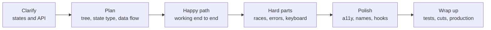

## 82.5 The UI machine-coding round

### 82.5.1 How to approach it

#### Concept

In a UI machine-coding round you build a small working feature in 60 to 90 minutes, in a browser-based editor, usually in React and TypeScript, with a mock API or a provided `fetch` endpoint. It is the frontend cousin of the low-level design round in Part 69 — Low-Level Design and Machine Coding: the problem is small enough to finish, and the grade is mostly about how you finish it.

#### Why does it exist?

Because it is the closest thing to a real ticket that fits in an hour. An interviewer learns more from watching you build a typeahead than from any question about hooks: do you get a working slice early, do you think of the user typing faster than the network, does the keyboard work, do you name things well, do you know when to stop.

#### Mental model

Imagine a carpenter's trial: build a small stool in an hour with someone else's tools. Nobody expects carving. They expect it to stand, to hold weight, to have no splinters, and to be built in a sensible order: legs and seat first, sanding last.

#### How it works

A time-boxed procedure for a 60-minute round:

| Minutes | Step | What you say or do |
|---|---|---|
| 0–5 | Clarify | Inputs, outputs, API shape, required states, keyboard and accessibility expectations, what "done" means, whether libraries are allowed |
| 5–8 | Plan out loud | The component tree, the state (and its type), the data flow, the one or two hard parts |
| 8–30 | Working slice | The happy path end to end, ugly but correct; render real data as early as possible |
| 30–45 | Hard parts | Races, cancellation, double submit, keyboard navigation, loading, empty and error states |
| 45–55 | Polish | Accessibility attributes, naming, extract a hook, remove dead code |
| 55–60 | Wrap up | What you would test, what you cut and why, what production would need |



What interviewers look for, roughly in this order: it works; state is modelled clearly (a discriminated union beats five booleans); async edge cases are handled; it is usable with a keyboard and a screen reader; the code is readable; you communicated throughout. Styling is almost never graded beyond "usable".

**A rubric you can practise against** (interviewers use something close to it; 89.5 explains how such rubrics are built):

| Dimension | Weak | Meets bar | Strong |
|---|---|---|---|
| Working software | Does not run, or only the first case | Main flow works | Main flow plus edge cases work, verified by trying them |
| State modelling | Many booleans that can contradict | Clear state, some duplication | Minimal state, derived values computed, impossible states unrepresentable |
| Async correctness | Races, no error handling | Errors shown, loading shown | Cancellation, latest-wins, double-submit guard, retries considered |
| Accessibility | Clickable divs, no labels | Semantic elements, labels | Keyboard support, ARIA where needed, live announcements, focus management |
| Code quality | One 200-line component | Reasonable components | Small hooks and components with good names, typed props |
| Communication | Silent, or talks without building | Explains decisions | Plans, narrates trade-offs, states what is cut and why |

#### How a Senior Full-Stack Engineer thinks about this

They get something on screen by minute 20, because a beautiful half-built architecture scores below an ugly working feature. They model state before writing JSX. They ask about the API because half of the hard problems (pagination, search limits, idempotency) are decided there. And they say out loud what production would add (tests, analytics, error tracking), which shows awareness without spending time on it.

#### Common mistakes

- Installing a state library or a form library before anything renders.
- Building the whole UI with hard-coded data and running out of time before the fetch.
- Ignoring the error path because the mock API never fails. Ask; or add a "fail" toggle to the mock yourself.
- Long silences. Narrate: "I am choosing a reducer here because there are four states with clear transitions."

### 82.5.2 Worked problem: typeahead search with debouncing and race handling

**The prompt.** "Build a product search box. As the user types, show up to 8 matching products from `GET /api/products/search?q=`. The user can pick one with the mouse or keyboard."

**Clarifying questions worth asking.** Minimum query length? (2 characters.) Debounce? (Yes, your choice.) Does the API support `limit`? (Yes.) What happens on error? (Show a message, keep typing working.) Is a screen reader user in scope? (Always say yes.)

**The hard parts.** Out-of-order responses ("ap" returning after "apple"), too many requests, keyboard navigation, and announcing results.

```tsx
import { useEffect, useId, useRef, useState } from 'react';

type Product = { id: string; name: string; priceMinor: number };
type SearchState =
  | { status: 'idle' }
  | { status: 'loading' }
  | { status: 'success'; items: Product[] }
  | { status: 'error' };

function useDebouncedValue<T>(value: T, delayMs: number): T {
  const [debounced, setDebounced] = useState(value);
  useEffect(() => {
    const timer = setTimeout(() => setDebounced(value), delayMs);
    return () => clearTimeout(timer);               // every keystroke cancels the previous timer
  }, [value, delayMs]);
  return debounced;
}

function useProductSearch(query: string): SearchState {
  const [state, setState] = useState<SearchState>({ status: 'idle' });
  const cache = useRef(new Map<string, Product[]>());

  useEffect(() => {
    if (query.length < 2) { setState({ status: 'idle' }); return; }
    const cached = cache.current.get(query);
    if (cached) { setState({ status: 'success', items: cached }); return; }

    const controller = new AbortController();
    setState({ status: 'loading' });
    fetch(`/api/products/search?q=${encodeURIComponent(query)}&limit=8`, { signal: controller.signal })
      .then(async (res) => {
        if (!res.ok) throw new Error(`HTTP ${res.status}`);
        const items = (await res.json()) as Product[];
        cache.current.set(query, items);
        setState({ status: 'success', items });
      })
      .catch((err: unknown) => {
        if (err instanceof DOMException && err.name === 'AbortError') return; // superseded, not a failure
        setState({ status: 'error' });
      });
    return () => controller.abort();                 // a newer query aborts the older request: latest wins
  }, [query]);

  return state;
}
```

The component handles the combobox pattern: the input owns focus, the highlighted option is announced through `aria-activedescendant`, and a live region reads out the result count.

```tsx
export function ProductSearch({ onSelect }: { onSelect: (p: Product) => void }) {
  const [text, setText] = useState('');
  const [open, setOpen] = useState(false);
  const [active, setActive] = useState(-1);
  const query = useDebouncedValue(text.trim().toLowerCase(), 250);
  const state = useProductSearch(query);
  const listId = useId();
  const items = state.status === 'success' ? state.items : [];

  useEffect(() => setActive(-1), [query]);           // a new result set starts with nothing highlighted

  function choose(p: Product) { onSelect(p); setText(p.name); setOpen(false); }

  function onKeyDown(e: React.KeyboardEvent<HTMLInputElement>) {
    if (e.key === 'ArrowDown') { e.preventDefault(); setOpen(true); setActive((i) => Math.min(i + 1, items.length - 1)); }
    else if (e.key === 'ArrowUp') { e.preventDefault(); setActive((i) => Math.max(i - 1, 0)); }
    else if (e.key === 'Enter' && active >= 0 && items[active]) { e.preventDefault(); choose(items[active]); }
    else if (e.key === 'Escape') { setOpen(false); }
  }

  const expanded = open && items.length > 0;
  return (
    <div className="search">
      <label htmlFor={`${listId}-input`}>Search products</label>
      <input
        id={`${listId}-input`}
        role="combobox"
        aria-autocomplete="list"
        aria-expanded={expanded}
        aria-controls={listId}
        aria-activedescendant={active >= 0 ? `${listId}-opt-${active}` : undefined}
        value={text}
        onChange={(e) => { setText(e.target.value); setOpen(true); }}
        onKeyDown={onKeyDown}
        onBlur={() => setOpen(false)}
      />
      {expanded && (
        <ul id={listId} role="listbox">
          {items.map((p, i) => (
            <li
              key={p.id}
              id={`${listId}-opt-${i}`}
              role="option"
              aria-selected={i === active}
              onMouseDown={(e) => e.preventDefault()}  // keep focus in the input so blur does not close first
              onClick={() => choose(p)}
            >
              {p.name}
            </li>
          ))}
        </ul>
      )}
      <div aria-live="polite" className="visually-hidden">
        {state.status === 'loading' && 'Searching'}
        {state.status === 'success' && `${items.length} results`}
        {state.status === 'error' && 'Search failed. Keep typing to try again.'}
      </div>
    </div>
  );
}
```

**What interviewers look for.**

- **Race handling, explained.** Debounce reduces requests from about 10 per word to 1 or 2; `AbortController` plus the effect cleanup guarantees the screen only ever shows the latest query's results. A strong candidate says both are needed and why: debounce alone still allows a slow "ap" response to arrive after "apple".
- **State as a union**, not `isLoading`, `isError`, `data` booleans that can contradict.
- **The cache** turns backspacing into instant results. A strong candidate notes it is unbounded and would cap it (an LRU of 50 entries) or hand it to TanStack Query with `placeholderData` to keep the old list visible while loading.
- **Accessibility**: the WAI-ARIA combobox pattern, `onMouseDown` preventing blur, and the live region. Most candidates skip this; it is the cheapest way to stand out.
- **API awareness**: the `limit` parameter, trimming and lower-casing so "Apple " and "apple" share a cache entry, and asking whether the backend search is prefix-based or full-text (34.7).

**Follow-ups to expect.** "Highlight the matched text" (split the name on the query, wrap matches in `<mark>`, never inject HTML). "Results flicker while loading" (keep previous results with a dimmed style). "How would you test it?" (Testing Library with fake timers and MSW returning delayed responses out of order, 79.4, 79.5).

### 82.5.3 Worked problem: an infinite-scroll order list

**The prompt.** "Show the user's orders, newest first, loading 20 more when they reach the bottom. The API is `GET /api/orders?cursor=` returning `{ items, nextCursor }`."

**The hard parts.** Not loading the same page twice, stopping at the end, recovering from an error, not duplicating rows when new orders arrive between pages, and keeping the page usable for keyboard users who cannot "scroll to the bottom".

```tsx
import { useCallback, useEffect, useRef, useState } from 'react';

type Order = { id: string; placedAt: string; totalMinor: number; status: string };
type Page = { items: Order[]; nextCursor: string | null };

function useOrderPages() {
  const [items, setItems] = useState<Order[]>([]);
  const [cursor, setCursor] = useState<string | null>(null);
  const [done, setDone] = useState(false);
  const [status, setStatus] = useState<'idle' | 'loading' | 'error'>('idle');
  const inFlight = useRef(false);                  // a ref, because state updates are not visible until next render

  const loadMore = useCallback(async () => {
    if (inFlight.current || done) return;          // guard against the observer firing twice
    inFlight.current = true;
    setStatus('loading');
    try {
      const qs = cursor ? `?cursor=${encodeURIComponent(cursor)}` : '';
      const res = await fetch(`/api/orders${qs}`, { credentials: 'include' });
      if (!res.ok) throw new Error(`HTTP ${res.status}`);
      const page = (await res.json()) as Page;
      setItems((prev) => {
        const seen = new Set(prev.map((o) => o.id));
        return [...prev, ...page.items.filter((o) => !seen.has(o.id))]; // dedupe across page boundaries
      });
      setCursor(page.nextCursor);
      setDone(page.nextCursor === null);
      setStatus('idle');
    } catch {
      setStatus('error');
    } finally {
      inFlight.current = false;
    }
  }, [cursor, done]);

  return { items, status, done, loadMore };
}

function Sentinel({ onVisible, disabled }: { onVisible: () => void; disabled: boolean }) {
  const ref = useRef<HTMLDivElement>(null);
  useEffect(() => {
    const el = ref.current;
    if (!el || disabled) return;
    const observer = new IntersectionObserver(
      (entries) => { if (entries[0]?.isIntersecting) onVisible(); },
      { rootMargin: '600px 0px' },                 // start loading before the user reaches the end
    );
    observer.observe(el);                          // observe() reports the current state at once
    return () => observer.disconnect();
  }, [onVisible, disabled]);
  return <div ref={ref} aria-hidden="true" />;
}

export function OrderHistory() {
  const { items, status, done, loadMore } = useOrderPages();
  return (
    <section aria-labelledby="orders-heading">
      <h2 id="orders-heading">Your orders</h2>
      <ul aria-busy={status === 'loading'}>
        {items.map((o) => <li key={o.id}><OrderRow order={o} /></li>)}
      </ul>
      {status === 'error' && (
        <p role="alert">Could not load more orders. <button onClick={loadMore}>Try again</button></p>
      )}
      {!done && status !== 'error' && (
        <button onClick={loadMore} disabled={status === 'loading'}>
          {status === 'loading' ? 'Loading' : 'Load more orders'}
        </button>
      )}
      {done && items.length === 0 && <p>You have no orders yet.</p>}
      <Sentinel onVisible={loadMore} disabled={done || status !== 'idle'} />
    </section>
  );
}
```

**What interviewers look for.**

- **Cursor pagination, and why.** Offset pagination (`?page=3`) skips or repeats rows when new orders are inserted at the top between requests; a cursor ("orders older than this one") does not, and it is cheaper for the database at depth (15.5, 18.4.1). A strong full-stack candidate says what the cursor encodes (`placed_at` plus `id`, to break ties) and that the index must match.
- **The in-flight guard** in a ref, because two observer callbacks in the same frame would both see the old `status`.
- **The re-observe detail.** When a short page leaves the sentinel still visible, the observer will not fire again by itself. Because `loadMore` changes identity when the cursor changes and `disabled` flips back to `false`, the effect reconnects, and `observe()` reports the current intersection immediately, loading the next page. Candidates who notice this impress.
- **A real button.** Infinite scroll alone traps keyboard users and makes the footer unreachable. The "Load more" button doubles as the retry path.
- **Scale.** Past a few hundred rich rows, the DOM itself becomes slow; mention virtualisation (73.9) and that `useInfiniteQuery` (74.7) gives caching, retries and refetch for free in production code.

**Follow-ups to expect.** "Keep the scroll position when the user goes to an order and comes back" (cache pages in a query cache or `sessionStorage`, restore position after render). "New orders arrive live" (show a "2 new orders" button at the top rather than inserting rows that shift the page; CLS, 78.5).

### 82.5.4 Worked problem: a refund form with validation and double-submit protection

**The prompt.** "Build a refund request form: order, amount, reason, and details. Details are required when the reason is 'other'. Submit to `POST /api/refunds`. Make sure a customer cannot accidentally create two refunds."

**The hard parts.** Validation timing that is helpful rather than noisy, mapping server errors to fields, and double-submit protection that survives a fast double click, a slow network and a retry.

```tsx
import { useRef, useState } from 'react';

type Reason = 'damaged' | 'not_received' | 'wrong_item' | 'other';
type Values = { amount: string; reason: Reason | ''; details: string };
type Errors = Partial<Record<keyof Values | 'form', string>>;

function validate(v: Values, maxMinor: number): Errors {
  const e: Errors = {};
  const minor = Math.round(Number(v.amount) * 100);
  if (!v.amount || Number.isNaN(minor) || minor <= 0) e.amount = 'Enter an amount greater than 0.';
  else if (minor > maxMinor) e.amount = `You can refund at most ${(maxMinor / 100).toFixed(2)}.`;
  if (!v.reason) e.reason = 'Choose a reason.';
  if (v.reason === 'other' && v.details.trim().length < 20) e.details = 'Tell us a little more (at least 20 characters).';
  return e;
}

export function RefundForm({ orderId, maxMinor, onDone }: { orderId: string; maxMinor: number; onDone: (id: string) => void }) {
  const [values, setValues] = useState<Values>({ amount: '', reason: '', details: '' });
  const [touched, setTouched] = useState<Partial<Record<keyof Values, boolean>>>({});
  const [errors, setErrors] = useState<Errors>({});
  const [submitting, setSubmitting] = useState(false);
  const submittingRef = useRef(false);                       // synchronous guard: state is not updated until re-render
  const idempotencyKey = useRef(crypto.randomUUID());        // one key per refund attempt, reused on retry

  const shown = (f: keyof Values) => (touched[f] ? errors[f] : undefined);
  function update<K extends keyof Values>(field: K, value: Values[K]) {
    const next = { ...values, [field]: value };
    setValues(next);
    setErrors(validate(next, maxMinor));
  }

  async function onSubmit(e: React.FormEvent<HTMLFormElement>) {
    e.preventDefault();
    const found = validate(values, maxMinor);
    setErrors(found);
    setTouched({ amount: true, reason: true, details: true });
    if (Object.keys(found).length > 0) {
      document.getElementById(`refund-${Object.keys(found)[0]}`)?.focus(); // move focus to the first problem
      return;
    }
    if (submittingRef.current) return;
    submittingRef.current = true;
    setSubmitting(true);
    try {
      const res = await fetch('/api/refunds', {
        method: 'POST',
        credentials: 'include',
        headers: { 'Content-Type': 'application/json', 'Idempotency-Key': idempotencyKey.current },
        body: JSON.stringify({ orderId, amountMinor: Math.round(Number(values.amount) * 100), reason: values.reason, details: values.details.trim() }),
      });
      if (res.status === 201 || res.status === 200) { onDone(((await res.json()) as { id: string }).id); return; }
      const problem = (await res.json().catch(() => ({}))) as { issues?: { path: string; message: string }[]; detail?: string };
      if (res.status === 422 && problem.issues?.length) {
        setErrors(Object.fromEntries(problem.issues.map((i) => [i.path === 'amountMinor' ? 'amount' : i.path, i.message])));
      } else {
        setErrors({ form: problem.detail ?? 'We could not submit your request. Please try again.' });
      }
    } catch {
      setErrors({ form: 'Network problem. Your request may not have been sent; trying again is safe.' });
    } finally {
      submittingRef.current = false;
      setSubmitting(false);
    }
  }

  return (
    <form onSubmit={onSubmit} noValidate aria-describedby={errors.form ? 'refund-form-error' : undefined}>
      {errors.form && <p id="refund-form-error" role="alert">{errors.form}</p>}
      <label htmlFor="refund-amount">Amount</label>
      <input id="refund-amount" inputMode="decimal" value={values.amount}
        aria-invalid={!!shown('amount')} aria-describedby={shown('amount') ? 'refund-amount-err' : undefined}
        onChange={(e) => update('amount', e.target.value)} onBlur={() => setTouched((t) => ({ ...t, amount: true }))} />
      {shown('amount') && <p id="refund-amount-err">{shown('amount')}</p>}
      {/* reason (a <select>) and details (a <textarea>) follow the same pattern */}
      <button type="submit" disabled={submitting}>{submitting ? 'Submitting' : 'Request refund'}</button>
    </form>
  );
}
```

**What interviewers look for.**

- **Three layers of double-submit protection**, each for a different failure: the disabled button (visual, but a second click can land before the re-render); the `submittingRef` guard (synchronous, stops a double click in the same frame); and the **idempotency key**, created once per attempt and sent on every retry, so even a retry after a timeout cannot create a second refund. Only the third one protects money; the server must store the key and return the first result for a repeat (15.12, 30.12, 71.8).
- **Validation timing**: errors appear after a field is touched or on submit, not while the user types their first character; focus moves to the first error; `aria-invalid` and `aria-describedby` connect messages to inputs.
- **Money as integer minor units** on the wire, never floats (76.7). A strong candidate notes `Math.round(Number('10.10') * 100)` is safe for two decimals but would parse with a decimal library or a string split in production, and that currencies differ in decimal places.
- **Server errors mapped to fields** using the problem-details `issues` array from the error contract (76.6), and an honest network-error message: the request may have succeeded, so retry with the same key.
- **Client validation is convenience.** The server checks the amount against the real order, and the shared zod schema (76.3) keeps both sides' rules identical.

**Follow-ups to expect.** "When do you reset the idempotency key?" (After success, or when the user changes the payload meaningfully, since a key reused with a different body should be rejected by the server.) "Use React Hook Form" (fine; show `register`, `handleSubmit`, `formState.isSubmitting` and `setError`, 73.7). "What if the user refreshes during submit?" (The server has the key; on reload, the order page shows the refund as pending.)

### 82.5.5 Worked problem: an order status stepper as a small state machine

**The prompt.** "Show an order's progress: placed, confirmed, packed, shipped, delivered. An order can be cancelled before it is packed. Updates arrive from a live stream. Show a Cancel button only when cancelling is allowed."

**The hard parts.** Modelling legal transitions, handling events that arrive late, duplicated or out of order, and not letting the UI's opinion override the server's truth.

```tsx
import { useReducer } from 'react';

type Status = 'placed' | 'confirmed' | 'packed' | 'shipped' | 'delivered' | 'cancelled';
const STEPS = ['placed', 'confirmed', 'packed', 'shipped', 'delivered'] as const;

const NEXT: Record<Status, readonly Status[]> = {
  placed: ['confirmed', 'cancelled'],
  confirmed: ['packed', 'cancelled'],
  packed: ['shipped'],
  shipped: ['delivered'],
  delivered: [],
  cancelled: [],
};
const canCancel = (s: Status) => NEXT[s].includes('cancelled');

type View = { status: Status; version: number; pendingCancel: boolean; notice?: string };
type Action =
  | { type: 'server_update'; status: Status; version: number }
  | { type: 'cancel_requested' }
  | { type: 'cancel_failed'; message: string };

function reducer(view: View, action: Action): View {
  switch (action.type) {
    case 'server_update': {
      if (action.version <= view.version) return view;              // duplicate or out-of-order event: ignore
      if (!NEXT[view.status].includes(action.status)) {
        console.warn('Skipped transition', view.status, '->', action.status); // we missed an event; the server wins
      }
      return { status: action.status, version: action.version, pendingCancel: false };
    }
    case 'cancel_requested':
      return canCancel(view.status) ? { ...view, pendingCancel: true, notice: undefined } : view;
    case 'cancel_failed':
      return { ...view, pendingCancel: false, notice: action.message };
  }
}

export function OrderStepper({ initial, onCancel }: { initial: { status: Status; version: number }; onCancel: () => Promise<void> }) {
  const [view, dispatch] = useReducer(reducer, { ...initial, pendingCancel: false });
  // In the real page, the SSE hook from 80.4 Q23 dispatches { type: 'server_update', ... } for each event.

  async function cancel() {
    dispatch({ type: 'cancel_requested' });
    try { await onCancel(); }                                       // the stream delivers the 'cancelled' update
    catch { dispatch({ type: 'cancel_failed', message: 'This order can no longer be cancelled.' }); }
  }

  if (view.status === 'cancelled') return <p role="status">This order was cancelled.</p>;
  const current = STEPS.indexOf(view.status as (typeof STEPS)[number]);
  return (
    <div>
      <ol className="stepper">
        {STEPS.map((step, i) => (
          <li key={step} data-state={i < current ? 'done' : i === current ? 'current' : 'todo'}
              aria-current={i === current ? 'step' : undefined}>
            {step}
          </li>
        ))}
      </ol>
      {canCancel(view.status) && (
        <button onClick={cancel} disabled={view.pendingCancel}>{view.pendingCancel ? 'Cancelling' : 'Cancel order'}</button>
      )}
      {view.notice && <p role="alert">{view.notice}</p>}
    </div>
  );
}
```

**What interviewers look for.**

- **An explicit transition table** instead of scattered `if` statements. The same table drives which buttons appear, so the UI cannot offer an action the domain forbids. It mirrors the backend's status machine (81.3), ideally generated from the same contracts package.
- **Versions, not timestamps, for ordering.** Events can arrive twice (at-least-once delivery) or out of order after a reconnect; a monotonically increasing version from the server makes the reducer idempotent (35.10.1).
- **The server is the authority.** If the client missed "packed" and receives "shipped", it does not reject the update for being an illegal transition; it logs the gap and shows the truth. The table is for affordances, not for vetoing the source of record. This is the point most candidates miss.
- **Pending state for the cancel** without pretending it succeeded: the button is disabled, and the real `cancelled` state arrives from the stream. If the order was packed a second ago, the API returns a 409 and the UI says so honestly.
- **Semantics**: an ordered list with `aria-current="step"`, and the cancelled state announced with `role="status"`.

**Follow-ups to expect.** "Make cancel optimistic" (set a provisional `cancelled` state with rollback on failure, and an idempotency key, 74.6). "Add an estimated delivery time" (comes from the server, formatted with `Intl.DateTimeFormat` in the user's time zone). "Test it" (the reducer is a pure function: unit-test every transition, duplicate and out-of-order case with Vitest, 79.2).
