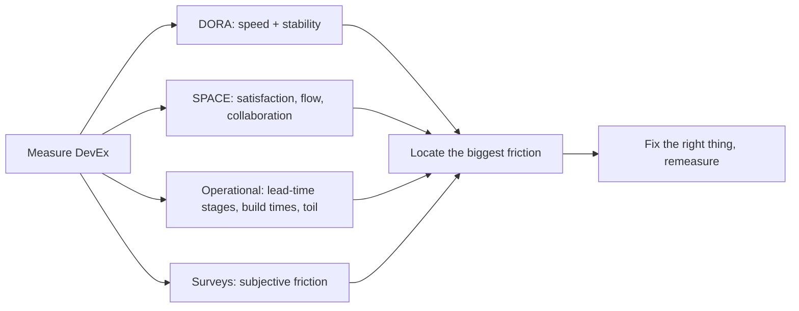

## 82.5 Measuring and improving developer experience

#### Concept

Developer experience (DevEx or DX) is how it feels, day to day, to build and ship software in your organisation — how long a change takes from idea to production, how long builds take, how often deploys fail, how much toil engineers endure, how satisfied they are. It is measurable, and measuring it well is how a principal engineer knows whether the platform and org design are actually helping. The key measurement frameworks are **DORA** (four delivery-performance metrics, from Part 89.8), **SPACE** (a broader, multi-dimensional view), plus concrete signals like **lead time**, **build times**, and **survey data**. The goal is to measure DevEx, find the biggest friction, and systematically remove it.

#### Why does it exist?

Imagine an org where leadership believes engineering is slow but has no idea why. Is it the architecture? The process? The tooling? Too many meetings? Without measurement, the debate is anecdote versus anecdote, and "fixes" are guesses — maybe they mandate more process (making it worse) or buy a tool nobody needed. Meanwhile the actual friction — say, a forty-minute build that engineers run twenty times a day — goes unidentified and unfixed because nobody measured it.

DevEx measurement exists to replace anecdote with data: to locate the actual friction so you can fix the right thing. DORA exists specifically to measure delivery performance in four well-validated numbers. SPACE exists because delivery performance alone misses important dimensions (satisfaction, collaboration). Surveys exist because some of the most important friction (frustration, cognitive load, unclear ownership) is subjective and only engineers can report it. Together they let you manage DevEx as a measurable property rather than a vibe.

#### Mental model

Imagine a factory manager who wants to speed up the production line but has no instruments — no stopwatch, no sensors, just a feeling that it is slow. They cannot improve it, because they cannot see where the bottleneck is; they might speed up a station that was never the problem while the real bottleneck (a jam at station 7) stays invisible. Now give them instruments: timers at each station, a counter of defects, a survey of the workers. Suddenly the bottleneck is obvious (station 7), and they fix the right thing. DevEx measurement is the factory's instruments. Without them, improving developer experience is guessing; with them, you can see the bottleneck and fix the station that is actually jammed.

#### How it works

**DORA — four delivery metrics (Part 89.8):**

```text
- Deployment frequency:    how often you deploy to production.
- Lead time for change:    from commit to running in production.
- Change failure rate:     % of deploys that cause a failure needing remediation.
- Time to restore service: how long to recover from a failure.
```

The first two measure speed; the last two measure stability. The DORA research shows elite teams are better at *both* — speed and stability are not a trade-off; good practices improve both together. DORA is the standard, well-validated starting point for measuring delivery performance.

**SPACE — five broader dimensions:** DORA measures delivery output, but DevEx is broader. SPACE adds dimensions:

- **S**atisfaction and well-being (are engineers happy, not burning out).
- **P**erformance (outcomes, not just output).
- **A**ctivity (volume of work, used carefully — activity is not value).
- **C**ommunication and collaboration (how well teams work together).
- **E**fficiency and flow (can engineers get into flow, or are they constantly interrupted and blocked).

SPACE exists because optimising DORA alone can miss burnout, bad collaboration, and interruption — an org can ship frequently while its engineers are miserable and its collaboration is broken. Measure across dimensions, not just delivery.

**Concrete operational signals:**

- **Lead time** broken into stages (code review wait, CI time, deploy wait) to find *where* the delay is.
- **Build / CI times** — a slow build is a tax paid on every change, many times a day.
- **Time to first meaningful change** for new engineers (onboarding effectiveness, Part 84).
- **Toil hours** — time spent on manual, repetitive operational work.

**Survey data.** Periodic developer surveys capture the subjective friction metrics cannot: "what is the most frustrating part of shipping here", "what wastes your time", "rate your satisfaction with the deploy process". Surveys find the friction that is real but not in any dashboard.



#### Practical example

A principal engineer wants to improve engineering velocity but, instead of guessing, measures. DORA shows deployment frequency is low and lead time is high. Breaking lead time into stages reveals the culprit: code review wait is a day on average, and CI time is forty minutes. A developer survey confirms it: the top frustration is "waiting for CI" and "waiting for review". Now the friction is located precisely. She addresses the two measured bottlenecks: parallelising and caching the CI pipeline to cut build time from forty minutes to eight, and establishing a review-SLA norm plus smaller PRs to cut review wait. Lead time drops dramatically, deployment frequency rises, and the next survey shows satisfaction up. The improvement worked because it was aimed at the measured friction (CI time and review wait), not at a guess. Had she guessed — say, mandated more process or bought a tool — she might have made it worse while the real bottlenecks persisted. Measure, locate, fix the right thing, remeasure.

#### Artifact example

A DevEx dashboard and the friction-prioritised improvement plan it drives — the artifacts that turn DevEx from a vibe into managed improvement.

```markdown
# DevEx dashboard (quarterly, per team + org-wide)

## DORA
Deployment frequency: 2/week (target: on-demand, multiple/day)
Lead time for change: 4 days (target: < 1 day)
Change failure rate: 12% (healthy, keep < 15%)
Time to restore: 45 min (healthy)
-> Speed is the problem, not stability.

## Lead-time breakdown (WHERE the 4 days go)
Code review wait:    1.1 days  <- biggest chunk
CI pipeline time:    40 min (run ~15x/day/eng = big cumulative tax) <- #2
Deploy wait:         0.3 days
Actual coding:       the rest
-> Review wait and CI time are the bottlenecks.

## SPACE / survey signals
Satisfaction with deploy process: 3.1/5 (low)
Top-reported frustration: "waiting for CI" (42% of respondents)
#2 frustration: "waiting for review" (31%)
Flow: 38% report being able to focus; frequent interruptions.

---

# DevEx improvement plan (friction-prioritised, from the data)
| Priority | Friction (measured) | Fix | Expected impact |
|---|---|---|---|
| 1 | CI = 40 min, run constantly | Parallelize + cache CI -> target 8 min | Big cumulative time saved |
| 2 | Review wait = 1.1 days | Review SLA norm + smaller-PR guidance | Lead time down ~1 day |
| 3 | Low flow (interruptions) | Protected focus time, fewer meetings | Flow + satisfaction up |
## Remeasure next quarter. If a fix didn't move its metric, it was the wrong fix.
```

The dashboard's value is that it does not just show DORA; it *breaks lead time into stages* to locate where the delay actually is, and it cross-references objective metrics with survey data so the friction is confirmed from two angles. The improvement plan is prioritised by measured friction and commits to remeasuring — so a fix that does not move its metric is recognised as the wrong fix. This is DevEx managed as an engineering problem: measure, locate, fix the right thing, verify.

#### Real-world scenario

A company's leadership is convinced its engineers are unproductive and considers introducing stricter process and productivity tracking (individual commit counts, lines of code). A principal engineer intervenes with measurement done right. He points out that activity metrics like commit counts measure the wrong thing (and, per SPACE, activity is not value and tracking individuals breeds gaming and fear). Instead he stands up a proper DevEx dashboard: DORA, lead-time breakdown, and a developer survey. The data tells a completely different story than leadership assumed — the engineers are not slow; they are *blocked*, spending huge fractions of their time waiting on a forty-minute CI pipeline and a slow review process, and on toil the platform should automate. The fix is not more process and surveillance (which would have made it worse); it is removing the measured friction. Six months later, with CI parallelised and the paved road absorbing the toil, delivery performance improves markedly — not because engineers were pushed harder but because they were unblocked. The measurement redirected the org from a harmful "the people are lazy" intervention to a correct "the system has friction" one. Measuring DevEx well does not just improve DevEx; it protects engineers from misdiagnoses that would have made everything worse.

#### Failure scenario

An org decides to measure developer productivity and picks the easiest-to-count metrics: individual commits per day, lines of code, pull requests closed. It makes these visible per engineer and uses them in performance reviews. The result is a textbook Goodhart's-law catastrophe: engineers optimise the metrics instead of the outcomes. They split one logical change into many small commits to inflate commit count, write verbose code to inflate lines, and open trivial PRs to inflate PR count. The metrics all go up; actual productivity goes *down*, because the incentives now reward activity over value and discourage the uncounted-but-valuable work (mentoring, deleting code, careful design, helping teammates). Collaboration suffers because helping a colleague does not show up in your numbers. Morale collapses because engineers feel surveilled and reduced to counters. The org measured activity (the thing SPACE warns against) at the individual level (the thing that breeds gaming and fear), and got exactly what it incentivised: inflated metrics and degraded reality. The failure was measuring the wrong things, at the wrong granularity, for the wrong purpose — the opposite of measuring system-level friction to help teams. DevEx measurement helps only when it measures outcomes and friction at the team/system level to improve the system, never activity at the individual level to judge people.

#### Edge cases & failure modes

- **Measuring activity instead of outcomes.** Commits and lines of code measure busyness, not value, and reward the wrong behaviour.
- **Measuring individuals instead of teams/systems.** Breeds gaming, fear, and degraded collaboration (Goodhart's law); DevEx is a system property.
- **DORA alone, ignoring SPACE dimensions.** An org can ship frequently while engineers burn out and collaboration breaks; measure satisfaction and flow too.
- **Measuring without breaking lead time into stages.** You see that it is slow but not *where*, so you cannot target the fix.
- **Not remeasuring after a fix.** You never learn whether the fix worked, so you keep investing in things that do not move the metric.
- **Using DevEx metrics as a stick.** The moment a metric judges people, it gets gamed and stops measuring reality (same as Part 113.6 on compliance).

#### How a Principal Engineer thinks about this

They treat developer experience as a measurable property to be managed, not a vibe to be argued about, and they measure it to *locate friction and fix the system*, never to judge individuals — because they know that individual activity metrics breed gaming and fear and degrade the very collaboration and uncounted work that makes teams effective. They start from DORA for delivery performance but insist on the broader SPACE dimensions, because they have seen orgs optimise delivery while their engineers burned out, and they know satisfaction and flow are as real as deploy frequency.

They always break lead time into stages, because "we are slow" is not actionable but "review wait is a day and CI is forty minutes" is, and they cross-reference objective metrics with survey data because some of the most important friction is subjective. And they close the loop by remeasuring after every fix, because a fix that does not move its metric was the wrong fix. Above all, they use DevEx measurement to protect engineers from the misdiagnosis that productivity problems are people problems — because the data almost always shows the problem is friction in the system, and the correct response is to remove the friction, not to push the people harder.

#### Common mistakes

- **Measuring activity (commits, LOC)** instead of outcomes and friction.
- **Measuring individuals** instead of teams and systems, breeding gaming and fear.
- **Using DORA alone** and missing burnout, flow, and collaboration.
- **Not breaking lead time into stages,** so the fix cannot be targeted.
- **Not remeasuring,** so you never learn whether a fix worked.

#### Interview questions

1. **How do you measure developer experience, and what do you measure it for?**
   *Expected answer:* use DORA (deployment frequency, lead time, change failure rate, time to restore) for delivery, SPACE dimensions (satisfaction, flow, collaboration) for the broader picture, operational signals (lead-time stages, build times, toil), and surveys for subjective friction — measured at the team/system level to locate and remove friction, never at the individual level to judge people. *Follow-up:* why break lead time into stages.

2. **Leadership wants to track individual commit counts to boost productivity. What's your response?**
   *Expected answer:* that measures activity not value, at the individual level, which triggers Goodhart's law — engineers game the metric (split commits, inflate LOC, trivial PRs) while real productivity drops and collaboration and uncounted valuable work suffer. Measure system-level friction and outcomes instead, to fix the system, not to judge people. *Why it matters:* tests understanding of measurement incentives, a critical principal judgement.

3. **Your DORA shows high lead time. How do you find and fix the cause?**
   *Expected answer:* break lead time into stages (review wait, CI time, deploy wait) to locate the bottleneck, confirm with survey data, fix the specific measured friction (e.g. parallelise CI, set review SLAs), then remeasure to verify the fix moved the metric. Do not guess at fixes. *Why it matters:* tests the measure-locate-fix-remeasure loop.

#### Practical exercise

Measure one aspect of your org's developer experience. Pick lead time for change, break it into stages (review wait, CI time, deploy wait, coding), and find which stage dominates. Cross-reference with a quick survey question ("what is the most frustrating part of shipping here"). Then propose the fix aimed at the measured biggest friction, and state the metric you would remeasure to verify it worked.

**Acceptance criteria:** you measure at the team/system level, not the individual level; you break the metric into stages to locate the actual bottleneck rather than just noting "it's slow"; your proposed fix targets the measured biggest friction; and you commit to a specific remeasurement that would tell you whether the fix worked.
