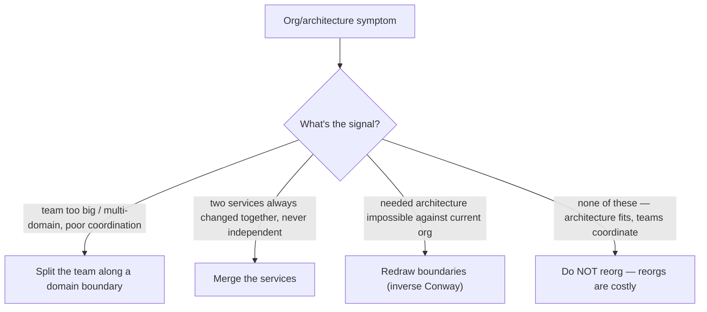

## 82.6 When to reorganise, and the architect's role in the org

#### Concept

Two topics that close the org-design toolkit. The first is knowing **when to split a team, merge services, or reorganise** — treating a reorg not as a disruptive political event but as a deliberate architectural change, because (per Conway's Law) changing the org changes the software. The second is the **architect's own role in the organisation**: whether architecture is **embedded** (architects sit within teams) or **central** (a separate architecture group), and the **player-coach** model where a principal engineer both does hands-on technical work and grows others, rather than drifting into a pure-advisory ivory tower.

#### Why does it exist?

Imagine a team that has grown to twenty-five people owning one sprawling service. Coordination within the team has become a nightmare — too many people, too many sub-areas, constant stepping on each other. Or imagine two tiny services, each owned by the same team, that are always changed together and never independently — the split between them buys nothing but overhead. Or imagine an org where the architecture no longer fits the business, and no amount of refactoring helps because the team boundaries are wrong. In each case, the right fix is an org change — split the overgrown team, merge the pointless services, redraw the boundaries — but orgs resist reorgs because they are disruptive and political, so these needed changes get deferred until the pain is severe.

The "when to reorganise" judgement exists to recognise these situations and treat the reorg as the architectural change it is. The architect's-role question exists because how architects are positioned in the org determines whether they stay connected to reality (embedded, hands-on) or drift into the ivory tower (central, advisory-only) — which Part 56 identified as the principal's main failure mode.

#### Mental model

For reorgs, imagine a growing tree that needs occasional pruning and training. A branch that has grown too heavy (an overgrown team) needs to be split so it does not break. Two branches that have grown into each other pointlessly (over-split services) might be better as one. And sometimes the whole tree is being trained against the wrong trellis (the org against the wrong architecture) and needs re-staking. Pruning is disruptive in the moment but essential for the tree's long-term health; avoiding it because it is disruptive lets the tree grow misshapen. A reorg is pruning: deliberate, occasionally necessary, painful in the moment, healthy over time — and, crucially, shaping the tree is shaping how it grows (Conway's Law).

For the architect's role, imagine a sports team's player-coach: someone who still plays in the games (stays sharp, earns respect, feels what the players feel) while also coaching (growing the others, setting strategy). Contrast the coach who stopped playing years ago and now only shouts from the sideline — increasingly out of touch with how the game is actually played. The player-coach architect keeps playing (shipping, taking on-call) so their coaching stays grounded.

#### How it works

**When to split a team:** a team has grown past the point where it can coordinate well (typically beyond 8-10 people, the two-pizza limit) or owns multiple distinct domains that could each be a team. Split along a domain/bounded-context boundary (Conway's Law: the split will become an architectural boundary, so split where you want a boundary).

**When to merge services:** two services are always deployed and changed together, never independently — the split between them buys only overhead (network calls, two pipelines) and no independence. Merging them (or back into a module) removes the overhead. This is the "services back to a monolith" direction from Part 109.2, which is entirely reasonable when the split was premature.

**When a reorg is the right architectural change:** when the architecture you need cannot be achieved against the current org (Conway's Law), the reorg *is* the architecture work. Redrawing team boundaries to match the target architecture (the inverse Conway maneuver, 82.1) is sometimes the only way to get the architecture you want.



The crucial judgement is also *when not to reorg*: reorgs are disruptive and costly (relationships reset, context is lost, momentum drops for a quarter), so they should be deliberate architectural decisions, not frequent or political. A reorg every six months is thrash, not design.

**The architect's role:**

- **Embedded architecture:** architects sit within and work alongside the teams. Pro: stays connected to reality, context-rich, trusted. Con: can lose the cross-cutting, org-wide view.
- **Central architecture:** a separate architecture group with the org-wide view. Pro: sees cross-cutting concerns. Con: the Part 56 ivory-tower risk — architects ruling on systems they do not operate, disconnected from reality.
- **The player-coach model:** the principal engineer both does hands-on technical work (ships the risky part, takes on-call, prototypes the design) *and* grows others and sets direction. This is the antidote to the ivory tower: by still playing, the architect keeps their judgement grounded and their credibility renewed (the Part 56 lesson that credibility at senior-plus levels is renewed by delivery, not past reputation).

The healthiest arrangement for most orgs is embedded or hybrid architecture with a strong player-coach norm: architects who are part of the teams, still ship, and spend a large fraction of their time growing others and connecting the cross-cutting dots — not a central board that decides from a distance.

#### Practical example

A principal engineer notices an ordering team has grown to eighteen people owning two distinct domains — ordering and promotions — with constant internal coordination pain. She recognises this as a split signal and reorganises it into two teams: an ordering team and a promotions team, split along the domain boundary. Per Conway's Law, this split will (and should) become an architectural boundary, so she pairs the team split with a service split along the same line. She does *not* reorganise the four other teams that are coordinating fine — reorgs are costly, and changing what is working is thrash. And throughout, she works as a player-coach: she personally ships the trickiest part of the ordering/promotions service split (the data-ownership separation, Part 114.4), takes on-call for the new promotions service during its first month, and coaches the newly-appointed promotions tech lead through their first cross-team design. Her hands stay dirty, so her architectural judgement stays grounded and her credibility with the teams stays current.

#### Artifact example

A reorg proposal framed as an architectural change, plus an architect-role definition — the artifacts that make a reorg deliberate and keep the architect out of the ivory tower.

```markdown
# Reorg proposal: split the ordering team (framed as architecture)

## The signal (why reorg, with evidence)
Ordering team = 18 people, owns ordering AND promotions (two distinct
domains). Internal coordination overhead is high: ~30% of standup is
cross-domain dependency management. The two domains change independently
~80% of the time (data shows). This is a team that should be two.

## The change (org AND architecture together — Conway's Law)
Split into: Ordering team (8) and Promotions team (7, +2 hires). Split the
service along the same boundary: extract a promotions service owning its
own promotions/coupon tables (data ownership per Part 114.4).

## Why this IS the architecture work
We cannot cleanly separate the promotions code from ordering while one team
owns both — the boundary erodes (Conway). Splitting the team is how we get
the service boundary. The reorg is the architecture decision.

## What we are NOT doing
Not touching the other 4 teams — they coordinate fine; reorging them would
be thrash. This is a targeted split, not a reorg-everything.

---

# Architect role definition (player-coach, anti-ivory-tower)
- Embedded: principal/staff engineers sit within teams, not a central board.
- Player: still ship the risky/exemplary parts, still take on-call, still
  prototype designs before proposing them. Credibility is renewed by
  delivery, not past reputation (Part 56).
- Coach: spend a large fraction of time growing engineers, connecting
  cross-cutting concerns, writing direction (Part 78).
- NOT: a central group that rules on systems it doesn't operate. If an
  architect hasn't shipped or taken a page in 6 months, that's a red flag.
```

The reorg proposal's power is that it frames the split as an *architectural* decision justified by data (two domains, 80% independent change, coordination overhead) and pairs the team split with the matching service split per Conway's Law — and it explicitly scopes the change narrowly (not reorg-everything) to avoid thrash. The architect-role definition encodes the player-coach model as a defence against the ivory tower, even flagging the warning sign (an architect who has not shipped or taken a page in six months). Both make the usually-political (reorgs, architect positioning) into deliberate, grounded design.

#### Real-world scenario

A principal engineer is offered a central-architecture role: a prestigious position on an architecture board, no team, no on-call, pure advisory. He declines the pure-advisory version and negotiates a player-coach arrangement instead: he will set direction and grow engineers (the coach part) but he will also stay embedded with a team, ship the risky parts of major initiatives, and take on-call (the player part). Colleagues are puzzled — why keep doing hands-on work at that level? Two years later the reason is obvious: his architectural proposals land, because they come from someone who still operates the systems and whose designs reflect current reality, not two-year-old assumptions. Meanwhile, a peer who took a pure central-architecture role has drifted into exactly the Part 56 failure — producing diagrams and strategies that teams politely ignore, because they come from someone disconnected from the code. The player-coach's hands-dirty discipline kept his judgement current and his credibility renewed; the pure architect's distance eroded both. The arrangement that looked less prestigious produced far more influence, because influence at that level flows from grounded credibility, not from a title on a board.

#### Failure scenario

An org reorganises constantly — a significant reorg every six months, driven by changing management priorities and politics rather than by architectural need. Each reorg resets team relationships, loses institutional context (people no longer own the thing they built), orphans services (as teams dissolve and reform), and drops momentum for a quarter while everyone finds their feet. Because the reorgs are frequent and not architecturally motivated, they do not produce a coherent architecture — per Conway's Law, the architecture is constantly being reshaped to match the churning org, so it never stabilises into anything clean; it is a permanent half-reorganised mess. Engineers become cynical ("why invest in owning this well, I'll own something else in six months"), ownership decays, and the accumulated orphaned services pile up. The org confused reorganising with progress, treating the reorg as a management tool rather than a deliberate, costly architectural decision used sparingly. Frequent, politically-driven reorgs are thrash: they pay the full cost of reorganising (reset relationships, lost context, dropped momentum, orphaned services) repeatedly while delivering none of the benefit, because no org structure survives long enough to shape a coherent architecture. Reorgs should be rare, deliberate, and architecturally motivated — the opposite of a routine management lever.

#### Edge cases & failure modes

- **Reorging too frequently.** Each reorg costs reset relationships, lost context, dropped momentum, and orphaned services; frequent reorgs are thrash, not design.
- **Reorging for political reasons,** not architectural need, producing a perpetually half-reorganised mess.
- **Splitting a team without splitting the service** (or vice versa), creating a mismatch Conway's Law will fight.
- **Not reorging when you should,** letting an overgrown team or a wrong boundary cause ongoing pain because reorgs feel too disruptive.
- **The pure-central architect** who rules from a distance and drifts into the ivory tower (Part 56).
- **The architect who stops shipping,** whose credibility and judgement erode until teams politely ignore them.

#### How a Principal Engineer thinks about this

They treat a reorg as a deliberate architectural change, used sparingly, because they understand via Conway's Law that changing the org changes the software — and they pair every team split with the matching service boundary, because a team split without the service split (or vice versa) creates a mismatch the law will fight. They know the signals (an overgrown multi-domain team, pointlessly-split services, an architecture unachievable against the current org) and they act on them, but they are equally disciplined about *not* reorging what works, because they have seen frequent political reorgs pay the full cost repeatedly while producing only thrash and orphaned services.

On their own role, they choose embedded, player-coach positioning over the pure-central ivory tower, and they guard their hands-dirty discipline fiercely — still shipping the risky parts, still taking on-call, still prototyping before proposing — because they have internalised the Part 56 lesson that credibility at this level is renewed by delivery, not by past reputation, and that an architect disconnected from the code produces designs teams ignore. The principal is a player-coach by conviction: they grow others and set direction, but they keep playing, because playing is what keeps the coaching grounded.

#### Common mistakes

- **Reorging too often,** paying the cost of reorganising repeatedly for no coherent-architecture benefit.
- **Reorging for politics** rather than architectural need.
- **Splitting a team without splitting the service,** creating a Conway mismatch.
- **Avoiding a needed reorg** because it feels disruptive, letting an overgrown team or wrong boundary cause ongoing pain.
- **Becoming a pure-advisory central architect** who stops shipping and drifts into the ivory tower.

#### Interview questions

1. **When should you split a team, merge services, or reorganise — and when should you not?**
   *Expected answer:* split a team when it has grown past good coordination or owns multiple distinct domains (split along a domain boundary, which becomes an architectural boundary per Conway); merge services that are always changed together and never independently; reorg when the needed architecture is unachievable against the current org (inverse Conway). Do NOT reorg what is working — reorgs are costly (reset relationships, lost context, dropped momentum, orphans), so they must be rare and architecturally motivated. *Follow-up:* why pair a team split with a service split.

2. **Why is frequent reorganising harmful even if each reorg seems reasonable?**
   *Expected answer:* each reorg pays the full cost (reset relationships, lost context, dropped momentum, orphaned services), and because no org structure survives long enough to shape a coherent architecture (Conway's Law), frequent reorgs produce a perpetually half-reorganised mess plus cynicism and decayed ownership. Reorgs should be rare, deliberate architectural decisions, not a routine management lever. *Why it matters:* tests understanding of reorg cost.

3. **What is the player-coach model for architects, and what failure does it prevent?**
   *Expected answer:* the architect both does hands-on technical work (ships the risky parts, takes on-call, prototypes) and grows others / sets direction, rather than being a pure-advisory central architect. It prevents the ivory-tower failure (Part 56) where an architect disconnected from the code produces designs teams ignore, because credibility at that level is renewed by delivery, not past reputation. *Why it matters:* tests self-awareness about the principal's main failure mode.

#### Practical exercise

Look at your org for a reorg signal: an overgrown multi-domain team that should split, two services that should merge, or an architecture unachievable against the current boundaries. Write a reorg proposal framed as an architectural change — the signal with evidence, the paired org-and-architecture change, and an explicit statement of what you are NOT changing (to avoid thrash). Separately, assess the architect role in your org: is it embedded/player-coach or central/advisory, and are the senior-plus engineers still shipping and taking on-call.

**Acceptance criteria:** your reorg proposal is justified by data (coordination overhead, independent-change frequency, or an unachievable architecture), pairs the team change with the matching service-boundary change per Conway's Law, and explicitly scopes itself narrowly; and your architect-role assessment identifies whether the senior engineers are grounded player-coaches or drifting toward the ivory tower, with the warning sign (not having shipped or taken a page recently) checked.
