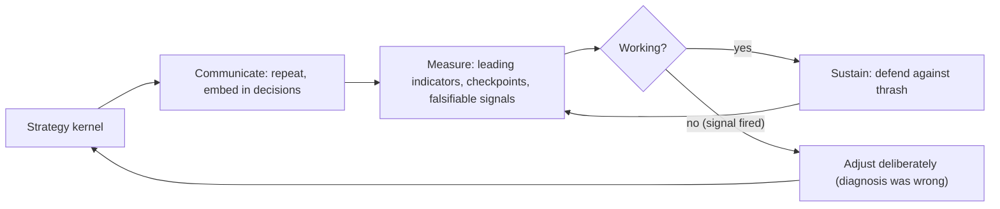
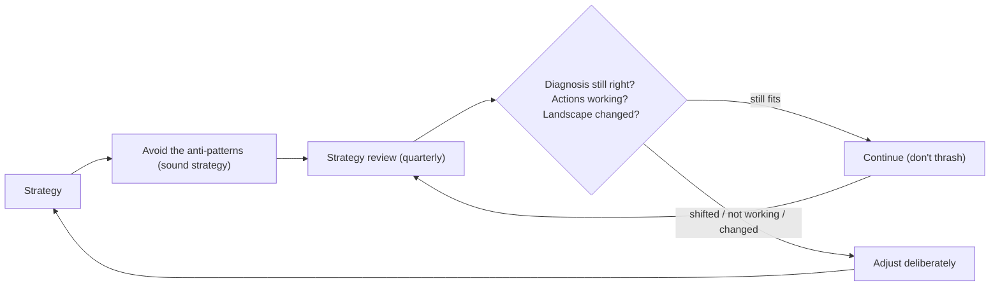

## 82.7 Worked example: strategy for scaling from 12 to 80 engineers

This section brings the whole Part together in one worked case: an e-commerce company growing from a single monolith with 12 engineers to 80 engineers over two years. It is the kind of situation where a principal engineer is asked for "a technical strategy", and it exercises every tool in this Part — the strategy kernel, the vision, the roadmap, debt as a portfolio, and the discipline to say no.

#### The situation

GreenCart sells groceries online. Today: 12 engineers, one NestJS monolith on one PostgreSQL database, deploying together a few times a week. It works. The company just raised money and will hire to 80 engineers over two years to expand into new cities and new product lines. The CTO asks the principal engineer: "what is our technical strategy for this growth?"

The naive answer is "microservices and Kubernetes", and it is wrong, because it is an action list with no diagnosis. Here is the real strategy.

#### The strategy kernel

```markdown
DIAGNOSIS:
A monolith with 12 engineers works because 12 people can coordinate one
deploy and one database. At 80 engineers, that same architecture means 80
people serialised behind one deploy pipeline and one schema. Lead time,
today ~1 week, would balloon toward a month, and the blast radius of each
deploy would become terrifying. The crux is NOT that the monolith is bad;
it is that SHARED, COORDINATED deploys and data do not scale with headcount.
We also lack the platform (templates, pipelines, observability standards)
that lets teams operate independently — today the 12 share tribal knowledge.

GUIDING POLICY:
Scale by reducing coordination, not by adopting fashionable architecture.
Give teams ownership of bounded contexts with their own data and deploys,
extracting services ONLY where coordination is the measured bottleneck.
Build the platform that makes independent operation cheap BEFORE extracting
widely. We will NOT do a big-bang rewrite, will NOT adopt microservices as
a goal, and will NOT add Kubernetes/Kafka/mesh unless a measured need
appears. The boring, staged path wins.

COHERENT ACTIONS:
1. Convert the monolith to an enforced modular monolith (clear module
   boundaries, own-your-tables rule, lint-enforced). Enables everything else.
2. Build the paved road: service template, CI/CD pipeline, observability
   and on-call standards. Makes independent operation cheap and repeatable.
3. Extract the 2-3 most coordination-bound contexts (payments, catalog,
   fulfilment) onto their own data and deploys, using the paved road.
These reinforce: #1 makes #3 safe, #2 makes #3 cheap and makes new teams
productive on day one.
```

#### The vision it serves

```markdown
# Vision 2026-2028: 15 teams shipping independently
In two years, GreenCart runs as ~15 stream-aligned teams, each owning a
bounded context end to end — its own data, deploys, and on-call — able to
ship multiple times a day without coordinating with another team, on a
paved road that makes a new service a day-one operation, not a quarter-long
setup.

## Business connection
- Expansion speed: new cities/product lines need teams that can move
  independently; coupled systems cap us at the speed of the slowest team.
- Hiring ROI: we will spend ~$20M on 68 new engineers over 2 years. Coupled
  architecture wastes that spend on coordination overhead; independent teams
  convert headcount into output.
- Reliability: blast radius per deploy shrinks from "the whole site" to "one
  context", protecting revenue as traffic grows.

## Measures
- Lead time: ~7 days -> under 1 day.
- Teams able to deploy independently: 1 -> 15.
- New-service setup time: ~1 quarter -> under 1 day (paved road).
- Change failure rate held under 15% while deploy frequency rises 10x.
```

#### The roadmap (abbreviated)

```markdown
Year 1
  Q1: Module boundaries enforced + CI split (action 1). Low risk, prereq.
  Q2: Paved road v1 — service template + pipeline (action 2). Early win.
  Q3: Extract payments (most coordination-bound). Front-loads extraction risk.
  Q4: Observability + on-call standards baked into the paved road.
Year 2
  Q1: Extract catalog. Cheap now — paved road exists.
  Q2: Extract fulfilment. New teams onboard onto the paved road directly.
  Q3-Q4: Remaining contexts split as teams grow into them; platform hardening.

Capacity: sized to effective headcount, ramping as hires land (12 -> ~40
by end of Y1 -> ~80 by end of Y2). Platform team formed first, in Q1.

Explicitly deferred: Kubernetes (revisit when deploy volume justifies the
ops cost; today ECS-style is enough), Kafka (one consumer today; ASSESS),
multi-region (no business driver yet), service mesh (no mesh-shaped
problems). All on the radar, none adopted without a measured trigger.
```

#### The debt portfolio angle

As GreenCart extracts services, it accumulates and pays debt deliberately. The "shared database" phase of extraction — where the new service still reads the old tables during transition — is *deliberate, prudent* debt, tracked with a payoff date (full data ownership by the end of each extraction quarter). The team resists the temptation to pay down cheap debt (the dual-ORM situation) and funds the high-interest debt (the tangled order module) as a named project before extracting fulfilment, because extracting a tangled module is far more expensive than extracting a clean one. The register from 82.4 governs this.

#### Why this strategy is right

Trace it against the Part. It starts with a *diagnosis* (shared coordinated deploys and data do not scale with headcount), not an action list. Its guiding policy *refuses* three fashionable things (big-bang rewrite, microservices-as-goal, premature K8s/Kafka/mesh) and concentrates force on reducing coordination. Its actions are *coherent* — boundaries enable extraction, the paved road makes extraction cheap and new teams productive. The roadmap respects *dependencies* (boundaries and paved road before wide extraction), *front-loads risk* (payments extraction in Y1 Q3, not Y2), schedules an *early win* (paved road v1), and is sized to *effective capacity* that ramps with hiring. New technology is held at *assess* with *falsifiable triggers*. And debt is managed as a *portfolio*, paying the high-interest items before they make extraction expensive.

The naive "microservices and Kubernetes" answer would have produced a distributed monolith (services split along the org chart before boundaries were understood — exactly the Part 85 failure), a premature platform the 12-person team could not operate, and a year lost to a rewrite. The boring, staged, diagnosis-driven strategy converts 68 new hires into independent output. That difference — between an exciting answer and a correct one — is the entire value of knowing how to do technical strategy.

#### Practical exercise

Take your own organisation's next big change (significant growth, a new market, a platform shift, a reliability push). Produce the full set of artifacts for it, each consistent with the others: a strategy kernel (diagnosis, guiding policy with refusals, coherent actions), a one-page measurable vision tied to business numbers, a dependency-respecting and capacity-honest roadmap with explicit deferrals, and a note on how you would manage the debt the change creates as a portfolio.

**Acceptance criteria:** the diagnosis names a cause, not a symptom; the policy refuses at least two tempting things; the actions reinforce one another; the roadmap violates no dependency and is sized to effective capacity; at least two technologies are explicitly deferred with falsifiable triggers; and the whole set is coherent — a reader can see how the vision, strategy, roadmap and debt plan all serve the same diagnosis.

## 82.8 Communicating, measuring, and sustaining a strategy

#### Concept

A strategy that is written but not communicated, measured, or sustained is a document, not a direction. Three disciplines turn a strategy kernel into a living force in the organisation: **communicating it** so people actually internalise it (repetition until bored, embedding it in decisions), **measuring it** so you know whether it is working and can adjust (leading indicators, checkpoints, falsifiable signals), and **sustaining it** across the quarters and the inevitable pressures that erode it (defending it against thrash, revisiting it deliberately rather than abandoning it reactively). This is the difference between a strategy that changes what the organisation does and one that sits in a wiki nobody follows.

#### Why does it exist?

Imagine writing an excellent strategy kernel, presenting it once in an all-hands, and then returning to daily work. Three months later, nobody remembers it, teams are making decisions that contradict it, and there is no way to tell whether it is working. The strategy existed but had no effect, because a strategy communicated once is forgotten, a strategy never measured cannot be known to work or adjusted, and a strategy never defended erodes under the constant pressure of competing priorities. The disciplines exist because the hard part of strategy is not writing it — it is making it actually direct the organisation's behaviour over time, which requires relentless communication, measurement, and defence.

#### Mental model

Imagine a ship's captain who sets a heading but then never repeats it to the crew, never checks the compass, and never corrects when currents push the ship off course. The ship drifts wherever the currents take it, regardless of the heading the captain once announced. Communicating the strategy is repeating the heading until every crew member knows it; measuring it is checking the compass and the ship's actual position; sustaining it is correcting for the currents (competing priorities, pressures) that constantly push the ship off the heading. A strategy without these is a heading announced once and then abandoned to the currents — the ship goes wherever the pressures push it, not where the strategy intended.

#### How it works

**Communicating the strategy:**

```text
- Repeat it until you're bored of saying it (and then keep going). People need
  to hear a direction many times before it sticks and shapes their decisions.
- Embed it in decisions: when you decide something, reference the strategy
  ("per our strategy to reduce coupling, we're extracting payments"). This
  teaches people to use it as a decision tool (the test of good direction, Part 58).
- Make it usable: the kernel (diagnosis, policy, actions) is short enough that
  people can hold it and apply it to say no to off-strategy proposals (52.1).
- Translate for audiences: engineers get the technical version, leadership gets
  the business version (Part 86.2).
```

**Measuring the strategy:**

```text
- Leading indicators: metrics that show EARLY whether the strategy is working,
  before the lagging outcome arrives (e.g. for a velocity strategy: lead-time
  trending down, teams deploying independently rising — before the final goal).
- Checkpoints: scheduled points to assess progress against the roadmap (52.3)
  and the strategy's expected effects.
- Falsifiable signals: define in advance what would show the strategy is WRONG
  (per Part 63 — "if lead time hasn't improved in 2 quarters, the diagnosis was
  wrong"), so you can adjust rather than persist in a failing direction.
```

**Sustaining the strategy:**

```text
- Defend it against thrash: competing priorities constantly pull resources off
  the strategy; the principal protects the strategic work (Part 86.5).
- Revisit deliberately, not reactively: update the strategy when the diagnosis
  changes or the measurement shows it's wrong — not every time a shiny new thing
  appears. Deliberate revision; not abandonment under pressure.
- Keep the vision stable while the roadmap flexes (52.1): the destination holds;
  the path adjusts as you learn.
```



#### Artifact example

A strategy scorecard — the artifact that makes a strategy measured and sustained rather than forgotten.

```markdown
# Strategy scorecard: Engineering Velocity (reviewed monthly)

## The kernel (repeated at the top every time — repetition is the point)
Diagnosis: coupling (one monolith + one DB) serialises all deploys.
Policy: reduce coupling via bounded-context ownership; extract only where blocked;
  NOT a big-bang rewrite.
Actions: (1) enforce boundaries, (2) extract 2 most-blocked contexts, (3) build
  the paved road.

## Leading indicators (early signals it's working)
- Lead time for change: 30d -> 18d (trending down — ON TRACK).
- Teams able to deploy independently: 1 -> 3 (rising — ON TRACK).
- Cross-team blocking dependencies/feature: 3 -> 1.8 (falling — ON TRACK).

## Checkpoints (vs roadmap, 52.3)
- [x] Boundaries enforced (Q1) [x] Paved road v1 (Q2) [>] Payments extracted (Q3)

## Falsifiable signal (defined in advance — would show the strategy is WRONG)
"If lead time hasn't improved by Q3, the diagnosis (coupling) was wrong and we
reassess." Status: improving, so the diagnosis holds.

## Sustaining
- Thrash watch: a VP proposed pausing the extraction for a feature push. Held
  the line — the extraction IS what enables faster features (reframed, Part 86).
- Next revisit: Q3 checkpoint. Not revising before then absent a fired signal.
```

The scorecard's power is that it repeats the kernel every time (repetition is how a strategy sticks), tracks leading indicators (early signals, not just the final outcome), checks progress against the roadmap, states the falsifiable signal defined in advance (so a failing strategy is adjusted rather than persisted in), and records the sustaining work (defending against thrash, deliberate revisit timing). It turns the strategy from a one-time document into a monitored, defended, living direction — which is the difference between a strategy that works and one that is forgotten.

#### Real-world scenario

A principal engineer writes a strong strategy and then does the unglamorous work of making it live. She references it in every relevant decision ("per our strategy..."), repeats it so often she worries she is boring people (and then keeps going, because she notices it is finally shaping their decisions). She tracks leading indicators monthly, so when lead time starts trending down she can show the strategy is working, and she has defined in advance the signal that would show it is wrong. When competing priorities threaten to pull resources off the strategic work, she defends it — reframing the strategic work as what enables the competing priority rather than opposing it. Two years later, the strategy has actually changed what the organisation built, because she communicated, measured, and sustained it relentlessly. A peer who wrote an equally good strategy and presented it once finds it forgotten within a quarter, contradicted by daily decisions, with no way to tell if it worked. The difference was not the quality of the strategy but the discipline of making it live — which is the part most people skip and the part that actually produces the effect.

#### How a Principal Engineer thinks about this

They know that writing the strategy is the easy part and making it direct the organisation's behaviour is the hard part, so they invest relentlessly in communicating it (repeating it past the point of their own boredom, embedding it in decisions so people learn to use it as a tool), measuring it (leading indicators for early signal, falsifiable signals defined in advance so a wrong strategy is adjusted not persisted in), and sustaining it (defending the strategic work against the constant pull of competing priorities, revisiting deliberately rather than abandoning reactively).

They treat the falsifiable signal as the mark of an engineering strategy rather than a belief (Part 63): by defining in advance what would show the strategy is wrong, they can adjust with evidence rather than either persisting stubbornly in a failing direction or abandoning a working one at the first pressure. They keep the vision stable while letting the roadmap flex, correcting for the currents without changing the destination. The principal understands that a strategy's effect is produced entirely by the discipline of making it live — communicated, measured, defended — and that the many good strategies that change nothing fail not in the thinking but in this sustaining work.

#### Common mistakes

- **Communicating the strategy once** and assuming it stuck, so it is forgotten within a quarter.
- **Not embedding it in decisions,** so people never learn to use it as a tool.
- **Measuring only the lagging outcome,** with no leading indicators to show early whether it is working.
- **No falsifiable signal,** so a failing strategy is persisted in (belief, not engineering) or a working one abandoned under pressure.
- **Not defending the strategy against thrash,** so competing priorities erode the strategic work.

#### Interview questions

1. **How do you make a strategy actually direct the organisation's behaviour, not just sit in a wiki?**
   *Expected answer:* communicate it relentlessly (repeat past your own boredom, embed it in decisions so people use it as a tool), measure it (leading indicators for early signal, checkpoints, falsifiable signals defined in advance), and sustain it (defend the strategic work against thrash, revisit deliberately not reactively). The hard part of strategy is making it live, not writing it. *Why it matters:* most good strategies change nothing because this work is skipped.

2. **Why define a falsifiable signal for a strategy in advance?**
   *Expected answer:* so you can adjust with evidence rather than either stubbornly persisting in a failing direction or abandoning a working one at the first pressure; defining in advance what would show the strategy is wrong (e.g. "if lead time hasn't improved in 2 quarters, the diagnosis was wrong") turns the strategy from a belief into engineering (Part 63). *Why it matters:* tests whether they treat strategy as falsifiable.

3. **A VP wants to pause your strategic work (service extraction) for a feature push. How do you respond?**
   *Expected answer:* defend the strategic work by reframing, not opposing — the extraction is what enables faster feature delivery (per the strategy's diagnosis that coupling slows features), so pausing it slows the very thing the VP wants; make the tradeoff explicit (Part 86.5) and hold the line unless the measurement shows the strategy is wrong. Sustaining a strategy means defending it against thrash. *Why it matters:* tests whether they can sustain a strategy under pressure.

#### Practical exercise

Take the strategy kernel you built earlier in this Part and make it measurable and sustainable. Define its leading indicators (early signals it is working, not just the final outcome), its checkpoints (against the roadmap), and its falsifiable signal (what, defined in advance, would show the strategy is wrong). Then write how you will communicate it (where you will repeat it, how you will embed it in decisions) and how you will sustain it (what thrash you anticipate and how you will defend against it).

**Acceptance criteria:** your strategy has leading indicators that show early whether it is working (not only the lagging outcome); it has a falsifiable signal defined in advance, so a failing strategy would be adjusted with evidence; you have a concrete plan to communicate it repeatedly and embed it in decisions; and you anticipate the thrash that will threaten it and how you will defend the strategic work — demonstrating that you can make a strategy live rather than letting it be forgotten.

## 82.9 Strategy anti-patterns and the strategy review

#### Concept

Two final tools. The **strategy anti-patterns** are the recurring ways technical strategy goes wrong, gathered into one catalogue so you can recognise and avoid them. And the **strategy review** is the regular forum where a strategy is examined — is the diagnosis still right, are the actions working, has the landscape changed — so that strategy is a living, periodically-revisited thing rather than a document written once and left to rot. Together they are how a principal keeps strategy honest and current over time.

#### Why does it exist?

Imagine a strategy written once, never reviewed, while the world changes around it. The diagnosis that was right eighteen months ago may be stale (the problem has shifted), the actions may be complete or failing, and the landscape (team size, technology, business direction) may have moved — but because nobody reviews it, the organisation keeps following a strategy that no longer fits. The strategy review exists to prevent this: to periodically ask whether the strategy is still right and adjust it deliberately, keeping it a living direction rather than a stale document.

The anti-patterns catalogue exists because technical strategy fails in predictable, recognisable ways — the roadmap-called-strategy, the goal-list, the diagnosis-free action list, the strategy that refuses nothing — and naming them lets a principal catch these failures in their own strategy and others' before they do damage. Both exist to keep strategy honest: the review keeps it current, and the anti-patterns catalogue keeps it from being the common non-strategies that masquerade as strategy.

#### Mental model

Imagine a ship's navigation that is set once at departure and never revisited, even as storms, currents, and new information arrive. The ship follows the original heading into dangers the captain could have avoided by re-checking the chart. The strategy review is re-checking the chart periodically — is the destination still right, has the landscape changed, is the current heading still the best way there — and adjusting. The anti-patterns are the common navigation mistakes (following a heading with no destination, a destination with no route, a route that ignores the storms) that a good navigator recognises and avoids. Strategy, like navigation, must be both initially sound (avoiding the anti-patterns) and periodically re-checked (the review).

#### How it works

**The strategy anti-patterns** (gathered from across the Part):

```text
- The roadmap-called-strategy: a sequence of activities with the reasoning
  removed; collapses under reprioritisation (52.1).
- The goal-list: "be scalable, reliable, modern" — adjudicates nothing, refuses
  nothing (52.1/52.2).
- The diagnosis-free action list: jumps to actions without naming the real
  problem, so it treats symptoms (52.2).
- The symptom-as-diagnosis: "too many incidents" (symptom) instead of the cause
  (52.2).
- The refuse-nothing strategy: says yes to everything, so no real choices (52.2).
- The incoherent actions: a committee-compromise list where off-policy items
  dilute the on-policy ones — where good strategies usually die (52.2).
- The undeliverable roadmap: sized to nominal not effective capacity (52.3).
- The unquantified-debt plea: arguing for debt work with feelings not numbers (52.4).
- The single-number tech adoption: adopting on one exciting metric, ignoring fit
  and exit cost (52.5).
- The write-once strategy: never reviewed, so it goes stale (this section).
```

**The strategy review:**

```text
- Cadence: review the strategy regularly (e.g. quarterly), at a checkpoint.
- Questions to ask:
  * Is the DIAGNOSIS still right? Has the problem shifted?
  * Are the ACTIONS working? (The leading indicators, 52.8.) Did any fire a
    falsifiable signal that the strategy is wrong?
  * Has the LANDSCAPE changed? (Team size, technology, business direction, a new
    constraint or opportunity?)
  * Should we ADJUST — the actions, the roadmap, or (rarely) the diagnosis?
- Deliberate adjustment, not reactive thrash: adjust when the review shows cause,
  not every time a shiny new thing appears (52.1 — vision stable, roadmap flexes).
- Keep it honest: the review is a place to admit an action isn't working and
  change it, not to defend the original strategy regardless.
```



#### Artifact example

A strategy review record — the artifact that keeps a strategy living and honest.

```markdown
# Strategy review: Engineering Velocity (Q3 review)

## Is the diagnosis still right?
Original: coupling (one monolith + one DB) serialises deploys. STILL RIGHT — the
coupling remains the binding constraint; no change.

## Are the actions working? (leading indicators, 52.8)
- Boundaries enforced: DONE, holding. Lead time 30d -> 15d (working).
- Paved road v1: DONE, adopted. (Working.)
- Payments extraction: IN PROGRESS, on track.
- Falsifiable signal check: "if lead time hadn't improved by Q3" — it HAS
  (30d->15d), so the diagnosis holds. No signal fired.

## Has the landscape changed?
- Team grew faster than planned (12 -> 50, ahead of schedule). ADJUSTMENT: pull
  the next extraction (catalog) forward a quarter — more capacity available.
- New: a compliance requirement for EU data residency emerged. NOT in the current
  strategy. DECISION: add a residency work-stream (small) to the roadmap; it
  doesn't change the diagnosis but adds a constraint.

## Adjustments (deliberate, not thrash)
- Pull catalog extraction forward (more capacity).
- Add EU residency work-stream (new constraint).
- NOT changing: the diagnosis, the guiding policy, the vision. The strategy is
  working; we adjust the roadmap, not the direction.

## Anti-pattern self-check
- Still a real strategy (diagnosis + policy + coherent actions)? YES.
- Still refusing things (no big-bang rewrite, no premature K8s)? YES, held the
  line on a K8s proposal this quarter.
```

The review record's power is that it periodically re-examines the strategy honestly — is the diagnosis still right (yes), are the actions working (yes, per leading indicators and the falsifiable-signal check), has the landscape changed (yes — faster growth and a new residency requirement) — and adjusts deliberately (pull an extraction forward, add a residency work-stream) without thrashing the core direction. The anti-pattern self-check keeps the strategy from decaying into a non-strategy. This turns strategy from a write-once document into a living, periodically-revisited direction that stays current and honest.

#### How a Principal Engineer thinks about this

They keep the anti-patterns catalogue in mind as a checklist against their own and others' strategies, because they know technical strategy fails in predictable, recognisable ways — and catching the roadmap-called-strategy, the goal-list, the diagnosis-free action list, the refuse-nothing strategy, or the incoherent actions early prevents the organisation from following a non-strategy that will collapse. They treat strategy as a living thing that must be periodically reviewed, because they know a write-once strategy goes stale as the diagnosis shifts, actions complete or fail, and the landscape changes.

They run the strategy review honestly — genuinely asking whether the diagnosis still holds, whether the actions are working (via leading indicators and falsifiable signals, 82.8), and whether the landscape has changed — and they adjust deliberately rather than defending the original strategy regardless or thrashing it at every new idea. They keep the vision stable while letting the roadmap flex, adjusting the path when the review shows cause while holding the direction steady. The principal understands that good strategy requires both initial soundness (avoiding the anti-patterns) and ongoing honesty (the review that keeps it current), and that the many strategies that fail do so either by being a non-strategy from the start or by going stale from never being revisited.

#### Common mistakes

- **Not recognising the anti-patterns** in your own strategy (roadmap-as-strategy, goal-list, diagnosis-free, refuses-nothing).
- **Writing a strategy once and never reviewing it,** so it goes stale as the landscape changes.
- **Defending the original strategy in reviews** regardless of whether it's working, instead of honestly adjusting.
- **Thrashing the strategy** at every new idea, instead of adjusting deliberately when the review shows cause.
- **Changing the vision when only the roadmap needs to flex,** destabilising the direction.

#### Interview questions

1. **What are the common ways technical strategy fails, and how do you recognise them?**
   *Expected answer:* the roadmap-called-strategy (activities with reasoning removed), the goal-list (adjudicates nothing), the diagnosis-free action list (treats symptoms), the symptom-as-diagnosis, the refuse-nothing strategy (no real choices), the incoherent-actions committee compromise (where strategies usually die), the undeliverable roadmap (nominal not effective capacity), and the write-once strategy (never reviewed, goes stale). Recognise them by checking for a real diagnosis, a policy that refuses things, and coherent actions. *Why it matters:* catching these early prevents following a non-strategy.

2. **How and why do you review a strategy over time?**
   *Expected answer:* review it on a cadence (e.g. quarterly), asking whether the diagnosis is still right, whether the actions are working (leading indicators, falsifiable signals), and whether the landscape has changed (team, technology, business, new constraints) — then adjust deliberately (the roadmap/actions, rarely the diagnosis) when the review shows cause, keeping the vision stable. Because a write-once strategy goes stale as the world changes around it. *Why it matters:* tests whether they treat strategy as living, not a one-time document.

3. **In a strategy review, the diagnosis still holds but the landscape changed (faster growth, a new compliance requirement). What do you do?**
   *Expected answer:* adjust the roadmap deliberately — pull work forward given the extra capacity, add a work-stream for the new constraint — without changing the still-valid diagnosis, guiding policy, or vision; flex the path, hold the direction. And self-check that it's still a real strategy (diagnosis + policy + coherent actions, still refusing things). *Why it matters:* tests deliberate adjustment versus thrash or rigidity.

#### Practical exercise

Audit a strategy (yours or your org's) against the anti-patterns catalogue: is it a real strategy (diagnosis + policy + coherent actions) or one of the non-strategies (roadmap, goal-list, diagnosis-free, refuses-nothing, incoherent)? Then conduct a strategy review: is the diagnosis still right, are the actions working (what would the leading indicators show), has the landscape changed, and what would you adjust deliberately — distinguishing a roadmap flex from a direction change.

**Acceptance criteria:** your audit identifies whether the strategy is real or a recognised non-strategy, naming any anti-pattern present; your review honestly asks whether the diagnosis still holds and the actions are working (not just defending the original), checks whether the landscape has changed, and proposes deliberate adjustments (flexing the roadmap/actions while keeping the vision stable, unless the diagnosis itself has genuinely shifted) rather than either rigidity or thrash.

## 82.10 A quick-reference for technical strategy

A compact reference distilling the Part into the checks that matter most when you set or assess technical direction.

#### The strategy checklist

```text
[ ] Do I know which I'm writing — vision, strategy, roadmap, or plan? (Don't conflate.)
[ ] Does my STRATEGY have a real DIAGNOSIS (a cause, not a symptom)?
[ ] Does the GUIDING POLICY refuse things? (A strategy that says yes to everything
    has made no choices.)
[ ] Are the ACTIONS coherent — each reinforcing another? (Where strategies die.)
[ ] Is the VISION measurable and tied to business numbers? (Not a slogan.)
[ ] Is the ROADMAP sequenced by dependency + risk, with an early win, sized to
    EFFECTIVE capacity? Are deferrals explicit?
[ ] Is tech debt managed as a PORTFOLIO — classified, measured in real units,
    funded by interest rate (and cheap debt deliberately carried)?
[ ] Is new tech evaluated on FIT and EXIT COST (not one exciting number), adopted
    in stages?
[ ] Is the strategy COMMUNICATED repeatedly, MEASURED (leading indicators,
    falsifiable signals), and REVIEWED on a cadence?
```

#### The enduring principle

The whole Part reduces to one idea: **strategy is choice — a diagnosis of the real problem, a policy that commits to an approach and refuses others, and coherent actions that reinforce each other — made measurable, communicated relentlessly, and kept honest through review.** Most things called strategy are non-strategies (roadmaps with the reasoning removed, goal-lists that choose nothing), and most real strategies fail not in the thinking but in the sustaining — never measured, never defended, left to go stale. When you set direction, ask: what is the honest diagnosis, what will we refuse, do the actions reinforce each other, how will we know it's working, and how will I keep it alive? And bias toward the boring choice, saying no to technology that doesn't earn its cost, because the simplest thing that meets the requirement wins.

Return to this reference when setting or assessing technical direction; the reasoning behind each line is in the sections above.

## Senior Checklist — Part 82

- [ ] I understand the concept
- [ ] I can explain it simply
- [ ] I can implement it
- [ ] I understand its failure modes
- [ ] I understand its scaling limitations
- [ ] I understand its security implications
- [ ] I understand its operational implications
- [ ] I can choose between alternatives
- [ ] I can explain the tradeoffs
- [ ] I can answer senior-level interview questions
- [ ] I can tell the difference between a vision, a strategy, a roadmap and a plan, and I never confuse them
- [ ] I can write a strategy kernel with a real diagnosis, a guiding policy that refuses things, and coherent actions
- [ ] My diagnoses name causes, not symptoms, and I am willing to name the awkward ones
- [ ] I write visions that are measurable and tied to business numbers
- [ ] I sequence roadmaps by dependency and risk, with an early win, sized to effective capacity
- [ ] I make deferrals explicit so they stop getting re-asked
- [ ] I manage technical debt as a portfolio: classify, quantify in real units, and fund by interest rate
- [ ] I deliberately carry cheap debt rather than fixing everything
- [ ] I evaluate new technology on fit and exit cost, not on a single exciting number
- [ ] I can say no to technology with a reasoned, falsifiable, recorded decision

## Part 82 — Key Takeaways

- Strategy, vision, roadmap and plan are four different things; conflating them produces documents that do none of their jobs, and most "strategies" are really roadmaps or goal-lists with the reasoning removed.
- A real strategy has three parts: a diagnosis that names the cause, a guiding policy that chooses an approach and refuses alternatives, and coherent actions that reinforce one another.
- The diagnosis is the hardest and most valuable part; skip it and your actions treat symptoms, and a strategy that refuses nothing has made no choices.
- A vision must be measurable and tied to business numbers, or it is a slogan that loses its funding to anything that can show a return.
- Roadmaps are sequenced by dependency and risk: respect prerequisites, front-load the plan-killers, schedule an early visible win, and size to effective, not nominal, capacity.
- Make deferrals explicit with reasons, because an unstated no gets re-asked forever and an explicit one reduces thrash.
- Manage technical debt as a portfolio: classify it, measure its cost in incidents, lead-time and toil hours, and fund paydown by interest rate rather than by guilt.
- Deliberately carry cheap debt; paying down low-interest debt wastes capacity that high-interest compounding debt needs.
- Evaluate new technology on weighted criteria dominated by fit and exit cost, run POCs that try to kill the candidate, compute three-year TCO including the forgotten costs, and adopt in stages.
- At scale, build only what differentiates you, buy or adopt open source for the rest, and treat contract terms — caps, exit clauses, data export — as architecture.
- Saying no to technology is one of a principal's highest-leverage habits; make every no reasoned, falsifiable and recorded, so it sticks and the boring, correct choice wins.
