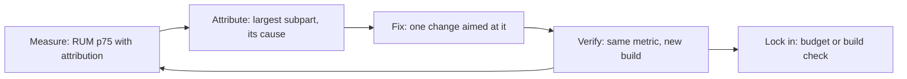
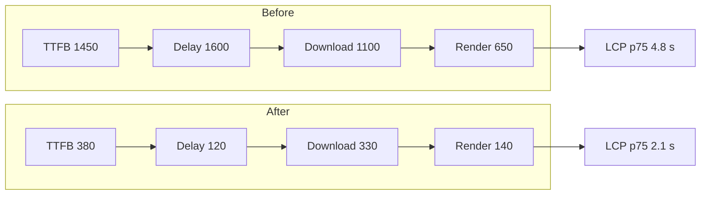

## 82.12 Worked example: a product page from LCP 4.8 s to under 2.5 s

#### Concept

This section applies the whole Part to one page, in the order a senior would work: measure in the field, attribute, fix the largest subpart, re-measure, repeat, then lock the result in with budgets. Every number is a p75 on mobile from RUM unless it says "lab".

#### The starting point

The page is `https://shop.example/p/trail-runner-gtx`, a Next.js 14 App Router product page in front of the NestJS catalogue, pricing and inventory services, behind CloudFront. It gets 140,000 mobile views a day, mostly first visits from search and ads. The goal: p75 mobile LCP under 2.5 s without regressing INP or CLS, and an estimate of the business effect.

RUM with `web-vitals/attribution` (82.2) over seven days, about 28,000 LCP samples:

```text
Metric (p75, mobile)     Value      Rating
LCP                      4.8 s      poor
  TTFB                   1,450 ms
  Resource load delay    1,600 ms
  Resource load dur.     1,100 ms
  Element render delay     650 ms
INP                      260 ms     needs improvement
CLS                      0.14       needs improvement
LCP element              div.gallery img (82% of loads), h1.product-title (18%)
Lab (Lighthouse mobile)  LCP 6.9 s, TBT 940 ms, CLS 0.12
```

The process, repeated once per subpart:



#### Step 0: find the cause of each subpart

A WebPageTest run on a real mid-range Android phone from a nearby location, plus a DevTools trace with 4x CPU throttling, explained every subpart:

- **TTFB 1,450 ms.** `x-nextjs-cache` was absent and CloudFront reported `Miss` on every request. The root layout called `cookies()` to show "Hi, Priya" and the cart count, which made **every** route dynamic (79.5). `Server-Timing` showed four sequential awaits: product 120 ms, price 90 ms, stock 140 ms, recommendations 380 ms.
- **Load delay 1,600 ms.** The gallery was a client-only carousel. Its image URLs came from `GET /v1/products/:id/media`, fetched in a `useEffect` after hydration of 610 KB of JavaScript.
- **Load duration 1,100 ms.** The hero was a 1,600-pixel JPEG of 340 KB with no `srcset`, competing for bandwidth with the JavaScript.
- **Render delay 650 ms.** An A/B testing script with an anti-flicker snippet hid the body until the experiment loaded (typically 400 ms, up to 2 s), and the brand font came from a third-party host with `display=block`.
- **CLS 0.14.** Mostly the font swap shifting the title and price block, plus a reviews widget that grew after load.



#### Step 1: TTFB, make the page cacheable and parallel

1. The greeting and cart count moved into a client component fed by the session view and `GET /api/bff/cart` (79.8, 81.1). The layout no longer reads cookies, so product pages can be statically rendered and revalidated.
2. The page got `export const revalidate = 30`, matching the freshness of price and stock; the product fetch uses `revalidate: 300` and a `product:<slug>` tag, and the catalogue service's update event calls `revalidateTag` through the publisher from 79.13.
3. Product, price and stock run in `Promise.all`; recommendations moved behind `<Suspense>` (82.10).
4. CloudFront's HTML cache policy honours `s-maxage` from Next.js, capped at 60 s (79.7).

Result after a week: CDN hit rate for the route from 0% to 93%, **TTFB p75 from 1,450 ms to 380 ms**, LCP p75 from 4.8 s to 3.7 s. The backend's own latency barely changed; it simply left the user's path for 93% of views.

#### Step 2: load delay, put the hero in the HTML

1. **API change**: the product response now includes `images[]` with `url`, `width`, `height`, `alt` and `position`, hero first (82.3). The separate media endpoint remains for the full gallery.
2. The first image renders in a server component with `next/image` and `priority`; the carousel hydrates later around it (82.3).
3. The 3D viewer (118 KB) moved to `next/dynamic` on click, and the reviews widget became a server component with a small client button (82.7). First-load JavaScript fell from 610 KB to 240 KB.

Result: **load delay from 1,600 ms to 120 ms**; LCP p75 from 3.7 s to 2.6 s. INP improved too, from 260 ms to 200 ms, because hydration got shorter.

#### Step 3: load duration, send the right bytes

1. `sizes="(max-width: 768px) 100vw, 50vw"`, `images.formats` with AVIF first, and `deviceSizes` trimmed to six widths (82.8).
2. Images moved to an image CDN path with content-hash keys and a one-year `immutable` policy, so the Next.js servers do no resizing.
3. The ingest endpoint now caps uploads at 2,400 pixels and stores dimensions (82.8).

Result: the hero on a typical phone is a 58 KB AVIF instead of 340 KB; **load duration from 1,100 ms to 330 ms**; LCP p75 from 2.6 s to 2.25 s.

#### Step 4: render delay, stop hiding the page

1. The experiment assignment moved to middleware at the edge, which sets a cookie and rewrites to the right variant (79.9), so the HTML already contains the variant. The anti-flicker snippet was deleted and banned in the third-party policy.
2. The font moved to `next/font/local`: one variable WOFF2, Latin subset, `display: 'swap'` with an adjusted fallback (82.8).
3. The reviews section got a reserved height from `reviewCount` in the API response (82.5).

Result: **render delay from 650 ms to 140 ms**; CLS p75 from 0.14 to 0.03.

#### Step 5: lock it in

- Lighthouse CI on every pull request, three runs against the preview deployment, with LCP, TBT and CLS assertions (82.11).
- `size-limit` for the product route's client chunks at 60 KB and the shared framework at 110 KB.
- A RUM alert per build: p75 mobile LCP for `/p/[slug]` above 2.5 s or 10% worse than the previous build, with at least 2,000 samples.
- A build check that fails if `/p/[slug]` is reported as dynamic in `next build` output, because Step 1's gain depends on it staying cacheable.

#### Results

28 days after the last change:

```text
Metric (p75, mobile)         Before     After
LCP                          4.8 s      2.1 s     good
  TTFB                       1,450 ms   380 ms
  Resource load delay        1,600 ms   120 ms
  Resource load duration     1,100 ms   330 ms
  Element render delay         650 ms   140 ms
INP                          260 ms     170 ms    good
CLS                          0.14       0.03      good
First-load JS (compressed)   610 KB     240 KB
Hero image bytes             340 KB     58 KB
Origin HTML renders/day      140,000    about 11,000
Lab LCP (Lighthouse mobile)  6.9 s      2.3 s
```

Steps 2 to 4 shipped behind a feature flag with a 10% holdout for two weeks. In the holdout comparison the faster page had a 4.1% higher relative add-to-cart rate and a 2.6-point lower bounce rate. Step 1 could not be held out cleanly (it changed caching for everyone), so the team reported its effect only as a before-and-after, labelled as such.

#### What the team chose not to do

Three proposals were rejected, and the reasons matter as much as the fixes. **A service worker** to cache the product page was turned down: most visitors were first-time visitors from search, so it would not have helped them, and it added a stale-HTML risk (82.9). **Moving to the edge runtime** for rendering was postponed: with a 93% CDN hit rate, the remaining origin renders were a small share of page views, and the edge would have needed a rewrite of the data layer (79.9). **Inlining all CSS** was measured and dropped: it removed one round trip on first visits but made every HTML response 30 KB larger and uncacheable separately for repeat visits. Each was a reasonable idea aimed at a subpart that was no longer the largest.

#### Backend side (NestJS)

| Change | Owner | Effect |
|---|---|---|
| Product response includes ordered images with dimensions and alt | Catalogue API | Load delay; CLS |
| `reviewCount` and `hasBundles` in the product response | Catalogue API | CLS: slots reserved at render |
| Public product data split from personal data; `s-maxage` headers | Catalogue API and BFF | HTML and API cacheable at the CDN |
| Tag revalidation on product update events | Catalogue publisher | Freshness without short TTLs |
| `Promise.all` with timeouts and fallbacks in the render | BFF (Next.js server) | TTFB on CDN misses |
| Image ingestion caps and content-hash keys | Media service | Load duration; CDN egress |
| RUM endpoint with zod validation and histograms | Platform API | The measurement loop |

More than half of the improvement came from backend and BFF changes, even though the metric is "frontend".

#### Failure scenario

Three weeks later the RUM alert fired for build `web@5.3.0`: p75 TTFB for `/p/[slug]` back to 1.2 s and LCP to 3.4 s. The build check had been added after this pull request merged. A new currency selector in the shared header called `cookies()` in a server component to read the preferred currency, turning every page dynamic again. The CDN hit rate dropped to zero within minutes of the deploy, and the origin's HTML render rate went up thirteenfold. The fix moved the currency read into the client component (prices are converted for display on the client from the minor-unit strings, Part 80.7) and the dynamic-route build check went live the same day. Total time in the regressed state: 3 hours, because the alert was per build.

#### How a Senior Full-Stack Engineer thinks about this

The senior did not start with images, even though "optimise images" was the team's first instinct. They started with attribution, fixed subparts in order of size, measured after each step, and assigned each fix to whoever owned it, backend included. They protected the gains with checks aimed at the specific mechanisms that produced them (cacheability, bundle size, the LCP element in HTML), not only with a generic score. They reported the business effect honestly, separating the experiment-backed part from the before-and-after part.

#### Interview questions

1. **Walk through how you would take a page from LCP 4.8 s to under 2.5 s.** Expected answer: field data with attribution, the four subparts, fix the largest first (often TTFB through caching, or load delay through putting the image in HTML), re-measure each step, add budgets. Follow-up: why not start with image compression? (It addresses only load duration.)
2. **Why did removing a `cookies()` call improve TTFB so much?** Expected answer: it made the route static or ISR, so the CDN and Full Route Cache could serve it; the API left the user's path.
3. **How would you prove the business effect?** Expected answer: a holdout behind a flag on part of the traffic, with conversion compared; label non-experimental changes honestly.
4. **What would you add to CI after this project?** Expected answer: Lighthouse CI metric assertions, bundle size limits, a check that the route stays static, a RUM alert per build.

#### Practical exercise

Run this process on a real page with poor LCP.

Acceptance criteria:

- A before table like the one above, from at least 5,000 field samples, with the four subparts and the LCP element.
- At least three steps, each aimed at one subpart, each with its own after-measurement.
- At least one backend change in the list, with its effect measured.
- Budgets and a build check that would catch a regression of each mechanism you fixed.
- p75 mobile LCP under 2.5 s, with INP and CLS not worse than before.

## Senior Checklist — Part 82

- [ ] I understand the concept
- [ ] I can explain it simply
- [ ] I can implement it
- [ ] I understand its failure modes
- [ ] I understand its scaling limitations
- [ ] I understand its security implications
- [ ] I understand its operational implications
- [ ] I can choose between alternatives
- [ ] I can explain the tradeoffs
- [ ] I can answer senior-level interview questions
- [ ] I can tie a Core Web Vitals change to a business metric and propose a holdout experiment to measure it
- [ ] I can state the LCP, INP and CLS thresholds and explain why they are judged at p75 on mobile
- [ ] I know which questions field data answers and which lab data answers, and I never gate on a Lighthouse score alone
- [ ] I can break LCP into its four subparts with `web-vitals/attribution` and fix the largest one first
- [ ] I can read INP attribution by phase and find the slow script with the Long Animation Frames API
- [ ] I can close the gap between lab and field CLS by moving "will this block exist?" decisions to the server and API
- [ ] I can map a critical path in round trips and use preconnect, preload, `fetchpriority` and speculation rules sparingly
- [ ] I set a JavaScript budget per route, default to server components, and govern third-party scripts with owners and strategies
- [ ] I serve images in modern formats at the right size from a pipeline that stores dimensions, and fonts self-hosted with adjusted fallbacks
- [ ] I cache hashed assets forever, HTML briefly, and keep pages eligible for the bfcache
- [ ] I keep the API out of the user's path with caching, parallel calls, streaming and view-shaped responses
- [ ] I run a RUM pipeline with low-cardinality labels, and budgets in CI that fail the build

## Part 82 — Key Takeaways

- Performance is revenue, and the slow quartile on mobile is where the money is; measure it before you optimise it.
- Core Web Vitals are LCP ≤ 2.5 s, INP ≤ 200 ms and CLS ≤ 0.1 at p75; INP replaced FID in 2024.
- Field data says what happened, lab data says why; when they disagree, the lab profile is wrong.
- LCP is four subparts; the two delays should be near zero, and a large one means an architecture problem, not a slow network.
- INP ends at the next paint: show feedback first, do the work later, and keep third parties off the main thread.
- Unreserved space is a bug; the API can prevent most layout shifts by saying in advance what will appear.
- Count round trips on the critical path before bytes, and treat every resource hint as a cost.
- JavaScript is CPU time on the user's phone: budget it per route, default to server components, and govern every tag.
- Images need a pipeline with dimensions and variants; fonts need self-hosting and matched fallbacks.
- Hashed assets are cached forever, HTML briefly, and the fastest page load is a bfcache restore.
- The backend's biggest contribution is often not a faster endpoint but taking the endpoint out of the user's path.
- A measurement loop with RUM by build and budgets in CI is what keeps a fast page fast.
