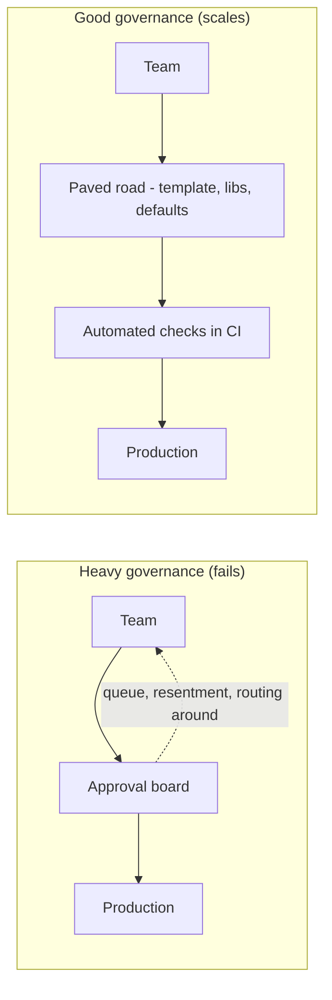

# Part 83 — Architecture Governance, Standards and Paved Roads

Governance is a word engineers flinch at, because most of them have only seen the bad kind: a review board that takes three weeks to approve a config change, a standards document nobody reads, an architect who says no to everything. This Part is about the good kind — governance that makes the right thing the easy thing, so that forty teams build consistent, reliable systems without anyone policing them. Part 62 catalogued the anti-patterns that governance aims to prevent; Part 47 covered CI/CD; Part 15 covered API design. This Part is about scaling those good practices across a whole organisation without strangling it.

The central idea is a shift in mechanism. Heavy governance tries to enforce good architecture through *approval* — a human gate every change must pass. Good governance achieves it through *defaults* — paved roads, templates, libraries and automated checks that make the correct choice the path of least resistance. The first scales linearly with the number of reviewers and becomes a bottleneck; the second scales infinitely because it requires no human in the loop.

The reader this Part assumes is a staff or principal engineer who has seen standards decay and review boards stall, and wants to know how to get consistency across many teams without becoming the bottleneck or the villain.

## 83.1 Why governance exists, and why heavy governance fails

#### Concept

Governance exists to produce consistency and quality across many teams that would otherwise each make their own choices, leading to a system nobody can operate. Without any governance, forty teams produce forty error formats, forty logging conventions, forty ways to paginate, and an operational nightmare. But *heavy* governance — the kind built on mandatory human approval of every decision — fails for a different reason: it becomes a bottleneck, it breeds resentment, and engineers route around it, which is worse than no governance because now the rules are both ignored and resented.

#### Why does it exist?

Imagine forty teams, each free to choose how their service reports errors. One returns `{"error": "..."}`, another `{"message": "..."}`, another an HTTP 200 with an error inside, another a bare string. Now imagine being the on-call engineer trying to debug an incident that spans six of these services at 3 a.m., each speaking a different error dialect. Or the engineer building a client that must handle all forty formats. The cost of inconsistency is paid continuously, by everyone, forever. Governance exists to prevent that cost.

But heavy governance creates its own cost. Imagine every one of those forty teams having to get an architecture review board's approval before adding an endpoint. The board has five people and sees two hundred requests a month. The queue grows to three weeks. Teams start batching changes to avoid the queue, or making changes without approval and backfilling, or designing around the board's known preferences rather than the actual problem. The board, meant to improve quality, now degrades it — by delaying everything and by teaching engineers to game the process. Heavy governance fails because human approval does not scale and because people resent and route around gates.

#### Mental model

Imagine two ways to make drivers stop at a dangerous junction. The first is to station a police officer there to check every car — expensive, it only works while the officer is present, it creates a queue, and drivers resent it and speed up the moment the officer looks away. The second is to build a roundabout — a piece of infrastructure that makes stopping-and-yielding the natural, easy thing to do, with no officer required, working the same at 3 a.m. as at noon, for every driver forever. Heavy governance is the police officer. Good governance is the roundabout. The roundabout scales; the officer does not. Build infrastructure that makes the safe behaviour the easy behaviour, and you need no police.

#### How it works

The failure modes of heavy governance are predictable:

```text
Bottleneck:    approval queue grows faster than reviewers can clear it.
Resentment:    engineers feel distrusted and slowed; morale drops.
Routing around: changes made without approval, or batched to dodge the gate.
Gaming:        designs shaped to please the board, not to solve the problem.
Staleness:     the board can't keep up, so it rubber-stamps or blocks blindly.
Centralisation of judgement: the board becomes a single point of failure
               for decisions it doesn't have the context to make well.
```

Good governance inverts the mechanism. Instead of a gate that every change passes through, it provides:



In the good model, the correct architecture is baked into the template the team starts from, the libraries they use by default, and the automated checks that run on every pull request. There is no human gate for the common case; the human attention is reserved for the genuinely novel, high-stakes decisions (via lightweight mechanisms covered in 83.4). The rules are enforced by making the right thing the easy thing, not by checking every change against a person.

#### Practical example

An org has a heavy architecture review board. Every new service and every significant change needs its sign-off. The board is three principal engineers; the queue is two to three weeks. Teams hate it. A new principal engineer measures the cost: the board approves 95% of requests essentially unchanged, meaning 95% of the queue time is pure delay adding no value, and the 5% it does change could have been caught by a few automated rules plus office hours for the genuinely novel cases. She replaces the universal gate with a paved road (a service template that bakes in the standards) plus automated CI checks (that enforce the common rules) plus optional office hours (for the novel 5%). Review-board load drops by 95%, delay disappears for the common case, and consistency actually *improves*, because the template enforces the standards uniformly rather than relying on three humans to remember them.

#### Artifact example

A governance model one-pager — the artifact that establishes how governance works in the org, replacing "everything needs board approval" with a tiered model.

```markdown
# How architecture governance works at GreenCart

## Principle
We achieve consistency by making the right thing the easy thing — paved
roads and automated checks — not by gating every change on human approval.
Human attention is reserved for genuinely novel, high-stakes decisions.

## Three tiers (match the mechanism to the stakes)
| Decision type | Mechanism | Human approval? |
|---|---|---|
| Routine (new endpoint, new service of a known shape) | Paved-road template + CI checks | No — automated |
| Standard-affecting (new shared library, API convention change) | RFC (Part 81) + review guild | Async, lightweight |
| Novel / high-stakes (new datastore, cross-cutting pattern) | RFC + architecture office hours | Yes, but advisory not gatekeeping |

## What this means in practice
- Starting a new service? Use the template. No approval needed; the
  standards are built in.
- Every PR runs fitness functions (layering, dependency rules, error
  format). They enforce the rules so humans don't have to.
- Doing something genuinely new? Bring it to office hours. We advise and
  help; we rarely block, because you own your service.

## What we explicitly rejected
A mandatory review board for all changes. It was a 3-week bottleneck that
approved 95% unchanged. We replaced it with the model above.
```

The one-pager's power is that it is explicit about matching mechanism to stakes, it reserves scarce human judgement for the rare novel case, and it names what it rejected (the universal board) and why (3-week bottleneck, 95% rubber-stamped). It turns governance from a gate into a service.

#### Real-world scenario

A company's architecture review board is a prestigious, dreaded institution. Getting on its calendar takes weeks; presenting to it is nerve-wracking; its decisions are final and often context-poor because the board members do not operate the systems they rule on. A principal engineer who sits on the board realises it has become exactly the ivory-tower failure mode from Part 58 — architects ruling on systems they have never run. He leads the board to dissolve itself as a universal gate and reconstitute as office hours plus a set of fitness functions. The same expertise is still available — more available, because office hours have no three-week queue — but it is advisory, context-aware, and no longer a bottleneck. Decisions that used to take three weeks of waiting now happen in a thirty-minute conversation, and the ones that are routine happen with no conversation at all because the template and the checks handle them.

#### Failure scenario

A new VP, alarmed by an architecture inconsistency, institutes a mandatory architecture review board for all changes. For a month it catches a few real issues and everyone agrees it is valuable. Then the queue builds. By month three it is two weeks deep. Teams start batching a quarter's worth of changes into one board submission to minimise trips through the gate, which means the board now reviews enormous, un-reviewable change sets and rubber-stamps them because it cannot absorb them. Other teams simply stop submitting and make changes quietly, so the board's records no longer reflect reality. The inconsistency the VP worried about is now *worse*, because the board gave an illusion of control while actual decisions moved underground. The gate did not produce consistency; it produced a queue, a workaround culture, and a false sense of safety. Infrastructure — a template and automated checks — would have produced the consistency the gate only pretended to.

#### Edge cases & failure modes

- **Approval queue bottleneck.** Human review does not scale; the queue grows without bound and delays everything.
- **Routing around the gate.** Teams batch changes or make them quietly, so the governance records diverge from reality.
- **Rubber-stamping under load.** An overwhelmed board approves without real review, giving an illusion of control.
- **Context-poor rulings.** Boards decide on systems they do not operate, so their decisions carry the wrong assumptions (the Part 58 ivory-tower failure).
- **No governance at all.** The opposite failure: forty teams, forty error formats, an operational nightmare.
- **Governance that never sunsets rules.** Old standards that no longer make sense stay enforced because nobody owns removing them.

#### How a Principal Engineer thinks about this

They treat governance as an infrastructure problem, not an approval problem: the goal is to make the right thing the easy thing, so that consistency emerges from defaults rather than from policing. They are deeply suspicious of universal human gates, because they have watched every one of them become a bottleneck that teaches engineers to route around it. They reserve scarce human judgement for the genuinely novel, high-stakes decisions and automate everything routine, because a human reviewing a routine change is both a waste of an expensive person and a delay for the team.

They also keep governance *advisory* wherever possible rather than gatekeeping, because the team that owns and operates a service has better context than any central board, and the principal's job is to make the good choice easy and visible, not to substitute their judgement for the owner's. And they are willing to dissolve their own governance institutions when those institutions have become the bottleneck — the board that cannot let go of being a gate is itself the problem.

#### Common mistakes

- **Equating governance with approval,** so every change needs a human gate that cannot scale.
- **Building a review board that rules on systems its members do not operate,** producing context-poor decisions.
- **Letting the approval queue become a bottleneck** that teaches teams to route around it.
- **Having no governance at all,** producing forty incompatible ways to do everything.
- **Never sunsetting old rules,** so governance accretes stale constraints nobody can justify.

#### Interview questions

1. **Why does heavy, approval-based architecture governance tend to fail?**
   *Expected answer:* human approval does not scale, so the queue becomes a bottleneck; teams resent it and route around it (batching changes, making them quietly), boards rubber-stamp under load and rule on systems they do not operate. The result is worse consistency plus an illusion of control. *Follow-up:* what would you replace it with.

2. **How do you get consistency across forty teams without a review board for every change?**
   *Expected answer:* make the right thing the easy thing — paved-road templates that bake in the standards, default libraries, and automated fitness functions in CI that enforce the rules on every PR; reserve lightweight human review (RFC, office hours) for the genuinely novel cases. *Why it matters:* this is the core of the whole Part.

3. **When is a central architecture decision gate actually appropriate?**
   *Expected answer:* rarely, and only for genuinely novel, high-stakes, hard-to-reverse decisions (a new datastore, a cross-cutting pattern) — and even then advisory is better than gatekeeping, because the owning team has better context. Routine changes should never hit a human gate. *Why it matters:* tests judgement about proportionality.

#### Practical exercise

Audit your org's current architecture governance. For each mechanism (review board, approval step, standards doc, CI check), classify it as a gate (human approval required) or infrastructure (makes the right thing easy automatically). Count how many routine changes require human approval. Then propose a tiered model that moves routine decisions to paved roads and automated checks, and reserves human review for the genuinely novel.

**Acceptance criteria:** you can name at least one human gate that could be replaced by an automated check or a template, estimate the delay it currently adds, and describe the infrastructure (template section or CI rule) that would enforce the same standard without a human in the loop.
