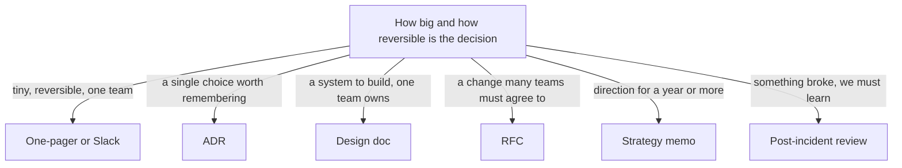

## 83.2 Document types and when to use each

#### Concept

There is not one architect's document; there is a small family of them, and each has a job. Using the wrong one is like using a screwdriver as a chisel — it sort of works, and it ruins both the tool and the work. A one-pager is for getting a quick yes on a direction. An RFC is for getting many teams to agree on a change. A design doc is for working out how to build something. An ADR records a single decision so the future knows why. Knowing which to reach for is half the skill.

#### Why does it exist?

Different situations need different amounts of ceremony. Imagine you decide, with one teammate, to rename a confusing internal variable. Writing a six-section RFC for that is absurd; it would take longer than the change and nobody would read it. Now imagine you want to move 25 services onto a new error format. Deciding that in a Slack thread is equally absurd; it will be forgotten, contested, and half-adopted.

The family of document types exists so the ceremony matches the stakes. Light decisions get light documents. Heavy, cross-team, expensive-to-reverse decisions get heavy documents. Picking the right weight is what stops you from either drowning small decisions in process or letting big ones slip through on a verbal nod.

#### Mental model

Imagine a set of forms at a bank. A deposit slip is one line. A loan application is several pages. A mortgage is a folder. You do not fill in a mortgage folder to deposit twenty dollars, and you do not get a mortgage on a deposit slip. The size of the form matches the size and risk of the transaction. The architect's documents are the same: match the form to the size of the decision.

#### How it works

Each document type has a distinct shape, audience, and lifecycle. Here is the family, ordered roughly from lightest to heaviest.



- **One-pager.** One page, one idea, one ask. Used to test a direction cheaply before investing in a full design. Audience: your lead and one or two peers. Lifecycle: short; it either becomes a design doc or it dies.
- **ADR (Architecture Decision Record).** One decision, its context, the options, the choice and the consequences. Covered in Part 64.22. Used to record *why* a single choice was made so the future does not have to guess. Audience: anyone who later touches the thing. Lifecycle: immutable once accepted; superseded by a new ADR, never edited.
- **Design doc.** How you will build a specific system or feature. Context, requirements with numbers, the proposed design, alternatives, risks, rollout. Audience: the team that will build and operate it, plus reviewers. Lifecycle: alive during design, then a reference.
- **RFC (Request for Comments).** A proposal for a change that needs agreement from people outside your team. Structurally similar to a design doc but with an explicit review-and-decision process bolted on. Audience: all affected teams. Lifecycle: draft, review, decide, accepted or rejected.
- **Tech spec.** The detailed, implementation-level description once a design is agreed: exact endpoints, schemas, error codes. Audience: implementers. Lifecycle: alive until built, then it should match the code or be deleted.
- **Post-incident review (PIR).** What broke, the timeline, the root cause, the actions. Covered operationally in Part 49. Audience: the org, blamelessly. Lifecycle: permanent record; actions tracked to completion.
- **Strategy memo.** Where we are going technically over a year or more, and why. Audience: leadership and the whole org. Lifecycle: long; revisited each planning cycle. Covered fully in Part 84.

#### Practical example

Your team runs the inventory service. Over three months you face four situations, and each wants a different document.

1. You are wondering whether to add a read replica for inventory reads. You are not sure it is worth it. You write a **one-pager**: here is the read load, here is the replica cost, here is the latency we would save, should we do a spike. Your lead reads it in five minutes and says yes.
2. The spike confirms it, and you need to design how reads route to the replica and how you handle replication lag on the "is this in stock" check. You write a **design doc**. Your team reviews it.
3. Along the way you decide to use PostgreSQL streaming replication rather than logical replication. That single choice is worth remembering, so you write an **ADR**.
4. The replica causes a brief incident when stale reads oversell a popular item. You write a **PIR** and add an action to read stock-critical checks from the primary.

Four documents, four jobs, matched to four sizes of decision.

#### Artifact example

A filled-in one-pager, the lightest and most under-used document in the family. This is the whole thing — one page is the point.

```markdown
# One-pager: add a read replica for inventory reads

**Author:** you | **Date:** 2026-02-03 | **Ask:** approve a 1-week spike

## Problem
Inventory read traffic is 4,200 req/s at peak, all hitting the primary.
The primary is at 70% CPU at peak, mostly from reads. Write traffic is
only 180 req/s. We are one Black-Friday away from the primary saturating,
and we cannot scale reads without scaling writes we do not need.

## Proposed direction
Add one PostgreSQL streaming read replica. Route all catalog-style reads
(product detail, listing, search facets) to it. Keep the stock-decrement
write path and the "can I buy this right now" check on the primary.

## Why now
Peak season is 3 months out. A replica is roughly $320/month on our
instance class. The alternative — vertically scaling the primary — is
~$1,100/month and still couples reads to writes.

## Risks / open questions
- Replication lag on "in stock" reads could oversell. Spike must measure
  real lag under load and decide which reads are lag-sensitive.
- Connection pool split between primary and replica. Needs a plan.

## Ask
One engineer, one week, to run a load test against a replica and come back
with measured lag and a recommended read-routing split. Not a commitment
to ship — a commitment to measure.
```

Notice what makes it work: a numbered problem, a concrete direction, a cost comparison, named risks, and an ask that is small and specific ("one engineer, one week, to measure" — not "approve the whole project"). A reader can say yes to that in thirty seconds.

#### Real-world scenario

A food-delivery company has no document conventions. Every decision, large or small, happens in Slack or in meetings. The result is predictable: small decisions consume meeting time out of proportion to their stakes, and large decisions get made without the right people, then re-litigated endlessly because there is no record of why.

A principal engineer introduces exactly three document types, and no more: a lightweight ADR for recorded decisions, a design doc template for anything one team builds, and an RFC process for anything cross-team. He deliberately refuses to add more types, because a zoo of document types is its own kind of process bloat. Within a quarter, the "why did we do it this way" questions have somewhere to point, cross-team changes stop surprising people, and meeting time drops because the reversible stuff gets decided in a one-pager instead of a meeting.

#### Failure scenario

A team adopts an RFC process and applies it to everything, including a one-line config change and a variable rename. Each RFC requires three reviewers and a decision meeting. Velocity collapses. Engineers start routing around the process — making changes without RFCs and backfilling fake ones — which is worse than having no process, because now the documents lie.

The root cause is a category error: they used the heaviest document for the lightest decisions. The fix is not to abandon RFCs; it is to reserve them for decisions that are cross-team or expensive to reverse, and to let everything else happen in a one-pager, an ADR, or just a pull request.

#### Edge cases & failure modes

- **One document type for everything.** Either everything is an RFC (process bloat) or nothing is written (chaos). Both are failures of matching weight to stakes.
- **Design doc that is really a tech spec.** It drowns the reader in endpoint signatures before they understand the problem. Separate the "why and what" (design doc) from the "exact how" (tech spec).
- **ADR that gets edited.** Someone updates an accepted ADR to reflect a new decision. Now the record of what you believed in 2024 is gone. ADRs are immutable; you supersede them.
- **Strategy memo written like a design doc.** Too much implementation detail, not enough direction and business framing. Leadership cannot act on it.
- **No PIR for a near-miss.** Teams write PIRs for outages but not for the time something almost broke. The near-misses are the cheapest lessons you will ever get; skipping them wastes them.

#### How a Principal Engineer thinks about this

They keep the number of document types small on purpose. Three or four well-understood types beat a dozen precisely specified ones, because people can actually remember when to use three. They match ceremony to stakes instinctively, reaching for the one-pager far more often than juniors expect, because most decisions are smaller and more reversible than they feel in the moment.

They also understand that the document type sets reader expectations. When someone opens an RFC, they know they are being asked to comment and that a decision will follow. When they open an ADR, they know it is a record, not a debate. These shared expectations are most of the value of having named types at all — the type tells the reader how to engage before they read a word of content.

#### Common mistakes

- **Inventing a new document type for every situation.** Nobody can remember them, so nobody uses them correctly.
- **Using an RFC when a one-pager would do.** You spend a week of review on a decision that was reversible in an afternoon.
- **Using a Slack thread when an RFC was needed.** The cross-team decision is made by whoever was awake, and re-litigated forever because there is no record.
- **Editing ADRs in place.** You destroy the historical record that is the entire point of an ADR.
- **Skipping the PIR because "it wasn't that bad".** The cheap lessons get thrown away.

#### Interview questions

1. **Walk me through the documents you would use over the life of a medium-sized feature, and why each.**
   *Expected answer:* one-pager to test the direction, design doc to work out how, ADR for any single durable decision, tech spec for implementers if needed, PIR if something breaks. *Why it matters:* tests whether they match ceremony to stakes rather than applying one tool to everything.

2. **Your company's RFC process has become a bottleneck. What do you do?**
   *Expected answer:* narrow its scope to cross-team or hard-to-reverse decisions, push everything else to lighter documents, and fix the review latency (pre-wiring, time-boxed review windows). Do not abolish it; right-size it. *Follow-up:* how would you decide what still requires an RFC.

3. **What is the difference between a design doc and an ADR, and why keep both?**
   *Expected answer:* a design doc works out *how* to build something and is alive during design; an ADR records a single *decision* and its reasoning and is immutable. You keep both because the design doc rots as the system evolves, but the ADR preserves why a specific choice was made even after the design has moved on.

#### Practical exercise

List the last ten engineering decisions your team made. For each, write down which document type (if any) was used, and which type *should* have been used given its size and reversibility. Count the mismatches.

**Acceptance criteria:** you can identify at least two decisions that got more ceremony than they needed and at least one that got less than it needed. Propose, in two sentences, the smallest set of document types your team should standardise on.
