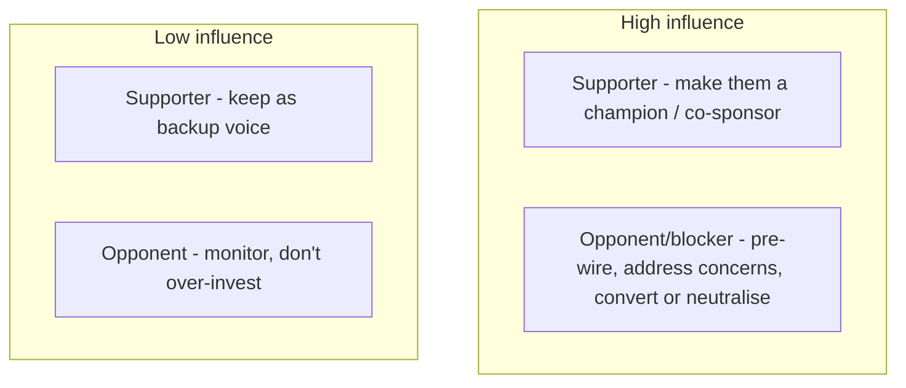

## 83.2 Stakeholder mapping and communicating with executives

#### Concept

Two skills that determine whether your influence reaches the people who matter. **Stakeholder mapping** is working out, for any initiative, who decides, who is affected, and who can block — so you spend your influence effort on the right people rather than broadcasting equally to everyone. **Communicating with executives** is a distinct discipline: leading with the bottom line, keeping it to one page, and translating technical risk into business risk — because executives are time-poor, non-technical about details, and make decisions in terms of revenue, cost, risk, and time, not in terms of Kafka partitions.

#### Why does it exist?

Imagine spending your influence effort evenly across twenty people when, in reality, one person decides, two can block, and the other seventeen are merely affected. You exhaust yourself and the initiative stalls because you under-invested in the decider and the blockers while over-investing in people who were never going to determine the outcome. Stakeholder mapping exists to direct your finite influence effort where it actually changes the result.

Now imagine explaining to a CFO, in a dense technical memo full of latency percentiles and database internals, why a reliability investment matters. The CFO cannot act on it — it is in a language they do not speak, at a length they will not read, framed in terms (p99 latency) they do not value. Executive communication exists because the people who control funding and priority are reached only through a specific style: bottom line first, one page, business terms. An engineer who cannot translate into that style is locked out of the decisions that matter most.

#### Mental model

For stakeholder mapping, imagine a battlefield commander deciding where to commit limited forces. They do not spread troops evenly across the whole map; they identify the decisive points — the hill that controls the valley, the bridge the enemy must cross — and concentrate force there. Stakeholder mapping is identifying the decisive people (the decider, the blockers) and concentrating your influence there, rather than spreading it thin across everyone.

For executive communication, imagine a news article. It does not build to a conclusion like an essay; it puts the most important thing in the headline and the first sentence (the "inverted pyramid"), because readers may stop at any point and the editor may cut from the bottom. Executive communication is the inverted pyramid: the bottom line (the ask and the why) goes first, because the executive may read only the first few lines, and everything after is supporting detail for those who want it.

#### How it works

**Stakeholder mapping.** For any initiative, classify the people involved:

```text
- Decider(s):    who actually makes the call. Often one person. Invest heavily.
- Blockers:      who can stop it (by authority, by owning a resource, by
                 influence). Pre-wire these especially — a blocker who
                 feels ambushed will block.
- Affected:      who is impacted by the change. Keep informed; address their
                 concerns, but they do not decide.
- Influencers:   who the decider listens to. Winning them wins the decider
                 indirectly. Often more reachable than the decider.
```

A common map is a grid of influence (high/low) by stance (for/against):



You invest most in the high-influence quadrants: turn high-influence supporters into champions, and pre-wire high-influence opponents to convert or neutralise them. You do not waste effort on low-influence opponents.

**Communicating with executives — three rules:**

1. **Bottom line up front (BLUF).** Start with the conclusion and the ask: "We need to invest two quarters in payment reliability to stop losing an estimated $45k per outage hour; we've had three such outages this quarter." The executive gets the whole point in the first two sentences. Detail follows for those who want it.

2. **One page.** Executives are time-poor. A one-page update that is read beats a ten-page memo that is skimmed. If it must be longer, the one-page summary stands alone at the top.

3. **Translate technical risk into business risk.** This is the crucial skill. Executives do not value "p99 latency is 820ms" or "we have a dual-write consistency risk"; they value what it means in their terms: revenue at risk, cost, customer churn, regulatory/legal exposure, competitive position, delivery speed. Every technical point must be translated:

```text
Technical statement          ->  Business translation (what the exec hears)
"Our p99 checkout is 820ms"  ->  "Slow checkout costs us ~2% of conversions,
                                 ~$X/month in lost orders."
"We have a dual-write risk"  ->  "There's a risk of silently losing order
                                 data, which would mean refunds, support
                                 cost, and trust damage."
"The DB is at 70% CPU"       ->  "We're one traffic spike from a checkout
                                 outage during peak season — ~$45k/hour."
"Tech debt in the order mod" ->  "Every order feature now takes 3x longer,
                                 slowing our roadmap by ~a quarter/year."
```

#### Practical example

A principal engineer wants funding for a reliability program after three payment outages. Stakeholder mapping: the *decider* is the VP of Engineering (who controls headcount) with sign-off from the CFO (who controls budget); the *blockers* are the product VP (who would lose feature capacity to the reliability work) and the finance partner; the *influencer* is the VP of Engineering's trusted staff engineer. She pre-wires the product VP first (the most likely blocker), framing the reliability work not as "stop features" but as "protect the revenue features generate" — converting a blocker into a neutral party. She wins the influencer. Then she presents to the decider with a one-page, BLUF, business-translated case: "Three payment outages this quarter cost an estimated $X in lost orders and support; a two-quarter reliability program costs Y and reduces that risk by Z; ROI positive in N months." The VP and CFO, seeing the business case in their language with the blocker already neutralised, approve. The mapping directed her effort to the decider and blocker; the executive communication made the case in terms they could act on. (Full business case in 83.3.)

#### Artifact example

A one-page executive update — the artifact that reaches the people who control funding and priority.

```markdown
# Payment reliability: funding request (1 page, for VP Eng + CFO)

## BOTTOM LINE (read this if nothing else)
We've had 3 payment outages this quarter, costing an estimated $340k in lost
orders and support. A 2-quarter reliability program (2 engineers) would cut
this risk by ~80%. Cost: ~$180k. It pays for itself after the next ~1.5
outages we prevent. ASK: approve 2 engineers for 2 quarters.

## The business risk (in your terms)
- Each payment-outage hour costs ~$45k in lost orders + churn + support.
- We've had 3 outages (7 hours total) this quarter. Trend is worsening as
  traffic grows into peak season.
- Root cause is structural (shared payments DB + retry storms), so it will
  recur and worsen without investment — this is not bad luck.

## What the program does (one line each)
1. Give payments its own database -> removes the single point of failure.
2. Ship a resilience library (timeouts, backoff, circuit breaker) -> ends
   the retry storms that turn one slow dependency into a full outage.
3. Add the two alerts that would have caught all 3 outages early.

## The numbers
| | Cost | Benefit |
|---|---|---|
| Do nothing | $0 now | ~$680k+ expected outage cost next 2 quarters (worsening) |
| The program | ~$180k (2 eng, 2 qtrs) | ~80% risk reduction; ~$540k expected loss avoided |
-> ROI positive after ~1.5 prevented outages.

## What we're NOT asking for
Not a rewrite. Not new technology. Not pausing the roadmap — 2 engineers,
targeted. The other teams keep shipping features.
```

The update's power is entirely in its form: BLUF (the whole case in the first paragraph), one page, and every technical point translated to business terms (outages in dollars, the fix in risk reduction, the decision as an ROI table). It names what it is *not* asking for, to neutralise the product-VP blocker's fear of losing the roadmap. An executive can read the first paragraph and decide, or read the whole page and decide better — either way, in their language, in their time.

#### Real-world scenario

Two staff engineers each need executive funding for reliability work. The first sends a detailed, technically excellent memo: pages of latency analysis, architecture diagrams, and failure-mode taxonomy, framed in engineering terms. The executive skims it, does not understand why it matters to the business, and deprioritises it in favour of a product initiative that came with a clear revenue number. The second sends a one-page BLUF update that leads with "three outages cost us an estimated $340k; this program costs $180k and prevents ~80% of it". The executive reads the first paragraph, immediately grasps the business case, and funds it. The first engineer's work was more technically thorough; the second got funded. The difference was entirely communication: the first spoke engineering to a business audience, the second translated into business terms and led with the bottom line. The lesson that stings for technical people: the quality of your engineering case is irrelevant to an executive who cannot parse it; the translation into their language is what determines whether it gets funded. A worse idea communicated in business terms beats a better idea communicated in engineering terms, every time, at the executive level.

#### Edge cases & failure modes

- **Spreading influence effort evenly** instead of concentrating on the decider and blockers.
- **Not identifying the blockers,** so one ambushed blocker kills the initiative late.
- **Burying the ask** instead of leading with it (BLUF), so the time-poor executive never reaches it.
- **Writing ten pages for an executive** who will read one, so the case is skimmed, not absorbed.
- **Failing to translate technical risk into business risk,** leaving the executive unable to see why it matters.
- **Over-translating into vague business speak** with no specifics, so the case sounds like hand-waving (translate to specific numbers, not generic "it's risky").
- **Ignoring the influencer** the decider actually listens to, who is often more reachable than the decider.

#### How a Principal Engineer thinks about this

They map stakeholders before investing influence effort, concentrating on the decider and the blockers rather than broadcasting equally, because they know influence is finite and most people in the room do not determine the outcome. They identify and pre-wire the blockers especially, because a blocker who feels ambushed will block, and they seek out the influencers the decider trusts, who are often more reachable than the decider directly.

With executives, they lead with the bottom line and the ask, keep it to one page, and — the skill they treat as non-negotiable — translate every technical point into business terms with specific numbers, because they know executives act on revenue, cost, risk, and time, not on latency percentiles. They have internalised that a technically excellent case communicated in engineering language loses to a simpler case communicated in business language, so they do the translation work however much it grates to reduce their nuanced engineering into "$45k per outage hour". The principal's edge with executives is not dumbing down; it is translating up — into the language of the decision being made.

#### Common mistakes

- **Spreading influence evenly** instead of targeting the decider and blockers.
- **Leaving the ask until the end** instead of leading with it.
- **Sending executives long technical memos** they will not read.
- **Not translating technical risk into business risk** with specific numbers.
- **Ignoring the influencer** the decider listens to.

#### Interview questions

1. **How do you decide where to focus your influence effort on an initiative?**
   *Expected answer:* map stakeholders — identify the decider(s), the blockers, the affected, and the influencers the decider trusts — and concentrate effort on the high-influence people (make supporters champions, pre-wire and convert/neutralise blockers), rather than broadcasting equally to everyone. *Follow-up:* why are influencers often more reachable than the decider.

2. **How do you communicate a technical risk to an executive?**
   *Expected answer:* lead with the bottom line and the ask (BLUF), keep it to one page, and translate the technical risk into business terms with specific numbers — revenue at risk, cost, churn, delivery impact — because executives act on business terms, not latency percentiles. "p99 is 820ms" becomes "slow checkout costs ~2% of conversions, ~$X/month". *Why it matters:* this translation is the gate to every funding and priority decision.

3. **Why does a simpler case in business language beat a more thorough case in engineering language at the executive level?**
   *Expected answer:* because the executive makes decisions in business terms and is time-poor; a thorough engineering case they cannot parse or will not read has zero influence on a business decision, while a simpler case translated into their language and led with the bottom line lets them see and act on the value. The translation, not the technical depth, determines funding. *Why it matters:* tests whether they understand the audience determines the communication, not the content's merit.

#### Practical exercise

Take an initiative you need executive support for. Build the stakeholder map: identify the decider, the blockers, the affected, and the influencers, and classify them by influence and stance. Then write the one-page executive update: BLUF (the ask and why, in the first paragraph), the business risk translated into specific numbers, the solution in one line each, and a cost/benefit that frames the decision as an ROI. Name what you are NOT asking for, to neutralise the most likely blocker's fear.

**Acceptance criteria:** your stakeholder map identifies the actual decider and at least one blocker, and your plan concentrates effort on them; your executive update leads with the ask and the business bottom line in the first paragraph, fits one page, and translates every technical point into a specific business number (not vague "it's risky"); and it explicitly addresses the most likely blocker's concern.
