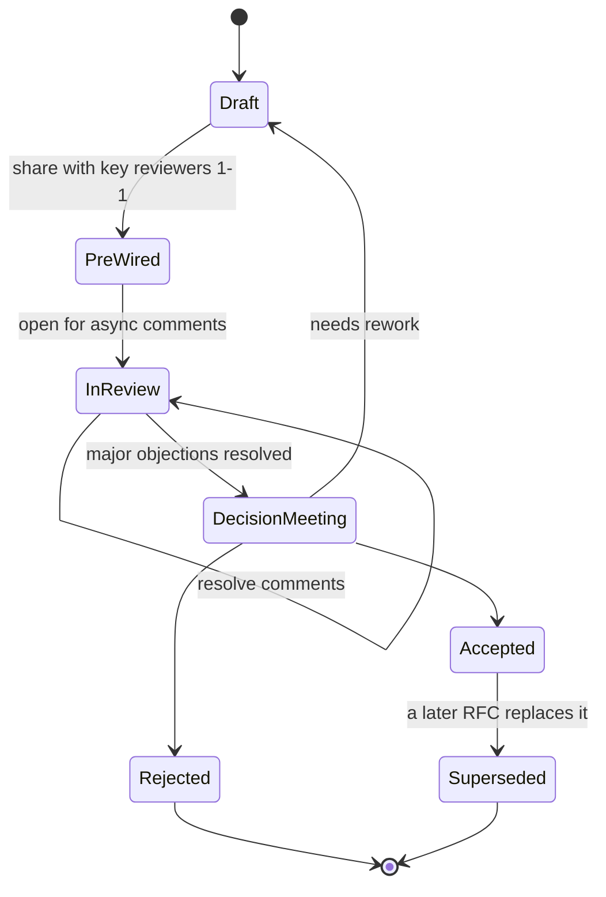

## 83.4 Writing alternatives honestly, and running the RFC process

#### Concept

Two skills live together here because they are the heart of getting a design agreed. The first is writing the alternatives you rejected *honestly*, so reviewers trust that you actually considered them rather than building a lineup of strawmen to make your favourite look good. The second is running the RFC process — the machinery of drafting, pre-wiring reviewers, collecting async comments, resolving them, and reaching a decision — so that the honest document actually produces a decision instead of an endless thread.

#### Why does it exist?

Imagine a design doc with an "alternatives considered" section that lists two options: your proposal, described in loving detail, and "do nothing", described as obviously terrible. A smart reviewer reads that and thinks: this person already decided, and the alternatives are theatre. Trust evaporates. They stop believing your tradeoffs too, because if you misrepresented the alternatives, what else did you shade.

Honest alternatives exist to earn trust and to actually find the best design. Sometimes writing an alternative fairly makes you realise it is better than your proposal, which is the system working. The RFC process exists because a good document on its own does not create alignment; alignment is manufactured by getting the right people to engage with the document before the decision, so the decision is theirs too, not something imposed on them.

#### Mental model

Imagine a courtroom where the prosecution writes the defence's argument. If they write it as a weak, obviously-wrong case, the jury sees through it and distrusts the whole trial. The strawman is a weak defence argument written by the prosecution. To be believed, you must state the opposing case as strongly as its real advocates would — steelman it, not strawman it. A reviewer who reads their own objection, stated fairly, and then sees a genuine answer to it, is won over. A reviewer who reads a caricature of their objection digs in.

#### How it works

First, honest alternatives. For each real alternative, write three things: what it is, its genuine advantages, and the specific reason you rejected it for *this* context. The reason must be contextual, not universal — "Kafka is bad" is not a reason; "Kafka adds a cluster we would have to operate for a throughput we will not reach for two years" is.

Second, the RFC process. It has a lifecycle:



The steps:

1. **Draft.** You write the document. It is not shared widely yet.
2. **Pre-wire.** Before opening it to everyone, you talk one-on-one to the two or three people most likely to object or most affected. Part 59.4 called this pre-socialising. Either they change your mind (saving you a public failure) or you incorporate their concern and they become supporters. Proposals that first appear in a big meeting mostly die there.
3. **Open for review.** The document goes to all affected teams with a clear comment deadline. Asynchronous, so people in every timezone can engage.
4. **Resolve comments.** You respond to every comment: accept and change the doc, or explain why not. A comment left unresolved is a reviewer left unconvinced.
5. **Decision meeting.** A short, scheduled meeting (often thirty minutes) where the decision is ratified. If pre-wiring worked, this is a formality. Its real job is to force a decision date so the RFC does not drift forever.
6. **Status lifecycle.** The RFC is marked Accepted, Rejected, or needs rework. Accepted RFCs can later be Superseded by a new one — never edited to say something different.

#### Practical example

For the notification RFC, the alternatives section, written honestly:

```markdown
## Alternatives considered

### A. Keep synchronous, add a circuit breaker
Keep the direct HTTP call but wrap it in a circuit breaker so order
placement is not blocked when notifications degrade.
- **Advantages:** smallest change, no new infrastructure, no eventual
  consistency, easy to reason about.
- **Why rejected:** when the breaker is open, notifications are simply
  dropped, not deferred. We would lose "order shipped" emails during
  exactly the incidents when customers are most anxious. Durability
  requirement (no lost notification if the order committed) is not met.

### B. Fire-and-forget async HTTP (no outbox)
Order service calls notifications asynchronously, not awaiting the result.
- **Advantages:** removes the call from the hot path with almost no new
  infrastructure.
- **Why rejected:** if the order commits and the process crashes before
  the async call fires, the notification is lost. No durability. This is
  the classic dual-write problem (see Part 30.9); the outbox exists
  specifically to solve it.

### C. RabbitMQ instead of Kafka
Use RabbitMQ, which the team already operates, instead of Kafka.
- **Advantages:** we already run it, lower operational cost, simpler,
  per-message acknowledgement fits at-least-once naturally.
- **Why NOT clearly rejected:** this is genuinely close. See §Tradeoffs.
  We lean Kafka because the platform team is standardising on it for
  event streaming and two other consumers are likely within a year. If
  that standardisation slips, RabbitMQ is the better choice for this
  alone. We will confirm with the platform team before the decision
  meeting.
```

Notice option C. It is not dismissed; it is admitted to be close, and the real deciding factor (an organisational bet on Kafka, not a technical superiority) is stated plainly. That honesty is what makes reviewers trust options A and B were also fairly judged.

#### Artifact example

A comment-resolution log — the record that shows reviewers were heard. This is what turns "I left a comment and it was ignored" into "I left a comment and here is what happened".

```markdown
## Review comments and resolutions (RFC-114)

| # | Reviewer | Comment | Resolution |
|---|---|---|---|
| 1 | Priya (platform) | Confirm Kafka standardisation is real before we commit a consumer to it. | Confirmed in 1-1; platform roadmap Q3 has 2 more producers. Added to §4C. ACCEPTED. |
| 2 | Sam (notifications) | Per-order ordering — how do we guarantee it? | Partition the topic by order_id so all events for one order go to one partition. Added to design §5. ACCEPTED. |
| 3 | Lena (mobile) | Will push notification latency get worse? | p95 end-to-end moves from ~1s to <10s. We judge this acceptable; mobile confirmed. NOTED, no change. |
| 4 | Raj (order) | Outbox table will grow forever. Cleanup? | Added a relay-then-delete step and a daily sweep of rows older than 7 days. Added to §5. ACCEPTED. |
| 5 | Sam (notifications) | Should we do exactly-once? | Out of scope; non-goal. At-least-once + idempotent consumer. Pointed to non-goals §3. DECLINED, with reason. |
```

Every comment has a visible outcome. Two changed the design (comments 2 and 4 are genuinely better for the change). One was declined with a reason and a pointer. This table is the single most powerful trust-builder in the RFC process: reviewers see that engaging actually changes things, so they keep engaging on your future RFCs.

#### Real-world scenario

A staff engineer at an e-commerce company has a 90% hit rate on getting RFCs accepted, far above her peers. People assume she writes better documents. She does write well, but the real reason is pre-wiring. Before any RFC goes wide, she has a fifteen-minute call with each of the three or four people who could kill it: the owner of the affected system, the skeptic who always has good objections, and whoever controls the resource she needs.

By the time the RFC opens for review, those people have already shaped it and feel ownership of it. The public review surfaces only minor comments, because the major objections were handled in private where nobody had to lose face. Her decision meetings are ten minutes long. Her peers who skip pre-wiring have two-hour debates in the open and a 50% acceptance rate. Same documents, different process, double the success.

#### Failure scenario

An engineer writes a technically excellent RFC and opens it cold to twenty people with no pre-wiring. The owner of the system being changed first hears about the proposal when it lands in their inbox, framed as nearly decided. They feel ambushed. In the public thread, defending their territory, they raise every possible objection, some real and some face-saving. Other reviewers pile on. The thread reaches sixty comments. The decision meeting becomes a two-hour argument. The RFC is sent back for rework, loses momentum, and quietly dies three weeks later.

The document was fine. The process killed it. One fifteen-minute call with the system owner before going wide would have turned an ambush into a collaboration, and the sixty-comment thread into a five-comment one.

#### Edge cases & failure modes

- **Strawman alternatives.** Rejected options described weakly. Reviewers lose trust in the whole document.
- **No pre-wiring.** Key people first see the proposal in public and feel ambushed, so they fight it in the open.
- **Comments left unresolved.** A reviewer whose comment got no response is a reviewer who will not support the RFC and will remember next time.
- **No decision deadline.** The RFC drifts in "review" forever. Someone must own forcing a decision date.
- **Editing an accepted RFC to change the decision.** You destroy the record. Supersede instead.
- **Decision meeting doing the review.** If major objections are still live at the meeting, pre-wiring and async review failed, and the meeting becomes a design session that runs over and resolves nothing.
- **The author who argues every comment.** Defending every point, even minor ones, signals you want to win rather than find the best answer. Concede the small stuff fast.

#### How a Principal Engineer thinks about this

They spend more effort on the alternatives section than on their own proposal, because they know that is where trust is won or lost, and because writing an alternative fairly is the best way to discover their own proposal is wrong before shipping it. They pre-wire as a reflex, not as a special effort — they would never dream of opening a consequential RFC cold, because they have watched too many good proposals die in public ambushes.

They treat every comment as a debt to be settled, visibly, because an unresolved comment is an unconvinced reviewer and reviewers have long memories. And they force a decision date, because they have seen RFCs rot in review for months while the problem they addressed got worse. A decision — even a "no" — is better than a document in limbo, because a "no" frees everyone to do something else.

#### Common mistakes

- **Strawmanning alternatives to make the proposal look inevitable.** The giveaway is that no alternative has any real advantages listed.
- **Skipping pre-wiring to save time.** It costs far more time later in a hostile public thread.
- **Treating the decision meeting as the review.** By then it is too late to raise major objections gracefully.
- **Never closing the RFC.** It drifts; the problem festers; momentum dies.
- **Winning every argument.** You can win the review and lose the willingness of people to work with you again.

#### Interview questions

1. **How do you write the "alternatives considered" section so reviewers trust it?**
   *Expected answer:* steelman each alternative — state its real advantages, then give a contextual, specific reason for rejecting it; and be willing to admit when an alternative is close. Strawmen destroy trust in the whole document. *Why it matters:* tests intellectual honesty, which is the currency of architecture influence.

2. **Walk me through how you take an RFC from draft to decision.**
   *Expected answer:* draft, pre-wire the key reviewers one-on-one, open for async review with a comment deadline, resolve every comment visibly, hold a short decision meeting that ratifies rather than debates, mark status. *Follow-up:* who exactly do you pre-wire and what do you say to them.

3. **An RFC has been in review for six weeks with no decision. What is wrong and how do you fix it?**
   *Expected answer:* no owner is forcing a decision date, or major objections were never pre-wired so the public thread stalled. Fix: pre-wire the remaining blockers privately, set a hard decision date, and make the call — even a "no" is better than limbo. *Why it matters:* tests whether they drive closure rather than admire the problem.

#### Practical exercise

Take a decision you are currently facing. Write the alternatives section: at least two real alternatives besides your preferred option, each with genuine advantages and a contextual reason for rejection. Then write down who you would pre-wire before opening it for review, and the one sentence you would say to each to bring them on board.

**Acceptance criteria:** at least one alternative has advantages strong enough that a reasonable person could pick it, and your rejection reason is specific to your context (mentions your numbers, your team, or your constraints) rather than a universal claim. You can name the two or three people whose buy-in determines whether this gets approved.
