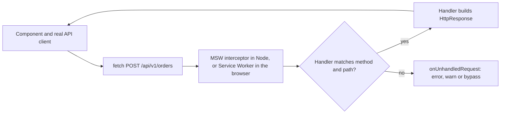
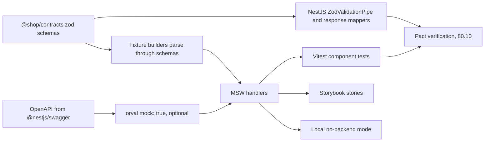

## 83.5 Mocking the network with MSW

#### Concept

**Mock Service Worker (MSW)** intercepts HTTP requests at the network layer and answers them with handlers you write. In the browser it registers a real **Service Worker** (75.8, 82.9) that catches `fetch` from the page; in Node (Vitest, Jest, Playwright's Node side) it patches the request modules (`fetch`, `http`, `XMLHttpRequest`) through its interceptors library. Either way, your application code runs unchanged: the real API client, the real parsers, the real error mapper (80.6). Only the server is fake.

MSW 2 (released in late 2023) changed the API completely from v1. Handlers are built with `http.get(...)`, `http.post(...)` and return `HttpResponse` objects based on the Fetch API's `Response`. The v1 style, `rest.get(path, (req, res, ctx) => res(ctx.json(...)))`, does not exist in v2; most blog posts and many Stack Overflow answers still show it.

#### Why does it exist?

The alternatives all cut the test somewhere worse:

- **`vi.mock('../api/orders')`** removes the client, the zod parsing and the error mapping from the test (the coupon incident of 83.1).
- **`vi.stubGlobal('fetch', vi.fn())`** keeps the client but makes every test hand-build `Response` objects, and gives no protection against a request the test did not expect.
- **A real backend** is right for e2e (83.11) but too slow and too stateful for 400 component tests, and cannot easily produce a `503`, a timeout or a malformed body on demand.

MSW sits at the one boundary the backend team can describe exactly: method, path, headers, status and body.

#### Mental model

Imagine a film set where the actors (your components and client) perform exactly as they will in the cinema, but the street outside the window is a painted backdrop. The actors do not know it is painted. The crew can change the backdrop between takes: a sunny street, a storm, an empty road. MSW is the backdrop, and `server.use(...)` is changing it for one take.

#### How it works



1. **Handlers** describe responses: `http.get('http://localhost:3000/api/v1/orders/:id', ({ params, request }) => HttpResponse.json(...))`. Paths support parameters (`:id`) and wildcards (`*`).
2. **The server** (`setupServer(...handlers)` from `msw/node`) is started once per test file in the setup file with `server.listen()`, reset after each test with `server.resetHandlers()`, and stopped with `server.close()`.
3. **Per-test overrides**: `server.use(handler)` prepends handlers for the current test only; `resetHandlers()` removes them. `{ once: true }` makes a handler answer one request and then fall through, which is how you test "first attempt fails, retry succeeds".
4. **Unhandled requests**: `onUnhandledRequest: 'error'` turns a request no handler matched into a test failure, so a component that suddenly calls a new endpoint cannot pass by accident.
5. **Responses** are real `Response` objects: `HttpResponse.json(body, { status, headers })`, `HttpResponse.text()`, `new HttpResponse(null, { status: 204 })`, and `HttpResponse.error()` for a network failure (the client sees `TypeError: Failed to fetch`).
6. **Timing**: `await delay(200)` inside a handler; `await delay('infinite')` for a request that never answers (tests a timeout or a pending state).
7. **In the browser**, `npx msw init public/ --save` writes `mockServiceWorker.js` into the static folder; `setupWorker(...handlers).start()` from `msw/browser` registers it. The same handler modules serve local development without a backend and Storybook (through `msw-storybook-addon`).

Two environment details catch most teams:

- **Absolute URLs in Node.** In the browser, `fetch('/api/v1/orders')` resolves against the page's origin. Node's `fetch` has no page and throws `TypeError: Failed to parse URL`. The fix is in the app, not the test: route every request through one `apiUrl(path)` helper whose base is empty in the browser and `http://localhost:3000` in tests (set from `import.meta.env` or a config module), and write handlers with the same absolute base.
- **Jest with jsdom.** `jest-environment-jsdom` hides Node's `fetch`, `Response`, `TextEncoder` and streams, which MSW 2 needs. Use the `jest-fixed-jsdom` environment (from the MSW maintainers) or move to Vitest, whose jsdom environment keeps Node's globals.

#### Practical example

The checkout needs default handlers for the happy path (view, address, coupon, place order) and per-test overrides for each failure: `422` on the postcode, `409 CART_CHANGED` on the coupon, `402` declined payment, a timeout followed by a replay, a `503` with a non-JSON body from a proxy. The handlers also enforce part of the contract: the place-order handler rejects a request without `Idempotency-Key`, exactly as the API does, and counts calls so a double-click test can assert "one request".

#### React / Next.js example

The setup and default handlers:

```ts
// apps/web/src/test/msw/server.ts  (MSW 2)
import { setupServer } from 'msw/node';
import { checkoutHandlers } from './checkout.handlers';
import { orderHandlers } from './orders.handlers';

export const server = setupServer(...checkoutHandlers, ...orderHandlers);
```

```ts
// apps/web/src/test/setup.ts (additions to 83.2)
import { afterAll, afterEach, beforeAll } from 'vitest';
import { server } from './msw/server';

beforeAll(() => server.listen({ onUnhandledRequest: 'error' }));   // a surprise request fails the test
afterEach(() => server.resetHandlers());                            // drop per-test overrides
afterAll(() => server.close());
```

```ts
// apps/web/src/test/msw/checkout.handlers.ts
import { http, HttpResponse, delay } from 'msw';
import { PlaceOrderRequestSchema, ApplyCouponSchema } from '@shop/contracts';
import { aCheckoutView, aPricedCart, aProblem } from '../builders';

export const API = 'http://localhost:3000/api/v1';
export const placeOrderCalls: { key: string | null; body: unknown }[] = [];

export const checkoutHandlers = [
  http.get(`${API}/checkout/view`, () => HttpResponse.json(aCheckoutView({ version: 7 }))),

  http.post(`${API}/checkout/coupon`, async ({ request }) => {
    const parsed = ApplyCouponSchema.safeParse(await request.json());
    if (!parsed.success) return HttpResponse.json(aProblem('VALIDATION_FAILED', 400), { status: 400 });
    return HttpResponse.json(aPricedCart({ version: parsed.data.cartVersion + 1, appliedCoupon: parsed.data.code }));
  }),

  http.post(`${API}/orders`, async ({ request }) => {
    const key = request.headers.get('Idempotency-Key');
    const body = await request.json();
    placeOrderCalls.push({ key, body });
    if (!key) return HttpResponse.json(aProblem('IDEMPOTENCY_KEY_REQUIRED', 400), { status: 400 }); // like the API
    if (!PlaceOrderRequestSchema.safeParse(body).success) {
      return HttpResponse.json(aProblem('VALIDATION_FAILED', 400), { status: 400 });
    }
    await delay(30);                                                 // enough for a double click to land
    return HttpResponse.json({ id: 'A7K2Q9P', status: 'PENDING' }, { status: 201 });
  }),
];
```

Per-test overrides for the failure paths:

```tsx
// apps/web/src/checkout/CouponStep.msw.test.tsx
import { screen } from '@testing-library/react';
import { http, HttpResponse } from 'msw';
import { beforeEach, expect, it } from 'vitest';
import { server } from '../test/msw/server';
import { API } from '../test/msw/checkout.handlers';
import { aProblem, aPricedCart } from '../test/builders';
import { renderCheckoutAt } from '../test/render-checkout';         // renderWithProviders + CheckoutPage at a step

it('shows the server message under the code for an expired coupon', async () => {
  server.use(http.post(`${API}/checkout/coupon`, () => HttpResponse.json(
    aProblem('COUPON_REJECTED', 422, [{ path: 'code', code: 'EXPIRED', message: 'This code expired on 31 Oct' }]),
    { status: 422, headers: { 'Content-Type': 'application/problem+json' } },
  )));
  const { user } = await renderCheckoutAt('coupon');
  await user.type(screen.getByRole('textbox', { name: 'Coupon code' }), 'OCT50{Enter}');
  expect(await screen.findByText('This code expired on 31 Oct')).toBeVisible();
});

it('shows the cart-changed notice and the fresh totals on a 409', async () => {
  server.use(http.post(`${API}/checkout/coupon`, () => HttpResponse.json(
    { ...aProblem('CART_CHANGED', 409), cart: aPricedCart({ version: 12, totalMinor: '84900' }) },
    { status: 409, headers: { 'Content-Type': 'application/problem+json' } },
  )));
  const { user } = await renderCheckoutAt('coupon');
  await user.type(screen.getByRole('textbox', { name: 'Coupon code' }), 'SAVE50{Enter}');
  expect(await screen.findByText(/your cart changed in another tab/i)).toBeVisible();
  expect(screen.getByRole('complementary', { name: 'Order summary' })).toHaveTextContent('₹849.00');
});

it('treats an HTML 502 from a proxy as "service unavailable", not a crash', async () => {
  server.use(http.post(`${API}/checkout/coupon`, () =>
    new HttpResponse('<html><body>Bad Gateway</body></html>', { status: 502, headers: { 'Content-Type': 'text/html' } })));
  const { user } = await renderCheckoutAt('coupon');
  await user.type(screen.getByRole('textbox', { name: 'Coupon code' }), 'SAVE50{Enter}');
  expect(await screen.findByText('Could not apply the code. Please try again.')).toBeVisible(); // toApiError handled it
});

it('recovers from a network failure on retry', async () => {
  server.use(http.post(`${API}/checkout/coupon`, () => HttpResponse.error(), { once: true }));  // then default handler
  const { user } = await renderCheckoutAt('coupon');
  const input = screen.getByRole('textbox', { name: 'Coupon code' });
  await user.type(input, 'SAVE50{Enter}');
  expect(await screen.findByText('Could not apply the code. Please try again.')).toBeVisible();
  await user.click(screen.getByRole('button', { name: 'Apply' }));
  expect(await screen.findByText('SAVE50 applied.')).toBeVisible();
});
```

Counting requests for the double-click test uses the handler's own log. MSW's life-cycle events (`server.events.on('request:start', ...)`) are an alternative when you want to count every request regardless of handler:

```tsx
it('sends one order request for a double click, with an idempotency key', async () => {
  placeOrderCalls.length = 0;
  const { user } = await renderCheckoutAt('payment');
  await user.dblClick(screen.getByRole('button', { name: 'Place order' }));
  expect(await screen.findByText(/order A7K2Q9P/i)).toBeVisible();
  expect(placeOrderCalls).toHaveLength(1);
  expect(placeOrderCalls[0].key).toMatch(/^[0-9a-f-]{36}$/);
});
```

#### Backend side (NestJS)

A handler is a claim about what the API does. Each claim should be traceable to the API's real behaviour:

| Handler behaviour | API behaviour that must exist | Where the API proves it |
|---|---|---|
| `400 IDEMPOTENCY_KEY_REQUIRED` without the header | `IdempotencyInterceptor` rejects missing keys (18.12) | Supertest e2e (45.13) |
| `409 CART_CHANGED` with a fresh `cart` in the body | Conditional `UPDATE ... WHERE version = $n` (77.13) | Integration test with a real PostgreSQL (45.9) |
| `problem+json` with `code`, `issues`, `requestId` | One global `ProblemDetailsFilter` (80.6) | Pact verification (80.10) |
| HTML `502` from a proxy | The load balancer, not Nest, returns it | Not an API test: a resilience case the client must handle |

The API can also make mocks safer by exporting what the mocks need from `@shop/contracts`: the request schemas (so handlers validate what they receive), the error codes as a zod enum (so a handler cannot invent `CART_CHANGD`), and example payloads used in its own OpenAPI document (80.2). When the backend renames an error code, the web's handler modules fail to type-check, which is the right moment to find out.

```ts
// packages/contracts/src/errors.ts: the known codes of 80.6 plus checkout's, as a closed enum for writers and fixtures
// (readers still accept any string in ProblemSchema.code, so a new code never crashes an old client)
import { z } from 'zod';

export const ErrorCodeSchema = z.enum([
  'VALIDATION_FAILED', 'IDEMPOTENCY_KEY_REQUIRED', 'IDEMPOTENCY_IN_PROGRESS', 'CART_CHANGED',
  'COUPON_REJECTED', 'ADDRESS_REJECTED', 'PAYMENT_DECLINED', 'ORDER_NOT_CANCELLABLE', 'UPSTREAM_UNAVAILABLE',
]);
export type ErrorCode = z.infer<typeof ErrorCodeSchema>;    // ProblemDetailsFilter and aProblem() both take ErrorCode
```

#### Production scenario

A storefront has 64 MSW handlers across 9 modules, used in three places: 420 Vitest component tests, 140 Storybook stories (through `msw-storybook-addon`, so designers can see every error state), and a "no backend" local mode (`setupWorker` started when `NEXT_PUBLIC_API_MOCKING=enabled` in development only). Handler maintenance costs about an hour a week. In one quarter `onUnhandledRequest: 'error'` caught 14 pull requests that added a new API call without a test for its failure states.

#### Failure scenario

A team's MSW handlers returned `HttpResponse.json(...)` for errors without a `Content-Type: application/problem+json` header, so `Content-Type` was `application/json`. The client's `toApiError` (80.6) accepted any JSON. Months later the API team made the global filter stricter and the client was changed to check for `problem+json` before parsing an error body, to avoid treating a JSON success payload from a misconfigured proxy as an error. Every component test of an error state now failed, but only in the web repository, two weeks after the API change, during an unrelated pull request. The real fix was shared: `aProblem()` in the fixtures package now returns a full `HttpResponse` with the right content type, and the API's Pact verification asserts the header.

#### Edge cases & failure modes

- **Relative URLs in Node** throw before MSW sees the request; use an absolute base in tests.
- **Handler order**: the first matching handler wins; a wildcard `http.all('*', ...)` placed first hides everything after it.
- **`resetHandlers()` forgotten**, so a `503` override from one test leaks into the next.
- **Reading the body twice**: `await request.json()` consumes it; use `request.clone()` if two pieces of code must read it.
- **Fake timers with `delay()`**: the delay never resolves unless time is advanced.
- **Timeouts with `AbortSignal.timeout(15_000)`** are not controlled by Vitest's fake timers in Node; make the timeout configurable and use 50 ms in tests, with `delay('infinite')` in the handler.
- **The Service Worker in development** keeps intercepting after you disable mocking until the page is reloaded and the worker is unregistered; gate it on an environment flag and call `worker.stop()`.
- **Never ship MSW to production**: import `msw/browser` only inside a development-only dynamic import.

#### How a Senior Full-Stack Engineer thinks about this

The senior treats MSW handlers as a second, small implementation of the API's contract, and holds them to the same standard: they validate requests with the real request schemas, return responses built through the real response schemas, use the real error codes, and fail on any request nobody planned for. They keep one handler set for tests, Storybook and offline development so there is one place to update. And they remember what MSW cannot prove: that the real API behaves like the handler. That is the job of contract tests (80.10) and a few e2e journeys (83.7).

#### Common mistakes

- **Copying v1 examples** (`rest`, `res(ctx.json())`) into an MSW 2 project.
- **`onUnhandledRequest: 'bypass'` in tests**, which lets real requests leak out to the network or fail silently.
- **Handlers that accept anything**, so a client sending the wrong body still gets a happy response.
- **Inline fixtures** in every test, each shaped a little differently.
- **Mocking only the happy path**, leaving error, empty and slow states untested.

#### Interview questions

1. **Why mock at the network layer rather than the module layer?** Expected answer: the real client, parsing and error mapping run; tests break when the contract breaks, not when internals move.
2. **How do you test a retry that succeeds on the second attempt?** Expected answer: `server.use(http.post(url, () => HttpResponse.error(), { once: true }))`, then the default handler answers the retry.
3. **What does `onUnhandledRequest: 'error'` protect against?** Expected answer: components calling endpoints no test planned for, and accidental real network calls.
4. **How do MSW mocks drift from the real API, and how do you limit it?** Expected answer: hand-written shapes and codes; build fixtures through shared schemas, validate requests in handlers, share the error code enum, verify with Pact.
5. **What changed between MSW 1 and 2?** Expected answer: `http` namespace and `HttpResponse` based on Fetch API types instead of `rest` and `res(ctx...)`; Node 18+ required; `msw/node` and `msw/browser` entry points.

#### Practical exercise

Build the MSW layer for checkout and the order pages.

Acceptance criteria:

- `onUnhandledRequest: 'error'` in tests; zero unhandled-request errors on `main`.
- Every handler that accepts a body validates it with the shared request schema and returns the API's `400 VALIDATION_FAILED` shape on failure.
- Error fixtures are typed with `ErrorCode`; changing an error code in `@shop/contracts` breaks the web's type check.
- Tests exist for: field `422`, `409 CART_CHANGED`, `429` with `Retry-After: 30`, HTML `502`, network error then success, and a timeout using a configurable 50 ms timeout and `delay('infinite')`.
- The same handlers power Storybook and a development-only "no backend" mode.

## 83.6 Sharing mocks with the backend contract

#### Concept

A **fixture** is a canned example of data: an order, a cart, an error. A **builder** is a function that returns a valid fixture with sensible defaults and lets each test override only what it cares about (`anOrder({ status: 'SHIPPED' })`, Part 45.6). Sharing mocks with the backend contract means fixtures and handlers are derived from the same source of truth the API uses: the zod schemas in `@shop/contracts` (80.3), or the OpenAPI document generated from NestJS (80.2). A fixture that the API could never produce cannot be built.

#### Why does it exist?

Because mocks rot. A hand-written order fixture written in March still has `totalAmount: 1299` (a number) in October, after the API moved to `totalMinor: '129900'` (a string, 80.7). The component tests are green, the UI renders `NaN` in production. Every mock is a copy of the contract, and copies drift unless something checks them.

#### Mental model

Imagine a bakery that makes display cakes for the window. If the display cakes are made from the same recipe cards as the real ones, a recipe change shows up in the window the next morning. If the window team keeps their own recipe cards, the window shows last year's cake forever.

#### How it works



1. **Builders parse.** `anOrder(overrides)` merges defaults with overrides and returns `OrderSummarySchema.parse(result)`. An override that breaks the schema throws in the test that wrote it, with zod's path and message.
2. **Builders live next to the contracts**, in a `packages/test-fixtures` workspace package (dev dependency only), so both the web and the API's tests can use them. The API uses them for request bodies in supertest tests; the web uses them for responses in MSW.
3. **Handlers validate requests** with the request schemas, so the mock rejects what the API would reject.
4. **Generated mocks** are an alternative or a starting point: orval with `mock: true` (80.2) generates MSW handlers with faker-generated data from the OpenAPI document. Generated mocks are good for "every endpoint answers something"; hand-written builders are better for named scenarios ("an order that shipped yesterday").
5. **The contract test closes the loop**: Pact (80.10) proves the API actually returns what the consumer tests expect, so the remaining risk is behaviour, not shape.

#### Practical example

The order fixture used by 140 tests and 30 stories:

- defaults represent a typical order: `PAID`, 2 items, INR, placed 2 hours ago in `Asia/Kolkata`;
- `deliveryDate`, `deliveredAt`, `storeTimeZone`, `version` and `updatedAt` are present because `OrderSummarySchema` requires them (80.7);
- money is minor units as strings;
- IDs are UUIDs with a readable `displayId`.

When the backend adds a required field to `OrderSummarySchema`, every builder call fails at once with `invalid_type at "deliveryWindow"`, and one change to the builder's defaults fixes 140 tests.

#### React / Next.js example

```ts
// packages/test-fixtures/src/orders.ts  (dev dependency of apps/web and apps/api)
import { OrderSummarySchema, type OrderSummary } from '@shop/contracts';

const FIXED_NOW = '2026-11-05T09:30:00.000Z';                 // stable for screenshots and date text

export function anOrder(overrides: Partial<OrderSummary> = {}): OrderSummary {
  return OrderSummarySchema.parse({                           // throws with a path if the fixture is impossible
    id: crypto.randomUUID(),                                  // global in browsers and Node 19+: works in Storybook too
    displayId: 'A7K2Q9P',
    status: 'PAID',
    totalMinor: '129900',
    currency: 'INR',
    placedAt: FIXED_NOW,
    updatedAt: FIXED_NOW,
    deliveryDate: '2026-11-06',
    deliveredAt: null,
    storeTimeZone: 'Asia/Kolkata',
    version: 3,
    items: [
      { sku: 'TB-SONIC-01', name: 'Sonic toothbrush', quantity: 1, unitPriceMinor: '99900' },
      { sku: 'FL-MINT-50', name: 'Mint floss', quantity: 2, unitPriceMinor: '15000' },
    ],
    ...overrides,
  });
}

export const aShippedOrder = (o: Partial<OrderSummary> = {}) => anOrder({ status: 'SHIPPED', ...o });
```

```ts
// packages/test-fixtures/src/problems.ts
import { HttpResponse } from 'msw';
import { ProblemSchema, type ErrorCode, type ApiIssue } from '@shop/contracts';

export function aProblem(code: ErrorCode, status: number, issues: ApiIssue[] = [], requestId = 'req-test-1') {
  return ProblemSchema.parse({ type: `https://errors.shop.example/${code}`, title: code, status, code, issues, requestId });
}

export const problemResponse = (code: ErrorCode, status: number, issues: ApiIssue[] = []) =>
  HttpResponse.json(aProblem(code, status, issues), {
    status,
    headers: { 'Content-Type': 'application/problem+json', 'X-Request-Id': 'req-test-1' }, // same as the real filter
  });
```

Using a recorded real response as a fixture is sometimes worth it for complicated payloads (a search result with facets). Record from staging once, then run it through the schema in a test, so the recording is also checked when the schema changes:

```ts
// apps/web/src/test/recorded.test.ts
// @vitest-environment node
import { expect, it } from 'vitest';
import { SearchResultSchema } from '@shop/contracts';
import recorded from './recordings/search-toothbrush.json';

it('the recorded search response still matches the contract', () => {
  expect(() => SearchResultSchema.parse(recorded)).not.toThrow();
});
```

#### Backend side (NestJS)

The API uses the same package in three ways:

- **Request bodies** in supertest tests come from builders (`aPlaceOrderRequest()`), so the API's tests and the web's mocks agree on what a valid request is.
- **Response conformance**: the API's e2e tests parse real responses with the response schemas. This is the backend half of the bargain: if the web's fixtures are built through `OrderSummarySchema` and the API's real responses are checked against `OrderSummarySchema`, the fixtures and reality can only differ in values, not in shape.
- **Error catalogue test**: one test triggers each `ErrorCode` the API can return and checks the body with `ProblemSchema` and the content type.

```ts
// apps/api/test/orders.e2e-spec.ts (excerpt)
import { OrderSummarySchema } from '@shop/contracts';
import { aPlaceOrderRequest } from '@shop/test-fixtures';

it('returns an order that matches the shared contract', async () => {
  const created = await request(app.getHttpServer())
    .post('/v1/orders').set(authHeaders).set('Idempotency-Key', randomUUID())
    .send(aPlaceOrderRequest({ cartId })).expect(201);
  const res = await request(app.getHttpServer()).get(`/v1/orders/${created.body.id}`).set(authHeaders).expect(200);
  expect(() => OrderSummarySchema.parse(res.body)).not.toThrow();   // the same schema the web fixtures parse through
});
```

#### Production scenario

After moving to schema-parsed builders, a storefront measured fixture-related escapes: in the 12 months before, 7 production bugs where a component test passed with a fixture shape the API no longer produced; in the 12 months after, zero. The cost was a one-off two-day migration of 210 inline fixtures into 18 builders, and about 4 ms extra per test for zod parsing.

#### Failure scenario

The API added `PARTIALLY_REFUNDED` to the order status enum. `OrderSummarySchema` used `z.enum([...])` with the known statuses, so the web's builders were still valid, but the web had no fixture with the new status and no UI for it. The API shipped first, as the rollout table in 80.9 says it may only when clients have a fallback. The web's status badge did `STATUS_LABELS[order.status].label`, which threw for the new value, and the error boundary replaced the whole order page.

The schema should have been an open enum on the client side (80.7): known values plus a fallback. The test that would have caught it is a single builder call, `anOrder({ status: 'SOMETHING_NEW' as never })`, rendered on the order page with an assertion that a generic "Updated" badge appears. The team now adds an "unknown enum value" test for every enum the UI renders.

#### Edge cases & failure modes

- **Random data in fixtures** (faker without a seed) produces screenshots and text assertions that differ per run; seed it or use fixed defaults.
- **Fixtures with real personal data** copied from production dumps; never, even in tests.
- **Builders that bypass the schema** for "special cases" (`as OrderSummary`), which reintroduce drift.
- **Generated mocks only**: every endpoint returns plausible noise, but nobody wrote the scenario that matters ("coupon expired").
- **Shared fixtures package pulling `msw` into the API's production dependencies**; keep it a dev dependency on both sides.
- **Dates**: fixtures with `new Date()` make "placed 2 hours ago" text change with the clock; use a fixed instant and fake timers or pass `now` explicitly.

#### How a Senior Full-Stack Engineer thinks about this

The senior asks "what makes this mock true?" for every mock, and wants the answer to be a mechanism, not a person's memory. Builders parsing through shared schemas, request validation in handlers, a shared error enum, response conformance checks in the API's tests and Pact verification are five cheap mechanisms that together make most drift impossible. They keep builders boring and deterministic, named for business situations, and owned by both teams.

#### Common mistakes

- **Fixtures typed with `as` casts** rather than parsed.
- **Each test file defining its own order shape.**
- **Not testing unknown enum values** that the API is allowed to add.
- **Builders that return the same object instance**, so one test's mutation changes another test's fixture.
- **Fixtures package depending on app code**, creating a cycle between apps and the package.

#### Interview questions

1. **How do you keep frontend mocks in sync with the API?** Expected answer: build fixtures through shared schemas, validate requests in handlers, share error codes, check real responses against the same schemas in API tests, verify with Pact.
2. **Builders or generated mocks?** Expected answer: generated mocks for breadth, builders for named scenarios; both through the schema.
3. **What test would have caught a new enum value crashing the UI?** Expected answer: render with an unknown value and assert a fallback; the client schema should accept unknown values.
4. **Why should the API's tests use the frontend's fixture package?** Expected answer: one definition of valid requests and responses on both sides; drift shows up in whichever pipeline runs first.

#### Practical exercise

Create `packages/test-fixtures` for the order and checkout domain.

Acceptance criteria:

- Builders for order, cart, checkout view, priced cart, address and problem documents, each parsing through `@shop/contracts`.
- The web's MSW handlers and the API's supertest tests both import from it; neither has inline fixtures for these types.
- An API e2e test parses every order endpoint's response with the shared schema.
- A web test renders the order page with an unknown status and asserts the fallback badge.
- Adding a required field to `OrderSummarySchema` produces a builder error that names the field.
