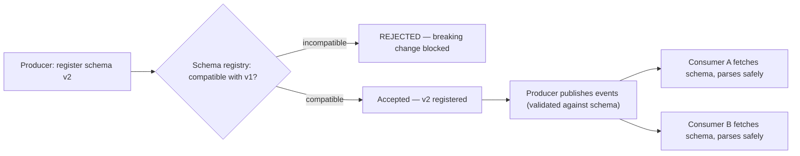
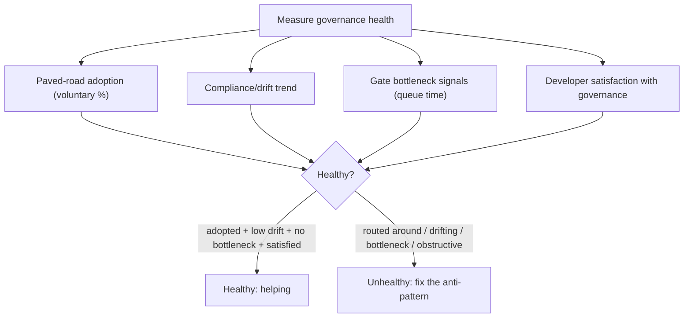

## 83.7 Worked example: rolling out a standard error format and OpenAPI-first contracts across 25 services

This section brings the whole Part together: introducing two standards — a uniform error format and OpenAPI-first API contracts — across 25 NestJS services, using paved roads, fitness functions, waivers and compliance measurement rather than a mandate from a review board. It is the canonical "governance rollout" problem, and doing it well is a principal-level skill.

#### The situation

An e-commerce org has 25 NestJS services, each with its own error format and each documenting its API however it likes (some with hand-written docs, some with nothing). Clients and the API gateway have to special-case every service. Incidents are hard to correlate because errors do not carry a consistent `trace_id`. The principal engineer wants two standards adopted fleet-wide: the error format from 83.3, and OpenAPI-first (the contract is written first and the code is verified against it). The naive approach — mandate it via a review board and chase 25 teams — would take a year and breed resentment. Here is the governance approach.

#### The rollout, step by step

**1. Bake the standard into the paved road (make the right thing the default).**
The shared paved-road package gets a `StandardErrorFilter` (produces the standard error format automatically) and OpenAPI generation wired into the service template. Any *new* service gets both for free, with zero effort. This stops the problem from growing while you fix the existing fleet.

**2. Write the fitness functions (make drift impossible going forward).**
Two fitness functions, added to the shared CI config:
- `error-format.spec`: asserts the service wires `StandardErrorFilter` and that sampled error responses match the schema (the 83.5 convention check).
- `openapi-contract.spec`: asserts the service publishes an OpenAPI spec and that the live endpoints match it (contract-first verification).

```ts
// openapi-contract fitness function (sketch)
it('every endpoint is described in the OpenAPI contract', async () => {
  const app = await buildTestApp();
  const document = loadPublishedOpenApiSpec();     // the committed contract
  const liveRoutes = extractRoutesFromApp(app);     // what the code exposes
  const documented = extractPathsFromSpec(document);
  // The contract and the code must not drift apart
  expect(liveRoutes.sort()).toEqual(documented.sort());
});
```

**3. Migrate the fleet incrementally, highest-value first (not big-bang).**
Rank the 25 services by how much they would benefit: the ones in the gateway's hot path and the ones most involved in incidents go first. Each migration is small: swap in the `StandardErrorFilter` (the paved road makes this a few lines), generate the OpenAPI spec, turn the fitness functions from warn to error. Because the error format is produced by the shared filter, migrating a service is mostly deleting its bespoke error handling and adopting the filter — a day or two of work, not a rewrite.

**4. Measure with scorecards (make progress visible, not policed).**
Each service's scorecard (83.6) shows the two standards as checks. Teams see their own gaps and a fleet-wide dashboard shows the migration trend. Nobody is named or shamed; teams migrate because they can see the gap and want a green scorecard, and because the paved road makes it easy.

**5. Grant waivers where legitimate (keep an escape hatch).**
Two of the 25 services are legacy systems slated for decommissioning in six months. Mandating migration there is waste. They get a recorded, time-boxed waiver ("decommissioning by Q4; no migration required; revisit if timeline slips"). This keeps the governance credible — teams see it is pragmatic, not dogmatic.

**6. Use office hours, not a review board (reserve human attention).**
Teams with tricky cases — a service with an unusual error-handling need, or a public API where the OpenAPI spec affects external partners — book office hours for help. No gate, no queue; advice on demand.

#### The timeline and outcome

```text
Month 1: Standards in the paved road; new services compliant by default.
         Fitness functions written, run as WARN on existing services.
Month 2: Top 8 services (hot path, incident-prone) migrated. Fitness
         functions flipped to ERROR on those 8.
Month 3-4: Next 15 services migrated opportunistically (teams pull it in
         when touching the service), scorecards driving self-correction.
Month 4: 2 legacy services waived (decommissioning). Fleet compliance ~92%.
         Error correlation across services now trivial via trace_id;
         gateway and clients handle all services uniformly.
```

#### Artifact example

The rollout plan as a one-pager — the artifact the principal circulates to align the org.

```markdown
# Rollout: standard error format + OpenAPI-first (25 services)

## Why (the problem, with evidence)
25 services, 25 error formats. Incidents take hours to correlate (no
consistent trace_id in errors). Clients & gateway special-case every
service. 2 of last quarter's long incidents were prolonged by this.

## How we're doing it (governance, not mandate)
1. Baked into the paved road -> new services compliant free, problem stops growing.
2. Two fitness functions -> drift impossible once a service is migrated.
3. Migrate incrementally, highest-value first -> not a big-bang.
4. Scorecards -> teams self-correct; no policing.
5. Waivers for legacy/decommissioning services -> pragmatic, credible.
6. Office hours for tricky cases -> help on demand, no gate.

## What we are NOT doing
- NOT mandating via a review board (bottleneck, resentment).
- NOT a big-bang cutover (too risky across 25 services).
- NOT forcing migration on services being decommissioned (waste).

## Success measure
Fleet compliance > 90% in 4 months; error correlation across services via
trace_id in one query; gateway handles all services uniformly.
```

Every mechanism from this Part appears: paved road (make it the default), fitness functions (enforce it), incremental migration (manage risk), scorecards (measure without policing), waivers (escape hatch), office hours (reserve human attention). No mandate, no review-board gate, and it lands in four months with ~92% compliance and rising, because the right thing was made the easy thing and drift was made impossible.

#### Why this beats the mandate approach

The mandate approach — a review board decrees the standard and chases 25 teams — would take far longer, breed resentment, and leave compliance fragile (services drift back the moment the chasing stops, because nothing enforces it). The governance approach lands faster, with buy-in, and compliance is *durable*, because the paved road makes new services compliant for free and the fitness functions make drift impossible. The difference is the difference between enforcing architecture with people (does not scale, decays) and enforcing it with infrastructure (scales, holds). That difference is the entire thesis of this Part.

#### Practical exercise

Pick a standard your org needs across many services (error format, logging, a security header, OpenAPI contracts). Write the full rollout plan using the six mechanisms: bake it into the paved road, write the fitness functions, migrate incrementally highest-value-first, measure with scorecards, grant waivers where legitimate, and use office hours for tricky cases. Include a timeline and a compliance success measure.

**Acceptance criteria:** the plan makes the standard the default for new services (so the problem stops growing), enforces it with at least one automated fitness function (so drift is impossible), sequences migration by value rather than all-at-once, measures progress via team-facing scorecards rather than policing, and includes a time-boxed waiver path for legitimate exceptions. A reader can see that it will land without a mandate and that compliance will be durable rather than fragile.

## 83.8 Event schema governance and the schema registry

#### Concept

Of all the standards an organisation needs, event schemas are among the most important and most often neglected. When services communicate through events (Part 28), every event has a shape, and if those shapes are inconsistent or change incompatibly, consumers break. **Event schema governance** is the discipline of standardising how events are defined, versioned, and evolved, enforced by a **schema registry** — a central service that holds the canonical schema for every event type and enforces compatibility rules, so a producer cannot publish an event that breaks existing consumers. It is the governance that keeps an event-driven architecture from decaying into a mess of incompatible, undocumented messages.

#### Why does it exist?

Imagine twenty services communicating through events, each team defining its event shapes however it likes, with no central definition and no compatibility checking. One team changes an event's field from a string to an object, and every consumer of that event breaks in production, because nothing stopped the incompatible change. Another team's events have no documented schema, so consumers reverse-engineer the shape from examples and break when an edge case appears. Events arrive that no consumer can parse because the producer and consumer disagree on the format. The event-driven architecture, meant to decouple services, has instead coupled them through undocumented, unstable message shapes.

Event schema governance and a registry exist to prevent exactly this: to give every event a canonical, documented schema, and to enforce that schema changes are backward-compatible so a producer cannot break its consumers. They exist because events are contracts between services (Part 25), and contracts without governance drift into incompatibility, turning the loose coupling of events into the tight, fragile coupling of undocumented message shapes.

#### Mental model

Imagine a postal system where anyone can define their own envelope and address format. Some letters have the address on the front, some on the back, some in a format the sorting machine cannot read; and one day the post office changes the address format, so all existing letters become undeliverable. Chaos. A schema registry is the standard that says: every envelope has this format, the address goes here, and you cannot change the format in a way that makes existing letters undeliverable. The registry is the post office's envelope standard, enforced, so every letter (event) can be delivered and understood by any recipient (consumer), and format changes never break letters already in the system.

#### How it works

The pieces of event schema governance:

```text
- A schema format: every event has a defined schema (JSON Schema, Avro,
  Protobuf). The schema is the contract — it defines the event's shape.
- A schema registry: a central service holding the canonical schema for each
  event type, versioned. Producers register schemas; consumers fetch them.
- Compatibility enforcement: when a producer tries to register a new version of
  a schema, the registry CHECKS it against compatibility rules and REJECTS
  incompatible changes. This is the key mechanism — it prevents breaking changes.
- Compatibility modes (per Part 25):
  * Backward: new consumers can read old events (add optional fields, don't remove).
  * Forward: old consumers can read new events.
  * Full: both. Usually the target for events with many independent consumers.
- Conventions: naming (order.placed.v1), required metadata (event id, timestamp,
  tenant_id), envelope structure — standardised across all events.
```

The registry's enforcement is what makes it governance rather than documentation: a producer physically cannot publish an event whose schema change would break existing consumers, because the registry rejects the incompatible schema. This turns "please don't make breaking changes" (a wish) into "you cannot make breaking changes" (an enforced invariant).



#### Artifact example

An event schema standard and a registry compatibility check — the artifacts that keep an event-driven architecture coherent.

```markdown
# Event schema standard (owner: platform/data team)

## Every event MUST have
- A registered schema in the schema registry (no schema, no publish).
- A standard envelope: { event_id (uuid), event_type, version, occurred_at,
  tenant_id, payload }.
- A versioned type name: `order.placed.v1`.

## Schema evolution rules (enforced by the registry)
- Compatibility mode: FULL (events have many independent consumers).
- Allowed changes: add OPTIONAL fields, add new event types.
- Forbidden changes: remove a field, change a field's type, rename a field,
  make an optional field required. (A truly breaking change = a new version,
  e.g. order.placed.v2, with both running until all consumers migrate — the
  strangler/parallel approach, Part 84.)

## Enforcement (this makes it governance, not a wish)
- The registry REJECTS an incompatible schema registration at publish time.
- A fitness function (Part 83.5) in CI validates events against their schema.
- A producer cannot publish an unregistered or schema-violating event.

---
# Registry compatibility check (what happens on a schema change)
Producer attempts to register order.placed.v1 with `total` changed string->object:
-> Registry: INCOMPATIBLE (type change on existing field). REJECTED.
-> Producer must either: keep `total` as-is, OR publish order.placed.v2 and run
   both until all consumers migrate. The breaking change CANNOT reach consumers.
```

The standard's power is that it defines the event contract precisely (envelope, versioning, evolution rules) and — crucially — names the enforcement: the registry rejects incompatible changes at registration time, so a breaking change physically cannot reach consumers. This turns event compatibility from a fragile convention that teams forget into a database-of-schemas-enforced invariant, which is exactly what keeps a twenty-service event-driven architecture from decaying into incompatible-message chaos.

#### Real-world scenario

An organisation with a schema registry avoids a class of production incidents that plague event-driven architectures without one. A team, under deadline pressure, changes an event's field type in a way that would break three downstream consumers — exactly the kind of change that, without governance, ships and causes a multi-service incident. But the registry rejects the incompatible schema at registration time, with a clear message that the change breaks compatibility, so the producer learns about the problem in CI before it ships, not in a production incident after. The team instead publishes a new event version and runs both until the consumers migrate (Part 84's parallel approach). The registry converted a would-be multi-service breakage into a caught-in-CI non-event. Over time, this is the difference between an event-driven architecture that stays coherent as it grows and one that decays into a minefield of incompatible messages where every schema change is a gamble — the registry is the governance that keeps events as the reliable contracts they are meant to be.

#### How a Senior Backend Engineer thinks about this

They treat event schemas as contracts between services (Part 25) that require governance, because they know that events without governance drift into incompatibility, turning the intended loose coupling of an event-driven architecture into the fragile tight coupling of undocumented, unstable message shapes. They insist on a schema registry that enforces compatibility, because they understand the difference between "please don't make breaking changes" (a wish teams forget) and "you cannot register an incompatible schema" (an enforced invariant) — and only the enforced version keeps a growing event-driven architecture coherent.

They standardise the event envelope and versioning conventions so every event is self-describing and every consumer can parse any event, and they handle genuinely breaking changes with versioning and parallel running (Part 84) rather than breaking consumers. They wire the registry into CI with a fitness function (83.5) so schema violations are caught before production. The senior engineer's view is that event schema governance is among the highest-value standards an organisation can enforce, because events are the contracts that hold a distributed architecture together, and a registry is what keeps those contracts from silently breaking — converting a whole class of multi-service incidents into caught-in-CI non-events.

#### Common mistakes

- **No schema registry,** so event shapes drift and incompatible changes break consumers in production.
- **No compatibility enforcement,** relying on teams to remember not to make breaking changes.
- **No standard envelope,** so events lack consistent metadata (id, timestamp, tenant_id) and cannot be handled generically.
- **Breaking changes shipped as in-place edits** instead of new versions run in parallel until consumers migrate.
- **Schemas documented but not enforced,** so the documentation drifts from the actual events (the 83.3 failure applied to events).

#### Interview questions

1. **Why do event-driven architectures need a schema registry?**
   *Expected answer:* events are contracts between services, and without governance their shapes drift and incompatible changes break consumers in production — turning the intended loose coupling into fragile tight coupling through undocumented, unstable messages. A schema registry holds the canonical versioned schema for each event type and enforces compatibility, rejecting incompatible changes at registration so a producer physically cannot break its consumers. *Why it matters:* this is critical governance for any event-driven system.

2. **How do you handle a genuinely breaking change to an event schema?**
   *Expected answer:* you cannot make it in place (the registry rejects it and it would break consumers); instead publish a new version (order.placed.v2) and run both v1 and v2 in parallel until all consumers have migrated to v2, then retire v1 — the strangler/parallel approach (Part 84). The registry enforces that the breaking change goes into a new version, not an edit to the existing one. *Why it matters:* tests schema evolution under compatibility constraints.

3. **What's the difference between documenting event schemas and governing them, and why does it matter?**
   *Expected answer:* documentation describes the schemas but relies on teams to comply and drifts from reality; governance via a registry enforces the schemas — a producer cannot publish an unregistered or incompatible event because the registry rejects it and a CI fitness function validates events — so the schemas are an enforced invariant, not a wish. Only enforcement keeps a growing event architecture coherent. *Why it matters:* tests the enforce-don't-document principle applied to events.

#### Practical exercise

Design event schema governance for a set of services communicating through events. Define the standard event envelope (required metadata), the versioning convention, and the compatibility mode (and why). Specify how a schema registry would enforce compatibility (rejecting incompatible changes at registration), and how you would handle a genuinely breaking change. Add the CI fitness function that validates events against their schemas.

**Acceptance criteria:** every event has a registered, versioned schema with a standard envelope (id, timestamp, tenant_id, etc.); the registry enforces a compatibility mode (backward/forward/full, justified) by rejecting incompatible changes at registration, not by asking teams nicely; a genuinely breaking change is handled as a new version run in parallel until consumers migrate (not an in-place edit); and a CI fitness function validates events against their schemas — demonstrating that event compatibility is an enforced invariant, not documentation that drifts.

## 83.9 Governance anti-patterns and measuring governance health

#### Concept

A final lens on the Part: the recurring **governance anti-patterns** that make governance fail, and how to **measure whether governance is actually healthy** — producing consistency and quality without becoming a bottleneck or being routed around. Governance is itself something to be governed: a principal watches for the anti-patterns that creep in (heavy gates, stale standards, unmaintained paved roads) and measures the health signals (adoption, drift, compliance trends, developer satisfaction with the paved road) to know whether the governance is helping or harming.

#### Why does it exist?

Imagine governance that everyone assumes is working because it exists — there is a review board, there are standards, there is a paved road. But nobody checks: the review board has quietly become a three-week bottleneck, the standards describe a system that no longer exists, the paved road is two years stale and teams avoid it. The governance looks healthy (all the structures are present) but is actually harmful (bottleneck, fiction, avoided). Without measuring governance health, you cannot tell the difference between governance that works and governance that merely exists, so you keep investing in structures that are actively hurting.

Measuring governance health exists to make the difference visible: adoption (are teams using the paved road voluntarily, or avoiding it), drift (are services complying or diverging), bottleneck signals (is a gate delaying things), and satisfaction (do engineers find the governance helpful or obstructive). The anti-patterns catalogue exists because governance decays in predictable ways, and naming the decay patterns lets a principal catch them before the governance turns from help into harm.

#### Mental model

Imagine a garden you planted well but never inspect. You assume it is fine because you planted it, but weeds (heavy gates) have crept in, some plants have died (stale standards), and the path you laid (the paved road) is overgrown and nobody walks it. A gardener who never inspects cannot tell a thriving garden from an overgrown one. Measuring governance health is inspecting the garden: checking what is actually growing (adoption, compliance), what has died (stale standards), and what has become a weed (a gate that is now a bottleneck). The anti-patterns are the weeds and dead plants to watch for, and measurement is the inspection that catches them before the garden is lost.

#### How it works

**The governance anti-patterns** (drawn from across the Part):

```text
- The universal gate: a review board that gates everything, becoming a
  bottleneck teams route around (53.1).
- The stale standard: a standard documented but not enforced, now fiction that
  misleads (53.3).
- The abandoned paved road: a road built and not maintained, now spreading rot
  to every new service (53.2).
- The illusory fitness function: a check that tests unrealistic conditions
  (empty DB) and enforces an illusion (53.5).
- The ossified shared library: a reflexively-shared, ownerless library that
  became the worst coupling (53.6).
- The permanent waiver: an exception never revisited, decaying the standard (53.6).
- The policing metric: compliance measured as a leaderboard, breeding gaming (53.6).
- Governance by poster: declared standards that nothing enforces (the whole
  anti-thesis of the Part — enforcement by infrastructure, not declaration).
```

**Measuring governance health** — the signals that tell you governance is helping, not harming:

```text
- Paved-road adoption: % of new services / deploys using the paved road
  VOLUNTARILY. High = the road is genuinely the easiest path. Low = it's stale
  or not good enough; teams are avoiding it.
- Compliance / drift trend: % of services meeting standards, over time (from
  scorecards, 53.6). Rising = governance working; falling = decaying.
- Bottleneck signals: time-in-queue for any human gate (office hours wait, RFC
  decision latency). Rising = a gate becoming a bottleneck.
- Fitness-function health: are checks green, stable (not flaky), and testing
  realistic conditions. Flaky/disabled checks = enforcement evaporating.
- Developer satisfaction with governance: survey — do engineers find the paved
  road and standards helpful or obstructive? Obstructive = governance is harming.
- Estate-wide leverage realised: can you make a fleet-wide change (security fix,
  version bump) via the paved road quickly? Slow = the leverage isn't there.
```

The key health principle: healthy governance is *adopted voluntarily* (because it is the easiest path) and *drift is low* (because it is enforced), while unhealthy governance is *routed around* (because it is a bottleneck) or *drifted-from* (because it is not enforced). Measuring adoption and drift tells you which you have.



#### Artifact example

A governance health dashboard — the artifact that makes the difference between governance-that-works and governance-that-merely-exists visible.

```markdown
# Governance health dashboard (quarterly)

## Paved road
- New-service adoption: 94% use the paved road voluntarily (HEALTHY — it's the
  easiest path). (If this were low, the road would be stale/avoided.)
- Paved-road version currency: template is current (NestJS 10, patched libs).
- Estate leverage: last security fix propagated to 92% of services in 3 days
  via a template+library bump (HEALTHY — the leverage is real).

## Standards compliance (from scorecards, 53.6)
- Error format: 96% of services compliant (up from 80% — trend RISING, healthy).
- Fitness functions: all green, stable, testing realistic data. 2 flaky checks
  fixed this quarter (prevented them being disabled).

## Gates (watching for bottlenecks)
- Office hours wait: same-week (HEALTHY — not a bottleneck).
- RFC decision latency: median 5 days (HEALTHY). Watching — if it rises, act.

## Developer satisfaction with governance (survey)
- "The paved road makes me faster": 4.3/5 (HEALTHY — governance is helping).
- Open feedback: 2 teams want a paved road for data pipelines (a gap — not yet
  paved; prioritise).

## Anti-pattern watch (none active, but monitored)
- No universal gate. No stale standards (all enforced). Paved road maintained.
- 3 active waivers, all time-boxed with revisit dates (none permanent).
```

The dashboard's power is that it measures whether governance is actually *helping* — voluntary adoption (the road is the easiest path), rising compliance (enforcement working), low gate latency (no bottleneck), and high developer satisfaction (governance helps, not obstructs) — rather than assuming governance works because the structures exist. It also actively watches for the anti-patterns (no universal gate, no stale standards, no permanent waivers). This turns governance from a set-and-forget assumption into a measured, maintained system, which is how you keep it on the helpful side of the line over time.

#### How a Senior Backend Engineer thinks about this

They treat governance as something that must itself be governed — measured and maintained — because they know governance decays in predictable ways (gates become bottlenecks, standards become fiction, paved roads rot) and that the structures existing is not the same as the governance working. They measure the health signals that reveal the difference: voluntary paved-road adoption (healthy governance is chosen because it is the easiest path, not mandated), compliance/drift trends (rising means enforcement works), gate latency (rising means a bottleneck is forming), and developer satisfaction (obstructive means governance is harming).

They watch actively for the anti-patterns — the universal gate, the stale standard, the abandoned paved road, the policing metric, the permanent waiver, governance-by-poster — because they have seen each one turn governance from help into harm, and they catch them via the health signals before they do damage. Above all, they hold the Part's central principle as the test of governance health: governance should make the right thing the easy thing, so healthy governance is adopted voluntarily and drift is low, while governance that is routed around or drifted-from has failed regardless of how impressive its structures look. The senior engineer inspects the governance garden regularly, because governance that is not measured and maintained decays into the very bottleneck and bureaucracy it was meant to replace.

#### Common mistakes

- **Assuming governance works because the structures exist,** without measuring adoption, drift, or bottlenecks.
- **Not measuring voluntary paved-road adoption,** so you don't notice teams avoiding a stale road.
- **Not watching gate latency,** so a review mechanism becomes a bottleneck unnoticed.
- **Ignoring developer satisfaction with governance,** so obstructive governance persists.
- **Letting anti-patterns creep in** (universal gates, stale standards, permanent waivers) without a watch for them.

#### Interview questions

1. **How do you tell whether your governance is actually healthy versus just existing?**
   *Expected answer:* measure the health signals — voluntary paved-road adoption (healthy governance is chosen because it's the easiest path), compliance/drift trends (rising means enforcement works), gate latency (rising means a bottleneck is forming), and developer satisfaction (obstructive means it's harming) — rather than assuming it works because the structures (board, standards, paved road) exist. Healthy governance is adopted voluntarily with low drift; unhealthy is routed around or drifted-from. *Why it matters:* tests whether they measure governance or assume it.

2. **What are the recurring ways governance decays, and how do you catch them?**
   *Expected answer:* the universal gate becoming a bottleneck, standards becoming stale fiction, paved roads rotting, fitness functions testing illusions, shared libraries ossifying, waivers becoming permanent, policing metrics breeding gaming, and governance-by-poster. Catch them by measuring the health signals (adoption, drift, latency, satisfaction) and actively watching for each anti-pattern. *Why it matters:* governance decays predictably, and a principal must catch it before it harms.

3. **Why is voluntary adoption the best signal of paved-road health?**
   *Expected answer:* because the whole governance thesis is making the right thing the easy thing — a paved road teams choose freely is genuinely the easiest, best path (healthy), while a road teams avoid or must be mandated onto is stale, not good enough, or obstructive (unhealthy). Voluntary adoption directly measures whether governance is achieving consistency through convenience rather than coercion. *Why it matters:* ties the health metric to the Part's core principle.

#### Practical exercise

Build a governance health dashboard for your org. Measure (or estimate) voluntary paved-road adoption, compliance/drift trends, gate latency (any human review queue time), and developer satisfaction with the governance. Then audit for the anti-patterns: is there a universal gate, a stale standard, an unmaintained paved road, a permanent waiver, or a policing metric. Identify whether your governance is on the healthy side (adopted voluntarily, low drift, no bottleneck) or the unhealthy side (routed around, drifting, bottleneck, obstructive).

**Acceptance criteria:** your dashboard measures whether governance is helping (voluntary adoption, rising compliance, low gate latency, developer satisfaction) rather than assuming it works because structures exist; your anti-pattern audit identifies at least one decay pattern present or at risk; and you can state whether your governance achieves consistency through convenience (healthy — adopted voluntarily) or through coercion/neglect (unhealthy — routed around or drifted-from), with a plan to fix any anti-pattern found.

## 83.10 A quick-reference for governance that scales

A compact reference distilling the Part into the decisions and checks that matter most when you design or assess governance.

#### The governance-mechanism decision

Match the mechanism to the stakes — the core move of the whole Part:

```text
Routine decision of a known shape    -> paved road + fitness functions (NO humans)
A new shared library / convention     -> RFC + review guild (async, lightweight)
Genuinely novel, cross-cutting,       -> selective ARB (advisory) OR office hours
  hard-to-reverse                        (reserve scarce human judgement here only)
Need advice on a tricky design        -> office hours (a service, not a gate)
Enforcing a standard on every change  -> a fitness function in CI (not a document)
```

#### The "is this governance healthy?" check

```text
[ ] Is the right thing the EASY thing? (Paved road, not mandates.)
[ ] Is the paved road ADOPTED VOLUNTARILY? (Low adoption = stale/avoided.)
[ ] Are standards ENFORCED by infrastructure, not documents? (Else they drift.)
[ ] Are standards MINIMAL? (The interoperability interface, not the internals.)
[ ] Is human review reserved for the genuinely novel? (Not a universal gate.)
[ ] Do fitness functions test REALISTIC conditions and stay stable? (Not illusions.)
[ ] Is the dependency fleet upgradable and auditable? (Automated upgrades + registry.)
[ ] Is shared code deliberate and owned? (Avoid the shared-library trap.)
[ ] Are waivers time-boxed and revisited? (No permanent undocumented exceptions.)
[ ] Is compliance measured to HELP teams (scorecards), not to police them?
```

#### The standard-rollout recipe (from 83.7)

To roll out any standard across many services without a mandate:

```text
1. Bake it into the paved road (new services compliant free; problem stops growing).
2. Write the fitness functions (drift impossible once migrated).
3. Migrate incrementally, highest-value first (not big-bang).
4. Measure with team-facing scorecards (self-correction, not policing).
5. Grant time-boxed waivers where legitimate (pragmatic, credible).
6. Use office hours for tricky cases (help on demand, no gate).
```

#### The enduring principle

The whole Part reduces to one shift: **enforce architecture with infrastructure, not with people.** People-enforced governance (approval gates, wiki standards, hoped-for compliance) does not scale and decays; infrastructure-enforced governance (paved roads, fitness functions, registries, scorecards) scales and holds. Everything else — paved roads, standards, fitness functions, the lightweight review alternatives, the compliance measurement — is an application of that one principle. When you design or assess governance, ask: is this enforced by infrastructure that makes the right thing the easy thing, or by people who will become a bottleneck and whose vigilance will decay? The first scales; the second does not.

Return to this reference when designing or assessing governance; the reasoning behind each line is in the sections above.

#### Where to start if you inherit ungoverned chaos

If you arrive at an organisation with no effective governance — forty services each doing everything differently, no paved road, standards that are wiki fiction — the temptation is to impose a review board and a thick standards document. Resist it; that is the heavy-governance failure (83.1). Instead, start where the leverage is highest and the resistance lowest:

```text
1. Build a paved road for the single most common operation (usually service
   creation or deploy). Make it genuinely the easiest path. This stops the chaos
   from GROWING — new services are consistent by default — while you deal with
   the existing mess. (Highest leverage, voluntary adoption, no mandate.)
2. Pick the ONE standard whose inconsistency hurts most (often the error format
   or logging/trace IDs, because they cripple incident debugging). Bake it into
   the paved road and enforce it with a fitness function. One standard, enforced.
3. Build a service catalog to surface what exists and who owns it — including the
   orphans (Part 85.3) that are your biggest hidden risk.
4. Only then, and only if needed, add lightweight human mechanisms (office hours,
   a guild) for the genuinely novel decisions. Never a universal gate.
```

The sequence matters: paved road first (stop the bleeding, highest leverage, voluntary), then one enforced standard (prove the model works), then visibility (the catalog), then — minimally — the human mechanisms. This builds governance that teams adopt because it helps them, establishing the infrastructure-not-approval model from the start, rather than imposing a bottleneck they will resent and route around. Governance earned through usefulness holds; governance imposed through authority decays.

## Senior Checklist — Part 83

- [ ] I understand the concept
- [ ] I can explain it simply
- [ ] I can implement it
- [ ] I understand its failure modes
- [ ] I understand its scaling limitations
- [ ] I understand its security implications
- [ ] I understand its operational implications
- [ ] I can choose between alternatives
- [ ] I can explain the tradeoffs
- [ ] I can answer senior-level interview questions
- [ ] I can explain why heavy approval-based governance fails and what scales instead
- [ ] I build paved roads that are opinionated, complete for the common case, and maintained as a product
- [ ] I enforce standards through infrastructure and automated checks, not documents and goodwill
- [ ] I reserve human review for genuinely novel, cross-cutting decisions, and use office hours and guilds for the rest
- [ ] I can write a fitness function that enforces a real architectural property against realistic conditions
- [ ] I keep the dependency fleet upgradable and auditable, with automated upgrades and a support window
- [ ] I share code deliberately and avoid the shared-library trap
- [ ] I run a waiver process that is explicit, time-boxed and revisited
- [ ] I measure compliance to help teams, via scorecards, not to police them
- [ ] I can roll out a standard across many services without a mandate, so compliance is durable

## Part 83 — Key Takeaways

- Governance exists to produce consistency across many teams, but heavy, approval-based governance fails because human gates do not scale, become bottlenecks, and get routed around.
- The core shift is from enforcement-by-approval to enforcement-by-default: make the right thing the easy thing through paved roads, standards and automated checks.
- A paved road is the single highest-leverage governance investment; it achieves consistency through convenience, and it gives you estate-wide leverage (fix once, propagate everywhere).
- An unmaintained paved road is worse than none; it spreads rot to every new service, so it must be owned and maintained as a product.
- Standards scale only when enforced by infrastructure, kept minimal (the interoperability interface, not the internals), and owned with an evolution path; a wiki-only standard decays into fiction.
- Reserve scarce human judgement for genuinely novel, cross-cutting, hard-to-reverse decisions; use office hours, review guilds and named advisors for everything else, and never scale a bottleneck by enlarging it.
- Architecture fitness functions are the automated immune system that keeps architecture correct for years; they must test realistic conditions, stay stable, and be owned, or they enforce an illusion.
- Keep the dependency fleet upgradable and auditable with automated upgrades, a support window, and a registry, so a security fix is a one-day propagation, not an archaeology project.
- Share code deliberately and sparingly; a reflexively-shared, ownerless, unversioned library becomes the worst coupling in the system (the shared-library trap).
- Give standards an escape hatch: a waiver process that is explicit, time-boxed and revisited, or teams route around governance entirely.
- Measure compliance to help teams, with scorecards addressed to owners and trends rather than leaderboards; the moment a compliance metric becomes a stick, it gets gamed and stops measuring reality.
