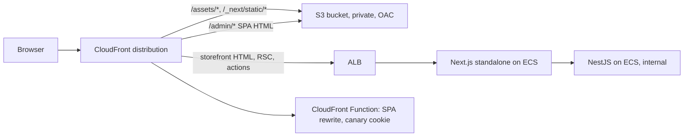

# Part 84 — Shipping and Operating Frontends

Part 51 — CI/CD and Deployment Strategies built the backend's delivery pipeline: continuous integration (51.1), artifacts (51.3), deployment strategies (51.7), feature flags (51.8), rollbacks (51.9) and post-deploy verification (51.10). Part 47 — Observability covered logs, metrics and traces (47.4), Part 48 containers, Part 50.8 CloudFront, and Part 53 SLOs and error budgets. This volume has already touched deployment from the frontend side: environment variables and runtime config (76.6), source maps (76.7), Next.js output modes and version skew (79.11), version telemetry and reload nudges (80.9), CSP (81.7) and caching for frontends (82.9).

A frontend deploy is different from a backend deploy in one way that drives most of this Part: **the old version keeps running after you replace it**. A NestJS deploy ends when the last old pod drains. A web deploy never quite ends, because the old JavaScript is running in thousands of open tabs, in CDN caches, in service workers, and in browsers that cached yesterday's HTML. This Part covers where to host, how to build once and configure per environment, how to keep old and new versions working together, how to roll out and roll back, how to see browser errors and connect them to backend traces, how to set frontend SLOs, which security headers belong at the edge, and one incident and one pipeline that put it together.

Stack and versions, as in the rest of the volume: Next.js 14 App Router (notes for 15) with `output: 'standalone'`, a Vite 5 SPA for the admin app, AWS S3 and CloudFront, GitHub Actions, the Sentry JavaScript SDK v8 concepts (notes where v7 differs), OpenTelemetry for the NestJS side (Part 47.4), and the `web-vitals` library v4 from Part 82.

## 84.1 Hosting options: static hosting, managed platforms and Node servers for SSR

#### Concept

A web app's build produces up to three kinds of output, and each needs a different kind of host:

- **Static files**: HTML, JavaScript, CSS, fonts and images. Any static host can serve them: **S3 behind CloudFront**, GitHub Pages, Netlify, Cloudflare Pages. A Vite SPA (76.11) and a Next.js static export (79.11) produce only this.
- **Server-rendered responses**: HTML or React Server Component payloads computed per request, Server Actions, Route Handlers, middleware. These need a running **Node.js server** (`next start` or the standalone `server.js` in a container on ECS or Kubernetes) or a **serverless function** platform.
- **Edge logic**: small functions that run in CDN locations close to the user (CloudFront Functions, Lambda@Edge, Vercel or Netlify edge functions, Next.js middleware on an edge runtime). They rewrite URLs, add headers, pick a canary, check a cookie.

**Managed frontend platforms** (Vercel, Netlify, Cloudflare Pages, AWS Amplify Hosting) bundle all three behind a Git integration: every push becomes an immutable deployment with its own URL, production is an alias pointing at one of them, and rollback moves the alias.

#### Why does it exist?

Because the cost and risk profiles differ by a factor of a hundred. A static SPA on S3 and CloudFront serving 10 million page views a month costs a few tens of dollars, has no servers to patch, and cannot be overloaded by traffic in any practical sense. A Next.js storefront with SSR and ISR needs servers that scale with traffic, share a cache (79.11), and can fail like any backend service. A team that picks SSR for an internal admin tool pays for servers it does not need; a team that picks a static SPA for an SEO-dependent product catalogue loses search traffic (79.1).

#### Mental model

Imagine three ways to sell sandwiches. A vending machine (static hosting) is stocked once and serves anyone, any hour, at almost no cost, but every sandwich is pre-made. A deli counter (Node server) makes each sandwich to order with fresh ingredients, needs staff on shift, and can get a queue at lunchtime. A franchise with a head office (managed platform) gives you the counter, the machines, the staff rota and the delivery vans as a service, for a fee and on their rules.

#### How it works



The common production shape on AWS for this book's stack:

1. **One CloudFront distribution per site**, with **cache behaviours** by path pattern. `/_next/static/*` and `/assets/*` go to an S3 origin; everything else for the storefront goes to an ALB origin in front of Next.js; the admin SPA's HTML and assets come from S3 under `/admin/`.
2. **The S3 bucket is private.** CloudFront reads it through **Origin Access Control (OAC)**, the successor to Origin Access Identity, with a bucket policy that allows only that distribution. Public S3 website hosting is not used: it cannot use OAC and serves over HTTP only.
3. **SPA routing**: a request for `/admin/orders/123` has no file in S3. A **CloudFront Function** on viewer request rewrites paths without a file extension to `/admin/index.html`. The older trick, mapping S3's `403`/`404` to `index.html` with custom error responses, also turns genuinely missing assets into `200` HTML responses, which breaks chunk-error detection (84.3).
4. **Next.js servers** run from the standalone output in containers (79.11), with readiness checks, a shared cache handler for ISR, and the same build ID and Server Actions key on every replica.
5. **Edge functions** stay tiny: CloudFront Functions run in under a millisecond, have no network access and a 10 KB code limit; Lambda@Edge can make network calls but adds tens of milliseconds and deploys slowly to all regions.

Hosting options for the three apps in this volume:

| Option | Fits | Strengths | Costs and limits |
|---|---|---|---|
| S3 + CloudFront | Vite SPA, Next.js static export, docs | Cheapest, no servers, absorbs any spike, full control of headers and caching | You build preview URLs, atomic switching and rollback yourself; no SSR |
| Next.js standalone on ECS/Kubernetes behind CloudFront | SSR storefront with ISR, Server Actions, BFF | Same platform as NestJS, private network to the API, full control | You run servers, shared cache, skew protection and scaling |
| Serverless adapters (OpenNext on Lambda) | SSR with spiky traffic on AWS | Scales to zero, per-request cost | Cold starts (200-1,000 ms on first request), more moving parts, adapter lag behind Next.js releases |
| Vercel / Netlify | Teams that want previews, rollbacks and edge features out of the box | Immutable deployments, instant rollback, preview per PR, skew protection (Vercel) | Price per seat and per usage at scale, platform-specific features, private network to your API needs extra setup |
| Amplify Hosting | Small AWS-centric teams | Git-connected, previews, SSR support | Fewer controls than raw CloudFront, lags newest Next.js features |

#### Practical example

The storefront company runs three frontends:

- **Storefront** (`shop.example`): Next.js 14 with SSR and ISR, 2.5 million page views a day, peaks of 900 requests per second at the origin after CDN caching. Hosted as standalone containers on ECS Fargate (6-24 tasks, autoscaled on CPU and request count) behind CloudFront.
- **Admin** (`admin.shop.example`): a Vite SPA used by 300 staff. Hosted on S3 + CloudFront. Hosting cost: about 4 dollars a month.
- **Docs** (`docs.shop.example`): Next.js static export on S3 + CloudFront.

All three share one GitHub Actions setup (84.11), and the storefront's API calls go through its BFF to NestJS on the same private network.

#### React / Next.js example

The CloudFront Function that serves the admin SPA's HTML for client-side routes and leaves real files alone:

```ts
// infra/cloudfront/admin-spa-rewrite.js  (CloudFront Functions runtime 2.0; plain JavaScript in the console)
// Shown with types for readability; deploy the compiled JS. No network, under 1 ms, 10 KB limit.
function handler(event: { request: { uri: string } }) {
  const req = event.request;
  const uri = req.uri;
  // Paths with a file extension are real objects: /admin/assets/index-B7xQ2kLm.js, /admin/favicon.svg
  if (/\.[a-zA-Z0-9]{1,8}$/.test(uri)) return req;
  // Everything else is a client-side route: /admin/orders/123 -> /admin/index.html
  if (uri.startsWith('/admin')) req.uri = '/admin/index.html';
  return req;
}
```

A missing chunk (`/admin/assets/Orders-OLDHASH.js`) now returns S3's real `403`/`404`, which the app can detect and handle (84.3), instead of an HTML page that fails to parse as JavaScript.

For the storefront, `next.config.js` keeps the settings from 79.11 and adds one that matters for multi-version hosting:

```ts
// apps/web/next.config.ts  (Next.js 15 supports a TypeScript config; on 14 use next.config.js / .mjs)
import type { NextConfig } from 'next';

const config: NextConfig = {
  output: 'standalone',
  generateBuildId: async () => process.env.GIT_SHA ?? 'local',
  deploymentId: process.env.GIT_SHA,       // tags asset and RSC requests with ?dpl=<sha> for skew handling (84.4)
  poweredByHeader: false,
  cacheHandler: require.resolve('./cache-handler.js'),
  cacheMaxMemorySize: 0,
};
export default config;
```

#### Backend side (NestJS)

Hosting choices change what the API must handle:

- **Same origin through the BFF** (the storefront): the browser calls `shop.example/api/v1/...`; the BFF forwards to NestJS on the private network with `x-bff-key` (81.10). No CORS on the API at all; the API is not reachable from the internet.
- **Separate origin** (the admin SPA calling `api.shop.example` directly): the API needs CORS for exactly `https://admin.shop.example`, `credentials: true` if cookies are used, `exposedHeaders` for `X-Request-Id`, `Retry-After` and `X-App-Version` (80.9), and a preflight cache (`maxAge`) to save a round trip per new URL.
- **CloudFront in front of the API**: the API must read the client IP from `X-Forwarded-For` correctly (Express `trust proxy` set to the number of proxy hops), or rate limits apply to CloudFront's IPs instead of users (Part 44.35).

```ts
// apps/api/src/main.ts (excerpt): admin SPA on another origin
import { NestFactory } from '@nestjs/core';
import type { NestExpressApplication } from '@nestjs/platform-express';
import { AppModule } from './app.module';

const app = await NestFactory.create<NestExpressApplication>(AppModule);
app.set('trust proxy', 2);                                   // CloudFront + ALB: req.ip is the user's IP
app.enableCors({
  origin: ['https://admin.shop.example'],                    // exact origins, never '*' with credentials
  credentials: true,
  allowedHeaders: ['Content-Type', 'Idempotency-Key', 'X-Client', 'X-Client-Version', 'traceparent'],
  exposedHeaders: ['X-Request-Id', 'Retry-After', 'X-App-Version'],
  maxAge: 600,                                               // browsers cache the preflight for 10 minutes
});
await app.listen(4000);
```

#### Production scenario

The storefront's CDN serves 94 % of requests (all hashed assets, ISR pages within `s-maxage`); the origin sees about 6 %. At a sale peak of 15,000 requests per second at the edge, the Next.js tasks handled 900 per second at p95 140 ms, with 24 tasks of 1 vCPU and 2 GB. The admin SPA's monthly CloudFront and S3 bill was 4.20 dollars. A brief evaluation of moving the storefront to a managed platform estimated a 6x higher hosting bill at their traffic, but also two engineer-weeks a quarter saved on preview environments and rollback tooling; the team stayed on ECS and built those features (84.11).

#### Failure scenario

A team hosted their SPA with S3 static website hosting and configured CloudFront's custom error responses to return `/index.html` with status `200` for every `403` and `404`. After a deploy that removed old chunks, users with open tabs clicked "Orders"; the browser requested `Orders-OLDHASH.js`, received `index.html` with status `200` and `Content-Type: text/html`, and failed with `SyntaxError: Unexpected token '<'`. Their error tracker grouped these as a JavaScript syntax error in a vendor file; nobody connected it to the deploy for two days. The fix: a CloudFront Function rewrite for extension-less paths only, so missing assets return a real `404` that the app's chunk-error handler recognises (84.4), plus keeping old assets (84.3).

#### Edge cases & failure modes

- **Public S3 buckets** for "simplicity"; use OAC and block public access.
- **Error-response mapping that turns missing JS into HTML**, hiding chunk errors.
- **Trailing slashes and `index.html`** in static exports: `/docs/intro` versus `/docs/intro/` versus `/docs/intro.html`; set `trailingSlash` consistently and rewrite at the edge.
- **Lambda@Edge for tasks a CloudFront Function can do**, adding latency and slow deploys.
- **SSR servers without a shared cache** serving different ISR versions per task (79.11).
- **Managed platform limits**: function timeouts, body size limits, and regions far from your API add latency to every server render.
- **API in a different region from the SSR servers**: each server render pays 80-150 ms per API call (Part 50.14).

#### How a Senior Full-Stack Engineer thinks about this

The senior chooses the least server that meets the requirement: static where possible, SSR where SEO, personalisation at first paint or the BFF demand it, and edge logic only for routing and headers. They price the options with real traffic and with engineer time, because a managed platform's bill buys features (previews, instant rollback, skew protection) that otherwise become a quarter of platform work. And they put the frontend's servers next to the API, because the slowest part of server rendering is almost always the network hop to the data.

#### Common mistakes

- **SSR for an internal SPA** that has no SEO needs and 300 users.
- **Static export for pages that need per-user data at first paint**, followed by loading spinners everywhere.
- **Serving the API cross-origin from the browser** when a same-origin BFF already exists, adding CORS and preflights.
- **Forgetting `trust proxy`**, so rate limiting and logs see the CDN's IPs.

#### Interview questions

1. **When would you host a frontend on S3 and CloudFront rather than a Node server?** Expected answer: when the output is static (SPA, static export, docs): cheaper, simpler, overload-proof; not when you need SSR, ISR, Server Actions or middleware.
2. **How do you serve a client-routed SPA from S3 correctly?** Expected answer: private bucket with OAC, and an edge rewrite of extension-less paths to `index.html`, so missing assets still return `404`.
3. **What do managed platforms give you that you must build yourself on AWS?** Expected answer: immutable deployments with URLs, preview per pull request, alias-based instant rollback, skew protection, integrated edge functions.
4. **What changes for the API when the SPA is on another origin?** Expected answer: CORS with exact origins, credentials, exposed headers, preflight caching, and correct client IPs behind the CDN.
5. **Why put SSR servers in the same region and network as the API?** Expected answer: each server render makes API calls; cross-region adds 80-150 ms per call to TTFB.

#### Practical exercise

Host the admin SPA and the storefront on AWS.

Acceptance criteria:

- The admin SPA is served from a private S3 bucket through CloudFront with OAC; the bucket blocks public access.
- `/admin/orders/123` returns the SPA's HTML; `/admin/assets/missing.js` returns `404`, not HTML.
- The storefront runs from the standalone output on ECS behind CloudFront, with `/_next/static/*` served from S3 by a separate cache behaviour.
- The API sees the user's IP in `req.ip` behind CloudFront and the ALB.
- A one-page cost estimate compares this setup with a managed platform at 2.5 million page views a day.
