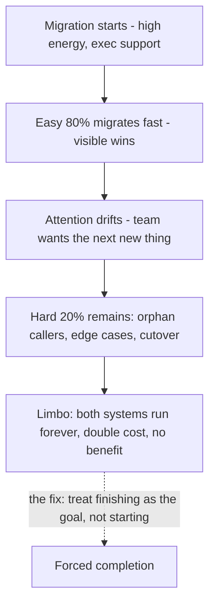

# Part 84 — Large-Scale Migrations and Legacy Modernization

Every large engineering organisation is, at any moment, somewhere in the middle of a migration it started two years ago and is not sure how to finish. The database engine it is moving off. The framework it is moving onto. The monolith it is decomposing. The cloud it is migrating to. Migrations are the dominant form of large-scale engineering work above the feature level, and they are where principal engineers earn their keep or destroy their credibility, because migrations are uniquely good at failing slowly, expensively, and in public.

Part 61.30 covered the strangler pattern. Part 24 covered schema migrations. Part 25 covered compatibility. Part 12 covered monolith versus microservices. This Part is about running a migration as a *program* — the organisational and technical discipline that gets a large migration all the way to done, including turning the old thing off, which is the part almost everyone skips.

The defining fact about large migrations is in this Part's first section: they fail by getting stuck at 80% done forever. Not by blowing up. By slowly stalling, as the easy 80% completes, the team's attention drifts to the next shiny thing, and the hard last 20% — the awkward callers, the legacy edge cases, the final cutover — never gets done. The result is the worst of both worlds: two systems running in parallel permanently, double the operational cost, and none of the benefit of finishing. Avoiding that fate is what this Part is about.

The reader this Part assumes is a senior or staff engineer who has been on a migration that stalled, or is about to lead one, and wants to know how to get it to actually finish.

## 84.1 Why large migrations fail: the 80% done forever problem

#### Concept

Large migrations rarely fail by exploding. They fail by stalling — getting to roughly 80% complete and staying there indefinitely. The first 80% is the exciting, high-value, straightforward part: migrate the main services, the common cases, the cooperative teams. The last 20% is the awkward part: the obscure caller nobody owns, the legacy edge case the new system does not handle, the one team too busy to migrate, and the final act of turning the old system off and deleting it. That last 20% is unglamorous, politically hard, and easy to defer, so it gets deferred, and the migration enters a permanent limbo where both systems run forever.

#### Why does it exist?

Imagine renovating a house while living in it. You enthusiastically do the kitchen and the living room — big, visible, satisfying wins. Then you are left with the awkward spare room full of boxes, the weird plumbing in the basement, and the final step of disposing of all the old furniture. Those are annoying, so you live with them "for now". A year later the old furniture is still in the garage, the spare room is still boxes, and you are paying to store things you meant to throw away. You are 80% renovated forever, carrying the cost of both the new and the old.

Migrations stall for exactly this human reason: the incentives all point at the first 80% (visible progress, early wins, cooperative teams) and all point *away* from the last 20% (invisible, hard, political, requires chasing people). Without deliberate countermeasures, the rational local behaviour of every individual produces a globally stalled migration. The "80% done forever" problem exists because finishing is nobody's favourite work and everybody's easiest thing to defer.

#### Mental model

Imagine a tug of war between "start the exciting new migration" and "finish the boring old one". The new migration always wins, because it is fresh, visible, and has executive enthusiasm, while finishing the old one is a grind with no applause. So the org accumulates a graveyard of 80%-done migrations, each carrying the full operational cost of running two systems, none delivering the benefit of being finished. The mental model to hold is that **a migration delivers its value only at 100%**, because until the old system is off, you pay for both. An 80%-complete migration has most of the cost and almost none of the benefit. Half a migration is not half the value; it is negative value, because you now operate two systems instead of one.

#### How it works

The stall happens in a predictable sequence:



The forces that drive the stall:

1. **Declining marginal visibility.** The first migrations are the big, obvious ones, so progress looks fast. The last ones are obscure, so progress looks like nothing even when it is hard work.
2. **Rising marginal difficulty.** The easy cases were easy because they were well-understood and well-owned. The remaining cases are hard precisely because they were skipped — orphaned, weird, or politically stuck.
3. **Attention economics.** Executives and engineers alike are drawn to starting new things over finishing old ones. The migration loses the competition for attention the moment it stops being new.
4. **No completion incentive.** Nobody is rewarded for turning off the old system; they are rewarded for shipping the new one. So the new one ships and the old one lingers.
5. **The orphan problem.** The last callers of the old system are often owned by nobody, or by a team with no incentive to move, so migrating them requires someone to do unpaid political work.

The cost of limbo is concrete and continuous: two systems to operate, two on-call surfaces, two sets of bugs, data split across both, every new engineer confused about which to use, and the constant risk that the un-migrated 20% contains the one path that causes an incident.

#### Practical example

A company decides to migrate from a legacy order system to a new one. In six months, 80% of order volume flows through the new system — all the main flows, the big partners, the cooperative internal teams. It looks like a triumph; there is a celebration. Then the migration stalls. The remaining 20% is: a batch import used by three enterprise customers, a reconciliation job owned by a finance team that is slammed, and a handful of internal tools that call the old API directly and whose owners have left. Each is individually small and individually annoying. Two years later, the legacy order system is still running — for 20% of volume — with its own on-call rotation, its own servers, and its own bugs, because finishing those last three things was never anyone's priority. The company pays for two order systems indefinitely. The migration that looked like a triumph at 80% is, at 100%-never, a permanent tax.

#### Artifact example

A migration status framing that makes the 80% trap visible and measurable — the artifact that reframes "progress" so finishing becomes the goal.

```markdown
# Order system migration — status framing (the honest version)

## The WRONG metric (what makes us stall)
"80% of order volume is on the new system." -> sounds like success, hides
the trap. Volume migrates fast because the big flows are easy.

## The RIGHT metrics (what actually matters)
- Legacy system still running? YES  -> we have 0% of the BENEFIT. We pay for
  both systems until this is NO.
- Callers still using the legacy API: 7 (down from 40). These 7 are the
  whole job now. Named below with owners.
- Date the legacy system can be DELETED: NOT SCHEDULED  <- the real red flag.

## The remaining 7 callers (the actual work)
| Caller | Owner | Status | Blocker |
|---|---|---|---|
| Enterprise batch import | Integrations team | Not started | Needs new bulk API |
| Finance reconciliation | Finance eng | Not started | Team at capacity |
| Legacy admin tool | ORPHANED | Not started | No owner — needs assignment |
| 4 internal scripts | Various | 2 done, 2 orphaned | Find owners or delete |

## Definition of DONE (non-negotiable)
Legacy order system is powered off and its code deleted. Not "95% migrated".
OFF. Until then, this migration has not delivered its value.
```

The reframing is the whole point: it replaces the flattering "80% of volume" metric with the honest ones — is the legacy system still running (if yes, 0% of benefit), how many callers remain (the real work), and is deletion scheduled (if not, the red flag). It names the remaining callers and their owners, surfacing the orphans. And it defines done as "powered off and deleted", not "mostly migrated". This artifact is how a principal engineer stops a migration from stalling: by measuring the thing that matters (finishing) instead of the thing that flatters (volume).

#### Real-world scenario

A principal engineer is brought in to "finish" a migration that has been 80% done for eighteen months. She finds exactly the expected pattern: the easy work is long done, the hard 20% is orphaned callers and political blockers, and nobody is measuring completion — they are measuring volume, which has not moved in a year. Her first move is not technical; it is to change the metric. She makes "the legacy system is still running" the headline status, visible to the executive sponsor, and she schedules a *deletion date* for the legacy system, working backward from it. Suddenly the orphaned callers have a deadline, the political blockers have an escalation path (the deletion date is coming whether they move or not), and the migration that was nobody's priority becomes a dated program with a finish line. The legacy system is deleted four months later. The technical work was never the hard part; the hard part was making finishing the goal, and that was a measurement and incentive change, not an engineering one.

#### Failure scenario

A team runs a database migration from the old engine to the new one. They migrate 80% of the tables and the main application paths, declare victory in a sprint review, and move on to feature work. The remaining 20% is a set of reporting queries and a nightly batch job that still hit the old database. "We'll migrate those next quarter." Next quarter never comes, because features always win. For two years, the company runs two database engines: the new one for the app, the old one for reporting and the batch job. They pay for both. They patch both. On-call must understand both. Then the old engine reaches end of life and the vendor drops support — and now the never-finished 20% is an *emergency*, because the unsupported old engine is a security and reliability liability, and the batch job that depends on it is business-critical. The migration that could have been finished calmly in a quarter two years ago must now be finished in a panic under a security deadline, with the original team dispersed and the context lost. The slow stall became a crisis, which is the usual way the 80%-forever problem finally gets resolved — badly.

#### Edge cases & failure modes

- **Measuring volume instead of completion.** "80% of traffic migrated" flatters while hiding that the legacy system still runs and delivers 0% of the benefit.
- **No scheduled deletion date for the old system.** Without a finish line, the last 20% is never anyone's priority.
- **Orphaned callers.** The remaining users of the old system are owned by nobody or by over-capacity teams, so migrating them requires unpaid political work.
- **Celebrating at 80%.** The celebration drains the urgency to finish, because it feels done.
- **Attention drifting to the next migration** before the current one is actually finished, accumulating a graveyard of 80%-done migrations.
- **The forced-crisis finish.** The never-finished 20% becomes an emergency when the old system hits EOL, turning a calm quarter of work into a panic.

#### How a Principal Engineer thinks about this

They treat *finishing* as the entire goal and are deeply skeptical of migration progress reported as volume or percentage of traffic, because those metrics flatter while the benefit — which comes only from turning off the old system — stays at zero. They schedule a deletion date for the old system early and work backward from it, because they know that without a finish line the last 20% loses every competition for attention and the migration stalls forever.

They refuse to celebrate at 80%, because the celebration drains the urgency to do the hard, unglamorous last part. They actively hunt for the orphaned callers early, assigning owners before the migration stalls on them, because they have learned that the last 20% is hard precisely because it is the stuff everyone skipped, and it will not resolve itself. And they hold the line that a migration is not done until the old system is powered off and deleted, because they have seen too many "successful" migrations become permanent two-system taxes. The principal's distinctive contribution to a migration is usually not the technical plan; it is the relentless, unpopular insistence on finishing.

#### Common mistakes

- **Reporting progress as volume or percent-migrated,** which hides that the old system still runs and delivers no benefit.
- **Never scheduling a deletion date** for the old system, so the last 20% is never prioritised.
- **Celebrating at 80%** and letting the urgency to finish evaporate.
- **Letting attention drift to the next migration** before finishing the current one.
- **Ignoring orphaned callers** until they become the permanent blocker that stalls everything.

#### Interview questions

1. **Why do large migrations usually fail, and what does failure actually look like?**
   *Expected answer:* they fail by stalling at ~80% done forever, not by exploding; the easy, visible 80% completes fast and the hard, unglamorous, political last 20% (orphaned callers, edge cases, final cutover) gets deferred indefinitely, leaving two systems running permanently — full cost, no benefit. *Follow-up:* what would you do differently to avoid the stall.

2. **How do you measure a migration so it actually gets finished?**
   *Expected answer:* measure completion, not volume — the headline metric is "is the old system still running" (if yes, 0% of benefit) and "how many callers remain, with owners"; schedule a deletion date for the old system and work backward from it. Define done as "old system powered off and deleted", not "95% migrated". *Why it matters:* this measurement change is the single most effective anti-stall intervention.

3. **A migration has been 80% done for eighteen months. You're asked to finish it. What's your first move?**
   *Expected answer:* change the metric and set a deletion date for the old system — making "the legacy system still runs" the visible status and giving the orphaned callers and political blockers a deadline and escalation path. The remaining work is usually political and orphan-chasing, not technical. *Why it matters:* tests whether they understand the stall is an incentive problem, not an engineering one.

#### Practical exercise

Find a migration in your organisation (or one you have been part of) that is or was stuck. Write its honest status framing: replace any volume/percentage metric with the real ones (is the old system still running, how many callers remain with named owners, is a deletion date scheduled). Identify the orphaned callers — the ones owned by nobody or by an over-capacity team. Then propose the deletion date and the escalation path that would force the last 20% to completion.

**Acceptance criteria:** your status framing makes "the old system is still running" the headline (not a flattering volume number), lists the remaining callers with owners and surfaces at least one orphan, and proposes a specific deletion date for the old system with a plan for the orphaned and politically-stuck callers. A reader can see that the remaining work is finite and that finishing is now the measured goal.
