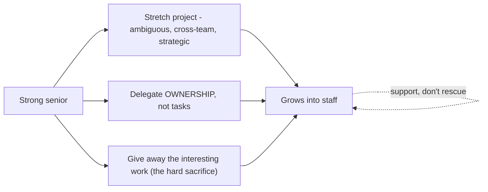

## 84.2 Review as a teaching tool, and growing seniors into staff

#### Concept

Two connected growth skills. **Code review and design review as teaching tools** means using the review you already do as a deliberate way to grow people — not just catching bugs, but transferring judgement, explaining the *why* behind feedback, and asking questions that build the author's reasoning. **Growing seniors into staff** is the specific, hard transition (Part 104.4) of helping a strong senior engineer become a staff engineer, which requires giving them stretch projects, delegating real ownership, and — the hardest part — giving away the interesting work you would rather keep for yourself.

#### Why does it exist?

Imagine code review used only to catch bugs: terse comments like "change this to X" with no explanation. The bug is fixed, but the author learned nothing — they do not know *why* X is better, so they will make the same class of mistake again, and they did not build any judgement. A huge teaching opportunity, happening dozens of times a week, is wasted. Review-as-teaching exists to capture that opportunity: every review is a chance to transfer judgement, and a reviewer who explains the why and asks questions grows the author, not just the code.

Growing seniors into staff exists as a distinct, hard problem because the senior-to-staff transition is different in kind (Part 104.4) — it is not more senior work but a different job (cross-team scope, strategy, influence), so you cannot grow someone into it by giving them more senior work. You grow them by giving them staff-shaped work: ambiguous, cross-team, strategic stretch projects. And the hardest part is that this means giving away the interesting, high-visibility work that you, the principal, would enjoy doing yourself — which is the specific sacrifice that growing staff engineers requires.

#### Mental model

For review-as-teaching, imagine a master craftsperson reviewing an apprentice's work. The poor master says "that joint is wrong, redo it" — the apprentice fixes that joint and learns nothing transferable. The great master says "that joint will fail under load because the grain runs the wrong way; see how this one handles stress — why do you think that is?" — the apprentice learns the principle and applies it to every future joint. Review is apprenticeship, and the difference between a craftsperson who grows apprentices and one who just corrects work is whether they transfer the *principle* behind the correction.

For growing staff engineers, imagine a head chef who wants to develop a sous-chef into a head chef. They cannot do it by giving the sous-chef more line-cook work; they must hand over the interesting, high-stakes responsibilities — designing the menu, running service, handling the critic's visit — the very things the head chef most enjoys. Growing a successor means giving away the work you love, because that work is how they grow into the role. A head chef who keeps all the interesting work for themselves never develops a successor.

#### How it works

**Review as a teaching tool:**

```text
- Explain the WHY, not just the what. "Change X to Y BECAUSE under concurrent
  load X has a race condition" — the author learns the principle.
- Ask questions, don't just dictate. "What happens here if the request is
  retried?" builds the author's judgement (coaching, 57.1).
- Distinguish must-fix from preference. Label "blocking: data loss risk" vs
  "nit: naming" so the author learns what matters (and you're not fighting
  every point, Part 116.1).
- Praise good work specifically. "This idempotency handling is exactly right"
  reinforces good judgement, not just corrects bad.
- Review the design, not just the code. Design review (Part 111.5) is where the
  highest-leverage teaching happens, before the code is written.
```

The shift is from review-as-gatekeeping (catch bugs, approve/reject) to review-as-teaching (transfer judgement so the author makes better decisions next time). The same activity, done with teaching intent, grows people continuously.

**Growing seniors into staff:**

- **Stretch projects.** Give the senior a project that is staff-shaped: ambiguous (they must define it), cross-team (they must influence without authority), strategic (it matters beyond one sprint). This is how they practise the staff skills in a real but supported setting.
- **Delegate real ownership, not tasks.** Delegating a task ("implement this") grows nothing; delegating ownership ("own the notification pipeline migration, including the cross-team coordination") grows a staff engineer. Real ownership means they make the decisions and feel the consequences.
- **Give away the interesting work.** The hardest part. The high-visibility, intellectually-satisfying work — the gnarly design, the important migration, the exec presentation — is exactly what grows a staff engineer, and it is exactly what you want to keep for yourself. Giving it away is the sacrifice that develops successors. Part 104.4 called this "giving away the interesting work" as a staff-defining behaviour; doing it for others is how you grow them.
- **Support, don't rescue.** When the senior struggles on the stretch project, coach them through it (84.1); do not take it back and do it yourself. Taking it back teaches them they are not trusted and robs them of the growth.



#### Practical example

A principal engineer wants to grow a strong senior into a staff engineer. She uses review-as-teaching continuously: in the senior's design reviews, she asks questions ("how does this handle a cross-team schema change?") rather than dictating, transferring the systems-and-influence judgement staff work requires, and she explains the why behind every piece of feedback. Then she gives away the interesting work: the upcoming event-driven-notifications migration (Part 78's worked RFC) — a high-visibility, intellectually-juicy, cross-team project she would love to lead herself — she hands to the senior to own entirely, including writing the RFC, pre-wiring the teams, and running the design review. She delegates *ownership*, not tasks: the senior makes the decisions. When the senior struggles with the cross-team pre-wiring, she coaches them through it rather than stepping in to do it. A year later the senior has led a cross-team migration end to end, which is the evidence for their staff promotion — evidence they could only have gotten because the principal gave away work she wanted to keep. The sacrifice (giving away the interesting migration) was exactly what grew the staff engineer.

#### Artifact example

A stretch-project delegation brief and a review-as-teaching example — the artifacts that make growing a staff engineer deliberate.

```markdown
# Stretch project: [senior] owns the notification-pipeline migration

## Why this project (staff-shaped on purpose)
- Ambiguous: they define the approach (not handed a spec).
- Cross-team: needs order, notifications, platform, mobile aligned — practises
  influence without authority (Part 83).
- Strategic: removes a recurring reliability risk; matters beyond one sprint.
- Visible: an RFC + design review + exec-facing outcome.
This is work I'd enjoy leading myself — which is exactly why I'm giving it away.

## What I'm delegating: OWNERSHIP (not tasks)
They own: the RFC, the design, the cross-team pre-wiring, the rollout plan,
the decision meeting. They make the calls. I don't pre-approve their decisions.

## My role: support, not rescue
- Coach them (ask, don't tell) when they're stuck, especially on the cross-team
  influence (which is new for them).
- I will NOT take it back if it gets hard. Struggling through it IS the growth.
- I'll sponsor: name them as the owner publicly so they get the credit.

---

# Review-as-teaching example (same senior's design review)
WEAK (gatekeeping): "Use an outbox here."
STRONG (teaching): "What happens if the service crashes after writing the
order but before the notification sends? [waits] Right — the notification is
lost (the dual-write problem). How could we make the notification intent
durable with the order? [guides toward outbox] Yes — and that's why the outbox
pattern exists. You'll hit this shape of problem a lot." 
-> The author learns the PRINCIPLE (durability of dual writes), not just the fix.
```

The delegation brief's power is that it explicitly chooses a staff-shaped project (ambiguous, cross-team, strategic, visible), delegates *ownership* not tasks, commits to supporting-not-rescuing, and names the hard sacrifice plainly ("work I'd enjoy leading myself — which is exactly why I'm giving it away"). The review example contrasts gatekeeping with teaching, showing how the same review, done with teaching intent and questions, transfers a durable principle rather than a one-off fix. Both make growing a staff engineer a deliberate practice rather than hoping it happens.

#### Real-world scenario

A principal engineer deliberately gives away every interesting project to the seniors she is growing, keeping for herself only the work nobody else can do or the genuinely unglamorous glue work. Colleagues are puzzled — why give up the fun, high-visibility work? Two years later the answer is a team with three new staff engineers, each of whom grew by owning a major cross-team project she handed them. Her own visibility took a short-term hit (she was not the name on those projects), but her impact multiplied enormously, because she now has three staff engineers doing staff work instead of one principal doing it alone, and those three will grow others. Meanwhile, a peer who kept all the interesting work for himself — because he enjoyed it and it kept him visible — has grown no one; his seniors are still seniors, frustrated at the lack of growth opportunities, and some have left for roles that offer the stretch he would not give them. The principal who gave away the interesting work multiplied herself; the one who hoarded it remained a single point of impact. Giving away the interesting work is a short-term sacrifice of visibility for a long-term multiplication of impact, and it is the defining act of growing staff engineers.

#### Failure scenario

A principal engineer wants to grow his seniors but cannot bring himself to give away the interesting work. Every time a juicy, high-visibility project comes up — the gnarly architecture, the important migration, the exec presentation — he takes it himself, telling himself the stakes are too high to delegate or that he will do it faster. He delegates only the routine, unglamorous work to his seniors. Predictably, his seniors do not grow into staff engineers: they have never owned an ambiguous, cross-team, strategic project, because he kept all of those, so they have no evidence for a staff promotion and no practice at the staff skills. They stagnate. The best of them, seeing no growth path, leaves. And the principal, having hoarded all the interesting work, is now a bottleneck — everything important depends on him, he is overloaded, and there is no one to share the load because he never grew anyone. His inability to give away the interesting work, driven by enjoyment and a false belief that he must do the high-stakes work himself, cost him his seniors' growth, cost the team a departure, and made him a single point of failure. Growing staff engineers requires the specific sacrifice of giving away the work you most want to keep, and a principal who cannot make that sacrifice grows no one and becomes a bottleneck.

#### Edge cases & failure modes

- **Review as pure gatekeeping.** Catching bugs with terse "change this" comments, wasting the teaching opportunity so authors learn nothing transferable.
- **Not distinguishing must-fix from preference in review,** so authors cannot tell what matters and you fight every point.
- **Delegating tasks, not ownership.** "Implement this spec" grows nothing; real growth requires owning the decisions and consequences.
- **Keeping the interesting work.** The core failure in growing staff — hoarding the high-visibility, satisfying projects, so seniors never get staff-shaped experience.
- **Rescuing instead of coaching.** Taking a struggling senior's project back, which robs them of the growth and signals distrust.
- **Giving staff-shaped work with no support.** Throwing someone into an ambiguous cross-team project with no coaching is setting them up to fail.

#### How a Principal Engineer thinks about this

They treat every review as a teaching opportunity, explaining the why and asking questions to transfer judgement rather than just catching bugs, because they know review happens constantly and a reviewer who teaches grows people continuously while one who merely gatekeeps wastes dozens of weekly chances. They distinguish blocking issues from preferences so authors learn what actually matters, and they praise good judgement specifically, not just correct bad judgement.

On growing staff engineers, they understand the transition is different in kind, so they give seniors staff-shaped work — ambiguous, cross-team, strategic, visible — and delegate real ownership, not tasks. And they make the defining sacrifice: giving away the interesting work they would rather keep, because they know that high-visibility, intellectually-satisfying work is exactly what grows a successor, and that hoarding it grows no one and makes them a bottleneck. They support without rescuing, coaching struggling seniors through rather than taking the work back, because the struggle is the growth. The principal measures their success partly by the staff engineers they have grown, and they know that number requires giving away work they love — a short-term sacrifice of their own visibility for a long-term multiplication of their impact.

#### Common mistakes

- **Using review only to catch bugs,** wasting the continuous teaching opportunity.
- **Not labelling blocking versus preference,** so authors cannot learn what matters.
- **Delegating tasks instead of ownership,** which grows no one.
- **Hoarding the interesting work,** so seniors never get staff-shaped experience and stagnate.
- **Rescuing struggling seniors** instead of coaching them through, robbing them of the growth.

#### Interview questions

1. **How do you use code and design review to grow people, not just catch bugs?**
   *Expected answer:* explain the why behind feedback (transfer the principle, not just the fix), ask questions that build the author's judgement (coaching), distinguish blocking issues from preferences so they learn what matters, praise good judgement specifically, and invest especially in design review where the highest-leverage teaching happens before code is written. *Why it matters:* review is the most frequent teaching opportunity a senior engineer has.

2. **What does it take to grow a strong senior into a staff engineer?**
   *Expected answer:* give them staff-shaped work (ambiguous, cross-team, strategic, visible stretch projects), delegate real ownership not tasks, support-not-rescue when they struggle, and — the hardest part — give away the interesting, high-visibility work you would rather keep, because that is exactly what grows a successor. The transition is different in kind, so more senior work does not do it. *Follow-up:* why is giving away the interesting work so hard and so important.

3. **A principal keeps all the interesting projects for himself. What's the cost?**
   *Expected answer:* his seniors never get staff-shaped experience, so they do not grow into staff (no evidence, no practice), they stagnate and the best leave; and he becomes a bottleneck and single point of failure because everything important depends on him and he grew no one to share it. Growing staff requires the sacrifice of giving away work you enjoy, trading short-term visibility for long-term multiplied impact. *Why it matters:* tests whether they understand the defining act of growing staff engineers.

#### Practical exercise

Take your next few code or design reviews and consciously shift from gatekeeping to teaching: on at least three comments, explain the why and ask a question rather than dictating, and label each as blocking or preference. Separately, identify an interesting, staff-shaped project coming up that you would normally do yourself, and plan to give it away to a senior you are growing — write the delegation brief (why it is staff-shaped, what ownership you are delegating, how you will support-not-rescue).

**Acceptance criteria:** your review comments transfer a transferable principle (the why) and use questions to build judgement, with blocking/preference labelled; and your delegation brief gives away a genuinely interesting, staff-shaped project (ambiguous, cross-team, strategic, visible) with real ownership delegated and a support-not-rescue commitment — and you can honestly acknowledge that giving it away is a sacrifice of work you would enjoy doing yourself.
