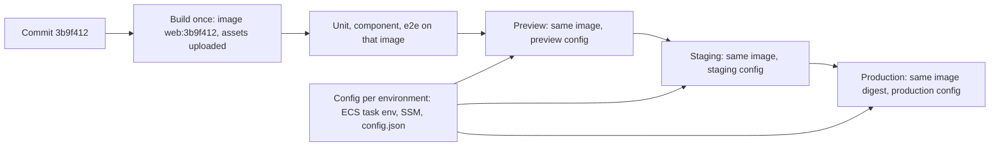
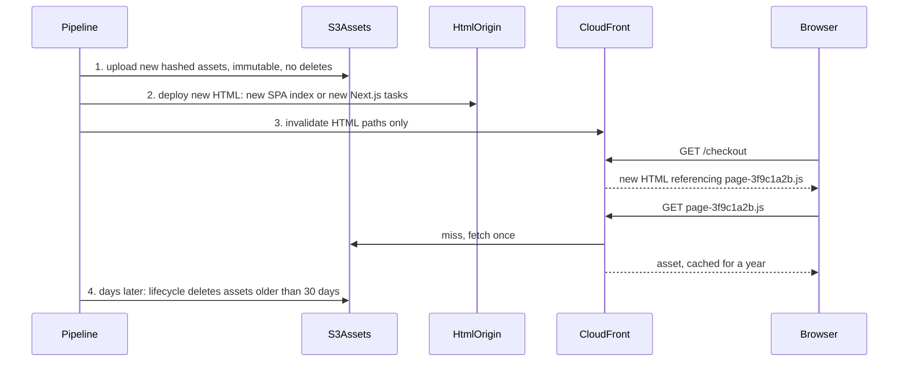

## 84.2 Build once, deploy many: runtime configuration for frontends

#### Concept

**Build once, deploy many** means the pipeline builds one artefact per commit (a container image for the Next.js server, a `dist/` folder for the SPA), tests that exact artefact, and promotes the same bytes through preview, staging and production. Nothing is rebuilt per environment. Whatever differs between environments (API base URL, Sentry environment, feature flag client key, analytics ID, allowed CSP origins) is supplied at **runtime**, not compiled in.

Part 76.6 introduced the problem from the tooling side: `VITE_*` and `NEXT_PUBLIC_*` values are inlined into the bundle at build time and are public, and a runtime config endpoint fixes the "frozen" problem. This section is about operating that pattern: what the artefact contains, where each value comes from in each hosting model, the Next.js traps that silently re-freeze runtime values, and how config changes are released and audited.

#### Why does it exist?

Because "it worked in staging" only means something if staging ran the same artefact. A team that runs `next build` three times, once per environment, has three different bundles: different chunk hashes, potentially different dependency resolutions if the lockfile moved, different inlined values. A bug that exists only in the production build cannot be reproduced in staging. Rebuilding also triples build time and makes rollback a rebuild of an old commit (slow, and not guaranteed to reproduce the same bytes). Part 51.3 made the same argument for backend artefacts; frontends add the inlining problem on top.

#### Mental model

Imagine a touring theatre production. The set, costumes and script are built once and travel in the same trucks to every city. What changes per city is a small card at the stage door: the venue's address, the local fire exit plan, the stage manager's phone number. If each city rebuilt the set from the drawings, no two performances would be the same show.

#### How it works



Where runtime values come from, by hosting model:

| Hosting | Server-only values | Public values the browser needs | Mechanism |
|---|---|---|---|
| Next.js server (container) | `process.env` read at request time in server code | Rendered by the root layout into a `<script>` or passed as props to a client provider | ECS task definition env, SSM Parameter Store, Secrets Manager |
| Static SPA on S3 | None (no server) | `/config.json` per environment, fetched at boot | Pipeline writes `config.json` per environment beside the immutable assets |
| SPA served by NestJS or nginx | Server env | Injected into `index.html` at start-up as `window.__APP_CONFIG__` | Template replacement at container start |

The rules that make it work:

1. **Classify each value** (76.6): public-by-design (analytics ID), environment-specific (API URL), or secret (never in the frontend). Only the first two reach the browser.
2. **One schema for the config**, in code, validated at boot with zod. A missing or malformed value fails loudly at start, not as a blank screen for one user segment.
3. **Config is not cached like assets.** `config.json` gets `Cache-Control: no-cache` (revalidate every time, cheap with an `ETag`), never the `immutable` header the hashed assets get.
4. **Next.js re-freezing trap**: in the App Router, a page or layout that is **statically rendered** at build time evaluates `process.env.X` during `next build`, and the value is baked into the prerendered HTML. To read runtime values, the component must render dynamically: call `noStore()` from `next/cache` (Next.js 14), `await connection()` from `next/server` (Next.js 15), read `headers()`/`cookies()`, or set `export const dynamic = 'force-dynamic'` on that segment. The root layout that injects public config is usually dynamic anyway in a storefront with sessions.
5. **One release identity everywhere**: the commit SHA is the image tag, the Next.js build ID (79.11), the `deploymentId`, the `release` sent to the error tracker (84.6), and the `X-Client-Version` header (80.9). When a browser error arrives, one string tells you which code and which source maps.

#### Practical example

The storefront's public runtime config has six values: `apiBasePath` (`/api`), `sentryDsn`, `sentryEnvironment` (`preview`, `staging`, `production`), `flagsClientKey`, `analyticsId`, and `release`. The server-only config has twelve, including `API_INTERNAL_URL`, `BFF_KEY` and the Redis URL for the cache handler. A preview environment for pull request 1842 runs the same image as production with `sentryEnvironment=preview`, a staging API, and the flag client key of the preview project.

#### React / Next.js example

The config schema and a server-side reader:

```ts
// apps/web/src/config/public-config.ts
import { z } from 'zod';

export const PublicConfigSchema = z.object({
  apiBasePath: z.string().startsWith('/'),
  sentryDsn: z.string().url().or(z.literal('')),           // empty disables reporting in local dev
  sentryEnvironment: z.enum(['local', 'preview', 'staging', 'production']),
  flagsClientKey: z.string().min(10),
  analyticsId: z.string().optional(),
  release: z.string().regex(/^web@[0-9a-f]{7,40}$|^web@local$/),
});
export type PublicConfig = z.infer<typeof PublicConfigSchema>;
```

```ts
// apps/web/src/config/server-config.ts
import 'server-only';                                       // importing this from a Client Component fails the build
import { PublicConfigSchema, type PublicConfig } from './public-config';

let cached: PublicConfig | null = null;
export function getPublicConfig(): PublicConfig {
  // Read at runtime from the container's environment, validated once per process
  cached ??= PublicConfigSchema.parse({
    apiBasePath: process.env.PUBLIC_API_BASE_PATH ?? '/api',
    sentryDsn: process.env.PUBLIC_SENTRY_DSN ?? '',
    sentryEnvironment: process.env.PUBLIC_SENTRY_ENVIRONMENT,
    flagsClientKey: process.env.PUBLIC_FLAGS_CLIENT_KEY,
    analyticsId: process.env.PUBLIC_ANALYTICS_ID,
    release: `web@${process.env.GIT_SHA ?? 'local'}`,
  });
  return cached;
}
```

Note the variable names: `PUBLIC_*`, not `NEXT_PUBLIC_*`. The `NEXT_PUBLIC_` prefix tells Next.js to inline the value at build time, which is exactly what we are avoiding.

The root layout renders the values into a provider, dynamically:

```tsx
// apps/web/app/layout.tsx  (Next.js 14; on 15 use `await connection()` from 'next/server')
import { unstable_noStore as noStore } from 'next/cache';
import { getPublicConfig } from '@/config/server-config';
import { PublicConfigProvider } from '@/config/PublicConfigProvider';   // 'use client' context provider

export default function RootLayout({ children }: { children: React.ReactNode }) {
  noStore();                                                // never prerender: config is read per request
  const config = getPublicConfig();
  return (
    <html lang="en-IN">
      <body>
        <PublicConfigProvider value={config}>{children}</PublicConfigProvider>
      </body>
    </html>
  );
}
```

For the static admin SPA, the pipeline writes `config.json` per environment and the app loads it before rendering:

```ts
// apps/admin/src/main.tsx  (Vite 5 SPA)
import { createRoot } from 'react-dom/client';
import { PublicConfigSchema } from './config/public-config';
import { App } from './App';

async function boot() {
  const res = await fetch('/admin/config.json', { cache: 'no-cache' });  // revalidates; ETag makes it a 304
  const config = PublicConfigSchema.parse(await res.json());               // fail loudly on bad config
  createRoot(document.getElementById('root')!).render(<App config={config} />);
}
boot().catch((e) => {
  document.getElementById('root')!.textContent = 'The admin app is misconfigured. Please contact the platform team.';
  console.error(e);
});
```

#### Backend side (NestJS)

The API takes part in the same discipline:

- **The API is configured the same way**: one image, environment from ECS task definitions and SSM, validated at boot with `ConfigModule.forRoot({ validate })` (83.11).
- **The API advertises the current web release** (`X-App-Version`, 80.9) from configuration that the deploy pipeline updates when a new web release goes live, not from the API's own build.
- **Public config can come from the API** for SPAs that have no server of their own (76.6's `/api/public-config`), with `Cache-Control: no-cache` and an `ETag`.
- **Config values that change behaviour are flags, not config.** Turning on a new checkout belongs in the flag service (84.5), evaluated identically by the web and the API (80.9), not in a config file that needs a deploy.

```ts
// apps/api/src/config/public-config.controller.ts  (for the admin SPA when served without config.json)
import { Controller, Get, Header } from '@nestjs/common';
import { ConfigService } from '@nestjs/config';

@Controller('public-config')
export class PublicConfigController {
  constructor(private readonly config: ConfigService) {}

  @Get()
  @Header('Cache-Control', 'no-cache')                       // revalidate every time; Express adds a weak ETag
  get() {
    return {
      apiBasePath: '/v1',
      sentryEnvironment: this.config.getOrThrow<string>('SENTRY_ENVIRONMENT'),
      sentryDsn: this.config.get<string>('ADMIN_SENTRY_DSN', ''),
      flagsClientKey: this.config.getOrThrow<string>('ADMIN_FLAGS_CLIENT_KEY'),
      release: this.config.getOrThrow<string>('ADMIN_RELEASE'),   // set by the admin deploy job
    };
  }
}
```

#### Production scenario

After moving to build once, deploy many, the storefront's pipeline went from three `next build` runs (4 min each) to one, and promotion from staging to production became a 40-second ECS service update with the same image digest. Over the next year the team had zero "works in staging, broken in production" incidents caused by build differences, compared with four the previous year (two from a lockfile change between builds, one from a `NEXT_PUBLIC_` value typo in the production build only, one from a different Node version on the production build runner).

#### Failure scenario

A developer moved the Sentry environment from `NEXT_PUBLIC_SENTRY_ENVIRONMENT` to a runtime `PUBLIC_SENTRY_ENVIRONMENT` read in `app/layout.tsx`, but the layout had no dynamic API call. `next build` prerendered the shell with `process.env.PUBLIC_SENTRY_ENVIRONMENT` undefined in the CI build environment, the zod schema was not yet in place, and every environment reported errors as `environment: undefined`. Production errors mixed with preview errors for a week, and an alert keyed on `environment:production` never fired during a real incident. The fix: `noStore()` in the layout, schema validation that throws on a missing value, and a post-deploy smoke test that fetches the page and asserts the expected environment string in the rendered config.

#### Edge cases & failure modes

- **`NEXT_PUBLIC_` on environment-specific values**: frozen at build, and different per build if you rebuild.
- **Statically rendered layouts reading `process.env`**: the value is from the build machine.
- **`config.json` cached with long `max-age`**: a config fix takes a day to reach users.
- **Secrets in public config** because "it is only the staging key".
- **Config schema drift**: the pipeline writes a field the app no longer reads, or misses a new one; validate in the pipeline too, with the same schema.
- **Rollback with config**: rolling back the image but not a config change that the old code cannot read; keep config backward compatible like an API (Part 28).

#### How a Senior Full-Stack Engineer thinks about this

The senior treats the frontend artefact like any backend artefact: built once, identified by its commit, promoted unchanged, configured from outside, validated at start. They push every environment difference into a small, typed, validated config, and everything that changes behaviour for users into flags. They know the framework's traps (build-time inlining, static prerendering) and test for them in the post-deploy smoke test, because these bugs are silent: nothing crashes, the app just quietly uses the wrong value.

#### Common mistakes

- **Rebuilding per environment.**
- **Using `NEXT_PUBLIC_` for anything that differs between environments.**
- **No validation**, so a missing value becomes `undefined` deep in a component.
- **Putting feature switches in config files** instead of the flag service.

#### Interview questions

1. **Why build a frontend once and promote it, rather than build per environment?** Expected answer: the tested bytes are the deployed bytes; faster pipeline; reproducible rollbacks; no build-time drift.
2. **How do you give a Next.js app runtime public config?** Expected answer: read non-`NEXT_PUBLIC_` env vars in server code at request time, render them into a client provider from a dynamic layout, validate with a schema.
3. **Why might `process.env.X` in a Next.js layout still be frozen at build time?** Expected answer: the layout was statically prerendered during `next build`; make it dynamic with `noStore()`, `connection()` or a dynamic API.
4. **How do you configure a static SPA per environment?** Expected answer: `config.json` per environment beside immutable assets, served with `no-cache`, fetched and validated before render.

#### Practical exercise

Convert the storefront and the admin SPA to build once, deploy many.

Acceptance criteria:

- One image per commit for the storefront and one `dist/` per commit for the admin; no per-environment builds.
- `grep -r` over the built output finds no environment-specific URL, key or environment name.
- Public config is validated by one zod schema in the app and in the pipeline.
- The same image digest runs in preview, staging and production, each reporting its own Sentry environment.
- A post-deploy smoke test asserts the rendered environment name and release for each environment.

## 84.3 Cache busting and versioned assets

#### Concept

**Cache busting** is making sure browsers and CDNs fetch new files when the content changes, while caching unchanged files as long as possible. The modern approach is **content-hashed file names**: the bundler names each output file after a hash of its content (`index-B7xQ2kLm.js`, `/_next/static/chunks/app/checkout/page-3f9c1a2b.js`). A changed file gets a new name, so it can be cached forever with `Cache-Control: public, max-age=31536000, immutable`. The **HTML** that references those names has a stable URL and is cached briefly or revalidated on every request (82.9).

Part 82.9 covered which headers each resource class gets. This section covers how a deploy publishes a new version without breaking anyone: the **order of uploads**, **asset retention**, **CDN invalidation**, and how to check the result.

#### Why does it exist?

Because the two goals pull against each other. Long caching makes repeat visits fast and the CDN cheap: 94 % of the storefront's requests never reach an origin. But a long-cached file with a stable name (`app.js`) cannot be updated: users keep the old one for a year. Content hashes resolve the conflict for assets. HTML remains the one file that must change at a stable URL, and the deploy procedure is about getting HTML and assets to agree at every moment.

#### Mental model

Imagine a library that never changes a book once it is on the shelf. A new edition gets a new catalogue number and goes on the shelf beside the old one. Only the catalogue card at the front desk (the HTML) is updated to point to the new edition. Readers halfway through the old edition can finish it, because nobody took it off the shelf.

#### How it works



1. **Assets first.** Upload the new build's hashed files before anything references them. If HTML went first, users would request files that do not exist yet.
2. **Never delete on deploy.** Old assets stay, because old HTML in browsers, CDN caches and open tabs still references them (84.4). `aws s3 sync --delete` is the classic mistake.
3. **HTML second.** For an SPA, upload `index.html` (and `config.json`) last, with `Cache-Control: no-cache`. For Next.js, rolling out the new tasks is the HTML switch: the new server renders HTML that references the new build's assets.
4. **Invalidate only what has a stable URL**: `/index.html`, `/admin/*` HTML routes, ISR pages if needed. Never invalidate `/*` "to be safe": it costs money beyond the free tier (1,000 paths a month; a wildcard counts as one path, but every cached object is refetched), and it causes a thundering herd at the origin.
5. **Retention by lifecycle**: an S3 lifecycle rule deletes objects under the assets prefix older than N days (30 is common), or a cleanup job keeps the last K builds' manifests and deletes files referenced by none of them.
6. **Hash scope**: unhashed files in `public/` (`logo.svg`, `robots.txt`) get short caching or must be imported through the bundler to get a hash (82.9).

Headers after a correct deploy, checked with `curl`:

```bash
$ curl -sI https://shop.example/_next/static/chunks/app/checkout/page-3f9c1a2b.js | grep -iE 'cache-control|x-cache|age'
cache-control: public, max-age=31536000, immutable
x-cache: Hit from cloudfront
age: 81234

$ curl -sI https://shop.example/checkout | grep -iE 'cache-control|x-cache'
cache-control: private, no-cache, no-store, max-age=0, must-revalidate
x-cache: Miss from cloudfront

$ curl -sI https://admin.shop.example/admin/index.html | grep -iE 'cache-control|etag'
cache-control: no-cache
etag: "9b2cf535f27731c974343645a3985328"
```

#### Practical example

The admin SPA's deploy:

1. `aws s3 sync dist/assets s3://shop-admin/admin/assets --cache-control 'public,max-age=31536000,immutable'` (no `--delete`).
2. `aws s3 cp dist/index.html s3://shop-admin/admin/index.html --cache-control 'no-cache'`.
3. `aws s3 cp config/production.json s3://shop-admin/admin/config.json --cache-control 'no-cache'`.
4. `aws cloudfront create-invalidation --paths '/admin/index.html' '/admin/config.json'` (often unnecessary with `no-cache`, but it removes any copy CloudFront cached under an older policy).

A lifecycle rule on the `admin/assets/` prefix expires objects 30 days after creation. The bucket holds about 40 builds' worth of assets, 180 MB in total, costing a few cents a month.

#### React / Next.js example

Next.js names everything under `/_next/static/` with content hashes (and a build ID directory for build manifests), and its server sends `immutable` for those paths. When CloudFront serves `/_next/static/*` from S3, the pipeline uploads the build's static folder before rolling out the new tasks:

```bash
#!/usr/bin/env bash
# ci/publish-web-assets.sh: run after the image is built, before the ECS rollout
set -euo pipefail
: "${GIT_SHA:?}" "${ASSET_BUCKET:?}"

# Extract .next/static from the built image so the uploaded files are exactly the image's files
cid=$(docker create "web:${GIT_SHA}")
docker cp "$cid:/app/apps/web/.next/static" ./static && docker rm "$cid"

aws s3 sync ./static "s3://${ASSET_BUCKET}/_next/static" \
  --cache-control 'public,max-age=31536000,immutable' \
  --no-progress                                 # never --delete: old tabs still need old chunks
echo "uploaded $(find ./static -type f | wc -l) files for ${GIT_SHA}"
```

Vite's equivalent check in the build: `build.manifest: true` writes `.vite/manifest.json`, listing every output file per entry. A cleanup job can keep the files referenced by the last 10 manifests and delete the rest, which is more precise than an age rule when releases are infrequent.

#### Backend side (NestJS)

The API's responses follow the same principle:

- **Versioned, hashed asset URLs from the API**: product images uploaded to S3 get content-hashed keys (`p/8f3a2c.webp`), so the API can return URLs that the CDN caches as `immutable`; a re-upload produces a new URL (Part 36).
- **No long caching of anything with a stable URL** unless there is a purge path: `GET /v1/catalog/categories` with `s-maxage=60` and `stale-while-revalidate`, not a day.
- **Static files served by NestJS** (`ServeStaticModule` from `@nestjs/serve-static`, for small internal tools) need explicit headers: `immutable` for hashed assets, `no-cache` for `index.html`. The defaults are neither.

```ts
// apps/api/src/app.module.ts (excerpt): an internal tool's SPA served by NestJS
import { ServeStaticModule } from '@nestjs/serve-static';
import { join } from 'node:path';

ServeStaticModule.forRoot({
  rootPath: join(__dirname, '..', 'ops-ui'),
  serveRoot: '/ops',
  serveStaticOptions: {
    setHeaders: (res, filePath) => {
      res.setHeader('Cache-Control', filePath.includes('/assets/')
        ? 'public, max-age=31536000, immutable'     // hashed by Vite
        : 'no-cache');                              // index.html and config.json
    },
  },
}),
```

#### Production scenario

The storefront deploys about 6 times a day. Each deploy uploads 30-60 new files (most chunks are unchanged and keep their hash, so the upload is incremental), about 2 MB. The `/_next/static` prefix holds roughly 30 days of builds: 9,000 files, 300 MB. CloudFront's hit ratio for hashed assets is 99.3 %; the first user after a deploy pays one origin fetch per new chunk per edge location. HTML invalidations are unnecessary for the SSR pages (they are `private, no-cache`) and limited to ISR paths that changed.

#### Failure scenario

A team's deploy script uploaded `index.html` first ("it's small") and then the assets. Uploads ran in parallel, and on a slow CI day the 400 asset files took 50 seconds. For those 50 seconds, users loading the admin received new HTML referencing chunks that did not exist yet, and got a blank page with `404`s in the console. The error tracker showed 1,200 errors in under a minute, every deploy. Reversing the order (assets, then HTML) removed the window completely.

#### Edge cases & failure modes

- **`aws s3 sync --delete`** on the assets prefix removes chunks open tabs still need.
- **HTML uploaded before assets**, opening a window of broken pages.
- **Query-string busting** (`app.js?v=42`): not content-based, and some caches ignore query strings (82.9).
- **Unhashed files with long caching**: a changed `logo.svg` stays old for a year.
- **Invalidating `/*` on every deploy**: cost, origin load spikes, and it masks wrong cache headers.
- **CDN caching error responses**: CloudFront caches `404`s for 10 seconds by default (configurable error caching minimum TTL); a request for a chunk just before it was uploaded can cache the `404`.
- **Lifecycle rules too short** for long-lived tabs (an operations dashboard open for a month).

#### How a Senior Full-Stack Engineer thinks about this

The senior thinks of a deploy as adding files, never replacing them, with HTML as the single pointer that moves. They order the steps so every reference points to something that exists, keep old files long enough to cover the real tail of old tabs (measured by version telemetry, 80.9), and check the result with `curl` in the post-deploy smoke test rather than trusting the configuration. They also know that the same thinking applies to anything the API returns as a URL: content-addressed and immutable where possible, short-lived and purgeable where not.

#### Common mistakes

- **Deleting old assets on deploy.**
- **Wrong upload order.**
- **Global invalidations** instead of correct headers.
- **Forgetting `config.json` and `index.html` need `no-cache`.**

#### Interview questions

1. **Why can hashed assets be cached forever?** Expected answer: the name changes when the content does; the old name always means the old content.
2. **In what order do you publish a frontend deploy, and why?** Expected answer: assets first, HTML last, no deletes; every reference points to an existing file at every moment.
3. **How long do you keep old assets?** Expected answer: long enough for the measured tail of old HTML and tabs (days to weeks), enforced by lifecycle rules or manifest-based cleanup.
4. **When do you need a CloudFront invalidation?** Expected answer: for stable-URL resources cached at the edge (HTML with `s-maxage`, ISR pages, config) that must change now; not for hashed assets.

#### Practical exercise

Write the asset publish step for the storefront and the admin.

Acceptance criteria:

- Assets are uploaded before HTML; no step deletes objects under an assets prefix.
- `curl -I` in the post-deploy smoke test asserts `immutable` on a hashed asset and `no-cache` (or `private, no-cache`) on HTML and `config.json`.
- A lifecycle or manifest-based cleanup keeps at least 30 days or the last 20 builds of assets.
- An open tab from three deploys ago can still lazy-load a route chunk.
