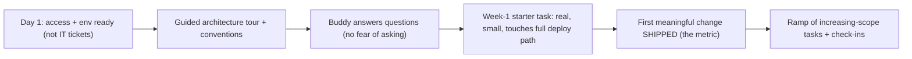

## 84.3 Onboarding programs that cut time to first meaningful change

#### Concept

Onboarding is how a new engineer goes from day one to being a productive, contributing member of the team. A good onboarding program is designed and measured, with a clear metric: **time to first meaningful change** — how long until a new hire ships something real to production. A great onboarding gets this down from months (the default in most companies) to days or a couple of weeks, by removing the friction and ambiguity that otherwise leave new hires lost and slow. Onboarding is high-leverage because every engineer goes through it once, and the difference between good and bad onboarding is weeks of productivity per hire, multiplied across every hire forever.

#### Why does it exist?

Imagine a new engineer's first weeks with no onboarding program: they are handed a laptop and a repo and left to figure it out. They spend days just getting the project to build, weeks understanding the architecture by reading code with no guide, and months before they feel confident enough to make a non-trivial change, because nobody showed them the paved road, the conventions, or who to ask. During this time they are expensive (full salary) and barely productive, frustrated, and at elevated risk of leaving (a bad onboarding is a top predictor of early attrition). Multiply this across every hire.

A designed onboarding program exists to compress this. It removes the undifferentiated friction (environment setup, finding docs, understanding conventions) that every new hire otherwise rediscovers painfully, and it provides a guided path to the first real contribution. It exists because onboarding is a repeated, predictable process that most companies leave to chance, and designing it well returns weeks of productivity per hire, every hire, forever.

#### Mental model

Imagine two ways to welcome a new resident to a town. The first: hand them a key and a map and say "good luck". They wander lost for weeks, slowly learning where the shops are, how the bus works, who to call for what. The second: a welcome packet with the essentials, a buddy who shows them around, a checklist of the first things to set up, and a small starter task to get them oriented. The second resident is functional in days. Onboarding is welcoming someone to the "town" of your codebase and team: the designed version (guide, buddy, checklist, starter task) gets them productive fast; the "here's a key, good luck" version wastes weeks and risks them giving up and leaving.

#### How it works

The elements of a good onboarding program:

```text
1. Pre-arrival / day one: laptop, accounts, access ready BEFORE they start, so
   day one isn't wasted on IT tickets.
2. Environment in < 1 day: a documented, scripted setup (ideally the paved
   road, Part 80) so they can build and run the system the first day, not spend
   a week fighting the environment.
3. A guided tour of the architecture: a doc or a session that explains the
   system's shape (the C4 diagrams, Part 111.5) and the key conventions, so they
   aren't reverse-engineering it from code.
4. An onboarding buddy: a named person whose explicit job is to answer the
   "stupid" questions, so the new hire isn't afraid to ask.
5. A starter task designed for the first week: a real but small, low-risk change
   that touches the full path (code, review, deploy) so they ship to production
   early and learn the whole workflow.
6. A ramp of increasing-scope tasks over the first weeks, with a check-in cadence.
```

The key metric: **time to first meaningful change** — days from start to shipping something real to production. Measure it, and drive it down. A starter task that touches the full path (code -> review -> CI -> deploy -> production) in week one teaches the new hire the entire workflow and gives them an early win, which is both productive and motivating.



#### Practical example

A team redesigns its onboarding after noticing new hires take about three months to become productive. They attack time to first meaningful change. Pre-arrival: accounts and laptop are ready on day one. Environment: they script the setup (building on the paved road) so a new hire can build and run the system in an afternoon, not a week. Architecture: they write a one-page guided tour with the C4 container diagram and the key conventions, and a staff engineer walks each new hire through it on day two. Buddy: each new hire gets a named buddy whose explicit job is to answer questions. Starter task: they maintain a backlog of real, small, low-risk tasks designed to touch the full deploy path, and the new hire picks one in week one. The result: new hires now ship their first meaningful change to production in the first week instead of the third month. The early win is motivating, the full-path starter task teaches the whole workflow, and the team gets months of extra productivity per hire. The redesign cost a few days of setup effort and returns weeks per hire forever.

#### Artifact example

An onboarding checklist and the starter-task definition — the artifacts that make onboarding a designed, fast process.

```markdown
# Onboarding checklist: [new engineer], ordering team
## Before day 1 (manager + IT)
- [ ] Laptop shipped, accounts (email, git, cloud, PagerDuty) created
- [ ] Added to team channels, calendars, repos
- [ ] Buddy assigned: [name]

## Day 1-2 (get oriented, remove friction)
- [ ] Environment set up via `scripts/setup.sh` (target: running locally by EOD day 1)
- [ ] Guided architecture tour with [staff eng]: C4 diagram + conventions
- [ ] Read: team README, the paved-road docs, the on-call runbook
- [ ] Buddy 1:1: "ask me anything, no question is too basic"

## Week 1 (ship something real — the metric)
- [ ] Pick a starter task (see backlog below)
- [ ] Ship it to production: code -> review -> CI -> deploy. Learn the FULL path.
- [ ] TARGET: first meaningful change in production by end of week 1.

## Weeks 2-4 (ramp)
- [ ] Increasing-scope tasks; weekly check-in with manager + buddy
- [ ] Shadow an on-call shift; pair on a design review
- [ ] By end of week 4: owning a small feature end to end

---
# Starter-task backlog (maintained, ready for new hires)
Criteria: real (ships to prod), small (< 2 days), low-risk (not payment-
critical), touches the full path (code + test + review + deploy).
- Add a field to the order-detail API response (+ test + deploy)
- Fix a known low-severity bug in the admin panel
- Add a metric/alert for an under-monitored endpoint
(NOT: a toy task with no real value, and NOT a high-risk payment change.)
```

The checklist's power is that it removes day-one friction (access ready before arrival), compresses environment setup to under a day via scripting, provides a guided architecture tour instead of leaving the hire to reverse-engineer it, assigns a buddy to make asking safe, and — the key move — drives toward shipping a real change to production in week one via a maintained backlog of starter tasks that touch the full path. The explicit metric (time to first meaningful change) and the starter-task criteria (real, small, low-risk, full-path) turn onboarding from "good luck" into a designed process that gets people productive in days.

#### Real-world scenario

A company treats onboarding as a measured, continuously-improved process, tracking time to first meaningful change for every hire and running a short retro with each new engineer after their first month ("what slowed you down?"). The retros surface friction the team had stopped noticing: a confusing setup step, a missing piece of architecture documentation, an unclear convention. They fix each one, so onboarding gets a little better with every hire. Over two years, time to first meaningful change drops from weeks to days, and new-hire satisfaction (and early retention) rises markedly. The compounding effect is large: every one of dozens of hires becomes productive weeks earlier and is less likely to leave early. A peer company that treats onboarding as a one-time "here's your laptop" event has new hires lost for months, higher early attrition, and no mechanism to improve, because nobody measures or retros it. The difference is treating onboarding as a designed, measured, continuously-improved process versus leaving it to chance — and because every hire goes through it, the improvement compounds across the whole growing organisation.

#### Failure scenario

A fast-growing company hires aggressively but has no onboarding program. Each new engineer is handed a laptop and pointed at the repos. They spend their first week fighting the environment (the setup is undocumented and broken), their first month reverse-engineering the architecture from code with no guide, and are afraid to ask questions because everyone seems busy and there is no designated buddy. They do not ship anything real for two to three months. Several things go wrong at once: the company pays full salaries for months of near-zero productivity across many hires; the new engineers are frustrated and demoralised by feeling useless and lost; and early attrition spikes, because a bad onboarding is a top predictor of leaving in the first year — some new hires quit within months, having never become productive, and the company must re-hire and re-onboard, compounding the waste. The absence of an onboarding program, in a company hiring fast, is enormously expensive: multiply months of lost productivity and elevated attrition across every hire. The fix is cheap relative to the cost — a few days to build a scripted setup, an architecture tour, a buddy system, and a starter-task backlog — but because onboarding is nobody's explicit job, it is left to chance, and the chance is bad. Onboarding neglected is one of the most expensive invisible costs in a growing company.

#### Edge cases & failure modes

- **No onboarding program.** New hires lost for months, expensive and demoralised, with elevated early attrition.
- **Day one wasted on IT tickets.** Access and laptop not ready, so the first days are bureaucracy, not orientation.
- **Environment setup that takes a week.** Undocumented or broken setup, so the new hire fights the tooling instead of learning the system.
- **No guided architecture tour.** The hire reverse-engineers the system from code, slowly and with wrong assumptions.
- **No buddy / fear of asking.** The new hire stays stuck on things a thirty-second answer would resolve, because they are afraid to interrupt busy people.
- **Starter task that is a toy** (no real value, teaches nothing) **or too risky** (a payment change that could cause an incident) **or doesn't touch the full path** (so they don't learn the deploy workflow).
- **Not measuring time to first meaningful change,** so onboarding is never improved.

#### How a Principal Engineer thinks about this

They treat onboarding as a high-leverage, measurable process rather than a one-time event, because they know every engineer goes through it once and the difference between good and bad onboarding is weeks of productivity per hire multiplied across the whole growing org, plus a major effect on early attrition. They drive toward a concrete metric — time to first meaningful change — and attack the friction that inflates it: day-one access ready, environment setup scripted to under a day (leveraging the paved road), a guided architecture tour instead of reverse-engineering, a named buddy so asking is safe, and a maintained backlog of starter tasks that are real, small, low-risk, and touch the full deploy path.

They understand that an early win — shipping something real to production in week one — is both productive and powerfully motivating, and that the full-path starter task teaches the entire workflow efficiently. And they treat onboarding as continuously improvable, retroing with each new hire to surface and fix the friction the team has stopped noticing, so onboarding gets better with every hire and the improvement compounds. The principal knows onboarding is one of the cheapest investments with one of the largest, most compounding returns, and that neglecting it is one of the most expensive invisible costs in a growing company.

#### Common mistakes

- **No onboarding program,** leaving new hires lost for months and raising early attrition.
- **Wasting day one on IT tickets** and the first week on a broken environment setup.
- **No guided architecture tour,** so hires reverse-engineer the system slowly and wrongly.
- **No buddy,** so new hires stay stuck rather than ask.
- **A starter task that is a toy, too risky, or doesn't touch the full deploy path.**
- **Not measuring time to first meaningful change,** so onboarding never improves.

#### Interview questions

1. **How do you design an onboarding program, and what's the key metric?**
   *Expected answer:* the key metric is time to first meaningful change (days from start to shipping something real to production); design toward it by having access ready day one, scripting environment setup to under a day, giving a guided architecture tour, assigning a buddy so asking is safe, and providing a maintained backlog of real, small, low-risk starter tasks that touch the full deploy path so the hire ships to production in week one. *Why it matters:* onboarding is high-leverage and most companies leave it to chance.

2. **Why is a good starter task real, small, low-risk, and full-path?**
   *Expected answer:* real so it has value and is motivating; small so it ships in week one; low-risk so a new hire's inevitable mistakes do not cause an incident (not a payment change); and full-path (code -> review -> CI -> deploy -> production) so they learn the entire workflow and get an early win. A toy task teaches nothing, a risky one is dangerous, and one that does not touch deploy leaves them not knowing how to ship. *Why it matters:* tests the detail of designing the first-week experience.

3. **What's the cost of having no onboarding program in a fast-growing company?**
   *Expected answer:* months of near-zero productivity per hire at full salary, multiplied across many hires; demoralised, frustrated new engineers; and spiked early attrition (bad onboarding is a top predictor of first-year leaving), forcing costly re-hiring and re-onboarding. The fix is cheap (a few days to build) relative to the compounding cost, but it is left to chance because it is nobody's explicit job. *Why it matters:* tests whether they see onboarding's large invisible cost.

#### Practical exercise

Assess your team's onboarding. Estimate the current time to first meaningful change for a recent hire, and identify the biggest sources of friction (environment setup, finding docs, understanding the architecture, fear of asking). Then design the improvements: a day-one readiness checklist, a scripted environment setup, a guided architecture tour, a buddy assignment, and a backlog of starter tasks meeting the criteria (real, small, low-risk, full-path). Set a target time to first meaningful change.

**Acceptance criteria:** you estimate the current time to first meaningful change and identify its biggest friction sources; your redesign removes day-one bureaucracy, compresses environment setup, provides a guided architecture tour and a buddy, and includes a starter-task backlog whose tasks are real, small, low-risk, and touch the full deploy path; and you set a concrete target metric (e.g. first meaningful change by end of week one) to measure and improve against.
