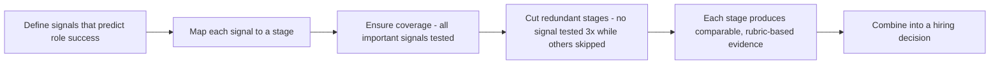

## 84.4 Designing an interview loop for backend roles

#### Concept

An interview loop is the sequence of interviews a candidate goes through. Designing one well means deciding what **signal** each stage is meant to produce — coding ability, system design judgement, debugging skill, collaboration, backend depth — and ensuring each stage produces a distinct signal, so you are not running redundant stages that measure the same thing while leaving important signals untested. A well-designed loop covers the signals that actually predict success in the role, in the fewest stages, with each stage producing clear, comparable evidence for the hiring decision.

#### Why does it exist?

Imagine a loop of five interviews where three of them are basically "write some code on a whiteboard" and none of them tests system design or how the candidate handles ambiguity. You have spent five hours of the candidate's time and five engineers' time producing three redundant signals (coding) and missing the signals that matter most for a senior backend role (design judgement, debugging, collaboration). You might hire someone who codes well but cannot design a system or work with a team, because you never tested for it. Or imagine the opposite: a loop with no clear plan, where each interviewer does whatever they feel like, so the signals are inconsistent and the hiring decision is made on a jumble of incomparable impressions.

A designed loop exists to produce the *right signals efficiently*: each stage targets a distinct signal that predicts success in the role, the loop covers all the important signals, and no stage is redundant. It exists because interview time is expensive (for candidates and interviewers) and hiring decisions are high-stakes, so the loop should be engineered to extract the maximum decision-relevant signal in the minimum time.

#### Mental model

Imagine a medical diagnosis. A good doctor orders a specific set of tests, each measuring a distinct thing relevant to the diagnosis — a blood test, an X-ray, an ECG — covering the important dimensions without redundancy (they do not order three blood tests measuring the same marker while skipping the X-ray). A bad diagnosis runs whatever tests are convenient, redundantly measuring some things while missing others, and reaches a conclusion on incomplete, overlapping evidence. An interview loop is a diagnostic battery: each stage is a test targeting a distinct signal, the battery covers the signals that matter for the role, and no test is redundant. You design the battery to answer the hiring question with the fewest, most informative tests.

#### How it works

**Step 1: Define the signals that predict success in the role.** For a senior backend engineer, the signals typically include:

```text
- Coding: can they write correct, clean code and reason about complexity?
- System design: can they design a system under realistic constraints and
  reason about tradeoffs, failure modes, scale? (Critical for senior+.)
- Backend depth: do they understand databases, concurrency, APIs, distributed
  systems at the depth the role needs?
- Debugging / problem-solving: can they diagnose a problem methodically?
- Collaboration / communication: how do they work with others, explain ideas,
  handle disagreement?
- (For senior+) Ownership / judgement: how do they operate under ambiguity,
  make decisions, handle production concerns?
```

**Step 2: Assign each signal to a stage, ensuring coverage and no redundancy.** Each interview targets one or two signals. The loop collectively covers all the important signals, and no signal is tested by three stages while another is untested.

```text
Example loop for a senior backend role (4-5 stages):
- Stage 1 (screen): coding + basic backend depth — filters fast.
- Stage 2: system design — the critical senior signal (57.6).
- Stage 3: backend deep-dive (databases, concurrency, APIs) + a debugging problem.
- Stage 4: past-project / behavioural — ownership, collaboration, judgement.
- (Optional) Stage 5: a second design or a code-review round if signal is unclear.
```

**Step 3: Avoid redundant stages.** If two stages produce the same signal, cut one. Three coding rounds for a senior role is redundant; one good coding round plus design, depth, and behavioural rounds covers far more. Redundancy wastes everyone's time and leaves other signals untested.

**Step 4: Make the stages produce comparable evidence.** Each stage uses a consistent question and rubric (84.5) so candidates are evaluated on the same basis, and the evidence from each stage is clear enough to combine into a decision.



#### Practical example

A company's loop for senior backend hires is five rounds: three coding rounds, one "culture fit" chat, and one system design round. A principal engineer redesigns it by first listing the signals that predict success (coding, system design, backend depth, debugging, ownership/collaboration) and mapping the current loop against them. The mapping reveals the problem: coding is tested three times (redundant), system design once (good), and backend depth, debugging, and ownership barely or not at all. He redesigns to four rounds, each a distinct signal: one coding round (sufficient), one system design round (the critical senior signal), one backend-deep-dive-plus-debugging round, and one structured past-project/behavioural round for ownership and collaboration. The new loop is shorter (four rounds vs five), covers more signals (all five vs three), and has no redundancy. The hiring decisions improve, because the loop now tests the design judgement, backend depth, and ownership that actually predict senior success, instead of testing coding three times and hoping. And candidates have a better experience, because their time is spent on distinct, relevant assessments rather than three variations of the same coding test.

#### Artifact example

An interview loop design — the artifact that specifies what each stage tests and why, ensuring coverage without redundancy.

```markdown
# Interview loop: Senior Backend Engineer (NestJS/PostgreSQL)

## Signals that predict success in THIS role (defined first)
1. Coding: correct, clean code; reasons about complexity.
2. System design: designs under constraints; tradeoffs, failure modes, scale.
3. Backend depth: databases, concurrency, APIs, distributed systems.
4. Debugging: methodical diagnosis of a realistic problem.
5. Ownership & collaboration: ambiguity, decisions, working with others.

## The loop (4 stages — each a DISTINCT signal, no redundancy)
| Stage | Targets | Format | Why this stage |
|---|---|---|---|
| 1. Screen | Coding + basic depth | 1hr, a realistic coding problem | Fast filter on the fundamentals |
| 2. System design | System design (the key senior signal) | 1hr, design a system (57.6) | Senior success predicts most on this |
| 3. Backend deep-dive | Backend depth + debugging | 1hr, DB/concurrency/API Qs + a debug scenario | Tests the role's technical core |
| 4. Past-project + behavioural | Ownership + collaboration | 1hr, structured past-project deep-dive | Tests how they operate, not just build |

## Coverage check (every signal tested, none 3x)
Coding: stage 1. Design: stage 2. Depth: stage 3. Debugging: stage 3.
Ownership/collab: stage 4. -> All 5 covered, none redundant.

## What we deliberately DON'T do
- No 3 coding rounds (redundant — stage 1 suffices for this level).
- No vague "culture fit chat" (unstructured, bias-prone — replaced by the
  structured behavioural in stage 4, with a rubric).
```

The loop design's power is that it defines the signals *first* (what predicts success in this specific role), maps each stage to a distinct signal, includes an explicit coverage check (every signal tested, none redundant), and names what it deliberately omits (redundant coding rounds, the bias-prone unstructured "culture fit" chat). This turns the loop from an accidental accumulation of rounds into an engineered battery that extracts the decision-relevant signal efficiently. The coverage check is the key discipline: it proves the loop tests everything important without wasting time testing anything three times.

#### Real-world scenario

A company audits its interview loop and discovers it has grown by accretion — each time someone felt a hire went wrong, they added a stage, so the loop ballooned to seven rounds, several redundant, and the candidate experience was brutal (a full day-plus of interviews). A principal engineer redesigns from first principles: define the signals, map one stage per signal, cut redundancy. The loop shrinks from seven rounds to four, each with a clear purpose and rubric. Three things improve at once: the hiring decisions get better (the loop now covers all the important signals instead of over-testing a few), the candidate experience improves dramatically (four focused rounds instead of seven scattered ones, which matters for competitive candidates who have other offers), and the interviewer time cost drops (fewer rounds per candidate frees interviewers). The accreted seven-round loop was worse on every dimension than the designed four-round one, because it had grown reactively rather than being engineered for signal. The lesson: interview loops, like any system, accrete cruft and benefit from deliberate redesign around what they are actually meant to measure.

#### Edge cases & failure modes

- **Redundant stages.** Multiple stages testing the same signal (three coding rounds), wasting time while other signals go untested.
- **Missing signals.** Not testing a signal that predicts success (no system design round for a senior role, no ownership assessment).
- **The vague "culture fit" chat.** An unstructured round with no defined signal or rubric, which is bias-prone and produces unreliable, non-comparable evidence.
- **Loop grown by accretion.** Stages added reactively over time without redesign, producing a bloated, redundant, brutal loop.
- **Too many stages.** A loop so long it deters competitive candidates and wastes interviewer time for diminishing signal.
- **Stages with no rubric,** so the evidence is inconsistent impressions rather than comparable assessments (84.5).

#### How a Principal Engineer thinks about this

They design the loop backward from the signals that actually predict success in the specific role, rather than accumulating stages reactively, because they know an interview loop is a diagnostic battery that should extract maximum decision-relevant signal in minimum time. They ensure each stage targets a distinct signal and that the loop covers all the important ones — especially system design and ownership for senior roles, which weak loops often skip in favour of over-testing coding. They ruthlessly cut redundant stages, because three rounds testing the same thing waste everyone's time and crowd out the signals that matter.

They are especially wary of the unstructured "culture fit" chat, which they replace with a structured, rubric-based behavioural round, because they know unstructured rounds are bias-prone and produce unreliable evidence. And they treat the candidate experience as a real consideration, because a bloated or brutal loop deters exactly the competitive candidates they most want to hire. The principal engineers the loop like any system: defined purpose per component, full coverage, no redundancy, and periodic redesign to clear the cruft that accretes — because hiring decisions are high-stakes and the loop is how the evidence for them is produced.

#### Common mistakes

- **Redundant stages** testing the same signal while others go untested.
- **Missing critical signals** (no system design for senior roles, no ownership assessment).
- **The unstructured "culture fit" chat,** which is bias-prone and signal-free.
- **A loop grown by accretion** into a bloated, brutal, redundant sequence.
- **Stages without rubrics,** producing inconsistent, non-comparable evidence.

#### Interview questions

1. **How do you design an interview loop for a senior backend role?**
   *Expected answer:* define the signals that predict success in the role first (coding, system design, backend depth, debugging, ownership/collaboration), then assign each signal to a distinct stage, ensure the loop covers all the important signals, cut redundant stages (e.g. three coding rounds), and give each stage a rubric so the evidence is comparable. Design backward from signals, not by accumulating stages. *Why it matters:* tests whether they engineer the loop or let it accrete.

2. **What's wrong with a loop that has three coding rounds and a "culture fit" chat?**
   *Expected answer:* the three coding rounds are redundant (same signal three times) while critical signals — system design, backend depth, ownership — go untested; and the "culture fit" chat is unstructured, has no defined signal or rubric, and is bias-prone, producing unreliable evidence. Replace the redundant rounds with distinct-signal stages and the chat with a structured, rubric-based behavioural round. *Why it matters:* tests the two most common loop failures.

3. **Why does the candidate experience matter when designing a loop?**
   *Expected answer:* a bloated or brutal loop (seven rounds, a full day-plus) deters exactly the competitive candidates you most want, who have other offers; a shorter, well-designed loop with distinct purposeful rounds respects their time and reflects well on the company, while still extracting the signal you need. Fewer, better rounds beat more, redundant ones on hiring quality, candidate experience, and interviewer cost. *Why it matters:* tests whether they consider the candidate side, not just the signal.

#### Practical exercise

Audit your team's current interview loop for a role you hire for. List the signals that actually predict success in that role, then map each current stage to the signal(s) it produces. Identify redundancy (signals tested by multiple stages) and gaps (important signals untested). Redesign the loop so each stage targets a distinct signal, all important signals are covered, and there is no redundancy — and flag any unstructured "culture fit" style rounds for replacement with structured, rubric-based ones.

**Acceptance criteria:** you define the role's success-predicting signals first; your audit identifies at least one redundancy or one gap in the current loop; your redesigned loop maps each stage to a distinct signal with a coverage check showing all important signals are tested and none redundant; and any unstructured rounds are replaced with structured, rubric-based assessments.
