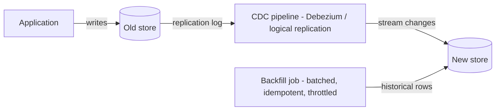

## 84.5 Data migrations at scale: dual writes, CDC, backfills, and reconciliation

#### Concept

Moving the data itself — billions of rows from an old store to a new one, while the system keeps running and the data keeps changing — is the hardest technical part of most migrations. It requires getting the *existing* data across (a backfill of potentially billions of rows without taking the system down), getting *new and changed* data across continuously while both systems run (dual writes or change-data-capture), and *proving* the two stores agree (reconciliation and verification). Get any of these wrong and you silently lose or corrupt data, which in a payment or order system is catastrophic and often invisible until much later.

#### Why does it exist?

Imagine migrating ten billion order rows from the old database to the new one. You cannot take the system down for the hours or days a naive copy would take — the business runs continuously. And while you are copying, new orders are being placed and existing orders are being updated, so the data is a moving target: by the time your copy finishes, the source has changed. And when you are done, how do you *know* the new store is correct? If 0.3% of rows silently failed to copy, you will not notice until a customer complains that their order is missing, long after the cutover.

Scaled data migration techniques exist to solve these three problems: copy the existing data without downtime (backfill in batches), keep the stores in sync while both run (dual write or CDC), and verify they agree (reconciliation). Without all three, you have a migration that is fast, live, and silently wrong.

#### Mental model

Imagine moving the water from one reservoir to another while the first reservoir is still being filled by rivers and drained by cities. You cannot just scoop it across once, because it keeps changing. You need three things: a pump that moves the existing water over gradually (backfill), a pipe that diverts the incoming rivers to also fill the new reservoir while the old one is still in use (dual write / CDC), and gauges on both reservoirs to confirm the levels match before you shut off the old one (reconciliation). Shut off the old reservoir before the levels match, and a city goes thirsty (data loss). The whole discipline is moving a live, changing body of data without losing a drop.

#### How it works

**Backfilling existing data.** Copy the historical rows in batches, not all at once, to avoid overwhelming the database or holding long locks:

```sql
-- Backfill in bounded batches, by primary key, so each batch is fast and
-- holds no long lock. Run until no rows remain.
INSERT INTO new_store.orders (id, customer_id, total_minor, status, created_at)
SELECT id, customer_id, total_minor, status, created_at
FROM old_store.orders
WHERE id > :last_copied_id        -- keyset pagination, not OFFSET (Part 22)
ORDER BY id
LIMIT 5000
ON CONFLICT (id) DO NOTHING;      -- idempotent: safe to re-run a batch
```

Backfill properties that matter at billions of rows: batch by key (keyset pagination, never `OFFSET` on a huge table), make each batch idempotent (`ON CONFLICT DO NOTHING`) so you can re-run safely, throttle to avoid saturating the database, and checkpoint progress so you can resume after a failure. A ten-billion-row backfill at 5,000 rows per batch and a safe rate might run for days; that is fine, because it runs alongside the live system.

**Keeping the stores in sync (new/changed data).** Two approaches:

- **Dual writes.** The application writes to both stores on every change. Simple to understand, but dangerous: if the write to one store succeeds and the other fails (crash, timeout), the stores diverge — the dual-write problem from Part 30.9. Dual writes need the same care as any dual write: ideally an outbox, or at minimum careful error handling and reconciliation to catch divergence.
- **CDC (change data capture).** Read the old database's replication log (e.g. PostgreSQL logical replication, or Debezium) and stream every change to the new store. The new store is kept in sync by consuming the change stream. CDC is generally safer than application-level dual writes because it captures every committed change from the source of truth (the log) rather than relying on the application to write twice, so it cannot miss a change that committed.



The combination — backfill for history, CDC for ongoing changes — is the standard pattern: the backfill catches up the past while CDC keeps the present in sync, and when the backfill finishes, the new store is fully caught up and staying caught up.

**Reconciliation and verification.** Prove the stores agree before cutover. Run a reconciliation job that compares the two stores — by row counts, by checksums over ranges of rows, by sampling and comparing individual records, or by comparing aggregates (sum of all order totals in both stores). Any discrepancy is investigated and fixed before cutover. Reconciliation is not optional for anything important: it is the only way to know your migration did not silently lose or corrupt data.

#### Practical example

A team migrates five billion order rows to a new store. They run a backfill: batched by `id` with keyset pagination, 5,000 rows per batch, idempotent on conflict, throttled to keep the source database under 60% CPU, checkpointing the last copied id. It runs for four days. Simultaneously, they set up CDC via PostgreSQL logical replication, streaming every new and changed order from the old store to the new one, so that changes during the four-day backfill are captured. When the backfill finishes and CDC lag is near zero, the new store is fully caught up. Before cutover, they run reconciliation: compare total row counts (match), compare the sum of all order totals (match to the cent), and sample 100,000 random orders and compare every field (match). Only after reconciliation passes do they cut reads over to the new store, keeping CDC running so they can fall back. The backfill moved the past, CDC moved the present, and reconciliation proved correctness — the three pieces that make a billions-of-rows live migration safe.

#### Artifact example

A reconciliation report and cutover-readiness checklist — the artifacts that gate a data cutover on proof, not hope.

```markdown
# Order data migration: reconciliation report (pre-cutover gate)

## Backfill
Rows in old store:  5,012,443,901
Rows in new store:  5,012,443,901   -> MATCH
Backfill completed: 2027-05-10. Checkpoints clean, no gaps.

## CDC sync
CDC lag (old -> new): 0.4s  -> within tolerance (< 5s)
Changes applied since backfill start: 48,221,004. Errors: 0.

## Reconciliation checks (ALL must pass to cut over)
| Check | Old store | New store | Result |
|---|---|---|---|
| Total row count | 5,012,443,901 | 5,012,443,901 | PASS |
| Sum of order totals (checksum) | 918,443,221,05 | 918,443,221,05 | PASS |
| Count by status (10 buckets) | — | — | PASS (all match) |
| Random sample 100k, all fields | — | — | PASS (0 diffs) |
| Orders in last 24h (freshness) | 1,204,331 | 1,204,331 | PASS |

## Cutover readiness
[x] Backfill complete, no gaps
[x] CDC lag within tolerance
[x] All reconciliation checks PASS
[x] Rollback plan: keep CDC running, reads can fall back to old store in <5min
[x] Old store NOT deleted until 30 days post-cutover (safety window)

## Decision: CLEARED FOR CUTOVER
Reconciliation proves the stores agree. Cut reads over; keep writing both +
CDC for 30 days as a safety net before deleting the old store.
```

The report's whole purpose is to replace "we think the data is fine" with "here is proof the stores agree, by five independent checks". The row counts, the checksum over all order totals, the per-status counts, the 100k-field-level sample, and the freshness check together make silent data loss extremely unlikely to slip through. The cutover is gated on this proof, and the old store is kept for 30 days as a safety net. This is how you migrate billions of rows and *know* you did not lose any.

#### Real-world scenario

A team migrating order data runs reconciliation before cutover and the row counts match exactly — but the checksum over order totals is off by a tiny amount, a few cents across billions of dollars. Row counts matching but totals not matching is a telltale sign: the right *number* of rows copied, but some rows copied with wrong *values*. Investigation reveals that a handful of orders with a rare currency had their totals truncated by a type mismatch between the old and new schema (a precision difference). Because reconciliation caught it — specifically the checksum check, which row counts alone would have missed — the team fixes the type handling, re-syncs the affected rows, re-runs reconciliation until the checksum matches to the cent, and only then cuts over. Had they reconciled on row count alone (a common shortcut), the truncated totals would have shipped silently, corrupting a small number of orders in a way nobody would notice until a customer or an auditor found it months later. The multi-dimensional reconciliation — counts *and* checksums *and* field-level sampling — is what caught a corruption that any single check would have missed. For money data, reconciling on count alone is a trap.

#### Failure scenario

A team migrates data using application-level dual writes with no reconciliation. The application writes every order to both the old and new stores. For months it seems fine. But dual writes have the dual-write problem: occasionally, the write to the new store fails (a timeout, a transient error) after the write to the old store succeeded, and the error handling just logs it and moves on. Each such failure is a single order that exists in the old store but not the new one — a tiny, silent divergence. Over months, these accumulate: 0.3% of orders are missing from the new store. Because there is no reconciliation, nobody knows. At cutover, reads switch to the new store, and suddenly 0.3% of customers cannot see some of their orders — orders that were silently dropped during the dual-write period. The incident is severe (lost order data in production), hard to diagnose (the data was lost months ago, gradually), and expensive to fix (reconstruct the missing orders from the old store, which is still around only by luck). The root causes are two: dual writes without the dual-write protections (outbox or CDC), and no reconciliation to catch the divergence before cutover. Either safeguard alone would have caught it; together they are the standard discipline, and skipping both turned a routine migration into a data-loss incident. (This is the 0.3%-of-refunds incident story referenced in the outline, generalised.)

#### Edge cases & failure modes

- **Dual writes without protection.** A failed write to one store silently diverges the data; without an outbox/CDC and reconciliation, the divergence accumulates unseen.
- **Reconciling on row count alone.** Matches the number of rows but misses rows copied with wrong values (truncation, type mismatches) — catastrophic for money data.
- **No reconciliation at all.** You cut over with no proof the data is correct, and discover loss or corruption only when a customer does.
- **Backfill with `OFFSET` on a huge table.** `OFFSET` on billions of rows gets catastrophically slow; use keyset pagination.
- **Non-idempotent backfill.** A re-run (after a failure) double-inserts or errors; make batches idempotent (`ON CONFLICT`).
- **Deleting the old store immediately after cutover.** No safety net if a problem surfaces days later; keep the old store for a safety window.
- **CDC that silently falls behind or drops events.** Unmonitored CDC lag means the new store drifts from the source without anyone noticing.

#### How a Principal Engineer thinks about this

They treat "prove the data is correct" as a non-negotiable gate on any data cutover, and they reconcile on multiple independent dimensions — counts, checksums over values, field-level sampling, freshness — because they know that any single check has blind spots and that silent data loss or corruption is the worst outcome of a migration precisely because it is invisible until much later. For money and order data especially, they would never reconcile on row count alone, because they have seen value-corruption that count checks miss entirely.

They prefer CDC over application-level dual writes when feasible, because CDC captures every committed change from the source of truth (the log) and cannot miss a change that committed, whereas dual writes rely on the application succeeding twice and silently diverge when it does not. When dual writes are unavoidable, they insist on the dual-write protections (outbox) and on reconciliation as the backstop. And they keep the old store alive for a safety window after cutover and keep the sync running, because they know problems can surface days later, and a migration that has deleted its fallback has thrown away its rollback. The principal's defining instinct in a data migration is distrust: assume the data migrated wrong until proven right, and build the proof.

#### Common mistakes

- **Dual writes with no outbox/CDC and no reconciliation,** accumulating silent divergence.
- **Reconciling on row count alone,** missing value corruption (truncation, type mismatches).
- **Skipping reconciliation entirely,** cutting over with no proof of correctness.
- **Backfilling with `OFFSET` or non-idempotent batches,** which is slow and unsafe to re-run.
- **Deleting the old store immediately after cutover,** leaving no fallback when a problem surfaces later.

#### Interview questions

1. **How do you migrate billions of rows to a new store while the system keeps running, and prove you didn't lose any?**
   *Expected answer:* backfill the historical rows in idempotent, throttled, keyset-paginated batches; keep new/changed data in sync via CDC (preferred) or carefully-protected dual writes during the backfill; then reconcile on multiple dimensions (row counts, value checksums, field-level sampling, freshness) before cutover, keeping the old store and the sync running as a safety net afterward. *Follow-up:* why reconcile on more than row count.

2. **Why is reconciling on row count alone dangerous for money data?**
   *Expected answer:* row count confirms the right number of rows copied but not that they copied with correct values; truncation or type mismatches can corrupt values while the count still matches. For money data you must also check value checksums (e.g. sum of all totals) and field-level samples, or silent corruption ships. *Why it matters:* tests whether they understand the blind spots of a single reconciliation dimension.

3. **Why is CDC generally safer than application-level dual writes for keeping two stores in sync?**
   *Expected answer:* CDC captures every committed change from the source of truth (the replication log), so it cannot miss a change that committed; application dual writes rely on the app successfully writing to both stores, and when one write fails (crash, timeout) the stores silently diverge — the dual-write problem. If dual writes are unavoidable, use an outbox and reconcile. *Follow-up:* what do you monitor on a CDC pipeline.

#### Practical exercise

Design the data-migration plan for moving a large table (orders, or a table you work with) to a new store while the system runs. Specify: the backfill (batching strategy, idempotency, throttling, checkpointing), the sync method for ongoing changes (CDC or protected dual writes, and why), and the reconciliation checks that must pass before cutover (at least three independent dimensions, including a value checksum if the data includes money). Include the post-cutover safety window.

**Acceptance criteria:** the backfill uses keyset pagination and idempotent batches (safe to re-run); the sync method is justified (CDC preferred, or dual writes with explicit protection); the reconciliation includes at least three independent checks with a value checksum for any money data (not row count alone); and the plan keeps the old store and the sync running for a safety window after cutover so a late-surfacing problem can fall back.
