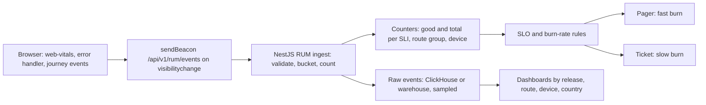
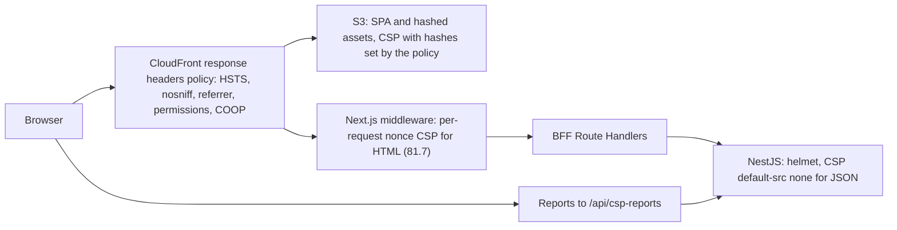

## 84.8 Real-user monitoring and frontend SLOs

#### Concept

**Real-user monitoring (RUM)** measures what actual users experience in their browsers: page load timings and Core Web Vitals (Part 82), JavaScript errors, failed API calls as the browser saw them, and whether user journeys complete. Part 82.11 covered collecting Web Vitals with the `web-vitals` library and using them in performance budgets. This section turns RUM into **frontend service level objectives (SLOs)**: targets for the user's experience, with error budgets and alerts, in the same discipline Part 53 applied to the backend (53.2 SLIs, 53.3 SLOs, 53.5 error budgets).

A frontend **SLI** (service level indicator) is a ratio of good events to all events, measured in the browser:

- **Page load availability**: page loads that rendered the main content without a fatal error, out of all page loads.
- **Load performance**: page loads with LCP at or under 2.5 s, out of all page loads with an LCP value.
- **Interaction responsiveness**: page views with INP at or under 200 ms.
- **Journey success**: checkout attempts (a click on "Place order") that reached the confirmation page or a definite, user-caused failure (declined card), out of all attempts.
- **Client-observed API success**: browser API calls that got a non-5xx response within the timeout, including network failures and timeouts the server never saw.

#### Why does it exist?

Because the backend's SLOs can be green while users suffer. The API's availability counts requests that reached it. It cannot count the request that failed in a phone's flaky network, the checkout that broke because a JavaScript chunk failed to load, the 7-second LCP caused by a third-party font, or the button that did nothing because of an exception in a click handler. Frontend SLOs measure the product where the customer is, and their error budgets give the frontend team the same tool the backend team has for deciding between features and reliability work.

#### Mental model

Imagine a delivery company that measures on-time departures from its depots (backend SLOs) and also asks every customer whether the parcel arrived intact and on time (frontend SLOs). The depot numbers can be perfect while vans break down on the road. Only the doorstep number tells you what the customer got.

#### How it works



1. **Collect in the browser**: Web Vitals via `onLCP`, `onINP`, `onCLS` (82.11); page load success when the main content's component mounts; fatal errors from the error boundary; journey events (`checkout_attempt`, `checkout_confirmed`, `checkout_failed_user`, `checkout_failed_system`); API call outcomes from the client's middleware.
2. **Send reliably**: batch events and flush with `navigator.sendBeacon` on `visibilitychange` to `hidden` (not `unload`, which is unreliable and blocks the bfcache, 82.9).
3. **Validate and bucket on ingest**: reject malformed or absurd values (LCP of 10 minutes), map URLs to **route groups** (`/p/:slug`, `/checkout`), device to **classes** (mobile, desktop), keep labels bounded.
4. **Count good and total events** per SLI as counters. Percentiles (p75 LCP) are useful on dashboards; SLOs are cleaner as ratios ("90 % of loads have good LCP"), because ratios add up across time and instances and support error budgets.
5. **Define SLOs over a window** (28 days) with an **error budget**: an SLO of 99.5 % for checkout page availability allows 0.5 % bad loads.
6. **Alert on burn rate** (53.5): page when the budget is being spent fast (for example 14.4x the allowed rate over both 1 hour and 5 minutes), open a ticket on slow burns (for example 3x over 6 hours).
7. **Segment by release**: every event carries the release (84.2), so a regression in one deploy shows as a step change for that release, and the canary comparison of 84.5 uses the same data.

The storefront's SLOs:

| SLI | Good event | SLO (28 days) | Owner |
|---|---|---|---|
| Checkout page availability | Checkout step rendered without a fatal error | 99.5 % | Web team |
| Checkout journey success | Attempt ends in confirmation or a user-caused failure | 99.0 % | Web and orders API |
| Product page LCP (mobile) | LCP at or under 2.5 s | 85 % | Web team |
| INP (all pages, mobile) | INP at or under 200 ms | 85 % | Web team |
| Client-observed API success | Non-5xx within timeout, no network error | 99.3 % | Orders API, platform |

#### Practical example

On a normal day the storefront records 2.5 million page loads and 41,000 checkout attempts. Checkout journey success runs at 99.6 %; the remaining 0.4 % are mostly payment-provider timeouts. The error budget for the 99.0 % SLO is 1 % of attempts, about 12,000 bad attempts in 28 days. A deploy that breaks the coupon step for Safari users (6 % of checkout traffic) would burn the budget at about 6x the allowed rate: a ticket, not a page, under a fast-burn threshold of 14.4x. That is why the checkout availability SLO is tighter and alerts faster, and why canaries (84.5) compare releases directly instead of waiting for SLO burn.

#### React / Next.js example

The journey events, sent through the same RUM queue as Web Vitals:

```ts
// apps/web/src/observability/rum.ts
import { onCLS, onINP, onLCP, type Metric } from 'web-vitals';   // v4

type RumEvent =
  | { t: 'vital'; name: 'LCP' | 'INP' | 'CLS'; value: number; rating: Metric['rating']; route: string }
  | { t: 'page'; ok: boolean; route: string }
  | { t: 'journey'; name: 'checkout_attempt' | 'checkout_confirmed' | 'checkout_failed_user' | 'checkout_failed_system'; code?: string }
  | { t: 'api'; route: string; outcome: 'ok' | 'http_5xx' | 'timeout' | 'network'; status?: number };

const queue: RumEvent[] = [];
let release = 'web@unknown';
let routeGroup = 'unknown';

export function initRum(opts: { release: string; routeGroup: string }) {
  release = opts.release;
  routeGroup = opts.routeGroup;                          // from the App Router segment, e.g. '/p/[slug]'
  const vital = (m: Metric) => queue.push({ t: 'vital', name: m.name as 'LCP' | 'INP' | 'CLS', value: m.value, rating: m.rating, route: routeGroup });
  onLCP(vital); onINP(vital); onCLS(vital);
  addEventListener('visibilitychange', () => { if (document.visibilityState === 'hidden') flush(); });
}

export const track = (e: RumEvent) => { queue.push(e); if (queue.length >= 20) flush(); };

function flush() {
  if (!queue.length) return;
  const body = JSON.stringify({ release, events: queue.splice(0, queue.length) });
  navigator.sendBeacon('/api/v1/rum/events', new Blob([body], { type: 'application/json' }));   // survives page hide
}
```

The checkout calls `track({ t: 'journey', name: 'checkout_attempt' })` on submit, and one of the three outcome events when `usePlaceOrder` (77.8) returns. An "unknown outcome" counts as `checkout_failed_system`, because the user did not get an answer.

#### Backend side (NestJS)

The RUM ingest endpoint is a public, unauthenticated, high-volume write path. It must be cheap, defensive and bounded. It sits beside 82.11's `POST /v1/rum/vitals` (which keeps feeding the `web_vitals_value` histogram) and adds the SLI counters for availability, journeys and the LCP good/total ratio:

```ts
// apps/api/src/rum/rum-events.controller.ts  (next to 82.11's rum.controller.ts)
import { Body, Controller, HttpCode, Post } from '@nestjs/common';
import { Throttle } from '@nestjs/throttler';
import { Counter } from 'prom-client';
import { z } from 'zod';
import { ZodValidationPipe } from '../common/zod-validation.pipe';

const ROUTES = new Set(['/', '/p/[slug]', '/c/[slug]', '/cart', '/checkout', '/orders', '/orders/[id]']);
const Batch = z.object({
  release: z.string().max(60),
  events: z.array(z.object({ t: z.enum(['vital', 'page', 'journey', 'api']) }).passthrough()).max(50),
});

const sli = new Counter({ name: 'rum_sli_events_total', help: 'Frontend SLI events', labelNames: ['sli', 'route', 'good'] });

@Controller('v1/rum')
export class RumEventsController {
  @Post('events')
  @HttpCode(204)
  @Throttle({ default: { limit: 30, ttl: 60_000 } })            // per IP; a beacon every few seconds at most
  ingest(@Body(new ZodValidationPipe(Batch)) batch: z.infer<typeof Batch>) {
    for (const e of batch.events as Record<string, unknown>[]) {
      const route = ROUTES.has(String(e.route)) ? String(e.route) : 'other';   // bounded label values
      if (e.t === 'vital' && e.name === 'LCP' && typeof e.value === 'number' && e.value < 120_000) {
        sli.inc({ sli: 'lcp', route, good: String(e.value <= 2500) });
      } else if (e.t === 'page') {
        sli.inc({ sli: 'page_availability', route, good: String(e.ok === true) });
      } else if (e.t === 'journey' && e.name !== 'checkout_attempt') {
        sli.inc({ sli: 'checkout_journey', route: '/checkout', good: String(e.name !== 'checkout_failed_system') });
      }
    }
    // Raw events go to a queue for the warehouse at a 10 % sample; the counters above are unsampled.
  }
}
```

The SLO and a fast-burn alert in Prometheus terms:

```yaml
# prometheus/rules/frontend-slo.yaml
groups:
  - name: frontend-slo
    rules:
      - record: sli:checkout_journey:ratio_rate1h
        expr: sum(rate(rum_sli_events_total{sli="checkout_journey",good="true"}[1h]))
              / sum(rate(rum_sli_events_total{sli="checkout_journey"}[1h]))
      - record: sli:checkout_journey:ratio_rate5m
        expr: sum(rate(rum_sli_events_total{sli="checkout_journey",good="true"}[5m]))
              / sum(rate(rum_sli_events_total{sli="checkout_journey"}[5m]))
      - alert: CheckoutJourneyFastBurn
        expr: (1 - sli:checkout_journey:ratio_rate1h) > (14.4 * 0.01)
              and (1 - sli:checkout_journey:ratio_rate5m) > (14.4 * 0.01)
        labels: { severity: page, team: web }
        annotations: { summary: "Checkout journey SLO burning 14x budget; check the latest web release and orders API" }
```

The release is deliberately not a Prometheus label (it would add a series per deploy); per-release analysis uses the sampled raw events in the warehouse and the error tracker's release health.

#### Production scenario

Three months after introducing frontend SLOs, the storefront's error budget report showed: checkout availability 99.78 % (budget 44 % spent, mostly one bad deploy), journey success 99.41 % (budget 59 % spent, mostly a payment provider's degradation), mobile product LCP 87 % good (just above the 85 % target, after a hero image regression), INP 91 % good. The product manager used the LCP budget, close to exhausted, to schedule image work ahead of a new carousel feature, a decision that previously would have been an argument.

#### Failure scenario

The team's first availability SLI counted a page load as good if the HTML returned `200`. A release broke hydration on the cart page for Chrome on Android: the server-rendered HTML looked right, but every button was dead because a client chunk threw during hydration. The SLI stayed at 99.9 % for six hours while cart-to-checkout conversion fell by 40 %. The SLI now requires a client-side "page ready" signal from the main content's component after hydration, plus no fatal error in the first 10 seconds.

#### Edge cases & failure modes

- **Server-side definitions of good** that miss client failures (hydration errors, dead buttons).
- **Beacons lost** when sent on `unload`; use `visibilitychange` and `sendBeacon`.
- **Bots and synthetic traffic** inflating good events; filter known bots and exclude your own monitoring.
- **Ad blockers** blocking `/rum` endpoints with telltale names; same-origin, neutral paths help.
- **Unbounded labels** (full URLs, release, user agent) exploding metric cardinality.
- **bfcache restores and soft navigations**: client-side route changes produce no new LCP; measure route-change timings separately and do not count them as page loads.
- **Sampling bias**: users on slow networks are the most likely to leave before the beacon; flush early as well as on hide.
- **SLOs nobody owns**: an SLO without an owner and an action when the budget is spent is a chart.

#### How a Senior Full-Stack Engineer thinks about this

The senior defines good events from the user's side of the screen, keeps the number of SLOs small (four or five that map to revenue and trust), and makes each one a ratio with a window, an owner and a policy for when the budget runs out. They connect frontend SLOs to backend ones without merging them: a payment provider's degradation burns the journey SLO and the API's dependency SLO at the same time, which is the point. And they segment by release, because the fastest frontend regression detector is comparing one build with the previous one.

#### Common mistakes

- **Using HTTP status as the only availability signal** for a client-rendered app.
- **Percentile SLOs** that cannot be added up or budgeted; prefer good/total ratios.
- **Alerting on every dip** instead of on burn rate.
- **Too many SLOs**, so none of them drives decisions.

#### Interview questions

1. **Why can backend SLOs be green while users suffer?** Expected answer: they only see requests that arrived; client-side failures (network, chunk loads, hydration, script errors, third parties) are invisible to them.
2. **Define a frontend availability SLI.** Expected answer: page loads where the main content rendered after hydration without a fatal error, over all page loads, measured in the browser.
3. **Why ratios rather than p75 for SLOs?** Expected answer: ratios aggregate correctly over time and instances and map to error budgets and burn-rate alerts.
4. **How do you alert on a frontend SLO?** Expected answer: multi-window burn-rate alerts on the good/total ratio; page on fast burn, ticket on slow burn.
5. **What must the RUM ingest endpoint defend against?** Expected answer: volume, malformed or absurd values, label cardinality, abuse; validate, bound, throttle, sample raw events.

#### Practical exercise

Define and implement frontend SLOs for the storefront.

Acceptance criteria:

- Four SLIs defined as good/total ratios measured in the browser, each with a 28-day SLO and an owner.
- Page availability requires a post-hydration "ready" signal; a deliberately broken hydration in staging drops the SLI within 10 minutes.
- The ingest endpoint validates with zod, bounds route labels to a fixed list and is throttled.
- Burn-rate alerts exist for checkout availability and journey success, tested by replaying a synthetic failure.
- A per-release dashboard shows each SLI for the current and previous release.

## 84.9 Frontend security headers at the edge

#### Concept

**Security headers** are HTTP response headers that tell the browser to enforce protections the page cannot enforce on its own: use HTTPS only, run only approved scripts, refuse to be framed, do not guess content types, send less referrer data, disable powerful features. Part 44.33 listed them for APIs, and Part 81.7 built a nonce-based Content Security Policy for the Next.js app. This section is about **where** these headers are set for frontends (CDN, Next.js middleware, origin), how to set them for a static SPA that has no server, how to roll out a CSP without breaking production, and how to keep the layers from contradicting each other.

The headers that matter for a storefront:

| Header | Typical value | Protects against |
|---|---|---|
| `Strict-Transport-Security` | `max-age=63072000; includeSubDomains; preload` | Downgrade to HTTP, cookie theft on first visit (with preload) |
| `Content-Security-Policy` | Per app; nonce-based for SSR (81.7), hash or `'self'`-based for static | XSS impact, rogue scripts, data exfiltration |
| `X-Content-Type-Options` | `nosniff` | Browsers executing a non-script response as script |
| `Referrer-Policy` | `strict-origin-when-cross-origin` | Leaking full URLs (with tokens or order IDs) to third parties |
| `Permissions-Policy` | `camera=(), microphone=(), geolocation=(self), payment=(self)` | Embedded or injected code using powerful features |
| `frame-ancestors` (CSP) or `X-Frame-Options` | `frame-ancestors 'none'` / `DENY` | Clickjacking (81.9) |
| `Cross-Origin-Opener-Policy` | `same-origin` (or `same-origin-allow-popups` for payment popups) | Cross-window attacks, enables process isolation |
| `Reporting-Endpoints` | `csp="/api/csp-reports"` | Where violation reports go (Reporting API) |

#### Why does it exist?

Because the browser is the last line of defence and only does what it is told. A static SPA on S3 sends no security headers at all by default. A Next.js app sends some. If headers are set in three places (CloudFront, middleware, NestJS), they can contradict each other, and browsers apply the strictest CSP when more than one is present, which turns a harmless duplication into a production outage. Setting headers at the edge gives one place to see and change them for every response, including the static files no application code touches.

#### Mental model

Imagine a building's front door with a security desk. The desk hands every visitor the same badge rules (HTTPS only, no photography upstairs, escort required), whether they came for a meeting (dynamic page) or to pick up a parcel (static file). Some rooms need a special pass printed fresh for each visitor (a per-request CSP nonce), and only the room's own staff can print it.

#### How it works



1. **Static, same-for-every-response headers** (HSTS, `nosniff`, `Referrer-Policy`, `Permissions-Policy`, COOP) go in a **CloudFront response headers policy** attached to every cache behaviour. AWS provides a managed `SecurityHeadersPolicy`; a custom policy sets exact values. The policy's **origin override** setting decides whether CloudFront replaces a header the origin already sent.
2. **CSP for SSR HTML** needs a fresh nonce per response, so it is set where the HTML is generated: Next.js middleware (81.7). The CloudFront policy must not override it.
3. **CSP for a static SPA** cannot use nonces (the same `index.html` is served to everyone). Use `script-src 'self'` with no inline scripts, or `'sha256-...'` hashes of the few inline scripts, set by the response headers policy for the HTML behaviour.
4. **Roll out in report-only mode first**: `Content-Security-Policy-Report-Only` with `report-to csp` (and the older `report-uri` for browsers without the Reporting API). Collect reports for one to two weeks, fix or allow-list legitimate sources, then switch to enforcing.
5. **HSTS preload** is a one-way door: once `shop.example` is in browsers' built-in preload list, every subdomain must serve HTTPS, and removal takes months. Start with a short `max-age`, add `includeSubDomains` after auditing subdomains, and submit for preload last.
6. **Test headers** in the post-deploy smoke test with `curl -I` against each behaviour (HTML, asset, API), so a CDN configuration change cannot silently drop them.

#### Practical example

The admin SPA on S3 gets all headers from one custom response headers policy, including an enforcing CSP: `default-src 'self'; script-src 'self'; style-src 'self'; img-src 'self' data: https://img.shop.example; connect-src 'self' https://api.shop.example; frame-ancestors 'none'; base-uri 'self'; form-action 'self'; report-to csp`. The storefront's HTML gets its CSP from middleware with a nonce; CloudFront adds the rest and is configured not to override CSP. NestJS responses carry `helmet`'s defaults plus `Content-Security-Policy: default-src 'none'; frame-ancestors 'none'`, which is right for JSON that should never render as a page.

#### React / Next.js example

The response headers policy as infrastructure code (CloudFormation YAML, as used for the rest of the CDN):

```yaml
# infra/cloudfront/admin-headers.yaml (excerpt)
AdminSecurityHeaders:
  Type: AWS::CloudFront::ResponseHeadersPolicy
  Properties:
    ResponseHeadersPolicyConfig:
      Name: admin-security-headers
      SecurityHeadersConfig:
        StrictTransportSecurity: { AccessControlMaxAgeSec: 63072000, IncludeSubdomains: true, Preload: true, Override: true }
        ContentTypeOptions: { Override: true }                                   # X-Content-Type-Options: nosniff
        FrameOptions: { FrameOption: DENY, Override: true }
        ReferrerPolicy: { ReferrerPolicy: strict-origin-when-cross-origin, Override: true }
        ContentSecurityPolicy:
          Override: true
          ContentSecurityPolicy: >-
            default-src 'self'; script-src 'self'; style-src 'self'; img-src 'self' data: https://img.shop.example;
            connect-src 'self' https://api.shop.example; frame-ancestors 'none'; base-uri 'self'; form-action 'self';
            report-uri https://api.shop.example/csp-reports; report-to csp
      CustomHeadersConfig:
        Items:
          - { Header: Permissions-Policy, Value: "camera=(), microphone=(), geolocation=(), payment=()", Override: true }
          - { Header: Cross-Origin-Opener-Policy, Value: same-origin, Override: true }
          - { Header: Reporting-Endpoints, Value: 'csp="https://api.shop.example/csp-reports"', Override: true }
```

For the storefront, the middleware from 81.7 sets the nonce CSP; the CloudFront policy for the storefront's HTML behaviour omits `ContentSecurityPolicy` entirely so there is exactly one CSP header. A Playwright check (83.7) asserts it:

```ts
// apps/web/e2e/headers.spec.ts
import { expect, test } from '@playwright/test';

test('HTML responses carry exactly one CSP with a nonce, plus the edge headers', async ({ page }) => {
  const res = await page.goto('/checkout');
  const headers = await res!.allHeaders();                                // lower-cased; duplicates joined with ", "
  expect(headers['content-security-policy']).toMatch(/script-src 'self' 'nonce-[A-Za-z0-9+/=]{16,}' 'strict-dynamic'/);
  expect(headers['content-security-policy'].match(/default-src/g)).toHaveLength(1);   // not two merged policies
  expect(headers['strict-transport-security']).toContain('max-age=63072000');
  expect(headers['x-content-type-options']).toBe('nosniff');
});
```

#### Backend side (NestJS)

- **Headers for the API's own responses** with `helmet` (Part 44.33): JSON responses get `default-src 'none'` and `frame-ancestors 'none'`; the API never serves HTML that needs a permissive policy.
- **The CSP report endpoint from 81.7, extended for operations**: it must normalise both report formats: the older `report-uri` sends `Content-Type: application/csp-report` with one `csp-report` object; the Reporting API sends `application/reports+json` with an array. It must be throttled and size-limited, and it should drop reports from browser extensions (`chrome-extension:` source files), which are most of the noise.
- **Cookies depend on HTTPS**: the `__Host-` and `__Secure-` cookies of 81.2 are only accepted over secure connections, so HSTS is a prerequisite for the auth design, not an extra.

```ts
// apps/api/src/security/csp-report.controller.ts  (81.7's controller, now normalising both formats and dropping noise)
import { Body, Controller, Header, HttpCode, Post } from '@nestjs/common';
import { Throttle } from '@nestjs/throttler';
import { Logger } from '@nestjs/common';

type Legacy = { 'csp-report'?: { 'violated-directive'?: string; 'blocked-uri'?: string; 'document-uri'?: string; 'source-file'?: string } };
type Modern = { type: string; body?: { effectiveDirective?: string; blockedURL?: string; documentURL?: string; sourceFile?: string } }[];

@Controller('csp-reports')
export class CspReportController {
  private readonly log = new Logger('csp');

  @Post()
  @HttpCode(204)
  @Header('Cache-Control', 'no-store')
  @Throttle({ default: { limit: 20, ttl: 60_000 } })
  receive(@Body() body: Legacy | Modern) {           // body parser configured for application/csp-report and reports+json, 16 KB limit
    const reports = Array.isArray(body)
      ? body.filter((r) => r.type === 'csp-violation').map((r) => r.body ?? {})
      : [{ effectiveDirective: body['csp-report']?.['violated-directive'], blockedURL: body['csp-report']?.['blocked-uri'],
           documentURL: body['csp-report']?.['document-uri'], sourceFile: body['csp-report']?.['source-file'] }];
    for (const r of reports) {
      if (r.sourceFile?.startsWith('chrome-extension:') || r.sourceFile?.startsWith('moz-extension:')) continue; // noise
      this.log.warn({ msg: 'csp_violation', directive: r.effectiveDirective, blocked: r.blockedURL, page: r.documentURL });
    }
  }
}
```

#### Production scenario

The storefront ran its CSP in report-only mode for 12 days and received about 180,000 reports. After dropping extension noise, 96 % came from two legitimate sources missing from the policy (the payment provider's fraud-detection script and a font CDN) and 4 % from a compromised browser extension injecting ads on 0.3 % of sessions. The team added the two sources, switched to enforcing, and the injected ads disappeared from those users' checkout pages. Enforcing reports now average 2,000 a day, mostly extensions, and a spike above 10,000 pages the web on-call, because it usually means a deploy added an inline script.

#### Failure scenario

A platform engineer attached AWS's managed security headers policy, which includes a `Content-Security-Policy`, to every behaviour of the storefront's distribution, with origin override on. CloudFront replaced the middleware's nonce-based CSP with a generic one that allowed no inline scripts and no nonces. Next.js's inline bootstrap scripts were blocked; the storefront rendered server HTML with no interactivity on every page. Because the error tracker's script was blocked too, the first signal was conversion dropping to near zero 14 minutes later. The rollback took 9 minutes (CloudFront propagation). The fix: a custom policy without CSP for the storefront's HTML behaviour, the header test above in the post-deploy smoke test, and CDN header changes treated as deploys with a canary.

#### Edge cases & failure modes

- **Two CSP headers** from different layers: the browser enforces both, so the effective policy is the intersection.
- **Static SPA with inline scripts**: no nonce is possible; remove inline scripts or use hashes, and remember a hash changes when the script does.
- **HSTS preload with an HTTP-only subdomain** (an old marketing site): it becomes unreachable in every browser.
- **CSP blocking the error tracker or RUM**: `connect-src` must include the tunnel or ingest origin (84.6, 84.8).
- **`X-Frame-Options: DENY` on a page legitimately embedded** (a payment return page inside an iframe); use `frame-ancestors` with the exact allowed origin instead.
- **COOP `same-origin` breaking payment popups** that need `window.opener`; use `same-origin-allow-popups` where the flow requires it.
- **Report floods**: one bad page sends a report per violation per page view; throttle and sample.

#### How a Senior Full-Stack Engineer thinks about this

The senior decides, for each header, the single layer that owns it: the CDN for headers that are the same on every response, the HTML generator for anything per-request, the API for its own JSON. They roll out CSP in report-only mode with a real report pipeline, treat CDN header changes as deploys with tests and canaries, and keep HSTS preload as a deliberate, audited step. They verify headers from the outside after every deploy, because configuration that is not tested is configuration that will drift.

#### Common mistakes

- **No headers on static hosting** because "there is no server".
- **Managed policies applied blindly** over application-set CSPs.
- **Enforcing CSP without a report-only phase.**
- **HSTS preload before auditing subdomains.**

#### Interview questions

1. **Where would you set security headers for a static SPA on S3?** Expected answer: a CloudFront response headers policy, including a CSP based on `'self'` and hashes, since S3 cannot add headers per response.
2. **Why can a CDN-level CSP break a Next.js app?** Expected answer: it replaces or adds to the per-request nonce CSP; inline bootstrap scripts without the nonce are blocked; multiple CSPs intersect.
3. **How do you roll out CSP safely?** Expected answer: report-only with a report endpoint, analyse and fix, then enforce, keep monitoring reports.
4. **What is the risk of HSTS preload?** Expected answer: it is hard to undo, and every subdomain must support HTTPS.
5. **What headers should a JSON API send?** Expected answer: `nosniff`, a restrictive CSP (`default-src 'none'; frame-ancestors 'none'`), HSTS, no caching of personal data; via helmet.

#### Practical exercise

Put security headers at the edge for the admin SPA and the storefront.

Acceptance criteria:

- The admin SPA's responses carry HSTS, `nosniff`, `Referrer-Policy`, `Permissions-Policy`, COOP and an enforcing CSP from a CloudFront response headers policy; S3 sends none itself.
- The storefront's HTML carries exactly one CSP, with a per-request nonce from middleware; a Playwright test fails if a second CSP appears.
- CSP reports from both report formats reach NestJS, extension noise is dropped, and the endpoint is throttled.
- The post-deploy smoke test checks headers on an HTML page, a hashed asset and an API response.
