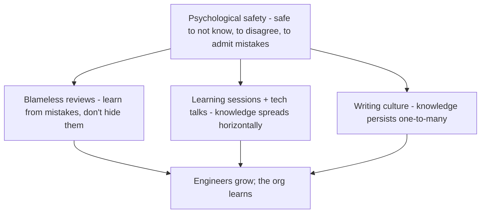

## 84.6 Running a system design interview, and building a technical culture

#### Concept

Two final skills. **Running a system design interview as the interviewer** is a distinct craft from being the candidate: steering the conversation, probing for depth at the right moments, giving the candidate room to show their judgement, and scoring against a rubric — all while making it a good experience. **Building a technical culture** is the broader, long-term work of creating an environment where engineers grow and do their best work: blameless reviews, learning sessions, internal tech talks, and a writing culture. Culture is the soil everything else grows in; a principal who shapes it well multiplies the effect of all their mentoring, hiring, and standards.

#### Why does it exist?

Imagine a system design interview run badly: the interviewer either lectures the candidate (so the candidate never gets to show their own judgement), or sits silent and gives no steer (so a candidate who heads down an unproductive path wastes the whole hour), or probes randomly (so the signal is inconsistent). The interview produces little usable signal about the candidate's actual design ability, and the candidate has a bad experience. Running it well — steering without leading, probing for depth, giving room — exists to extract clear signal about the candidate's judgement while giving them a fair chance to show it.

Building a technical culture exists because all the other practices in this Part — mentoring, hiring, standards — operate within a culture, and a toxic or stagnant culture undermines them while a healthy, learning-oriented one amplifies them. A blameless culture makes people share mistakes (so everyone learns); a learning culture makes people grow; a writing culture makes knowledge persist and spread (Part 78). Culture exists as a deliberate thing to build because it does not happen by accident — left alone, culture drifts, often toward fear and stagnation, and a principal's shaping of it is one of their most lasting impacts.

#### Mental model

For the system design interview, imagine a driving examiner. A good examiner does not drive the car (lecture), nor sit mute while the candidate drives off a cliff (no steer); they give the candidate the wheel, provide the occasional direction ("take the next left" — steering without leading), and probe at key moments ("why did you check your mirror there?" — probing for depth), all while assessing against a standard. The system design interviewer is the driving examiner: hand the candidate the wheel, steer gently to keep them on a productive road, probe for the judgement behind their choices, and score against the rubric.

For technical culture, imagine a garden. The gardener does not grow the plants directly; they create the conditions — soil, light, water — in which plants thrive. Culture is the soil in which engineers grow. A principal does not directly produce every good engineer or decision, but by shaping the culture (blameless, learning-oriented, writing-based) they create the conditions where good engineers and decisions grow abundantly. Neglect the soil and even good plants struggle; tend it and everything flourishes.

#### How it works

**Running a system design interview as the interviewer:**

```text
1. Set the problem and constraints clearly, then hand over the wheel.
2. Let the candidate drive — they should talk most; you listen and observe.
3. Steer without leading: if they go badly off track, a gentle nudge ("what
   about when the service is down?"), not the answer.
4. Probe for depth at key moments: "why that choice? what are the tradeoffs?
   what happens at 10x scale? how do you know it works?" — the senior signals.
5. Give room: don't interrupt a productive train of thought to show you know more.
6. Manage time: ensure you cover the dimensions the rubric needs (don't let them
   spend the whole hour on one corner).
7. Score against the rubric (57.5), with specific evidence.
8. Make it a good experience: candidates talk; a hostile or lecturing interviewer
   produces bad signal AND damages your employer brand.
```

The core skill is steering without leading and probing without lecturing: you want to see the candidate's own judgement, so you give them room to show it and probe to find its depth, rather than demonstrating your own.

**Building a technical culture:**

- **Blameless reviews (Part 48).** Incidents and mistakes are examined for systemic causes, not for whom to blame. This makes people share mistakes openly, so the whole org learns, rather than hiding them, so the same mistakes recur. Blamelessness is the foundation of a learning culture.
- **Learning sessions and internal tech talks.** Regular forums where engineers share what they have learned — a tricky bug, a new pattern, a post-incident lesson. Spreads knowledge horizontally and signals that learning is valued.
- **A writing culture (Part 78).** Norms that decisions, designs, and lessons get written down, so knowledge persists and spreads one-to-many rather than living in heads and evaporating.
- **Psychological safety.** People can ask "basic" questions, admit they do not know, disagree with seniors, and share half-formed ideas without fear. This is the substrate of learning, and it is created mostly by how senior people behave (admitting their own mistakes and gaps).



Culture is shaped mostly by what senior people model and tolerate. A principal who admits their own mistakes, writes things down, asks "basic" questions without embarrassment, and runs blameless reviews creates a culture where others do the same.

#### Practical example

A principal runs a system design interview well. She sets the problem (design an order notification system) and constraints, then hands over the wheel and mostly listens. The candidate starts designing; when they head down an over-complex path (building a full event-sourcing system for a simple need), she steers gently ("what's the simplest thing that meets the requirement?") rather than telling them it is over-engineered. She probes at key moments: "why async here? what happens if a notification is sent twice? how would you know in production if this is working?" — eliciting the failure-mode and operability judgment the rubric weights. She gives the candidate room to reason rather than interrupting to show her own knowledge, and she manages time to cover scale before the hour ends. She scores against the rubric with specific evidence. The interview produces clear signal (she can tell the candidate has strong failure-mode instincts but weak scale reasoning) and the candidate has a good experience (they got to show their thinking). Separately, she builds culture by running blameless incident reviews, hosting a fortnightly learning session, modelling a writing culture (she writes her decisions as ADRs), and visibly admitting her own mistakes and gaps — which makes it safe for others to do the same, so the team learns and grows.

#### Artifact example

A system-design interviewer's guide and a technical-culture practices summary — the artifacts that make both deliberate.

```markdown
# Interviewer guide: System Design round
## Your job: elicit and assess the candidate's design judgement. NOT to lecture.
## The problem (give this, then hand over the wheel)
"Design the order notification system for an e-commerce site: order placed,
shipped, delivered. ~1,000 events/sec peak." Give constraints only if asked.

## How to run it
- Let them drive. They should talk ~70%+. You listen and take rubric notes.
- STEER (don't lead): if off-track, nudge ("what about failure modes?"), never
  give the answer.
- PROBE for depth at key moments:
  * "Why that choice over the alternative?"  (tradeoffs)
  * "What happens if the notification is sent twice / lost?" (failure modes)
  * "What breaks first at 10x?" (scale)
  * "How do you know in prod it's working?" (operability)
- Manage time: cover design -> failure modes -> scale -> operability.
- Make it a good experience: no lecturing, no gotchas. Candidates talk.
## Score against the rubric (57.5). Write evidence-based feedback.

---
# Our technical culture (what we deliberately build)
- Blameless reviews: incidents examined for systemic cause, never for blame.
  Senior people model admitting their own mistakes first.
- Learning sessions: fortnightly, anyone shares a lesson/bug/pattern.
- Internal tech talks: monthly, deeper dives. Builds a sharing norm.
- Writing culture: decisions as ADRs, designs as docs (Part 78). Knowledge
  persists and spreads one-to-many.
- Psychological safety: it's safe to ask "basic" questions, admit you don't
  know, and disagree with seniors. Built by how WE (seniors) behave.
```

The interviewer guide's power is that it explicitly frames the interviewer's job as eliciting the candidate's judgement, not lecturing, and gives concrete steer-don't-lead and probe-for-depth techniques tied to the rubric's dimensions. The culture summary makes culture a deliberate set of practices (blameless reviews, learning sessions, writing culture, psychological safety) and names the key lever: these are built by how senior people behave. Both turn things often left to chance — interview quality and culture — into deliberate practices.

#### Real-world scenario

A principal engineer joins a team with a fear-based culture: incidents trigger blame, people hide mistakes, nobody asks questions for fear of looking stupid, and knowledge lives in a few heads. He changes it deliberately, mostly by modelling. In the first incident review, he openly discusses a mistake *he* made that contributed, and frames the review around systemic causes, not blame — which signals that admitting mistakes is safe. He starts a fortnightly learning session and gives the first talk himself, on a bug that stumped him, modelling that sharing struggles is valued. He writes his decisions as ADRs, modelling a writing culture. He asks "basic" questions in meetings without embarrassment, modelling that not-knowing is safe. Within two quarters, the culture shifts: people share mistakes (so the org learns from them instead of repeating them), ask questions freely (so they get unstuck faster), and write things down (so knowledge spreads). The team's learning rate and psychological safety rise, and with them, their growth and their decision quality. The culture changed not through a policy or a poster but through a senior person consistently modelling the behaviours — admitting mistakes, sharing struggles, asking questions, writing things down — because culture is shaped most by what senior people do, and a principal who models a learning culture creates one.

#### Edge cases & failure modes

- **Lecturing in the system design interview.** The interviewer shows their own knowledge instead of eliciting the candidate's, producing little signal.
- **No steer at all.** Letting a candidate waste the hour on an unproductive path, so you learn nothing about their best thinking.
- **Leading the candidate.** Steering so hard you hand them the answer, so you are assessing your own design, not theirs.
- **Gotcha questions / hostile interviewing.** Produces bad signal (stressed candidates underperform) and damages the employer brand.
- **Blame culture.** People hide mistakes, so the org never learns and the same incidents recur.
- **No psychological safety.** People do not ask questions, admit gaps, or disagree, so learning and good decisions are suppressed.
- **Culture by poster, not by behaviour.** Declaring values ("we're blameless!") while senior people behave otherwise; culture follows behaviour, not declarations.

#### How a Principal Engineer thinks about this

They run a system design interview to elicit the candidate's judgement, not to display their own, steering gently to keep the candidate productive and probing for the depth the senior rubric requires (tradeoffs, failure modes, scale, operability) while giving room and managing time. They treat the interview as a two-way experience, because they know a hostile or lecturing interviewer produces bad signal and damages the employer brand with exactly the candidates they want to attract.

On culture, they understand it is the soil everything else grows in and that it is shaped most by what senior people model and tolerate, not by declared values. So they deliberately build a blameless, learning-oriented, writing culture by behaving that way first — admitting their own mistakes, sharing their struggles, asking "basic" questions, writing their decisions down — because they know psychological safety and a learning norm are created by senior behaviour, not by posters. They treat culture-building as one of their most lasting impacts, because a healthy culture amplifies all their other work (mentoring, hiring, standards) while a toxic one undermines it, and because the culture they shape outlives any system they build. The principal gardens the soil, knowing that is where the real, compounding growth happens.

#### Common mistakes

- **Lecturing or giving no steer** in the system design interview, producing little signal.
- **Leading the candidate** so you assess your own design, not theirs.
- **Hostile or gotcha interviewing,** which stresses candidates and damages the brand.
- **Tolerating a blame culture,** so mistakes are hidden and lessons lost.
- **Declaring culture values while senior people behave otherwise,** since culture follows behaviour, not posters.

#### Interview questions

1. **How do you run a system design interview as the interviewer to get good signal?**
   *Expected answer:* set the problem and hand over the wheel; let the candidate drive and talk most; steer gently without leading if they go off-track; probe for depth at key moments (tradeoffs, failure modes, scale, operability — the senior signals); give room rather than interrupting to show your own knowledge; manage time to cover the rubric; and score with evidence. Elicit their judgement, don't display yours. *Why it matters:* interviewing is a distinct craft from being the candidate.

2. **How do you build a healthy technical culture, and what's the main lever?**
   *Expected answer:* deliberately build blameless reviews (learn from mistakes, don't hide them), learning sessions and tech talks (spread knowledge), a writing culture (persist knowledge), and psychological safety (safe to not know, disagree, admit mistakes) — and the main lever is senior behaviour: culture is shaped by what senior people model and tolerate (admitting their own mistakes, asking basic questions, writing things down), not by declared values or posters. *Why it matters:* tests whether they understand culture is built by behaviour.

3. **Why does a blame culture hurt an engineering organisation, and what replaces it?**
   *Expected answer:* blame makes people hide mistakes, so the org never learns from them and the same incidents recur; it also suppresses the psychological safety needed for questions, disagreement, and sharing. Replace it with blameless reviews that examine systemic causes, modelled by senior people admitting their own mistakes first, which makes learning from mistakes safe and turns incidents into org-wide lessons. *Why it matters:* tests understanding of the foundation of a learning culture.

#### Practical exercise

Prepare to run a system design interview: pick a realistic problem, write the interviewer guide (how you will hand over the wheel, steer without leading, probe for depth at key moments, and manage time), tied to a rubric. Then assess your team's technical culture against the four practices (blameless reviews, learning sessions, writing culture, psychological safety), and identify one behaviour you (as a senior person) could model to improve it.

**Acceptance criteria:** your interviewer guide elicits the candidate's judgement rather than your own, with concrete steer-don't-lead and probe-for-depth techniques tied to a rubric; and your culture assessment identifies at least one of the four practices that is weak and one specific behaviour you could model (admitting a mistake, sharing a struggle, asking a basic question, writing a decision down) to strengthen it — recognising that culture is shaped by senior behaviour, not declarations.
