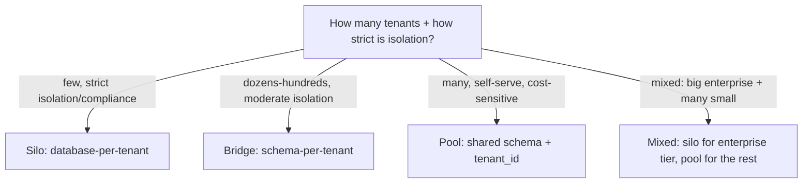

# Part 85 — Enterprise and Multi-Tenant SaaS Architecture

Most backend engineers learn to build an application for one organisation's users. Building a SaaS product means building one application that serves *many* organisations — tenants — at once, each believing they have their own private system, while in reality they share infrastructure. This is multi-tenancy, and it is one of the highest-stakes architectural domains in backend engineering, because the central requirement is isolation: tenant A must never, under any circumstances, see tenant B's data. A single isolation bug is not a normal bug; it is a breach that can end customer relationships and trigger legal consequences.

This Part uses the normal technical template with real NestJS, PostgreSQL, and TypeORM code, because multi-tenancy is a deeply technical domain. Part 67.5 covered multitenant write scaling; Part 74.11 covered data protection and audit; Part 109.6 covered regions. This Part goes deep on the architecture: the multi-tenancy models (silo, pool, bridge), tenant isolation in PostgreSQL with row-level security, tenant context in NestJS, noisy-neighbour control, per-tenant configuration and entitlements, enterprise B2B features (SSO, SCIM, audit logs), data residency, compliance-driven architecture (GDPR, PCI, SOC 2, HIPAA), enterprise integration patterns, and tenant lifecycle.

The reader this Part assumes is a senior backend engineer who can build a single-tenant application and now needs to build or operate a multi-tenant SaaS, where isolation is the first requirement and getting it wrong is catastrophic.

## 85.1 Multi-tenancy models: silo, pool, and bridge

#### Concept

A multi-tenancy model is how you divide tenants across your infrastructure. There are three main models. **Silo** gives each tenant their own isolated stack (separate database, sometimes separate everything). **Pool** shares one stack across all tenants, with data separated logically by a `tenant_id`. **Bridge** is a middle ground — shared application, but separated data (separate schemas or databases per tenant within shared infrastructure). For the database specifically, the choices are **database-per-tenant**, **schema-per-tenant**, and **shared-schema-with-tenant_id (row-level)**. Each trades isolation against cost and operational complexity differently, and choosing the right model is the foundational decision of a multi-tenant architecture.

#### Why does it exist?

Imagine building a SaaS and putting all tenants in one shared database with a `tenant_id` column (pool model), then landing a huge enterprise customer who requires, contractually, that their data be physically isolated from other customers and in a specific region. Your pool model cannot satisfy them, and retrofitting isolation for one tenant is painful. Or imagine giving every tenant their own database (silo) and then signing up ten thousand small tenants — now you operate ten thousand databases, which is operationally ruinous. Neither extreme fits all situations.

The models exist because tenants differ in their isolation requirements and in their economics. A thousand small tenants are only viable in a pooled model (shared cost); a handful of large enterprise tenants with strict isolation requirements need silos. The bridge model and the per-tenant-schema option exist to give intermediate points on the isolation-versus-cost tradeoff. Choosing deliberately — and often offering different models to different tenant tiers — is the foundational multi-tenant decision.

#### Mental model

Imagine housing arrangements. **Silo** is a detached house per family: maximum privacy and isolation (nothing shared, no noisy neighbours), but expensive per family and a lot to maintain if you have thousands of families. **Pool** is an open-plan dormitory with assigned beds: cheapest per person, but everyone shares the space and isolation depends entirely on everyone respecting the boundaries (a `tenant_id` check) — one broken rule and someone is in the wrong bed. **Bridge** is an apartment building: shared structure (one building to maintain) but separate locked apartments (separate schemas/databases), a middle ground of isolation and cost. The right choice depends on how many families you have and how much privacy each needs — and a smart developer might offer detached houses to the demanding enterprise families and the dormitory to the many budget ones.

#### How it works

The three models and the database-level options:

```text
SILO (isolated stack per tenant)
  - Each tenant: own database, maybe own app instance.
  - Max isolation; satisfies strict compliance/residency.
  - Expensive per tenant; operationally heavy at scale.
  - Fits: few, large, demanding enterprise tenants.

POOL (shared stack, logical separation)
  - All tenants share app + database; data separated by tenant_id.
  - Cheapest per tenant; best resource utilisation.
  - Isolation depends on correct tenant_id filtering EVERYWHERE (risky).
  - Fits: many small/medium tenants; self-serve SaaS.

BRIDGE (shared app, separated data)
  - Shared application; separate schema or database per tenant.
  - Middle ground: better isolation than pool, cheaper than full silo.
```

Database-level options (these map onto the models):

| Option | Isolation | Cost / density | Operational complexity | Fits |
|---|---|---|---|---|
| Database-per-tenant (silo) | Strongest | Low density, high cost | High (N databases to manage) | Few large/compliance tenants |
| Schema-per-tenant (bridge) | Strong | Medium density | Medium (N schemas, migrations ×N) | Dozens to low hundreds of tenants |
| Shared schema + tenant_id (pool) | Weakest (app-enforced) | Highest density, cheapest | Low (one database) | Many tenants, self-serve |



A key insight: these are not mutually exclusive. A mature SaaS often runs a **mixed model** — pool for the many small self-serve tenants (cheap, dense) and silo for the few large enterprise tenants who demand (and pay for) isolation. The tenant tier determines the model.

#### Practical example

A SaaS inventory product (the worked example of this Part, 85.8) starts pooled: all tenants share one PostgreSQL database with a `tenant_id` on every table, which is cheap and right for the many small businesses it initially serves. As it grows, it lands large enterprise customers with strict requirements — one needs their data in the EU (residency, 85.7), another contractually requires physical isolation. The product adopts a mixed model: the small tenants stay pooled (dense, cheap), while the enterprise tenants are moved to silos (database-per-tenant, in the required region). The tenant's tier and contract determine which model they get. This mixed approach is the common end state: the pool makes the many small tenants economically viable, and the silos satisfy the few large tenants who need and pay for isolation. Committing to a single model for all tenants would have forced a bad tradeoff — either too expensive for the small tenants (all silos) or unable to satisfy the enterprise ones (all pool).

#### NestJS example

The tenant model affects how you connect to the database. For pool (shared schema), one connection serves all tenants and you filter by `tenant_id`. For silo/bridge, you route to the right database or schema per tenant. A connection-routing provider for a bridge (schema-per-tenant) model:

```ts
// A service that returns the right DataSource/connection for a tenant.
// For schema-per-tenant, we set the search_path per request.
import { Injectable, Scope, Inject } from '@nestjs/common';
import { DataSource } from 'typeorm';
import { REQUEST } from '@nestjs/core';

@Injectable({ scope: Scope.REQUEST })  // request-scoped: one per request
export class TenantConnectionService {
  constructor(
    @Inject(REQUEST) private readonly req: { tenantId: string },
    private readonly dataSource: DataSource,            // shared pool
  ) {}

  // Set the PostgreSQL search_path to this tenant's schema for the request.
  async getConnection() {
    const schema = `tenant_${this.req.tenantId}`;       // validated elsewhere
    const runner = this.dataSource.createQueryRunner();
    // SECURITY: schema name must be validated against an allowlist, never
    // interpolated from raw user input, to avoid SQL injection.
    await runner.query(`SET search_path TO "${schema}"`);
    return runner;
  }
}
```

For the pool model, you do not switch schemas; instead every query carries the `tenant_id`, enforced by row-level security (85.2) and a tenant context (85.3), which is the harder but denser approach covered in the next sections.

#### PostgreSQL example

The three database options as DDL. Database-per-tenant is separate `CREATE DATABASE` per tenant (managed by provisioning). Schema-per-tenant:

```sql
-- Bridge: schema-per-tenant. Each tenant gets an isolated schema.
CREATE SCHEMA tenant_acme;
CREATE TABLE tenant_acme.products (
  id          UUID PRIMARY KEY,
  sku         TEXT NOT NULL,
  name        TEXT NOT NULL,
  stock_qty   INTEGER NOT NULL DEFAULT 0
);
-- A query runs within the tenant's schema via search_path:
SET search_path TO tenant_acme;
SELECT * FROM products;   -- sees only tenant_acme's products
```

Pool (shared schema with `tenant_id`), the densest model:

```sql
-- Pool: one shared table, tenant_id on every row. Densest, cheapest.
CREATE TABLE products (
  id          UUID PRIMARY KEY,
  tenant_id   UUID NOT NULL,                 -- the isolation key
  sku         TEXT NOT NULL,
  name        TEXT NOT NULL,
  stock_qty   INTEGER NOT NULL DEFAULT 0
);
-- EVERY query must filter by tenant_id, or tenants see each other's data:
CREATE INDEX products_tenant_idx ON products (tenant_id, sku);  -- tenant-first index
-- Isolation here depends on correct filtering + row-level security (58.2).
```

The pool model's `tenant_id` column is the isolation boundary, and the entire rest of this Part is largely about making that boundary unbreakable, because a single query that forgets `WHERE tenant_id = ...` is a cross-tenant data leak.

#### Production scenario

A SaaS with 5,000 tenants runs a mixed model. The 4,950 small tenants share a pooled PostgreSQL cluster (shared schema, `tenant_id`, row-level security), achieving high density — one cluster serves thousands of tenants at a few dollars each. The 50 enterprise tenants each have a dedicated database (silo), some in specific regions for residency. The pooled cluster handles the bulk of traffic efficiently; the silos satisfy the enterprise contracts and isolation requirements. Operationally, the pool is one thing to manage for 4,950 tenants, and the 50 silos are managed by automation (provisioning, migrations applied to each). This mix delivers both the density that makes the small-tenant business viable and the isolation that wins enterprise deals — the economics of the whole SaaS depend on getting the model mix right.

#### Failure scenario

A SaaS chooses database-per-tenant (silo) for all tenants, reasoning that maximum isolation is safest. It works fine at 50 tenants. Then the product succeeds and grows to 8,000 tenants — which means 8,000 databases. The operational burden becomes crushing: every schema migration must be applied to 8,000 databases (and if it fails on some, the fleet is now inconsistent), monitoring 8,000 databases is a nightmare, connection management across 8,000 databases exhausts resources, backups and upgrades are 8,000-fold work, and the cost of 8,000 database instances is enormous relative to the revenue from mostly-small tenants. The silo model, chosen for safety, has made the business economically and operationally unviable at scale, because it does not pool the many small tenants whose economics only work when they share infrastructure. Migrating 8,000 silos into a pooled model under duress is a massive, risky project. The lesson: the all-silo model does not scale to many small tenants; density requires pooling, and the right architecture for a SaaS with many small tenants is pool (or a mix), not silo-for-everyone. Choosing isolation over economics without considering scale is a foundational mistake.

#### Edge cases & failure modes

- **All-silo at scale.** Thousands of databases to migrate, monitor, back up, and pay for — operationally and economically unviable for many small tenants.
- **All-pool for a demanding enterprise tenant.** Cannot satisfy a contractual physical-isolation or residency requirement, losing the deal or forcing a painful retrofit.
- **Forgotten `tenant_id` filter in the pool model.** A single query without the tenant filter leaks data across tenants — a breach (mitigated by RLS, 85.2).
- **Schema-per-tenant migration explosion.** Migrations must run against every schema; a partial failure leaves the fleet inconsistent.
- **Connection exhaustion.** Database-per-tenant or schema-switching can exhaust connection pools if not managed (a pooler like PgBouncer helps).
- **Choosing a model without considering tier mix.** Committing to one model for all tenants forces a bad tradeoff; a mix usually fits better.

#### How a Senior Backend Engineer thinks about this

They treat the multi-tenancy model as the foundational architectural decision and choose it based on the tenant mix and isolation requirements, not on a single principle like "isolation is safest". They know the all-silo model does not scale to many small tenants (operational and cost ruin) and the all-pool model cannot satisfy strict enterprise isolation, so they reach for a mixed model — pool for the dense many, silo for the demanding few — as the common, economically-sound end state. They size the decision by how reversible it is: the model is expensive to change once data is in it, so they think ahead about the tenant tiers they will serve.

They treat the pool model's `tenant_id` as a security boundary, not just a column, because they understand that in a shared schema a single forgotten filter is a cross-tenant breach — so they never rely on application discipline alone and reach for row-level security (85.2) to enforce isolation at the database. And they plan for the operational realities each model imposes: migrations across N schemas or databases, connection management, monitoring at tenant granularity. The senior engineer's defining instinct here is that isolation is the first requirement and economics is the constraint, and the model must satisfy both — which almost always means a deliberate mix.

#### Common mistakes

- **All-silo for everyone,** which becomes operationally and economically ruinous at scale.
- **All-pool for everyone,** which cannot satisfy enterprise isolation or residency requirements.
- **Relying on application code to always include the `tenant_id` filter,** without database-enforced isolation (RLS).
- **Not planning for the tenant-tier mix,** committing to one model that forces a bad tradeoff.
- **Ignoring the operational cost** of migrations, monitoring, and connections across N schemas or databases.

#### Interview questions

1. **What are the main multi-tenancy models, and how do you choose between them?**
   *Expected answer:* silo (isolated stack/database per tenant — max isolation, high cost, for few demanding tenants), pool (shared stack, data separated by tenant_id — cheapest and densest, for many tenants), and bridge (shared app, separate schema/database — middle ground). Choose by the tenant mix and isolation requirements; a mature SaaS often uses a mix — pool for the many small tenants, silo for the few enterprise ones. *Follow-up:* what breaks if you use all-silo at scale.

2. **In a pooled (shared-schema) model, what is the central risk and how do you mitigate it?**
   *Expected answer:* isolation depends on every query correctly filtering by tenant_id, so a single forgotten filter leaks data across tenants — a breach. Mitigate with database-enforced row-level security (85.2) so the database enforces tenant isolation regardless of application mistakes, plus a tenant context that sets the tenant automatically and never relies on hand-written filters. *Why it matters:* tenant isolation is the first requirement of a SaaS and the pool model is where it is most at risk.

3. **Why does the all-silo (database-per-tenant) model fail at scale for a SaaS with many small tenants?**
   *Expected answer:* it means one database per tenant, so at thousands of tenants you have thousands of databases to migrate (with partial-failure risk), monitor, back up, upgrade, connect to, and pay for — operationally crushing and economically unviable relative to small-tenant revenue. Density for many small tenants requires pooling; silo is for the few large tenants who need and pay for isolation. *Why it matters:* tests understanding of the isolation-versus-economics tradeoff at scale.

#### Practical exercise

For a SaaS you are designing (or your inventory product), choose a multi-tenancy model. List your expected tenant mix (how many small vs large, their isolation and residency requirements), then decide on a model — likely a mix — justifying it by isolation requirements and economics. Sketch the database approach (shared schema with tenant_id, schema-per-tenant, or database-per-tenant per tier) and identify the operational costs each imposes (migrations, monitoring, connections).

**Acceptance criteria:** your model choice is justified by the actual tenant mix and isolation requirements (not a blanket "isolation is safest"); if you serve many small tenants you use pooling for density; if you serve demanding enterprise tenants you provide silos for them; you identify the central isolation risk of your chosen model and how you will enforce isolation at the database (RLS for pool); and you name the operational costs your model imposes at scale.
