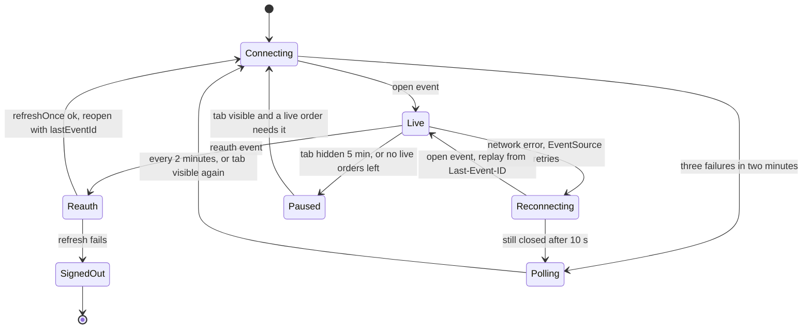

## 85.6 Next.js frontend: live status, optimistic actions and error states

#### Concept

`TrackingLive` is the page's one interactive island. It does four jobs:

1. **Seed** the TanStack Query cache with the server-rendered state, so the cache, not component state, is what the UI reads (78.1).
2. **Stay live** through the per-customer stream, merging events into the cache with the version guard of 78.8, and tell the user honestly when live updates stop.
3. **Edit the delivery note optimistically**: show the new note at once, send it with an idempotency key and the expected version, and reconcile with the server's answer.
4. **Cancel pessimistically**: cancelling touches money and races with packing, so the button waits for the server's answer before the page says "Cancelled".

#### Why does it exist?

Because live UIs fail in ways static pages do not. The stream drops on a train through a tunnel; the session expires while the page is open; another tab changes the note; an event for version 8 arrives before the response for version 7; packing starts in the second between "Cancel" and the request reaching the API. A live page that handles only the happy path shows wrong information with confidence, which is worse than a page that shows old information honestly.

#### Mental model

Imagine an airport arrivals board connected to the control tower by a radio link. The board shows the latest message it received, with the time it received it. If the radio goes quiet, a small light says "last update 2 minutes ago" and an attendant phones the tower every half minute. When a passenger asks the attendant to change their pickup note, the attendant writes it on the board straight away in pencil and inks it when the tower confirms.

#### How it works



The rules, in order of importance:

1. **One stream per tab, shared by every subscriber.** A `LiveOrdersProvider` mounted in the `(shop)/orders` layout owns the `EventSource` (78.8's hook, moved into a provider) and reference-counts the components that need it: the order list, the tracking page. When nothing needs live data (no subscriber, or every tracked order is `DELIVERED` or `CANCELLED`), it closes the stream, so a tab left open overnight costs the server nothing.
2. **Merge by version, by field.** An event updates `status`, `version`, `updatedAt` and `etaWindow` only if `event.version` is greater than the cached version; if the status changed it also appends to the timeline. If the event's status equals the cached status (a note change from another tab, 85.4), the event carries nothing to merge, so the tracking query is invalidated and refetched (one 1 KB `GET`, usually a `304`).
3. **`reauth` means refresh, then reopen.** The stream ends at token expiry or revocation (85.4). The provider calls `refreshOnce()` (81.3, single-flight across tabs), and on success opens a new `EventSource` with `?lastEventId=` set to the last ID it saw, because a new `EventSource` object does not send the `Last-Event-ID` header; only its own automatic reconnects do. If the refresh fails, the auth broadcast of 81.3 sends every tab to sign-in.
4. **`EventSource` hides HTTP status codes.** When it closes for good (`readyState === 2`), the page cannot tell a `401` from a `429` or a `503`. The provider treats every permanent close the same way: try `refreshOnce()`, reopen with backoff (2, 4, 8 s with jitter), and after three failures in two minutes switch to **polling** the tracking query every 30 s, with a banner.
5. **Honest staleness.** When not `Live`, the status line shows "Last updated 7:12 pm" from the cached `updatedAt`, and the banner explains what is happening. Nothing pretends to be live.
6. **Announce status, not noise.** A visually hidden `role="status"` region announces the event's `summary` only when the status changes, not on ETA adjustments (83.10, 83.9).
7. **Back/forward cache**: on `pageshow` with `event.persisted`, the provider reopens the stream and the tracking query refetches (82.9).

#### Practical example

A customer on a commuter train has the page open. Timeline of what they see:

- 19:12:40: "Packing your order", status line "Live". 
- 19:13:05: the train enters a tunnel; the connection drops. `EventSource` retries silently; after 10 s still closed, the banner shows "Reconnecting. Showing status from 7:12 pm" and polling starts.
- 19:15:27: the order goes out for delivery while they are in the tunnel; the poll at 19:15:35 fails (offline).
- 19:16:10: out of the tunnel; `online` fires, the provider reopens with `?lastEventId=1730812960113-0`; the server replays the `OUT_FOR_DELIVERY` event; the heading changes, the screen reader announces "Out for delivery. Arriving 7:25 to 7:40 pm", the banner disappears.

#### React / Next.js example

The provider, with the connection state machine reduced to its essentials:

```tsx
// apps/web/src/orders/LiveOrdersProvider.tsx  (React 18, TanStack Query v5)
'use client';
import { createContext, useCallback, useContext, useEffect, useRef, useState, type ReactNode } from 'react';
import { useQueryClient } from '@tanstack/react-query';
import { refreshOnce } from '@/api/auth-fetch';                      // 81.3
import { applyOrderEvent } from './applyOrderEvent';                // version-guarded merge, below
import { OrderEventRead } from './tracking.read';

type Conn = 'connecting' | 'live' | 'reconnecting' | 'polling' | 'paused';
const Ctx = createContext<{ conn: Conn; subscribe: () => () => void }>({ conn: 'paused', subscribe: () => () => {} });
export const useLiveOrders = () => useContext(Ctx);

export function LiveOrdersProvider({ enabled, children }: { enabled: boolean; children: ReactNode }) {
  const qc = useQueryClient();
  const [conn, setConn] = useState<Conn>('paused');
  const [subscribers, setSubscribers] = useState(0);
  const lastId = useRef<string | null>(null);
  const failures = useRef<number[]>([]);

  const subscribe = useCallback(() => { setSubscribers((n) => n + 1); return () => setSubscribers((n) => n - 1); }, []);

  useEffect(() => {
    if (!enabled || subscribers === 0 || document.visibilityState === 'hidden') { setConn('paused'); return; }
    let source: EventSource | null = null;
    let stopped = false;
    let retry: ReturnType<typeof setTimeout> | undefined;

    const open = () => {
      setConn('connecting');
      const qs = lastId.current ? `?lastEventId=${encodeURIComponent(lastId.current)}` : '';
      source = new EventSource(`/api/v1/orders/events${qs}`, { withCredentials: true });
      source.onopen = () => setConn('live');
      source.addEventListener('order', (m) => {
        const msg = m as MessageEvent<string>;
        lastId.current = msg.lastEventId || lastId.current;
        const parsed = OrderEventRead.safeParse(JSON.parse(msg.data));
        if (parsed.success) applyOrderEvent(qc, parsed.data);
      });
      source.addEventListener('reset', () => void qc.invalidateQueries({ queryKey: ['orders'] }));  // gap too old (78.8)
      source.addEventListener('reauth', () => { source?.close(); void reconnect(true); });
      source.onerror = () => {
        if (source?.readyState === EventSource.CONNECTING) { setConn('reconnecting'); return; }   // browser is retrying
        source?.close(); void reconnect(false);                                                  // closed for good
      };
    };

    const reconnect = async (expected: boolean) => {
      if (stopped) return;
      const now = Date.now();
      if (!expected) failures.current = [...failures.current.filter((t) => now - t < 120_000), now];
      if (failures.current.length >= 3) { setConn('polling'); retry = setTimeout(open, 120_000); return; } // try again in 2 min
      const ok = await refreshOnce();                             // a 401 is the most likely permanent close
      if (!ok) return;                                            // the auth broadcast sends every tab to sign-in (81.3)
      const backoff = expected ? 0 : 2 ** failures.current.length * 1000 + Math.random() * 1000;
      retry = setTimeout(open, backoff);
    };

    open();
    const onOnline = () => { if (conn !== 'live') { source?.close(); open(); } };
    addEventListener('online', onOnline);
    return () => { stopped = true; clearTimeout(retry); source?.close(); removeEventListener('online', onOnline); };
  }, [enabled, subscribers, qc]);                                 // eslint: conn read only in onOnline, deliberately

  return <Ctx.Provider value={{ conn, subscribe }}>{children}</Ctx.Provider>;
}
```

A separate small effect (not shown) sets `subscribers`-independent visibility state: when the tab has been hidden for five minutes it closes the stream, and `visibilitychange` back to visible reopens it and refetches. The polling fallback is not in the provider at all: `TrackingLive` sets `refetchInterval: conn === 'polling' ? 30_000 : false` on its query, so the cache stays the only source the UI reads.

The merge, shared by the list (78.8) and the tracking page:

```ts
// apps/web/src/orders/applyOrderEvent.ts
import type { QueryClient } from '@tanstack/react-query';
import { orderKeys } from './orderKeys';                          // 78.2, with tracking: (id) => [...details(), id, 'tracking']
import type { OrderTrackingView } from './tracking.read';
import type { z } from 'zod';
import type { OrderEventRead } from './tracking.read';

type Ev = z.infer<typeof OrderEventRead>;

export function applyOrderEvent(qc: QueryClient, e: Ev) {
  let needsRefetch = false;
  qc.setQueryData<OrderTrackingView>(orderKeys.tracking(e.orderId), (old) => {
    if (!old || e.version <= old.version) return old;            // unknown here, duplicate or out of order: no-op
    if (e.status === old.status) { needsRefetch = true; return old; } // a change the event does not carry (note)
    return {
      ...old,
      status: e.status, version: e.version, updatedAt: e.updatedAt,
      etaWindow: e.etaWindow === undefined ? old.etaWindow : e.etaWindow,
      timeline: [...old.timeline, { status: e.status, at: e.updatedAt }].slice(-20),
      cancellable: e.status === 'PENDING' || e.status === 'PAID',  // display hint; the server enforces (85.4)
      noteEditable: ['PENDING', 'PAID', 'PACKING'].includes(e.status),
      lastSummary: e.summary,                                     // client-only field for the live region, never sent back
    } as OrderTrackingView;
  });
  if (needsRefetch) void qc.invalidateQueries({ queryKey: orderKeys.tracking(e.orderId) });
  // ...plus 78.8's patch of the detail and list caches, unchanged
}
```

The two display hints duplicate `canCancel` and the note rule for the moment between the event and the next refetch; the server's answer to an action is still final. In the codebase they import the same `canCancel` from `@shop/contracts` (83.2); they are spelled out here for readability.

The island itself:

```tsx
// apps/web/app/(shop)/orders/[id]/TrackingLive.tsx
'use client';
import { useEffect } from 'react';
import { useQuery } from '@tanstack/react-query';
import { useLiveOrders } from '@/orders/LiveOrdersProvider';
import { orderKeys } from '@/orders/orderKeys';
import { fetchTracking } from '@/orders/api';                     // apiGet + OrderTrackingRead.parse (78.2, 80.7)
import { STATUS_COPY } from '@/orders/status-copy';
import { formatEtaWindow, formatTime } from '@/orders/format';
import type { OrderTrackingView } from '@/orders/tracking.read';
import { ConnectionBanner } from './ConnectionBanner';
import { DeliveryNote } from './DeliveryNote';
import { CancelOrder } from './CancelOrder';
import { Timeline } from './Timeline';

export function TrackingLive({ initial, live }: { initial: OrderTrackingView; live: boolean }) {
  const { conn, subscribe } = useLiveOrders();
  const terminal = (s: string) => s === 'DELIVERED' || s === 'CANCELLED';
  const { data: t } = useQuery({
    queryKey: orderKeys.tracking(initial.id),
    queryFn: ({ signal }) => fetchTracking(initial.id, signal),
    initialData: initial,                                         // the server-rendered state seeds the cache
    staleTime: 30_000,
    refetchInterval: (q) => (conn === 'polling' || !live) && !terminal(q.state.data?.status ?? '') ? 30_000 : false,
  });

  useEffect(() => (live && !terminal(t.status) ? subscribe() : undefined), [live, t.status, subscribe]);

  return (
    <section aria-labelledby="status-h" className="tracking-live">
      <h1 id="status-h">{STATUS_COPY[t.status].label}</h1>
      <p className="eta">{t.etaWindow ? formatEtaWindow(t.etaWindow.from, t.etaWindow.to, t.storeTimeZone) : ' '}</p>
      <ConnectionBanner conn={live ? conn : 'polling'} updatedAt={formatTime(t.updatedAt, t.storeTimeZone)} terminal={terminal(t.status)} />
      <p className="visually-hidden" role="status" aria-live="polite">{(t as { lastSummary?: string }).lastSummary ?? ''}</p>
      <Timeline steps={t.timeline} timeZone={t.storeTimeZone} current={t.status} />
      <DeliveryNote orderId={t.id} note={t.deliveryNote} editable={t.noteEditable} version={t.version} />
      {t.cancellable && <CancelOrder orderId={t.id} />}
    </section>
  );
}
```

The ETA line always renders (a non-breaking space when empty) so its height is reserved and a late window does not shift the page (82.5). `ConnectionBanner` renders nothing when `live`, a one-line notice otherwise, in a container with a fixed minimum height for the same reason.

**The optimistic note**, with version-aware, field-level rollback (78.6, 78.12):

```tsx
// apps/web/app/(shop)/orders/[id]/useSaveNote.ts
import { useMutation, useQueryClient } from '@tanstack/react-query';
import { useRef } from 'react';
import { orderKeys } from '@/orders/orderKeys';
import { saveDeliveryNote } from '@/orders/api';                  // authFetch PATCH with Idempotency-Key and x-csrf-token
import { ApiError } from '@/api/errors';
import type { OrderTrackingView } from '@/orders/tracking.read';

export function useSaveNote(orderId: string) {
  const qc = useQueryClient();
  const key = useRef<string | null>(null);
  const k = orderKeys.tracking(orderId);

  return useMutation({
    mutationFn: async (note: string) => {
      key.current ??= crypto.randomUUID();                         // one key per attempt; retries reuse it
      const expectedVersion = qc.getQueryData<OrderTrackingView>(k)!.version;
      return saveDeliveryNote(orderId, { note, expectedVersion }, key.current);
    },
    onMutate: async (note) => {
      await qc.cancelQueries({ queryKey: k });
      const before = qc.getQueryData<OrderTrackingView>(k)!;
      qc.setQueryData<OrderTrackingView>(k, { ...before, deliveryNote: note || null });   // show it now
      return { previousNote: before.deliveryNote };
    },
    onSuccess: (fresh) => {
      key.current = null;                                          // final answer: the next save is a new attempt
      qc.setQueryData<OrderTrackingView>(k, (old) => (!old || fresh.version >= old.version ? fresh : old));
    },
    onError: (e, _note, ctx) => {
      key.current = e instanceof ApiError && e.status < 500 ? null : key.current;          // keep the key on unknown outcomes
      if (e instanceof ApiError && e.code === 'VERSION_CONFLICT' && e.current) {
        qc.setQueryData(k, e.current as OrderTrackingView);       // server's truth, including the other tab's note
        return;
      }
      // Roll back only the field we changed: an SSE event may have advanced the status meanwhile.
      qc.setQueryData<OrderTrackingView>(k, (old) => old && { ...old, deliveryNote: ctx?.previousNote ?? null });
    },
  });
}
```

`current` is the extra member of the `VERSION_CONFLICT` problem document (85.4). 80.6's `toApiError` parses only the standard members, so this feature extends it by one line: it keeps `parsed.data.current` (validated with `OrderTrackingRead`) on a new optional `ApiError.current` field. Problem documents may carry extension members (RFC 9457), and clients that do not know them ignore them.

**Cancel** stays pessimistic: a confirmation dialog, then `POST /v1/orders/:id/cancel` with an idempotency key through 78.12's `useCancelOrder` with `onMutate` removed. On `409 ORDER_NOT_CANCELLABLE` the dialog says "Packing has already started, so this order can't be cancelled. You can refuse the delivery at the door" and the tracking query refetches; the SSE event moving the order to `PACKING` usually arrives first anyway.

#### Error states

| Situation | What the customer sees | Mechanism |
|---|---|---|
| Stream reconnecting (under 10 s) | Nothing different | `EventSource` auto-retry; banner only after 10 s |
| Stream down longer | "Reconnecting. Showing status from 7:12 pm" | `ConnectionBanner`, polling every 30 s |
| Session expired mid-page | Nothing; a reconnect within 2 s | `reauth`, `refreshOnce`, `?lastEventId=` |
| Logged out everywhere | Sign-in page in every tab | `reauth` `REVOKED`, failed refresh, auth broadcast (81.3) |
| API down when saving the note | Note shown, then "Couldn't save your note. Try again", old note restored | Field-level rollback |
| Another tab changed the note | The other tab's note appears with "Updated in another window" | `VERSION_CONFLICT` with `current`, or invalidate on a same-status event |
| Cancel too late | Dialog explains; status shows Packing | `409 ORDER_NOT_CANCELLABLE`, refetch |
| Unknown status from a newer API | "Updated" badge, timeline still correct | `openEnum` (80.7) |
| Offline | "You're offline. Showing status from 7:12 pm" | `navigator.onLine`, `online` event reopens |
| Tracking page for someone else's order | "We couldn't find that order" | `404`, `not-found.tsx` |

#### Backend side (NestJS)

What the client logic above relies on from the API, each a deliberate design decision:

- **Event IDs that are stable replay cursors** (Redis Stream entry IDs) and a replay window long enough for a tunnel or a lock screen: `MAXLEN ~ 500` per customer covers far more than 15 minutes for one customer's orders.
- **`reset` when the gap is too old**, so the client never silently misses a change.
- **A `VERSION_CONFLICT` body that includes the current state**, saving a round trip at the exact moment the user is confused.
- **Idempotent writes with keys stored for 24 hours** (18.12), so a note saved offline and retried on reconnect cannot apply twice.
- **`304` responses** for refetches, so the polling fallback costs about 200 bytes per poll per viewer when nothing changed.

#### Production scenario

In the first month: 12 % of tracking sessions saw at least one reconnect (mostly mobile networks), 0.8 % fell back to polling at some point, and the median time in polling was 50 s before the stream recovered. Reauth reconnects happened about once per 15 minutes per open page, invisible to users (median gap 0.9 s, events replayed). Delivery-note saves: 9,000 a day, 0.3 % conflicts (two devices), 0.1 % rolled back after network errors and saved on the user's retry.

#### Failure scenario

The first release opened the `EventSource` inside `TrackingLive` and another inside the order list's hook. Customers who opened the list and then a tracking page in the same tab held two streams; with React Strict Mode in development the double mount (77.4) briefly made four, and the per-user cap of 6 was reached by customers with three tabs open. The seventh connection got `429`, which `EventSource` reported only as a closed stream, and those tabs dropped into polling with a "Reconnecting" banner that never went away. Moving the stream into one reference-counted provider per tab, and closing it when no live order needs it, fixed both the cap and the banner.

#### Edge cases & failure modes

- **Two `EventSource`s in one tab**, from separate components; one provider per tab.
- **Manual reopen without `?lastEventId=`** loses events between the close and the reopen.
- **Status-based hints drifting from the server's rules**; import them from `@shop/contracts` and treat them as hints.
- **Rolling back a whole snapshot** after a failed save erases a status that arrived by SSE meanwhile; roll back the field.
- **Announcing every event** floods screen reader users; announce status changes only.
- **Strict Mode double effects** opening two streams; the effect's cleanup must close the stream (77.4).
- **Terminal orders kept live** for hours; close when nothing needs the stream.

#### How a Senior Full-Stack Engineer thinks about this

The senior treats the stream as one more writer to the query cache, with the same rules as mutations: versioned, idempotent, field-level. They design the connection as a state machine with an honest UI for every state, and they assume the transport will hide the information they want (status codes) and plan around it. They make optimistic updates only where being briefly wrong is harmless (a note) and keep money-touching actions pessimistic (cancel). And they count connections per tab and per user, because a live feature's cost and its failure modes both live in the connection count.

#### Common mistakes

- **Reading pushed data into component state** next to a cache that disagrees.
- **No polling fallback**, so a failed stream means a frozen page.
- **"Live" indicators that lie** when the stream is down.
- **Optimistic cancel** for an action that races with the warehouse.
- **Forgetting `pageshow` and `online`** events, so a restored or reconnected page stays stale.

#### Interview questions

1. **How do you handle a session expiring while an SSE stream is open?** Expected answer: the server ends the stream with a `reauth` event; the client refreshes once (single-flight), then reopens with the last event ID as a query parameter, because a new `EventSource` does not send `Last-Event-ID`.
2. **`EventSource` closed for good. What happened, and what do you do?** Expected answer: you cannot see the status code; try a refresh, reopen with backoff, and fall back to polling with an honest banner after repeated failures.
3. **Why roll back only the changed field after a failed optimistic update?** Expected answer: other writers (SSE events, other mutations) may have changed other fields meanwhile; a full snapshot rollback erases them.
4. **When should an action not be optimistic?** Expected answer: when it races with other actors and being wrong costs money or trust, like cancelling an order that may already be packing.
5. **How do you stop a tab left open overnight from holding a stream?** Expected answer: reference-count subscribers, close when every tracked order is terminal or the tab has been hidden for a while, reopen on visibility.

#### Practical exercise

Build `LiveOrdersProvider`, `TrackingLive`, the optimistic note and the pessimistic cancel.

Acceptance criteria:

- One `EventSource` per tab across the list and tracking pages, verified in DevTools with Strict Mode on.
- Duplicate and out-of-order events change nothing; a same-status event triggers exactly one tracking refetch.
- Expiring the session while the page is open reconnects within 3 s with no missed events.
- With the realtime service stopped, the banner appears within 10 s, polling runs every 30 s, and the stream returns within 2 minutes of the service coming back.
- A note saved while offline is retried with the same idempotency key and saved once.
- A screen reader (VoiceOver or NVDA) announces each status change once and no ETA-only changes.
