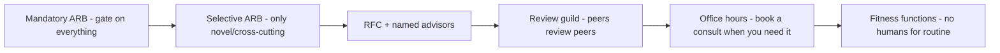

## 85.4 Architecture review boards and their lightweight alternatives

#### Concept

An architecture review board (ARB) is a group of senior engineers who review and approve architectural decisions. They can be genuinely valuable — a place to catch cross-cutting mistakes and share hard-won judgement — or they can become the bottleneck and ivory tower from 85.1. The skill is knowing when a board helps, when it becomes a liability, and what lighter mechanisms — office hours, review guilds, RFC-with-advisors — deliver most of the value without the bottleneck. The modern consensus leans heavily toward the lightweight alternatives, reserving anything board-like for the rare, genuinely cross-cutting decision.

#### Why does it exist?

Imagine an org with no forum at all for architectural judgement. Every team decides in isolation. The hard-won lesson one team learned about why not to share a database is never transmitted; the next team learns it the same painful way. A genuinely cross-cutting decision — say, how the whole org will do tenant isolation — is made by whoever happens to face it first, with no input from the people it affects. Some mechanism is needed to pool senior judgement and catch cross-cutting mistakes.

But the heavy ARB exists as an answer to that need and then overshoots: it inserts itself as a mandatory gate on *everything*, becoming the bottleneck from 85.1. The lightweight alternatives exist to meet the real need (pool judgement, catch cross-cutting issues) without the overshoot (gating everything, centralising decisions away from the teams who own them).

#### Mental model

Imagine a town's building decisions. The heavy ARB is a committee that must approve every change to every house — painting a door, moving a shelf — which is absurd and creates a queue a mile long. The lightweight model is: clear building codes (standards) that most work just follows, an architect you can book a consultation with when you are doing something unusual (office hours), and a guild of experienced builders who review each other's plans and share techniques (review guild). Only a genuinely town-altering project — a new high-rise that affects everyone's light and traffic — goes to a formal hearing. Most work needs no committee at all; the codes and the available expertise suffice.

#### How it works

The spectrum of mechanisms, from heaviest to lightest:



- **Mandatory ARB (avoid).** Gates everything. The 85.1 bottleneck. Almost never the right default.
- **Selective ARB.** Convenes only for genuinely novel, cross-cutting, hard-to-reverse decisions (a new datastore for the org, a tenancy model, a cross-cutting security pattern). Advisory where possible. A handful of times a quarter, not a standing gate.
- **RFC with named advisors.** The RFC process (Part 83) plus a norm that certain kinds of RFC must get review from named domain experts (the security lead for anything auth-related, the data lead for schema-wide changes). Async, no meeting required.
- **Review guild.** A community of practice where engineers from different teams review each other's designs, share patterns, and build shared judgement. Peer-to-peer, not top-down. Spreads lessons without a gate.
- **Office hours.** Senior engineers and architects hold regular open slots. Any team doing something tricky books a consult. Advice flows on demand, with no queue and no gate. This is often the single best mechanism.
- **Fitness functions.** For routine decisions, no human at all (see 85.5).

The decision of which to use:

| Situation | Best mechanism |
|---|---|
| Routine decision of a known shape | Fitness functions + paved road, no humans |
| Team wants advice on a tricky design | Office hours |
| Change affects a specific domain (security, data) | RFC + named advisor |
| Spreading patterns and judgement across teams | Review guild |
| Genuinely novel, org-wide, hard-to-reverse | Selective ARB (advisory) |

#### Practical example

An org replaces its mandatory ARB with a blend. Routine service decisions are handled by the paved road and fitness functions — no humans. A team designing a tricky distributed transaction books an office-hours slot and gets an hour of a principal engineer's time the same week, far faster than the old board's three-week queue. A change to how auth works must, by norm, get an async review from the security lead on its RFC. A monthly review guild meeting is where teams present interesting designs and the org's shared patterns evolve. And twice that quarter, a genuinely org-wide decision — adopting a new primary datastore, defining the tenancy model — convenes a selective, advisory ARB. The heavy board's one job (gate everything) is gone; its valuable job (pool senior judgement) is distributed across mechanisms that have no queue.

#### Artifact example

An office-hours charter plus a selective-ARB trigger list — the artifacts that make lightweight governance concrete.

```markdown
# Architecture office hours
When: Tue & Thu, 14:00-15:00. Book a 20-min slot, or drop in.
Who: rotating principal/staff engineers + domain leads as needed.
What it's for: get advice on a design, pressure-test an approach, find out
  if someone's already solved your problem, sanity-check before an RFC.
What it is NOT: an approval gate. We advise; you own your decision. You
  never NEED office hours to ship. It's a service, not a checkpoint.
Prep: bring a one-pager or a diagram. We'll give you more if you give us more.

---

# When a decision goes to the selective ARB (advisory)
Bring it to the ARB ONLY if it is ALL of:
- Cross-cutting: affects many teams or the whole estate, AND
- Novel: not covered by an existing standard or paved road, AND
- Hard to reverse: expensive to unwind once adopted.
Examples that qualify: adopting a new primary datastore org-wide; the
  multi-tenancy isolation model; a new cross-cutting auth pattern.
Examples that do NOT: a new endpoint (paved road), choosing a library for
  your service (your call), a schema change in your own tables (your call).
The ARB advises and helps de-risk. It does not own your decision.
```

The charter makes office hours explicitly a *service, not a gate* ("you never NEED office hours to ship"), which is what keeps it from sliding back into a bottleneck. The ARB trigger list uses an AND of three strict conditions, which keeps the board rare — most things fail at least one condition and are therefore handled by lighter mechanisms. Together they pool senior judgement without creating a queue.

#### Real-world scenario

A review guild at a food-delivery company meets fortnightly. There is no agenda beyond "someone presents a design they are working on, and everyone else probes it". Over a year, the guild becomes the org's immune system for architecture: a team about to make a mistake another team already made gets caught, not by a gate, but by a peer in the guild saying "we tried that, here is what happened". Patterns spread horizontally — one team's elegant idempotency approach becomes the org's default because the guild saw it and liked it. None of this required authority or approval; it required a forum where engineers review each other's work as peers. The guild delivers the ARB's real value (pooled judgement, spread lessons) with none of its cost (no queue, no gate, no ivory tower), because it is peer-to-peer rather than top-down.

#### Failure scenario

An org keeps its mandatory ARB but tries to make it faster by adding more members and meeting more often. It does not work, because the problem was never throughput; it was the model. More board members means more scheduling complexity and more conflicting opinions, so decisions take *longer*, not shorter. Meeting more often consumes more senior-engineer time without reducing the queue, because the queue grows with the org's change rate, which no amount of board meetings can match. Worse, the expanded board makes even more context-poor decisions, because now eight people who do not operate the systems are ruling on them instead of three. The org doubled its investment in the wrong mechanism and got a slower, worse version of the same bottleneck. The fix was never a bigger board; it was replacing the gate with infrastructure and distributed, advisory judgement.

#### Edge cases & failure modes

- **Scaling a bottleneck instead of removing it.** More board members or more meetings; the gate model cannot keep up with the org's change rate.
- **Office hours that become a gate.** If "we should check with office hours" becomes a de facto requirement, the lightweight mechanism has become the heavy one.
- **ARB that rules instead of advising.** Even a selective ARB, if it gates rather than advises, centralises decisions away from the owning teams.
- **Guild with no psychological safety.** If presenting a design to the guild feels like a trial, people stop presenting, and the forum dies.
- **No forum at all.** The opposite failure: lessons never spread, cross-cutting mistakes recur, judgement never pools.
- **Advisors who never get consulted.** Named-advisor norms that nobody follows, so domain expertise is routinely bypassed.

#### How a Principal Engineer thinks about this

They default to the lightest mechanism that meets the need and escalate heaviness only when genuinely required: fitness functions for routine, office hours for advice, named advisors for domain-specific changes, a guild for spreading judgement, and a rare advisory ARB only for the cross-cutting-and-novel-and-irreversible intersection. They are vigilant that advisory mechanisms stay advisory — the moment office hours or the guild becomes a de facto gate, it has reacquired the bottleneck they were avoiding.

They understand that the real value of any board-like forum is pooling judgement and spreading lessons, not gating, and that those goals are better served by peer-to-peer and on-demand mechanisms than by a top-down gate. And they protect the psychological safety of the guild and office hours fiercely, because the moment presenting a design feels like a trial, engineers stop bringing their real, half-formed, improvable designs, and the forum loses the very thing that made it useful.

#### Common mistakes

- **Trying to fix a slow ARB by making it bigger** instead of replacing the gate model.
- **Letting office hours or the guild harden into a de facto gate,** recreating the bottleneck.
- **Running an ARB that rules rather than advises,** centralising decisions away from owners.
- **Having no forum at all,** so lessons never spread and mistakes recur.
- **Killing guild safety** by making design presentations feel like trials.

#### Interview questions

1. **When does an architecture review board help, and when does it become a liability?**
   *Expected answer:* it helps as a rare, advisory forum for genuinely novel, cross-cutting, hard-to-reverse decisions; it becomes a liability when it gates everything (bottleneck), rules rather than advises (centralises decisions away from owners), or decides on systems its members do not operate (ivory tower). *Follow-up:* what lighter mechanisms would you use instead for the common cases.

2. **Your ARB is a three-week bottleneck. The proposed fix is to add more members and meet weekly. Why won't that work?**
   *Expected answer:* the problem is the gate model, not throughput; the queue grows with the org's change rate, which no board can match, and more members means slower, more conflicting, more context-poor decisions. The fix is to remove the gate — paved road + fitness functions for routine, office hours and named advisors for the rest — not to scale the board. *Why it matters:* tests whether they diagnose mechanism versus capacity.

3. **What makes a review guild effective at spreading architectural judgement?**
   *Expected answer:* it is peer-to-peer (not top-down), has no approval power (so it is a forum, not a gate), and has psychological safety (presenting a design is not a trial), so engineers bring real, improvable designs and lessons spread horizontally. *Why it matters:* tests understanding of distributed versus centralised judgement.

#### Practical exercise

Map your org's current architecture-decision mechanisms onto the spectrum from mandatory ARB to fitness functions. For each decision type your teams make (new service, library choice, schema change, novel pattern), identify which mechanism currently handles it and which *should*. Then design a selective-ARB trigger list (the strict AND conditions) and an office-hours charter that explicitly positions it as a service, not a gate.

**Acceptance criteria:** at least one decision type currently going through a heavy mechanism is reassigned to a lighter one; your ARB trigger list requires all three conditions (cross-cutting AND novel AND hard-to-reverse) so the board stays rare; and your office-hours charter explicitly states that teams never need it to ship, keeping it advisory.
