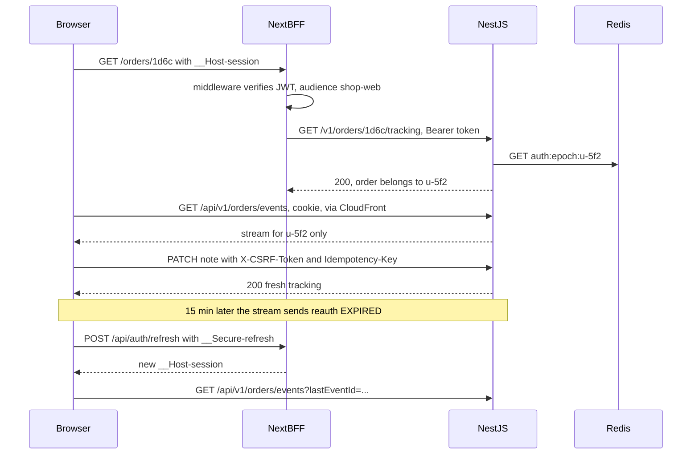

## 85.7 Auth across both sides: cookies, refresh and guards

#### Concept

The tracking feature adds no new authentication; it uses the design of Part 81 exactly, and this section checks every path the feature opens against it. The decisions being reused (81.10): the Next.js BFF owns the cookies; `__Host-session` holds a 15-minute access JWT with audience `shop-web`; `__Secure-refresh` is scoped to `Path=/api/auth` and rotated by the BFF's `/api/auth/refresh` route; `__Host-csrf` is a double-submit token bound to the session ID; NestJS accepts the session JWT from the cookie or a Bearer header, answers `401` with an `X-Auth-Error` code, and checks a Redis epoch (`auth:epoch:<userId>`) so "log out everywhere" takes effect on the next request.

The feature has five paths into the system, and each must be authenticated, authorised and protected against cross-site requests:

| Path | Who authenticates | Authorisation | CSRF |
|---|---|---|---|
| Page load `GET /orders/:id` | Next.js middleware (optimistic JWT check), then the server component's API call | NestJS: the order must belong to the user (in the SQL `WHERE`) | Not needed: a `GET` that changes nothing |
| Refetch `GET /api/v1/orders/:id/tracking` | NestJS `JwtAuthGuard`, cookie via the `rewrites` proxy | Same ownership query | Not needed |
| Stream `GET /api/v1/orders/events` | NestJS `JwtAuthGuard` at connect; expiry and epoch while open (85.4) | Stream key is the user's own ID; no order ID from the client is trusted | Not needed; `SameSite=Lax` cookies are not sent on cross-site subresource requests |
| Note `PATCH` and cancel `POST` | NestJS `JwtAuthGuard` | Ownership in the conditional `UPDATE` | `CsrfGuard`: `X-CSRF-Token` must equal `__Host-csrf` and match the session ID (81.6) |
| Status changes from the warehouse | `ServiceAuthGuard` (service token or mTLS) | Service scopes | Not reachable by browsers |

#### Why does it exist?

Because live features tend to open side doors. A stream endpoint written in a hurry takes `?orderId=` from the client and streams that order's events to whoever asks. A refetch route added "just for the page" skips the ownership check because "the page already checked". A note endpoint called from a client component forgets the CSRF header because the developer tested it from the same origin. Each one is an incident: an IDOR leaking addresses, or a cross-site request changing someone's delivery note.

#### Mental model

Imagine a building with several entrances: the main door, the car park lift, a loading bay and a side gate for staff. Securing the main door does nothing if the lift goes straight to every floor. Part 81 built the badge system; this section walks every entrance of the new wing and checks that each one reads the badge.

#### How it works



Three points that are easy to get wrong:

1. **Middleware is not authorisation.** It verifies that a session exists and redirects when it does not (81.10); it cannot know who owns order `1d6c`. The ownership check lives in NestJS, in the SQL, on every route that takes an order ID. The Next.js server component trusts the API's `404`.
2. **The stream takes no order ID.** It streams the authenticated user's own events (`orders:events:<userId>`). The client filters by order ID for display only; filtering is not security.
3. **Refresh happens in one place.** Client-side fetches go through `authFetch` (81.3), which refreshes on `401 UNAUTHENTICATED` and retries once; the stream's `reauth` path calls the same `refreshOnce`. There is no second refresh implementation for "the live part".

#### Practical example — the attacker's view

A security review tried five attacks against staging:

| Attempt | Result | Why |
|---|---|---|
| Change the order ID in the URL to another customer's | `404` page | Ownership in the `WHERE` |
| `curl` the stream with another user's ID as a parameter | The caller's own events | The stream ignores client-supplied identity |
| A page on `evil.example` posts a form to `PATCH /api/v1/orders/:id/delivery-note` | `403 CSRF_FAILED` | `SameSite=Lax` blocks the cookie on cross-site `POST` and the CSRF header is missing |
| Replay a stolen expired session cookie | `401` with `X-Auth-Error: UNAUTHENTICATED` | 15-minute JWT; the refresh cookie is never sent outside `/api/auth` |
| "Log out everywhere" on another device while the stream is open | `reauth` `REVOKED` within 20 s, then sign-in | Epoch checked on the heartbeat |

#### React / Next.js example

The client write helper, which is the only way the page calls the note endpoint:

```ts
// apps/web/src/orders/api.ts (excerpt)
import { authFetch } from '@/api/auth-fetch';                     // 81.3: refresh on 401, retry once
import { csrfHeader } from '@/api/csrf';                          // 81.6: { 'X-CSRF-Token': <__Host-csrf> }
import { toApiError } from '@/api/errors';
import { OrderTrackingRead } from './tracking.read';
import type { UpdateDeliveryNote } from '@shop/contracts';

export async function saveDeliveryNote(orderId: string, body: UpdateDeliveryNote, idempotencyKey: string) {
  const res = await authFetch(`/api/v1/orders/${encodeURIComponent(orderId)}/delivery-note`, {
    method: 'PATCH',
    headers: { 'Content-Type': 'application/json', 'Idempotency-Key': idempotencyKey, ...csrfHeader() },
    body: JSON.stringify(body),                                   // a string, so authFetch can resend it after a refresh
    signal: AbortSignal.timeout(8000),
  });
  if (!res.ok) throw await toApiError(res);
  return OrderTrackingRead.parse(await res.json());
}
```

#### Backend side (NestJS)

The note controller shows the full guard stack in one place:

```ts
// apps/api/src/orders/delivery-note.controller.ts
import { Body, Controller, Param, ParseUUIDPipe, Patch, UseGuards, UseInterceptors } from '@nestjs/common';
import { Throttle } from '@nestjs/throttler';
import { UpdateDeliveryNoteSchema, type UpdateDeliveryNote, type OrderTracking } from '@shop/contracts';
import { JwtAuthGuard } from '../auth/jwt-auth.guard';               // cookie or Bearer, epoch check (81.3)
import { CsrfGuard } from '../security/csrf.guard';                  // 81.6
import { UserThrottlerGuard } from '../common/user-throttler.guard';
import { IdempotencyInterceptor } from '../common/idempotency.interceptor'; // 8.12
import { ZodValidationPipe } from '../common/zod-validation.pipe';
import { CurrentUser, type AuthUser } from '../auth/current-user.decorator';
import { DeliveryNoteService } from './delivery-note.service';

@Controller('v1/orders')
@UseGuards(JwtAuthGuard, CsrfGuard, UserThrottlerGuard)              // order matters: who, then cross-site, then rate
export class DeliveryNoteController {
  constructor(private readonly notes: DeliveryNoteService) {}

  @Patch(':id/delivery-note')
  @Throttle({ default: { limit: 10, ttl: 60_000 } })
  @UseInterceptors(IdempotencyInterceptor)                           // replays the first response for a repeated key
  update(@CurrentUser() user: AuthUser, @Param('id', ParseUUIDPipe) id: string,
         @Body(new ZodValidationPipe(UpdateDeliveryNoteSchema)) body: UpdateDeliveryNote): Promise<OrderTracking> {
    return this.notes.updateNote(user.id, id, body);                 // ownership inside the UPDATE (85.4)
  }
}
```

Because the browser reaches NestJS through the same origin (the `rewrites` proxy and the CloudFront path behaviour), the API needs **no CORS configuration** for this feature; adding `enableCors` "to be safe" would only widen what other origins can do.

#### Production scenario

The feature's security review took half a day because there was nothing new to design: the review was the table of paths above, each mapped to an existing guard, plus the five attack attempts. One finding: the first version of the internal status endpoint lived under `/v1/orders/:id/status`, reachable through the public `rewrites` proxy and protected only by `ServiceAuthGuard`. It was moved under `/internal`, which CloudFront and the BFF do not route at all, so a mistake in the guard could not expose it.

#### Failure scenario

In another company's tracking feature, the stream endpoint was `GET /orders/:id/events`, authenticated but without an ownership check, "because the order ID is a UUID nobody can guess". Order IDs appeared in tracking links shared by customers on social media and in support screenshots. A scraper collected 30,000 IDs from public posts and subscribed to all of them, receiving names, delivery windows and rider first names in real time. UUIDs are identifiers, not secrets; the fix was the same ownership check every other route had, and a per-user stream instead of per-order streams.

#### Edge cases & failure modes

- **Shared tracking links** ("share my delivery with a friend") need a separate, scoped, expiring token and a reduced view, not the customer's session (a future feature, designed as such).
- **Support agents viewing an order** use a different audience and role, checked by the API (81.5), never the customer route with a flag.
- **The refresh cookie never reaches the stream or the API**: its `Path=/api/auth` keeps it out of every other request (81.2).
- **Cookie size**: the session JWT must stay small (81.2); the stream sends it on every reconnect.
- **CSRF on `GET`**: none needed as long as `GET` routes never change state; a "mark notifications read on view" side effect would break that rule.

#### How a Senior Full-Stack Engineer thinks about this

The senior lists every path a new feature opens and maps each to an existing control, adding new controls only where the feature truly differs (the stream's lifetime). They keep authorisation in the API and in the data query, treat identifiers as public, keep internal endpoints off the public routing table entirely, and refuse "temporary" CORS. Reusing the auth design unchanged is the goal, not a shortcut: every reuse is one less thing to get wrong.

#### Common mistakes

- **Trusting middleware or the page for authorisation.**
- **Order-scoped streams without ownership checks.**
- **Internal endpoints routed through the public proxy.**
- **A second refresh implementation** for the live connection.

#### Interview questions

1. **Where is "this order belongs to this user" checked, and why there?** Expected answer: in the API, inside the SQL of every route that takes an order ID; it is the only layer that cannot be bypassed.
2. **Why does the stream not take an order ID?** Expected answer: identity comes from the session; the stream is the user's own events; client-side filtering is display only.
3. **Does the SSE `GET` need CSRF protection?** Expected answer: no state change, and `SameSite=Lax` cookies are not sent on cross-site subresource requests; the writes need it.
4. **Why no CORS for this feature?** Expected answer: everything is same-origin through the BFF and CloudFront; CORS would only add exposure.

#### Practical exercise

Run the attack table against your staging environment.

Acceptance criteria:

- All five attempts behave as listed, recorded with request IDs.
- A test fails if any route under `/v1/orders/:id` lacks the user in its query (a unit test over the repository calls, or an integration test with two users).
- `/internal/*` is unreachable from the public CloudFront distribution.
- "Log out everywhere" cuts an open stream within 25 s, verified in Playwright (85.9).

## 85.8 Performance: caching, payload size and a Core Web Vitals check

#### Concept

Performance for this feature has three parts. **Load performance**: the first view of the page (TTFB, LCP, CLS) on a mid-range phone over 4G. **Interaction performance**: INP when the customer saves a note or opens the cancel dialog. **Steady-state cost**: what 60,000 open pages cost the servers and the network while nothing happens. Part 82 gave the tools and budgets; this section applies them and records the numbers.

#### Why does it exist?

Because live pages have a performance failure mode static pages do not: they get worse the longer they are open. A page that re-renders the whole timeline on every event, or leaks a listener per reconnect, has a fine Lighthouse score and a terrible INP after twenty minutes. And the steady-state cost (connections, heartbeats, refetches) is paid by the backend for every open tab, all evening.

#### Mental model

Imagine a taxi company's dispatch screen. It must come on quickly when a dispatcher sits down (load), respond instantly when they click (interaction), and still be responsive at the end of an eight-hour shift without the office's network groaning (steady state).

#### How it works

**What is cached where** (82.9):

| Resource | Where cached | Policy |
|---|---|---|
| `/_next/static/*` (framework and `TrackingLive` chunks) | CloudFront and browser | `public, max-age=31536000, immutable`, content-hashed (84.3) |
| Tracking HTML | Nowhere shared | `private, no-cache` (dynamic, personal); bfcache allowed, guarded (85.5) |
| `GET /v1/orders/:id/tracking` | Browser HTTP cache and TanStack Query | `private, no-cache` plus `ETag`; `staleTime` 30 s |
| Stream | Nothing | Caching disabled at CloudFront; `no-cache` |
| Product images in the item list | CloudFront and browser | Hashed URLs, `immutable`, sized `srcset` (82.8) |

**Payload budget**:

| Item | Size | Note |
|---|---|---|
| HTML (first response, streamed) | 11 KB gzip | Status, window, timeline, items, address |
| `TrackingLive` client chunk | 14 KB gzip | Provider, merge, banner, note form; cancel dialog lazy-loaded (5 KB) |
| Tracking JSON | 2.1 KB, 0.9 KB gzip | Refetch is usually a 304 of about 200 bytes |
| Stream event | about 250 bytes | Heartbeat 20 bytes every 20 s |

**Rendering cost per event**: `applyOrderEvent` replaces only the tracking object; `Timeline` and `OrderItems` are memoised by their props (items never change), so an event re-renders the heading, the ETA line, the banner and the timeline's last step. Measured with the React Profiler (77.12): 1.8 ms per event commit on a Moto G Power class device.

**Steady-state cost at 60,000 open pages**: 60,000 connections on 8 realtime tasks; 3,000 heartbeats per second in total (60 KB/s); about 70 reauth reconnects per second (each a refresh at the BFF, p95 31 ms in 81.10, and a stream reconnect with a short replay); about 40 refetch `304`s per second from focus events. Compared with the polling page's 6,000 full responses per second, the API's tracking load fell by about 99 %.

#### Practical example — the Core Web Vitals check before launch

The team ran three checks, matching 82.11's practice:

1. **Lighthouse CI on every preview** (84.11), mobile emulation, against a seeded order, with a session cookie for the test customer:

```ts
// apps/web/lighthouserc.js (excerpt)  Lighthouse CI 0.14; plain JS config file
module.exports = {
  ci: {
    collect: {
      url: [`${process.env.PREVIEW_URL}/orders/${process.env.SEEDED_ORDER_ID}`],
      numberOfRuns: 3,
      settings: { preset: 'perf', extraHeaders: JSON.stringify({ Cookie: process.env.LHCI_SESSION_COOKIE }) },
    },
    assert: {
      assertions: {
        'largest-contentful-paint': ['error', { maxNumericValue: 2000 }],
        'cumulative-layout-shift': ['error', { maxNumericValue: 0.05 }],
        'total-blocking-time': ['error', { maxNumericValue: 150 }],          // lab proxy for INP
        'resource-summary:script:size': ['error', { maxNumericValue: 180_000 }],
      },
    },
  },
};
```

The session cookie for a test customer comes from the test-support API (83.7) in the preview environment only.

2. **A long-session test** in Playwright: open the page, push 200 status and ETA events through the test-support API over 10 minutes, force 30 reconnects with `page.route` aborts, then measure: JS heap growth under 2 MB (`performance.memory` in Chromium), event listener count on `window` and `document` stable (CDP's `DOMDebugger.getEventListeners` through `page.context().newCDPSession(page)`), and an interaction (open and close the cancel dialog) under 100 ms in a performance trace.

3. **RUM after a 5 % flag rollout** (84.5): p75 mobile LCP 1.4 s, INP 70 ms, CLS 0.01 for the tracking route, compared with the old polling page's LCP 3.8 s, INP 180 ms (it re-rendered the whole page every poll), CLS 0.12 (the ETA line appeared late).

#### React / Next.js example

The timeline only re-renders the steps that changed, and keys are stable (77.3):

```tsx
// apps/web/app/(shop)/orders/[id]/Timeline.tsx
'use client';
import { memo } from 'react';
import { STATUS_COPY } from '@/orders/status-copy';
import { formatTime } from '@/orders/format';
import type { OrderTrackingView } from '@/orders/tracking.read';

type Step = OrderTrackingView['timeline'][number];

const StepRow = memo(function StepRow({ step, timeZone, current }: { step: Step; timeZone: string; current: boolean }) {
  return (
    <li aria-current={current ? 'step' : undefined}>
      <span>{STATUS_COPY[step.status].label}</span> <time dateTime={step.at}>{formatTime(step.at, timeZone)}</time>
    </li>
  );
});

export function Timeline({ steps, timeZone, current }: { steps: Step[]; timeZone: string; current: string }) {
  return (
    <ol className="timeline">
      {steps.map((s) => (
        <StepRow key={`${s.status}-${s.at}`} step={s} timeZone={timeZone} current={s.status === current} />  // stable keys
      ))}
    </ol>
  );
}
```

#### Backend side (NestJS)

The backend's share of the page's speed (82.10):

- **One request for the page**: the tracking endpoint returns everything the shell needs (summary, timeline, flags for the UI), so server rendering makes one API call, not four.
- **Indexes for the two reads**: `orders` by primary key (with `user_id` in the predicate) and `order_status_events (order_id, version)` from the unique constraint, both under 1 ms.
- **`ETag` and `304`** on refetches.
- **Small events**: the stream never carries items, addresses or notes.
- **SSE over HTTP/2** at CloudFront, so a tab's stream shares one connection with its other requests (78.8's six-connection problem does not apply).

```sql
EXPLAIN (ANALYZE, BUFFERS)
SELECT status, version, occurred_at FROM order_status_events
 WHERE order_id = '1d6c0b6e-2f3a-4c55-9d1e-8a7b6c5d4e3f' ORDER BY version ASC LIMIT 20;

 Limit  (cost=0.57..12.83 rows=6 width=29) (actual time=0.021..0.026 rows=6 loops=1)
   Buffers: shared hit=5
   ->  Index Scan using order_status_events_order_id_version_key on order_status_events
         (cost=0.57..12.83 rows=6 width=29) (actual time=0.020..0.024 rows=6 loops=1)
         Index Cond: (order_id = '1d6c0b6e-2f3a-4c55-9d1e-8a7b6c5d4e3f'::uuid)
 Planning Time: 0.092 ms
 Execution Time: 0.041 ms
```

#### Production scenario

Two weeks after full rollout, the tracking route was the fastest authenticated page on the site by p75 LCP. The realtime tasks cost about 230 dollars a month at the evening peak's scale (8 Fargate tasks of 1 vCPU and 2 GB, scaled down to 3 overnight), about 0.002 cents per tracked order, a tenth of the cost ceiling. The orders API's peak CPU fell by 28 % because the polling traffic was gone.

#### Failure scenario

A later change added a countdown ("Arriving in 12 minutes") that updated every second with `setInterval` and `setState` at the top of `TrackingLive`. Every second the whole island re-rendered, including the timeline and the note form; on low-end Android phones INP rose to 340 ms because a keypress in the note field often landed during a render, and battery drain complaints followed. The countdown moved into its own tiny component with its own state, updating every 30 seconds (minutes do not need second precision), and INP returned to 70 ms.

#### Edge cases & failure modes

- **Long-open pages**: leaks of listeners or timers per reconnect; test with long sessions, not only Lighthouse.
- **Re-rendering everything per event**; memoise stable regions and keep live state low in the tree.
- **Fonts or icons arriving late** and shifting the status heading; preload the subset, reserve space.
- **Large timelines** for orders with many ETA changes; cap at 20 steps.
- **Heartbeat frequency**: too frequent wastes battery and bandwidth; too rare lets proxies and NATs drop idle connections (38.8); 20 s fits CloudFront and ALB timeouts.

#### How a Senior Full-Stack Engineer thinks about this

The senior budgets the three kinds of performance separately: first view in the lab and the field, interactions with a profiler on a slow phone, and steady state as a server-and-network cost per open page per hour. They keep the live part of the tree small, measure long sessions as well as first loads, and count the backend savings, because a live feature done well should make the system cheaper than the polling it replaced.

#### Common mistakes

- **Only measuring first load** for a page people keep open.
- **Live state at the top of the tree.**
- **Caching personal responses in shared caches** "for speed".
- **Second-by-second timers** for minute-level information.

#### Interview questions

1. **How do you measure performance for a page users keep open for 30 minutes?** Expected answer: first-load Web Vitals plus a long-session test (memory, listeners, interaction latency after many events and reconnects) and RUM INP over the whole visit.
2. **What does the backend contribute to this page's LCP?** Expected answer: one fast aggregated read, indexed queries, an `ETag`, and server rendering's API latency inside TTFB.
3. **How did SSE change the backend cost compared with polling?** Expected answer: from thousands of full responses per second to idle connections, heartbeats and a few hundred small events and reconnects per second.

#### Practical exercise

Run the three checks on your preview environment.

Acceptance criteria:

- Lighthouse CI assertions as above pass on three runs against a seeded order.
- The long-session test shows heap growth under 2 MB and a stable listener count after 200 events and 30 reconnects.
- A Profiler recording shows each event commit under 4 ms on a throttled CPU (4x slowdown).
- A one-paragraph cost note compares the realtime tasks with the polling traffic they replaced.
