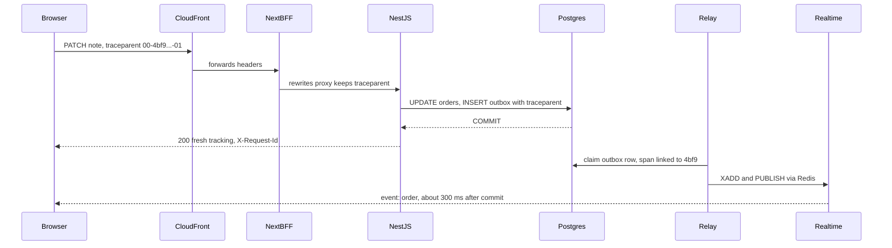
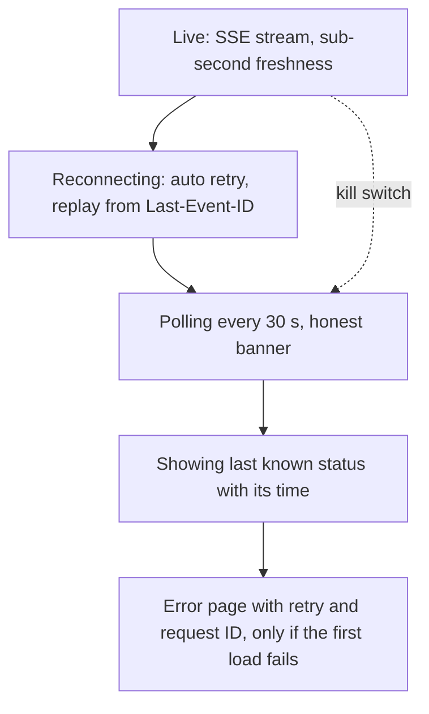
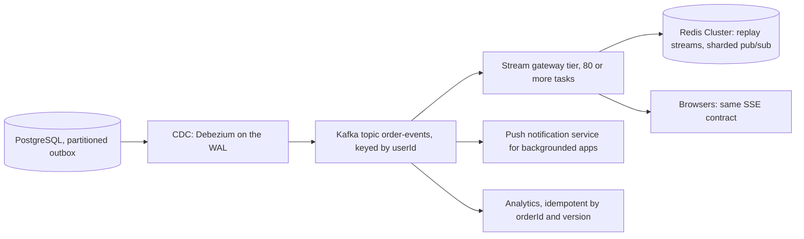

## 85.11 Observability: one trace from a browser click to a database write

#### Concept

Part 84.7 connected browser errors to backend traces with W3C `traceparent`. This feature has two journeys worth tracing. The **write path**: the customer clicks "Save note", the request crosses CloudFront, the BFF's proxy and NestJS, and ends in a PostgreSQL `UPDATE` and an outbox `INSERT`. The **push path**: a committed change travels from the outbox through the relay and Redis to the stream and the screen. The write path is one trace. The push path starts in a different process at a different time, so it is a second trace **linked** to the first through the `traceparent` stored in the outbox row (85.3).

#### Why does it exist?

Because "the note took ages to save" and "the status was late" are the two complaints this feature will get, and both cross five systems. Without a trace, the web team sees a slow request and the database team sees fast queries, and nobody sees the 900 ms the request spent queued behind a cold Next.js task. Without freshness metrics, a relay falling behind looks like nothing at all until support calls rise.

#### Mental model

Imagine a parcel tracking number that is printed on the customer's receipt, scanned at every depot, and also written on the delivery van's job sheet the next morning. The receipt and the job sheet are separate documents created at different times, but the shared number lets you follow the parcel from the shop counter to the doorstep.

#### How it works



1. **The browser starts the trace** for the user action with the small generator of 84.7 (or the OpenTelemetry web SDK), sending `traceparent` only to its own `/api/` paths, and tags any error event with the trace ID.
2. **The BFF's `rewrites` proxy forwards request headers**, so `traceparent` reaches NestJS unchanged. If the BFF's OpenTelemetry setup (84.7) instruments the proxy hop, it appears as a span; if not, NestJS's server span is the browser span's direct child. Either way the trace ID is the same.
3. **NestJS continues the trace** with auto-instrumentation (Part 47.4): the HTTP server span, the Redis `GET` for the auth epoch, the `pg` spans for `UPDATE`, `INSERT` and `COMMIT`. Parent-based sampling honours the browser's decision.
4. **The outbox row stores `traceparent`** (85.3). The relay starts its publish span with an OpenTelemetry **span link** to that context, so the trace UI can jump from the write to the publish.
5. **The stream does not create a span per event.** At 120 events a second, the useful signal is a **freshness histogram**: at the moment the realtime task writes an event, it records `now - updatedAt` in `order_event_lag_seconds`. The browser records the same age on arrival as a RUM value, corrected for clock skew with the response `Date` header.

The relay's linked span:

```ts
// apps/api/src/orders/outbox.relay.ts (inside tick(), per row)
import { ROOT_CONTEXT, propagation, trace, type Link } from '@opentelemetry/api';

const tracer = trace.getTracer('orders-relay');

function linkFrom(traceparent: string | null): Link[] {
  if (!traceparent) return [];
  const ctx = propagation.extract(ROOT_CONTEXT, { traceparent });   // rebuild the stored request context
  const sc = trace.getSpanContext(ctx);
  return sc ? [{ context: sc }] : [];
}

// for each claimed row r:
tracer.startActiveSpan('outbox.publish', { links: linkFrom(r.traceparent), attributes: {
  'order.id': r.aggregate_id, 'outbox.id': r.id, 'outbox.age_ms': Date.now() - r.created_at.getTime(),
} }, (span) => { /* pipe.xadd(...) as in 85.3 */ span.end(); });
```

The freshness metric at the edge of the system:

```ts
// apps/api/src/orders/order-events.stream.ts (where an event is turned into a MessageEvent)
import { Histogram } from 'prom-client';

const lag = new Histogram({
  name: 'order_event_lag_seconds',
  help: 'Database commit to SSE write, per event',
  buckets: [0.05, 0.1, 0.25, 0.5, 1, 2, 5, 10, 30],                  // 2 s is the freshness target (85.1)
});

export function observeLag(updatedAtIso: string): void {
  lag.observe(Math.max(0, (Date.now() - Date.parse(updatedAtIso)) / 1000));
}
```

#### Practical example — one "Save note", end to end

The trace for a note saved at the evening peak, as the trace UI shows it:

```text
trace 4bf92f3577b34da6a3ce929d0e0e4736                                total 182 ms (browser view)
browser  click "Save note" -> fetch PATCH                            ├──────────────────────────── 182 ms
  network + CloudFront (edge POP Mumbai)                             ├─ 41 ms
  web-bff  proxy /api/v1/orders/:id/delivery-note                    │  ├── 96 ms
    orders-api  PATCH /v1/orders/:id/delivery-note                   │  │  ├── 88 ms
      JwtAuthGuard + Redis GET auth:epoch                            │  │  │  ├ 1.1 ms
      CsrfGuard, UserThrottlerGuard (Redis INCR)                     │  │  │  ├ 0.9 ms
      IdempotencyInterceptor reserve (Redis SET NX)                  │  │  │  ├ 0.6 ms
      pg BEGIN; UPDATE orders ... WHERE version = $4                 │  │  │  ├ 2.4 ms
      pg INSERT outbox                                               │  │  │  ├ 0.8 ms
      pg SELECT tracking (order + 20 events)                         │  │  │  ├ 1.3 ms
      pg COMMIT                                                      │  │  │  ├ 2.0 ms
      serialise + idempotency store                                  │  │  │  ├ 1.2 ms
      (unexplained gap: event loop lag)                              │  │  │  └ 77 ms   <- the finding
linked: outbox.publish (relay)  outbox.age_ms=94                     └ +94 ms after commit, 0.7 ms
```

Fourteen milliseconds of real work, 77 ms of unexplained time inside the NestJS span. The API's event loop lag metric (Part 13.27) for that task showed 70 to 90 ms spikes every few seconds: a synchronous `JSON.stringify` of a large export job running on the same tasks. Moving the export to a worker (Part 39) brought the PATCH p95 from 210 ms to 60 ms. Without the trace, the database would have been blamed.

#### Backend side (NestJS)

What the backend emits for this feature, beyond the generic HTTP metrics:

| Signal | Type | Alert |
|---|---|---|
| `order_event_lag_seconds` | Histogram | p95 above 2 s for 10 minutes (freshness SLO burn) |
| Outbox backlog (`count(*) WHERE published_at IS NULL`) and oldest age | Gauges, sampled every 15 s | Oldest unpublished row older than 30 s |
| `ActiveStreams` per task (85.10) | Gauge | Above 9,000 per task for 10 minutes |
| Stream connects, reauth closes, `429 TOO_MANY_STREAMS` | Counters | 429 rate above 0.5 % of connects |
| Replay requests that returned `reset` | Counter | Above 2 % of reconnects (replay window too short) |
| `INVALID_TRANSITION` from internal callers | Counter by source | Spike after an upstream deploy |
| Tracking availability and journey SLIs (84.8) | RUM counters | Burn-rate alerts |

Logs carry `requestId`, `trace_id` and the order ID, never the delivery note (Part 44.31). The relay logs one line per batch (count, oldest age), not per row.

#### Production scenario

The tracking dashboard has six panels: freshness p50/p95/p99, outbox backlog and age, active streams per task with memory, connects and reauths per second, the RUM tracking availability SLI, and error-tracker issues for the tracking route by release. In the first quarter, freshness alerts fired three times: a Redis failover (40 s), a relay deploy that started with `RELAY_ENABLED=false` on every task (12 minutes; the backlog alert caught it before customers called), and a PostgreSQL vacuum stall on `outbox` (85.12). Each was diagnosed from the dashboard and one linked trace in under ten minutes.

#### Failure scenario

For the first two weeks, the freshness histogram was recorded in the relay at publish time, not at the stream write. It showed p95 0.2 s throughout an evening when customers on one realtime task saw updates 40 seconds late: that task's Redis subscriber connection had silently stalled after a network blip, and events piled up in its stream while the relay, correctly, kept publishing. The metric measured the part of the path that worked. Moving the measurement to the last server-side step, the SSE write, and adding a RUM measurement in the browser, made the stall visible; a subscriber health check (a self-published probe every 10 s that must arrive within 2 s) now restarts a stuck subscriber.

#### Edge cases & failure modes

- **Measuring freshness too early** in the path hides stalls downstream; measure at the last step you control, and in the browser.
- **Clock skew** between the database and the realtime tasks distorts lag; use database time (`updatedAt` from `now()`) and keep hosts on NTP; in the browser, correct with the server's `Date` header.
- **Span per event** at high rates costs more than it tells; histograms and sampled linked spans are enough.
- **Trace headers to third parties**: propagate only to your own origins (84.7).
- **Personal data in span attributes**: order IDs yes, notes and addresses never.

#### How a Senior Full-Stack Engineer thinks about this

The senior instruments the feature around its promise: freshness is a histogram measured at the last step, the write path is one trace from the click, and the asynchronous hop is joined by a stored context and a span link. They alert on symptoms customers feel (lag, availability) and on the leading indicators that predict them (backlog age, subscriber health), and they test that every alert can fire. The trace that found the event-loop problem is the typical payoff: the slow part was not where anyone was looking.

#### Common mistakes

- **No link between the request trace and the asynchronous publish.**
- **Freshness measured at the producer instead of the consumer.**
- **Alerting on stream count alone**, which changes with traffic, instead of lag and backlog age.
- **Logging payloads** of personal fields.

#### Interview questions

1. **How do you trace work that continues asynchronously after the request?** Expected answer: store the trace context with the work (here in the outbox row) and start the later span with a link to it.
2. **Where do you measure freshness for a live feature?** Expected answer: at the last server-side step (the stream write) and in the browser, both against the commit time from the database.
3. **What would you alert on to catch a stuck relay before customers notice?** Expected answer: the age of the oldest unpublished outbox row, plus freshness p95.

#### Practical exercise

Instrument the write and push paths.

Acceptance criteria:

- A note save produces one trace with browser, NestJS and PostgreSQL spans, and the relay's publish span links to it.
- `order_event_lag_seconds` is recorded at the SSE write; a deliberately paused relay makes the backlog-age alert fire within one minute.
- A browser error during a note save carries the same `trace_id` as the backend spans.
- No span attribute or log line contains a delivery note.

## 85.12 Failure drills: backend down, SSE disconnects, stale bundle, slow database

#### Concept

A **failure drill** (Part 53.12) breaks one dependency on purpose, in staging or in a controlled production window, and checks that the system behaves as designed and that the people on call can see it. Each drill states the expected behaviour in advance, so the drill either confirms the design or finds the gap. The four drills the outline requires, plus two more this design depends on, all have the same goal: the customer always sees the last known status, labelled honestly, and nothing is lost.

#### Why does it exist?

Because the degradation paths in 85.6 and 85.10 are code that runs only when something is broken, which means it almost never runs. Untested fallbacks fail the first time they are needed: the polling interval was never wired, the banner has a typo, the kill switch flag was renamed. Drills turn "we designed for that" into "we watched it work".

#### Mental model

Imagine a fire drill in an office. Nobody expects a fire on Tuesday, but on Tuesday everyone walks out by the planned route while someone times it and notes the door that sticks. The real fire is not the time to discover the door.

#### How it works



The drills, with what was expected and what was measured on staging at production scale (60,000 synthetic streams):

| Drill | Expected | Measured | Gap found |
|---|---|---|---|
| Orders API down 5 min (all api tasks stopped) | Open pages keep status; banner; note save fails with rollback; new page loads show `error.tsx` with retry | As expected; streams stayed up (realtime tasks independent) and kept delivering replays | `error.tsx` retry hammered the API on recovery: added jittered retry |
| Realtime tasks killed | Clients reconnect; after 10 s, polling; streams return within 2 min of recovery | Reconnect p95 3.1 s with jitter; 0 events lost | None |
| Network flap (CloudFront to ALB, 30 s) | Auto reconnect, replay | All events replayed; 0.4 % got `reset` and refetched | Replay window raised from 15 min to 30 min for slow customers |
| Stale bundle (tab on build N while N+2 emits a new status) | Old tab shows "Updated" badge, timeline intact; nudge to reload | As expected via `openEnum` | Nudge appeared only after 30 min (80.9 default); set to 5 min for tracking |
| Slow database (`pg_sleep` injected in the tracking read; lock held on one order row) | Reads time out at 2 s; SSR shows `error.tsx`; open pages unaffected; relay backlog grows; freshness alert | SSR timed out at 1.5 s as designed; relay blocked on the locked row only | Relay batch blocked behind one locked row: added `SKIP LOCKED` was already there, but the transition `UPDATE` waited 30 s; set `lock_timeout = 2s` on API transactions |
| Redis primary failover | Relay retries; streams drop and reconnect; replay fails over to `reset` if the stream was lost | 38 s outage; backlog peaked at 2,100; caught up in 6 s; clients refetched | Connection counter keys lost: limits briefly unenforced, acceptable |

#### Practical example — the four required drills in detail

**Backend down.** At 19:00 on staging the api service is scaled to zero. Open tracking pages: the stream is served by the realtime tasks, which do not depend on the api tasks, so live status keeps working for changes already in the outbox; the relay runs inside api tasks, so new changes stop flowing and the freshness alert fires after 30 s. Customers who reload see `error.tsx`: "We couldn't load your order. Try again", with the request ID, after 1.5 s (the SSR timeout). A note save shows the optimistic note, then rolls it back with "Couldn't save your note. Try again". At 19:05 the service returns; the relay drains the backlog in 4 s; streams deliver the queued events. Lesson recorded: the relay should run on its own small service so an api outage does not also stop status events (done in the next sprint).

**SSE disconnects.** A CloudFront origin is made unreachable for 90 s by blocking the realtime ALB's security group. `EventSource` retries silently; after 10 s, banners read "Reconnecting. Showing status from 7:12 pm" and polling starts against the api tasks (which are healthy). Polling load: 60,000 / 30 s = 2,000 requests per second, 95 % `304`. When the block is lifted, reconnects arrive spread over 8 s thanks to the jittered `retry`, each replaying from `Last-Event-ID`.

**Stale bundle.** A tab is opened on build N. Build N+1 adds a `READY_FOR_PICKUP` status for click-and-collect, and the API starts emitting it for one test order (the drill skips the "mobile first" gate on purpose). The old tab receives the event, `openEnum` maps the status to `UNKNOWN` and reports it once to the error tracker with a `skew` tag (84.4), the heading reads "Updated", the timeline adds a step labelled "Updated", and within 5 minutes the version nudge (80.9) shows "A new version is available. Reload". Nothing crashes. The same drill on a build without `openEnum` (kept as a negative control) throws in `STATUS_COPY[...]` and shows the segment error boundary, which is exactly the incident the rollout order prevents.

**Slow database.** A test transaction holds a row lock on order `1d6c` for 60 s while the warehouse simulator tries to move it to `OUT_FOR_DELIVERY`. Before the fix, the transition waited 30 s (the default statement timeout on that pool) and the warehouse integration retried three times, stacking waiters. After setting `lock_timeout = '2s'` for API transactions (`SET LOCAL lock_timeout` at the start of `transition()`), the transition fails fast with `55P03 lock_not_available`, mapped to `409 RETRY_LATER`, and the warehouse retries with backoff (Part 34.4). Other orders are unaffected: the relay's `SKIP LOCKED` passes over the locked outbox rows, and tracking reads for other orders stay at p95 18 ms.

#### Backend side (NestJS)

The two settings the slow-database drill added, in the transition transaction:

```ts
// apps/api/src/orders/order-status.service.ts (start of the transaction callback)
await m.query(`SET LOCAL lock_timeout = '2s'`);          // fail fast instead of queueing behind a held lock
await m.query(`SET LOCAL statement_timeout = '3s'`);     // bound any single statement (Part 22)
```

```ts
// apps/api/src/common/api-exception.filter.ts (addition): map PostgreSQL lock timeouts to a retryable 409
if (exception instanceof QueryFailedError && (exception.driverError as { code?: string }).code === '55P03') {
  return reply(409, 'RETRY_LATER', 'The order is being updated. Try again shortly.', { retryAfterSec: 1 });
}
```

#### Production scenario

The team runs one drill a month in staging at production scale and the "realtime tasks killed" drill quarterly in production during a quiet hour, announced to support. The production drill in month three took 9 realtime tasks down one at a time over 15 minutes: 64,000 streams moved without a single lost event, the freshness p99 rose to 4.1 s for 30 seconds per task, and no customer contacted support.

#### Failure scenario

Before the drills, the polling fallback had never run in production. The first real stream outage came from a CloudFront configuration change that set the stream behaviour's origin response timeout to 10 s. Every quiet stream was cut after 10 s; clients reconnected, were cut again, and after three failures in two minutes switched to polling, as designed. But polling used `refetchInterval` from a `conn` value captured in a stale closure (a bug no test exercised), so the pages never actually polled. For 50 minutes customers saw "Reconnecting" and a status that never changed. The fix was one line; the lesson was the monthly drill, and a component test for the polling path (85.9, the third test).

#### Edge cases & failure modes

- **Drills that skip the people part**: check that the alert fired, the right person was paged and the runbook was right.
- **Fallbacks that overload a healthy dependency**: 60,000 pages polling every 5 s would be 12,000 requests per second; 30 s and `304`s keep it at 2,000 mostly empty responses.
- **Recovery stampedes**: retries without jitter turn recovery into a second outage.
- **Shared fate**: the relay inside api tasks tied event flow to api health; drills reveal such coupling.
- **Negative controls**: run the old behaviour once to prove the drill can detect the failure.

#### How a Senior Full-Stack Engineer thinks about this

The senior writes the expected behaviour of every dependency failure before building the fallbacks, then proves it with scheduled drills at real scale, including the alerting and the humans. They look especially for shared fate (two features failing together because they share a process) and for recovery behaviour, which is where a second outage usually starts. A drill that finds nothing is good news; a drill that is never run is a guess.

#### Common mistakes

- **Fallback code without tests or drills.**
- **No `lock_timeout`**, so one held lock queues every writer.
- **Polling fallbacks with aggressive intervals.**
- **Drills only in tiny staging environments**, where scale effects never appear.

#### Interview questions

1. **What should a live tracking page do when the API is down?** Expected answer: keep showing the last known status with its time, label it honestly, roll back optimistic writes with a clear message, and show a retryable error only when there is no data at all.
2. **How do you stop one locked row from stalling a status pipeline?** Expected answer: `lock_timeout` on writers, `SKIP LOCKED` in the relay, and retryable errors with backoff for callers.
3. **How do you test that an old bundle survives a new enum value?** Expected answer: keep a tab on build N, emit the new value from build N+2, check the fallback label, the skew report and the reload nudge.
4. **Why drill at production scale?** Expected answer: reconnect storms, polling load and backlog drain only appear with realistic connection counts.

#### Practical exercise

Run the six drills on staging.

Acceptance criteria:

- A written expected behaviour for each drill before it runs.
- Each drill's alert fires and reaches the on-call channel within the expected time.
- No events are lost in any drill (verified by comparing outbox rows with events received by a synthetic client).
- At least one gap found and fixed, with a test added for it.

## 85.13 Senior review: what you would change at 10x scale

#### Concept

A **senior review** looks at a working system and asks what breaks first if load grows by an order of magnitude, and what should **not** change. At 10x, this feature means 600,000 concurrent viewers, 1,200 events per second on average, bursts of 6,000, and 4 million orders a day. Some parts scale by adding tasks; some hit hard limits and need a different design; and some decisions are worth keeping exactly as they are.

#### Why does it exist?

Because the cheapest time to know the next architecture is before you need it, and the most expensive mistake is building it now. The current design meets today's numbers with a lot of headroom and few moving parts (85.1). The review documents where the headroom ends, so the team watches the right metrics and starts the next step a quarter before it is urgent, not during an outage.

#### Mental model

Imagine a bakery that sells 1,000 loaves a day planning for 10,000. More ovens is easy. The single front door, the one delivery van and the owner doing every order by hand are the real limits. And the recipe, which customers love, should not change at all.

#### How it works

What breaks first, in order:

| Component | Today | At 10x | Change |
|---|---|---|---|
| Realtime tasks (memory per connection) | 9 tasks, 64,000 streams | about 80 tasks, 600,000 streams | Scales out as is; consider a dedicated gateway on a runtime with cheaper idle connections, or a managed service (AWS API Gateway WebSocket, AppSync Events) after a cost comparison |
| Redis, single primary: streams, pub/sub, counters | Under 5 % CPU | Pub/sub fan-out to 80 subscribers per message becomes the bottleneck | Redis Cluster with sharded pub/sub (`SSUBSCRIBE`, Redis 7) keyed by user, so a message goes only to the shard and tasks that hold that user |
| Relay polling one outbox | 600 rows/s burst | 6,000 rows/s burst | Partition the outbox by `user_id` hash across N relays, or replace polling with CDC (Debezium on the WAL, Part 42) publishing to Kafka |
| `orders` and `order_status_events` writes | Comfortable | 4 million orders, 20 million history rows a day | Monthly partitions for history and outbox (Part 26); archive delivered orders' history after 90 days |
| Reauth reconnects every 15 min | 70/s | 700/s, each a refresh at the BFF | Stagger with jitter already; consider a longer-lived, stream-only token minted by the BFF with a narrow audience (`shop-stream`), revocable by the same epoch |
| Mobile apps keeping streams open in the background | Not an issue | Large share of connections from backgrounded phones | Close streams when apps background; use push notifications (APNs, FCM) for status changes instead |
| Single region | One AWS region | Customers in several countries | Regional stacks with customers pinned to their home region; the contract and events unchanged |



What **not** to change, because it is what makes the system correct:

- **The contract**: `OrderTrackingSchema`, the event schema, the problem documents, the rollout rules for enums. Browsers and apps do not care how events reach them.
- **Versioned, idempotent consumers**: every consumer applies events by `(orderId, version)`; at-least-once delivery stays safe whatever the transport.
- **The outbox semantics**: events derive from committed state. CDC is the same idea with a different reader.
- **The honest fallback**: polling with a banner, behind a flag. At 10x the kill switch matters more, not less.
- **Server rendering of the shell**: the first view does not depend on the live tier at all.

#### Practical example — the cost check before building anything

The team priced the 10x options with real numbers. Staying on Fargate with SSE: about 80 tasks at the evening peak, roughly 2,100 dollars a month, plus Redis Cluster at about 900 dollars. A managed WebSocket service: priced per connection-minute and per message, it came to about 6,500 dollars a month at 600,000 peak connections with typical evening session lengths, without counting the work to move the browser from SSE to WebSockets. The decision: stay on SSE and Fargate, move to Redis Cluster with sharded pub/sub at 3x, introduce CDC at 5x, and revisit managed services if connection costs or operational load change. The thresholds became alerts on the metrics of 85.11.

#### Backend side (NestJS)

The change at 3x is small because the stream code already has one seam: `OrderEventsStream.forUser(userId, lastEventId)` (78.8, 85.4). Moving from `SUBSCRIBE` on a single Redis to `SSUBSCRIBE` on a cluster changes the implementation behind that method, not the controller, the contract or the client. The relay's seam is the same: the outbox row is the input, the customer's stream is the output; CDC replaces the loop, not the semantics. Keeping these seams narrow was a deliberate choice in 85.3 and 85.4.

#### Production scenario

Eighteen months later, at 3.4x, the team made the first planned change: Redis Cluster with sharded pub/sub, behind the existing interface, rolled out one realtime task at a time. Freshness p95 stayed at 0.4 s through the migration. CDC was prototyped but not yet needed: the partitioned relay (four relays, each owning a hash range of `user_id`) handled bursts of 2,500 rows per second at 15 % of one vCPU each.

#### Failure scenario

A different company, seeing a similar feature succeed, rebuilt it at 1x for "web scale": Kafka, a custom WebSocket gateway in another language, a separate tracking database fed by CDC, and a GraphQL subscription layer. It took two quarters, introduced four new on-call rotations, and at launch delivered freshness of 3 s p95 (worse than the simple version) because events crossed five systems. The review that followed recommended returning to the outbox, Redis and SSE design for their scale, which they did. Scaling ahead of need is a cost, not insurance.

#### Edge cases & failure modes

- **Changing the contract during a scale migration**: two risky changes at once; keep the wire format fixed.
- **Fan-out patterns that break at scale**: broadcast designs (every message to every gateway) fail long before 1:1 designs.
- **Regional splits** with users travelling: pin by home region, never by request location, or a customer's stream and orders disagree.
- **Push notifications as a replacement** for open tabs: they complement, they do not deliver to an open web page.

#### How a Senior Full-Stack Engineer thinks about this

The senior names what breaks first, at what multiple, with which metric warning in advance, and what the next design is, then deliberately does not build it yet. They protect the decisions that make the system correct (contract, versions, outbox, fallback) and keep narrow seams around the parts that will change (the stream source, the relay). And they price options with real numbers, because "it scales" is not a decision until someone has written down what it costs.

#### Common mistakes

- **Building the 10x architecture at 1x.**
- **Changing the client protocol to scale the server.**
- **Broadcast fan-out "for simplicity".**
- **No written thresholds**, so the scale work starts during an incident.

#### Interview questions

1. **What breaks first if live tracking grows tenfold?** Expected answer: pub/sub fan-out on a single Redis and the relay's burst capacity, then partition sizes; stream tasks simply scale out.
2. **What would you not change, and why?** Expected answer: the contract, versioned idempotent consumers, outbox semantics, the honest fallback and server-rendered shell; they make the system correct regardless of transport.
3. **When would you move from an outbox poller to CDC?** Expected answer: when relay throughput or database load from polling becomes the limit; CDC keeps the same semantics with lower latency and load, at the cost of new infrastructure.
4. **Managed realtime service or your own?** Expected answer: compare real connection-minute and message costs and operational load at your numbers; at moderate scale your own SSE tier is often cheaper and simpler.

#### Practical exercise

Write the 10x review for your own live feature.

Acceptance criteria:

- A table of components with today's load, the load at 10x and the first component to hit a hard limit.
- A list of decisions not to change, each with the reason.
- Costed options for the two most likely changes, with the metric and threshold that triggers each.
- The code seams where each change would happen, identified in your codebase.

## Senior Checklist — Part 85

- [ ] I understand the concept
- [ ] I can explain it simply
- [ ] I can implement it
- [ ] I understand its failure modes
- [ ] I understand its scaling limitations
- [ ] I understand its security implications
- [ ] I understand its operational implications
- [ ] I can choose between alternatives
- [ ] I can explain the tradeoffs
- [ ] I can answer senior-level interview questions
- [ ] I can write requirements and NFRs with numbers and derive connection, event and cost estimates from them
- [ ] I can design a REST plus SSE contract in a shared package and roll out enum and field changes in the right order
- [ ] I can change status with conditional updates and publish events through a transactional outbox with idempotent consumers
- [ ] I can build an SSE endpoint with ownership, a connection cap, an end at token expiry and a revocation check
- [ ] I can server-render the page shell with the answer in the first HTML and one small live island
- [ ] I can merge pushed events into the query cache by version and field, and fall back to honest polling
- [ ] I can make a write optimistic only where being briefly wrong is harmless, with field-level rollback
- [ ] I can map every path of a feature to the existing auth design without adding side doors
- [ ] I can measure load, interaction and steady-state performance for a page users keep open
- [ ] I can test streams without a browser and prove the whole path with one journey that encodes the freshness target
- [ ] I can deploy streams on their own tasks behind a CDN configured for them, and release by flag with a working off state
- [ ] I can follow one trace from a click to a database write and link the asynchronous publish to it
- [ ] I can run failure drills at realistic scale and turn the gaps into tests
- [ ] I can review a system for 10x, naming what breaks first and what must not change

## Part 85 — Key Takeaways

- Write the numbers first; for live features the NFRs (viewers, bursts, freshness, degradation) pick the architecture.
- The contract comes before the code, lives in the shared package, and changes follow a rollout order: clients that tolerate new values ship first.
- The database row is the only truth; history, streams, caches and screens are derived from committed changes through an outbox.
- Every consumer applies events by entity and version, so at-least-once delivery, duplicates and reordering are harmless.
- A long-lived connection holds authority and memory: give it a cap, an expiry, a revocation check and its own tasks.
- Put the answer in the first HTML; make live only the part that changes.
- The query cache is the one source the UI reads; pushed events are one more writer with the same rules as mutations.
- Optimistic for harmless changes, pessimistic for money and races; roll back fields, not snapshots.
- A live page must say honestly when it is not live, and keep working by polling behind a server-evaluated flag.
- Test time and connections with fakes you control, and keep one end-to-end journey whose timeout is the freshness target.
- Trace the click to the database write, link the asynchronous hop, and measure freshness at the last step.
- Drill every failure at realistic scale; fallbacks that never run do not work.
- At 10x, scale the parts that limit you and keep the contract, the versions, the outbox and the fallback exactly as they are.
