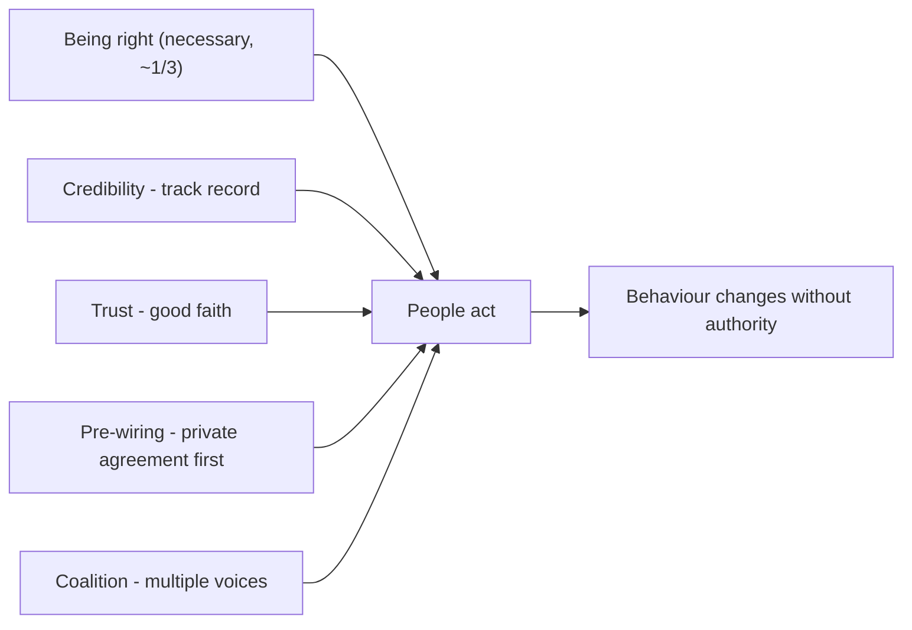

# Part 86 — Influence, Communication and the Business Case

A senior engineer's power comes from what they can build. A principal engineer's power comes from what they can convince others to build, change, fund, or stop. This is a harder kind of power, because you rarely have authority over the people whose behaviour needs to change — they do not report to you, and you cannot order them. You have to influence them. And the people you most need to influence — executives, finance, product leaders — do not speak your language and do not care about your elegant architecture; they care about revenue, risk, cost, and time. Learning to influence without authority, and to translate engineering into the language of the business, is the skill that turns a brilliant engineer into an effective principal.

Part 57.10 covered incident communication; Part 58.4 covered writing at staff level and the mechanics of cross-team influence. This Part goes deeper on the whole discipline of influence and communication: influencing without authority, mapping stakeholders, communicating with executives, building a business case with real numbers, making tradeoffs visible, disagreeing well, saying no and negotiating scope, presenting to mixed audiences, and running decision forums. The through-line is that engineering excellence is necessary but not sufficient; the ability to move people and translate value is what makes it count.

The reader this Part assumes is a strong senior or staff engineer who is often right and often ignored, and wants to understand why being right is not enough and what the rest of the skill is.

## 86.1 Influencing without authority

#### Concept

Influencing without authority is getting people who do not report to you to change what they do — adopt your standard, prioritise your project, stop doing a thing — through means other than command. The means are credibility (people trust your judgement), trust (people believe you act in good faith), pre-wiring (you build agreement privately before going public), and coalitions (you gather allies so you are not a lone voice). These are learnable mechanics, not charisma. A principal engineer's entire job depends on them, because their scope is always larger than their authority.

#### Why does it exist?

Imagine being technically right about a cross-team architecture problem — say, that four teams are building four incompatible event schemas and it will cause chaos. You have no authority over those four teams. You write the correct analysis and send it to them. Nothing happens, because being right does not make people act; they have their own priorities, their own pride, and no reason to do what a person with no authority over them says. Your correctness is invisible to the forces that actually move teams.

Influence-without-authority mechanics exist because this is the normal situation for a principal engineer: the problems worth solving span teams you do not control, and the only way to solve them is to move people who do not have to listen to you. The mechanics — credibility, trust, pre-wiring, coalitions — are how you convert being right into people acting, which is the only thing that matters.

#### Mental model

Imagine two people trying to get a group to take a new route on a hike. The first stands at the front and announces, with perfect map-reading, that the new route is objectively better, and is baffled when nobody follows. The second has, over previous hikes, built a reputation for good calls (credibility), is known to care about the group's comfort not just being right (trust), quietly talked to the two most influential hikers before suggesting it (pre-wiring), and has those two nodding along when she proposes it (coalition). The group takes her route. Both had the same correct map. The difference is that the second understood that people follow trust and social proof, not maps. Influence without authority is being the second hiker: the map matters, but it is maybe a third of it.

#### How it works

The four mechanics:

**Credibility.** People extend trust to your judgement in proportion to your track record. Credibility is earned by being right before (especially about hard calls), by shipping (delivery renews credibility, per Part 58), and by admitting when you are wrong (which paradoxically increases credibility, because it shows you are honest). Credibility is capital: you spend it when you ask people to do something, and you earn it by being right and delivering.

**Trust.** Distinct from credibility. Credibility is "I believe your judgement is good"; trust is "I believe you are acting in good faith, not just for yourself". You build trust by giving credit away (Part 58.4), by advocating for others' interests not just your own, and by being consistent — doing what you said you would. People will go along with someone they trust even when they are not sure the person is right, because they believe the intent is good.

**Pre-wiring.** Building agreement privately before any public proposal (Part 58.4, Part 81.4). You talk one-on-one to the people who could block or who are most affected, before the idea goes wide. Either they change your mind (saving a public failure) or you incorporate their concerns and they become supporters. Public proposals that were not pre-wired mostly die in the open.

**Coalitions.** Gathering allies so your proposal has multiple voices, not just yours. A good idea backed by one person is fragile; the same idea backed by a coalition of respected people across teams is hard to ignore. You build coalitions by pre-wiring, by aligning your proposal with others' interests, and by giving them a stake in it.



The key realisation: being right is roughly a third of influence. The other two-thirds is credibility, trust, framing, timing, pre-wiring, and coalitions. Engineers who believe correctness is sufficient are perpetually frustrated; those who learn the mechanics get their correct ideas adopted.

#### Practical example

A staff engineer sees the four-incompatible-event-schemas problem. The ineffective approach (being right at people): write the correct analysis, send it to all four teams, wait for them to see reason. Nothing happens. The effective approach (the mechanics): first, she establishes credibility by having shipped a related standard that worked. She pre-wires: she talks one-on-one to the lead of each of the four teams, starting with the most influential, framing the problem in terms of *their* pain (the integration bugs each team is already hitting), not her architectural preference. Two leads immediately agree because she named a pain they feel; she incorporates the third lead's concern into the proposed standard, turning him into a supporter; the fourth, seeing a coalition of three respected leads already aligned, goes along. By the time she proposes the shared event-schema standard publicly, it has four backers and passes easily. The analysis was the same in both approaches; the difference was using credibility, trust, pre-wiring, and coalition-building to convert being right into people acting.

#### Artifact example

An influence plan for a cross-team initiative — the artifact a principal engineer uses to convert a correct idea into adopted change.

```markdown
# Influence plan: adopt a shared event-schema standard (4 teams)

## The change I need
4 teams adopt one event-schema standard (schema registry + conventions).
I have NO authority over them. Being right is ~1/3 of this.

## Credibility I'm drawing on
I shipped the error-format standard last year; it worked and teams liked it.
I'll reference that track record.

## Stakeholder map + pre-wiring order (most influential / most affected first)
| Person | Stance | Their pain (frame in THEIR terms) | Pre-wire plan |
|---|---|---|---|
| Lead A (most respected) | likely ally | integration bugs cost her team a day/week | 1-1 first; make her a co-sponsor |
| Lead B | neutral | schema drift broke his consumer twice | 1-1; show how standard prevents it |
| Lead C | likely skeptic | worried about migration cost | 1-1; incorporate his concern, offer help |
| Lead D | follower | will go with the group | reach last, once A/B/C aligned (coalition) |

## Framing (THEIR language, not mine)
NOT "we should have architectural consistency." INSTEAD "each of you is
losing time to integration bugs and schema drift; a shared standard + registry
makes those bugs impossible and I'll do the migration work with you."

## Coalition
Target: Leads A, B, C aligned privately BEFORE any public proposal. Then
propose publicly with 3 co-sponsors. D follows. Nobody is ambushed.

## What I give away
Credit to Lead A as co-sponsor. Offer to do the migration work for the
skeptical team. Trust is built by serving their interests, not just mine.
```

The plan's power is that it treats influence as a deliberate, planned activity: it names the credibility being drawn on, maps stakeholders by stance and *their* pain, sequences the pre-wiring most-influential-first, frames everything in the stakeholders' language rather than architectural ideals, and builds a coalition before going public. This is what converts a correct idea into adopted change — being right is assumed; the plan is about the other two-thirds.

#### Real-world scenario

A principal engineer is known for getting cross-team initiatives adopted at a far higher rate than his equally-talented peers. Colleagues assume he is more persuasive or more senior. The real difference is that he treats influence as a craft with a process, while they treat being right as sufficient. Before any cross-team proposal, he spends a week pre-wiring — one-on-one conversations with every person who could block or who is affected, always framing the proposal in terms of their pain, always starting with the most influential. By the time he proposes anything publicly, it already has a coalition of backers and every major objection has been privately resolved. His peers, in contrast, bring correct proposals cold to large meetings, where they get ambushed, picked apart, and die. Same correctness, same seniority; the difference is that he does the invisible two-thirds of influence (credibility, pre-wiring, coalitions) and they rely on the visible one-third (being right). Over years, this compounds: he is seen as the person who gets things done across teams, which itself builds credibility, which makes the next initiative easier. Influence is a flywheel, and he turns it deliberately.

#### Failure scenario

A brilliant engineer, correct about nearly everything, is consistently ignored and increasingly bitter. He has strong, well-reasoned opinions and delivers them forcefully, usually for the first time in a large meeting, in engineering language, to an audience that includes people who do not operate the systems. He treats disagreement as a failure of the other person to understand the obvious, so he argues harder, which makes people defensive, which makes them dig in. He never pre-wires, because he believes a correct argument should not need private lobbying. He takes all the credit for his ideas, so nobody feels a stake in them. He fights equally hard about formatting and about data-loss risks, so people have learned to discount everything he says. The result is a person who is right about the technical substance and has almost zero influence, watching less-correct but more-skilled colleagues shape the direction he wishes he could. His failure is believing the entire one-third (being right) is the whole thing, and neglecting the two-thirds (credibility management, trust, framing, timing, pre-wiring, coalitions) that actually move people. Being right is necessary and nowhere near sufficient, and an engineer who refuses to learn the rest caps their impact permanently, no matter how good their judgement.

#### Edge cases & failure modes

- **Believing being right is sufficient.** Correctness is ~1/3 of influence; relying on it alone produces a frustrated, ignored expert.
- **No pre-wiring.** Bringing proposals cold to public forums, where they get ambushed and die.
- **Framing in your language, not theirs.** Arguing architectural ideals to people who care about their own pain, revenue, or risk.
- **Taking all the credit.** Nobody feels a stake in your ideas, and trust (the good-faith kind) never builds.
- **Fighting every point equally.** If you argue as hard about trivia as about real risks, people discount everything you say.
- **Spending credibility recklessly.** Pushing hard on too many things, or being wrong after being loud, depletes the capital you need for the important asks.

#### How a Principal Engineer thinks about this

They treat influence as a craft with learnable mechanics, not as charisma or seniority, and they internalise that being right is only about a third of it — the rest is credibility, trust, framing, timing, pre-wiring, and coalitions. They manage their credibility as capital: they spend it carefully on the asks that matter, they renew it by shipping and by being right about hard calls, and they protect it by not being loud about things they are unsure of. They build trust (the good-faith kind) deliberately by giving credit away and advocating for others' interests, because they know people go along with someone they trust even when unsure they are right.

They pre-wire as a reflex, never bringing a consequential proposal cold to a public forum, because they have watched too many correct ideas die in ambushes. They frame everything in the audience's language — the stakeholders' pain, the business's numbers — not in architectural ideals, because people act on their own concerns, not yours. And they are disciplined about which battles to fight, because they know that fighting trivia as hard as substance teaches people to discount them. The principal's distinctive skill is not being more right than others; it is doing the invisible two-thirds that turns being right into people acting.

#### Common mistakes

- **Relying on being right** and neglecting the two-thirds of influence that actually moves people.
- **Never pre-wiring,** so proposals are ambushed in public forums.
- **Framing in engineering ideals** instead of the audience's pain and interests.
- **Hogging credit,** so nobody has a stake in your ideas and trust never builds.
- **Fighting every point with equal force,** teaching people to discount you.

#### Interview questions

1. **You're technically right about a cross-team problem but you're being ignored. What's going on and what do you do?**
   *Expected answer:* being right is only ~1/3 of influence; you likely lack pre-wiring, coalition, and framing in the stakeholders' terms. Build credibility (track record), pre-wire the key people one-on-one framing it in their pain, incorporate objections to turn skeptics into supporters, and go public only with a coalition behind you. *Why it matters:* this is the core principal skill — converting correctness into action.

2. **What is the difference between credibility and trust, and why do both matter for influence?**
   *Expected answer:* credibility is "your judgement is good" (earned by track record, shipping, admitting errors); trust is "you act in good faith" (earned by giving credit away, advocating others' interests, consistency). Both matter because people act on credibility (they believe you are right) and trust (they believe your intent is good), and trust carries you even when they are unsure you are right. *Follow-up:* how would you build trust with a team that is wary of you.

3. **Why do experienced influencers pre-wire instead of bringing proposals straight to a meeting?**
   *Expected answer:* a cold proposal in a public forum invites ambush — affected people feel surprised and defend their territory with every objection, and the idea dies; pre-wiring resolves major objections privately (where nobody loses face), turns skeptics into supporters, and builds a coalition so the public proposal is a ratification, not a battle. *Why it matters:* tests the single most practical influence mechanic.

#### Practical exercise

Take a cross-team change you want to make but have no authority to mandate. Write the influence plan: the credibility you are drawing on, a stakeholder map (each person's stance and their pain in their terms), the pre-wiring order (most influential/affected first), the framing in the stakeholders' language rather than architectural ideals, and the coalition you will build before going public. Note what you will give away (credit, help) to build trust.

**Acceptance criteria:** your plan assumes being right is necessary but insufficient and focuses on the other two-thirds; it maps stakeholders by stance and frames the change in each one's actual pain or interest (not your architectural preference); it sequences pre-wiring to build a coalition before any public proposal; and it identifies concrete things you will give away (credit, migration help) to build the good-faith trust that carries influence.
