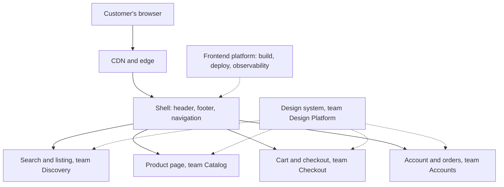
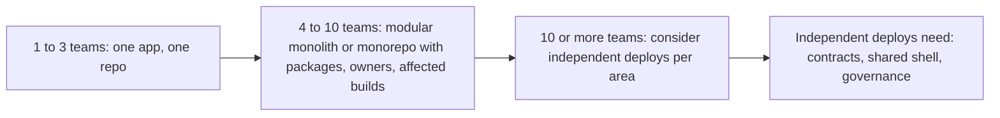
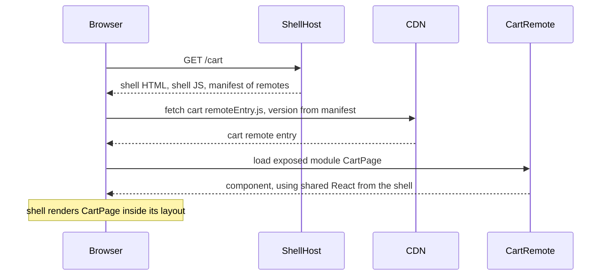
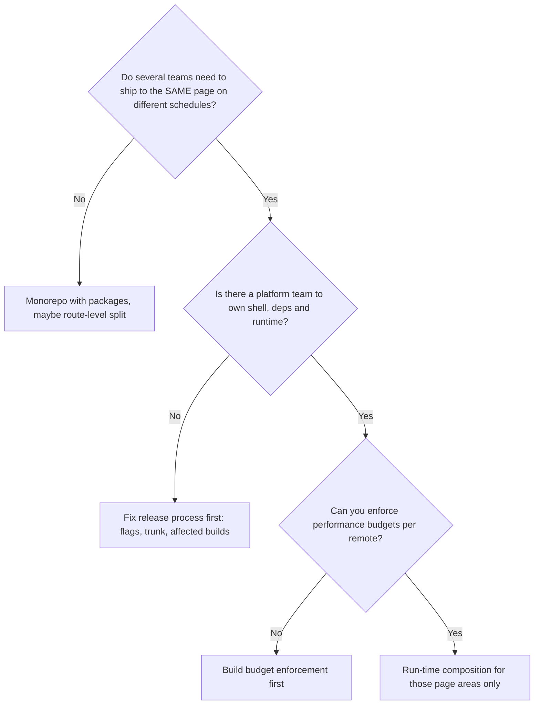

# Part 86 — Frontend Architecture at Scale

Parts 75 to 85 taught one team building one frontend well: the browser, the build tools, React, data fetching, Next.js, contracts with the backend, browser security, performance, testing, shipping and a worked full-stack project. This Part is about what happens when that frontend is no longer one team's. A large e-commerce site is built by fifteen or more teams: search, product pages, cart, checkout, accounts, seller tools, content, marketing, payments. They share one domain, one brand, one header, one performance reputation and one set of customers who do not care which team built which pixel.

At that scale the hard problems are no longer "how does `useEffect` work?" They are: how do fifteen teams deploy without waiting for each other; who owns the header; why does the product page ship three copies of React; why did a marketing tag break checkout; why is the design system two years behind on half the pages; and how do you migrate a seven-year-old single-page app without stopping feature work. This Part gives you architecture styles with honest trade-offs, the governance that keeps a shared frontend coherent, and the migrations that get you from where you are to where you want to be.

It assumes Part 76 — Frontend Tooling and TypeScript in the Browser (especially 76.9 on monorepos), Part 80 — Frontend–Backend Contracts, Part 82 — Web Performance, and Part 84 — Shipping and Operating Frontends. Those Parts explain the mechanisms; this one is about choosing between them for an organisation.



## 86.1 What changes when ten or more teams share a frontend

#### Concept

A frontend becomes an architecture problem, not just a code problem, when the number of teams contributing to it outgrows the coordination a single codebase and a single release can absorb. In practice the strain shows somewhere between five and ten teams, and by fifteen it dominates. The code may be fine. What breaks is **coordination**: who may change what, who waits for whom, who is woken at night, and who decides.

#### Why does it exist?

One team can hold a frontend in their heads: they know the routes, the shared components, the release schedule and the performance budget. With fifteen teams, nobody knows everything, every change risks someone else's page, and the shared parts (header, design system, build pipeline, dependency versions) become contested ground. The same forces that pushed backends towards services (see Part 92 — Org Design, Conway's Law and Platform Engineering, 92.1) push on the frontend, with one difference that changes everything: **the customer sees the frontend as one product**. A backend can be twelve services behind one API; a frontend that looks and behaves like twelve products has failed.

#### Mental model

Imagine a shopping mall. One shop can rearrange its shelves whenever it likes. A mall with forty shops needs rules: shared corridors and signage, opening hours, fire exits, a common look at the entrance, and a way to stop one shop's loud music from driving customers out of the whole building. Each shop still decorates its own interior. Frontend architecture at scale is designing the mall: what is shared, what each shop owns, and what rules everyone follows.

#### How it works

The symptoms arrive in a predictable order:

| Symptom | What it looks like | Root cause |
|---|---|---|
| Release queue | A weekly release train; a bug in one team's feature holds everyone's | One deployable unit |
| Merge pain | Conflicts in shared files (routes, store, theme) every day | Shared mutable code without owners |
| Slow CI | 40-minute pipelines because every change builds and tests everything | No dependency graph or caching |
| Inconsistent UI | Five button styles, three date pickers | Design system not adopted or not maintained |
| Performance drift | LCP creeps up 100 ms a quarter; nobody's change is "the" cause | No budget with owners |
| Error noise | One shared error tracker with 4,000 issues, none owned | No error ownership |
| Upgrade paralysis | Still on an old React major because one corner of the app cannot move | Coupled dependency versions |

Each later section addresses one row. The order matters: most organisations reach for an architecture change (micro-frontends) to fix the first row, when the cheaper fixes for rows two, three and five would have done more.



#### How a Senior Backend Engineer thinks about this

A senior names the specific pain before naming a solution. "Checkout cannot ship on Tuesday because search's release is broken" is a release-coupling problem with several solutions; "we need micro-frontends" is a solution looking for a problem. They also remember that the customer experiences one product, so anything that makes teams more independent must come with something that keeps the product coherent: a shared shell, a design system, budgets and contracts.

## 86.2 Architecture styles for a shared frontend

#### Concept

There are five main styles for structuring a frontend that many teams build, ordered roughly from most to least coupled:

1. **Modular monolith frontend.** One application, one build, one deploy, organised internally into modules with clear boundaries and owners.
2. **Monorepo with packages.** One repository with many packages (feature packages, the design system, shared utilities) and possibly several applications; built with a task runner that understands the graph.
3. **Micro-frontends with build-time composition.** Each team publishes its part as a versioned package; a host application installs them and builds one bundle.
4. **Micro-frontends with run-time composition.** Each team builds and deploys its part independently; the page assembles them in the browser at run time (Module Federation, import maps, single-spa, web components, iframes).
5. **Server or edge composition.** Each team's service renders HTML fragments or whole routes; a server, an edge worker or the CDN stitches them together, or simply routes each URL path to a different application.

#### Why does it exist?

Each style trades **team independence** against **product coherence, performance and simplicity**. The modular monolith is the most coherent and the simplest, but every team ships together. Run-time micro-frontends give the most independence and the most moving parts. No style is best; there is a best style for a given number of teams, rate of change and tolerance for operational complexity.

#### How it works

**Modular monolith.** Code is organised by domain (`src/domains/checkout`, `src/domains/search`), each with a public entry point; lint rules forbid deep imports across domains; CODEOWNERS assigns each folder to a team. One pipeline builds and deploys. With good tests and trunk-based development with feature flags (see Part 84 — Shipping and Operating Frontends, 84.5), many organisations ship several times a day this way with 50 or more engineers.

**Monorepo with packages.** The same idea with stronger walls: each domain is a workspace package with its own `package.json`, tests and build; the task runner (Turborepo, Nx; see Part 76 — Frontend Tooling, 76.9) builds only what a change affects and caches the rest. There may be several deployable apps (storefront, seller portal, admin) sharing packages. Deployment can still be one app per URL space.

**Build-time micro-frontends.** Team packages are published to a private registry with versions; the host pins versions and rebuilds. This gives code isolation but not deployment independence: to ship, a team publishes and then the host must upgrade and deploy. It is often the worst of both worlds, with version-bump pull requests piling up in the host, and it is rarely recommended today except for genuinely shared libraries.

**Run-time micro-frontends.** The host (or **shell**) loads each team's code from that team's deployment at run time:



- **Module Federation** (introduced in webpack 5, now also in Rspack and available for Vite through plugins, with a newer runtime maintained by the Module Federation project) lets a **remote** build expose modules and a **host** consume them at run time, sharing dependencies such as React as **singletons** so only one copy loads. At concept level the configuration looks like this:

```ts
// webpack.config.ts of the cart remote (concept-level; check the plugin docs for your version)
import { container } from 'webpack';

export default {
  // ...entry, output and loaders omitted
  plugins: [
    new container.ModuleFederationPlugin({
      name: 'cart',
      filename: 'remoteEntry.js',                  // the file the host loads at run time
      exposes: { './CartPage': './src/CartPage' }, // the public surface of this remote
      shared: {
        react: { singleton: true, requiredVersion: '^18.3.0' },
        'react-dom': { singleton: true, requiredVersion: '^18.3.0' },
        '@shop/design-system': { singleton: true, requiredVersion: '^7.0.0' },
      },
    }),
  ],
};
```

- **Import maps** are a browser standard that maps bare module names to URLs, so `import 'cart'` resolves to whatever URL the map says; changing the map (served by the shell) deploys a new version without rebuilding the host.
- **single-spa** is a framework that registers applications against routes and mounts or unmounts them, framework-agnostic.
- **Web components** (custom elements) let each team ship a framework-neutral element such as `<shop-cart-summary>`; useful as an integration boundary when teams use different frameworks.
- **Iframes** give the strongest isolation (separate document, JavaScript and CSS, and with a different origin, a security boundary), at the cost of layout, accessibility, routing and performance pain. They are the right tool for embedding third-party or untrusted content and for hard isolation such as a payment form, and the wrong tool for composing your own product.

**Server and edge composition.** The page is assembled before it reaches the browser:

- **Route-level split (multi-app routing).** The simplest and most underrated form: `/search/*` goes to the search team's app, `/checkout/*` to the checkout team's app, routed by the CDN, a reverse proxy or framework support such as Next.js Multi-Zones. Each team deploys independently; the shared header and footer come from the design system package or a fragment. Navigating between areas is a full page load, which, with server rendering and good caching, is often perfectly fast.
- **Fragment composition.** A layout service or edge worker fetches HTML fragments from several teams' services and stitches them into one page (Edge Side Includes at the CDN, or a composition layer; open-source examples include Podium and Tailor). Good for content-heavy pages with several owners, at the cost of a composition service on the critical path.

#### Decision table

| Factor | Modular monolith | Monorepo with packages | Run-time micro-frontends | Route-level split | Fragment composition |
|---|---|---|---|---|---|
| Independent deploys | No | Per app | Yes, per fragment | Yes, per route area | Yes, per fragment |
| Consistent UX | Easiest | Easy | Hard, needs strong governance | Medium (shared shell package) | Medium |
| Performance risk | Lowest | Low | Highest (duplicate deps, waterfalls) | Low per area; full loads between areas | Medium (composition on critical path) |
| Operational complexity | Lowest | Low to medium | Highest | Medium | High |
| Mixed frameworks | No | Rarely | Possible | Yes | Yes |
| Typical fit | Up to about 8 teams, one product | 5 to 20 teams, several apps | Many teams on the same page, separate release cadences | Many teams owning distinct journeys | Content pages with many owners |

#### How a Senior Backend Engineer thinks about this

A senior treats run-time composition as the last resort, not the default. The two cheapest wins for team independence are usually a monorepo with affected builds (CI time drops, teams stop waiting) and a route-level split where journeys are genuinely separate (search, checkout and accounts rarely need to share a page). Run-time composition earns its place when several teams must contribute to the **same page** on **different release cadences**, and the organisation can afford the governance that keeps that page fast and consistent.

## 86.3 When not to use micro-frontends

#### Concept

Micro-frontends are an organisational tool: they let teams deploy parts of a frontend independently. They do not make code better, pages faster or developers happier by themselves. They are the wrong choice more often than the right one, and a senior should be able to say no with reasons.

#### Why does it exist?

The pattern became fashionable, and many teams adopted it to solve problems it does not solve: slow builds (fix with caching and affected builds), messy code (fix with module boundaries), inconsistent UI (micro-frontends make this worse), or a desire to use a new framework (a migration problem, not an architecture). The costs are real and paid every day: more repositories or pipelines, version negotiation for shared dependencies, run-time failures that a single build would have caught at compile time, and pages that load more JavaScript.

#### How it works

Do not use run-time micro-frontends when:

1. **You have fewer than about five or six teams on the frontend.** The coordination cost they remove is smaller than the platform cost they add.
2. **The problem is build speed or CI time.** A monorepo with remote caching and affected builds fixes this directly.
3. **The problem is code quality or boundaries.** Lint-enforced module boundaries fix this without a network hop.
4. **Teams do not own distinct parts of the page.** If three teams edit the same component every week, splitting the deployment only moves the conflict to run time.
5. **Performance is a top business metric and you have no budget enforcement.** Each remote is a chance to load another copy of a library or add a request waterfall.
6. **There is no platform team.** Someone must own the shell, the shared dependency policy, the composition runtime, the manifests and the local development experience.
7. **You want to rewrite in another framework.** Run two frameworks during a migration if you must (86.14), but do not make permanent polyglot frontends a goal.



#### Failure scenario

A retailer with four frontend teams split its single-page app into eleven micro-frontends over nine months, one per feature area, each in its own repository with its own pipeline. Shared dependencies were declared but not enforced as singletons. Within a year the product page loaded two versions of React (one remote had pinned an older minor), three date libraries and two copies of the design system with slightly different button colours. LCP on mobile went from 2.4 s to 3.9 s, and conversion on mobile fell measurably. Local development required running six services. Two of the four teams spent more time on platform glue than on features. The company merged the remotes back into a monorepo with three route-level applications (86.14 describes the consolidation); release independence was preserved by feature flags and per-app pipelines, and LCP returned to 2.3 s.

#### How a Senior Backend Engineer thinks about this

A senior asks for the evidence: the release queue length, the CI time, the number of teams touching each page, and the conversion cost of a slower page. If those numbers do not show that release coupling on shared pages is the dominant cost, they recommend the monorepo, boundaries, flags and route-level splits first, and they are comfortable saying "not yet" to an architecture that would take a year to adopt and longer to undo.

#### Common mistakes

- One micro-frontend per component or per team rather than per page area that changes independently.
- Letting each remote choose its own framework and dependency versions "for autonomy".
- Composing on the client what could be routed at the edge with full page loads.
- Adopting the pattern without a shell owner, then discovering that nobody owns the header, authentication or error boundary.
