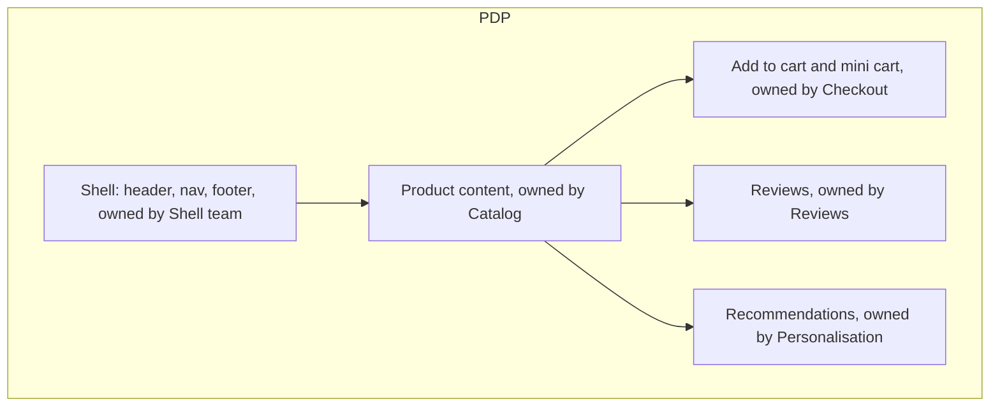
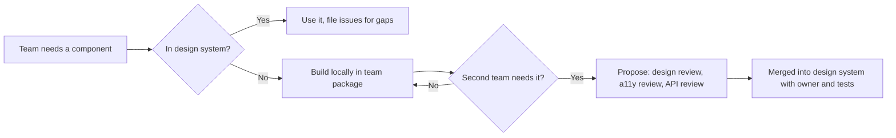
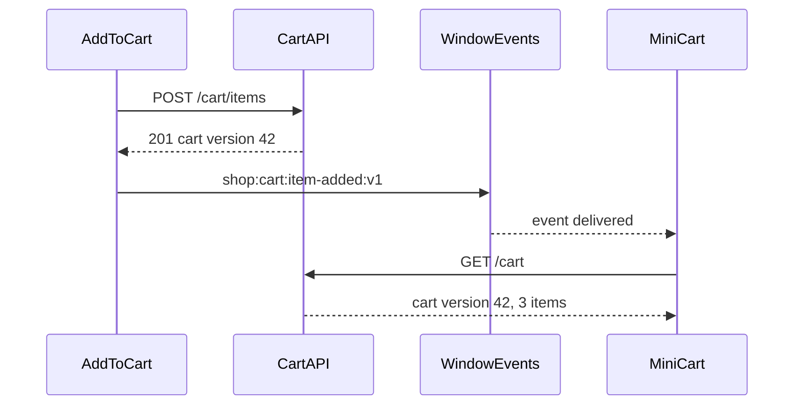

## 86.4 Boundaries and ownership

#### Concept

A **boundary** in a frontend is a line in the code, the URL space or the page across which one team's work ends and another's begins, with an explicit interface across it. **Ownership** means a named team is accountable for everything inside a boundary: the code, its tests, its errors in production, its performance and its accessibility. Good boundaries follow **business domains and user journeys** (search, product, cart, checkout, account), and usually map to **routes** first and **page regions** second.

#### Why does it exist?

Without boundaries, every team edits every file, and two things happen. Changes collide, so teams slow down to coordinate. And nothing has an owner, so errors, regressions and slow pages belong to everyone, which means to no one. Conway's Law (see Part 92 — Org Design, Conway's Law and Platform Engineering, 92.1) says the frontend will mirror the communication structure of the teams anyway; drawing the boundaries deliberately means the structure you get is the one you chose.

#### Mental model

Imagine a newspaper's front page. The sports editor owns the sports column, the business editor owns the markets box, and the front-page editor owns the layout, the masthead and the space each section gets. Nobody rewrites another section's article; they negotiate space through the front-page editor. A frontend page works the same way: domain teams own regions, the shell team owns the layout and the frame, and the interface between them is agreed.

#### How it works

Draw boundaries in three layers, from coarse to fine:

1. **Routes.** Assign URL spaces to teams: `/search` and `/c/*` to Discovery, `/p/*` to Catalog, `/cart` and `/checkout/*` to Checkout, `/account/*` to Accounts. A route owner owns the page's performance and errors.
2. **Page regions.** On shared pages, assign regions: on the product page, Catalog owns the main content, Reviews owns the reviews block, Recommendations owns the carousel, Checkout owns the add-to-cart button and mini cart. Each region has a contract: the props or events it accepts, the data it loads itself and the space it may take (a reserved height to prevent layout shift).
3. **Shared layers.** The shell (header, footer, navigation, authentication state, error boundary, analytics bootstrap) belongs to a platform or shell team; the design system belongs to a design platform team; build, deploy and observability tooling belongs to the frontend platform team.



Encode ownership in tools, not in a wiki:

```text
# .github/CODEOWNERS (last matching pattern wins)
*                                   @shop/frontend-platform
/apps/storefront/src/routes/search/ @shop/discovery
/apps/storefront/src/routes/p/      @shop/catalog
/packages/checkout-*/               @shop/checkout
/packages/reviews-widget/           @shop/reviews
/packages/design-system/            @shop/design-platform
/apps/storefront/src/shell/         @shop/shell
```

The same ownership map should drive error routing (86.11), performance budgets (86.10) and the service catalog, so that "who owns this?" has one answer everywhere.

#### Production scenario

On a large storefront, a single shared `ProductCard` component was edited by six teams over a year: search added badges, recommendations added a compact variant, marketing added a promotional ribbon, catalog changed image sizes. Each change was reasonable; together they produced a component with 23 props and a layout shift on every listing page. Assigning it to the design platform team as a design-system component, with the six teams as consumers who request changes through the design system's process (86.5), cut the props to nine and fixed the shift.

#### How a Senior Backend Engineer thinks about this

A senior aligns boundaries with the team structure that exists, or with the one that is planned, and changes both together. They prefer route boundaries because they are cheap and obvious; they accept region boundaries on a few high-value shared pages; and they make every shared thing either a design-system component with an owner or a piece of the shell with an owner. "Shared by everyone" is not an owner.

#### Common mistakes

- Boundaries by technical layer (a "components team", an "API layer team") rather than by domain, which makes every feature a cross-team project.
- Region boundaries with no space contract, so one team's late-loading widget pushes another team's content down.
- CODEOWNERS that lists individuals who have left, leaving reviews blocked or unreviewed.

## 86.5 Design systems as products

#### Concept

A **design system** is the shared set of design decisions and code that makes many teams' work look and behave as one product: **design tokens** (named values for colour, spacing, typography, radius, motion), **components** (buttons, inputs, dialogs, product cards) with documented behaviour and accessibility, **patterns** (forms, empty states, error messages), and the **process** for changing all of them. At scale it must be run as a **product**: it has customers (the product teams), a roadmap, versions, support, adoption metrics and a team accountable for it.

#### Why does it exist?

Without a design system, fifteen teams build fifteen buttons. Each re-solves focus states, keyboard navigation, loading states and right-to-left layouts, most of them incompletely. The brand drifts. Accessibility becomes a per-team gamble. And a rebrand or a new dark mode becomes a project touching every file. A design system that teams actually use makes the right thing the easy thing: the accessible, on-brand, tested component is the one already imported.

#### Mental model

Imagine a set of building standards and prefabricated parts for a housing estate. Doors, windows and staircases come from the factory already meeting the fire code and the accessibility rules. Builders can still design different houses, but they do not each invent a staircase. When the code changes, the factory updates the part, and every new house gets it. If the factory is slow or its parts do not fit, builders start making their own, and the estate stops looking like one place.

#### How it works

**Tokens first.** Tokens are the design system's lowest layer and its most powerful lever: change `color.action.primary` once, and every component and every team that uses it follows. Keep three tiers: **primitive** tokens (`blue.600 = #1F5FD6`), **semantic** tokens (`color.action.primary = {blue.600}`), and occasionally **component** tokens (`button.primary.background = {color.action.primary}`). Teams use semantic tokens; themes (dark mode, a sub-brand) remap semantic to different primitives. Tools such as Style Dictionary transform a token source file (the W3C Design Tokens Community Group format is the emerging standard) into CSS custom properties, TypeScript constants and native platform values.

```json
{
  "color": {
    "action": {
      "primary":  { "$type": "color", "$value": "{color.blue.600}" },
      "critical": { "$type": "color", "$value": "{color.red.600}" }
    },
    "text": {
      "default":  { "$type": "color", "$value": "{color.grey.900}" },
      "subtle":   { "$type": "color", "$value": "{color.grey.600}" }
    }
  },
  "space": {
    "2": { "$type": "dimension", "$value": "8px" },
    "4": { "$type": "dimension", "$value": "16px" }
  }
}
```

**Components with accessibility built in.** Each component ships with keyboard behaviour, focus management, ARIA roles and colour contrast handled, so consuming teams cannot easily get them wrong. Many design systems build on headless, accessibility-focused primitives (React Aria, Radix UI, or similar) and add the brand on top. Every component's documentation (usually in Storybook) shows usage, do and don't examples, and the accessibility contract. Automated checks run in the design system's CI: axe on every story (see Part 83 — Frontend Testing and Quality, 83.10) and **visual regression** snapshots on every state, so an unintended visual change fails the build (83.9).

**Versioning.** Publish the design system as versioned packages with semantic versioning. Use a tool such as Changesets to record changes per pull request and generate changelogs. Rules that work at scale:

- **Patch and minor releases must be safe to take without reading the changelog.** Visual changes that alter layout are at least minor and are announced.
- **Majors are rare (one or two a year), batched, and come with codemods** that rewrite consumer code automatically (for example with jscodeshift), plus a deprecation period in which the old API warns in development.
- **Support window:** the current major and the previous one receive fixes; older majors receive nothing. Publish the dates.

**Governance and contribution.** A small core team cannot build every component fifteen teams need, and fifteen teams cannot all edit the core. A common model: the core team owns foundations (tokens, primitives, top 30 components); product teams may contribute new components through a proposal, a design review and a code review against a checklist; components used by only one team stay in that team's package until a second team needs them.



**Adoption as a metric.** Measure what fraction of the product uses the system, not how many components it has. Practical measures: share of UI components on each route coming from the design system (a static scan of imports), number of distinct design-system versions in production (fewer is better), and count of hard-coded colours and spacing values (a lint rule can count raw hex colours). Publish the numbers per team.

#### Production scenario

A storefront's design system served 14 teams. A scan found five majors in production at once; two teams were four majors behind because each upgrade had broken their layouts. The design platform team changed three things: a codemod for every breaking change, a rule that every major is tested against the top 20 routes with visual regression before release, and an "upgrade week" each quarter in which the design platform team pairs with lagging teams. A year later, production ran at most two majors, and a dark-mode launch took one quarter because it was a token change rather than a rewrite.

#### Failure scenario

A design system team shipped a minor release that changed the default `Button` from `display: inline-flex` to `display: flex` to fix an alignment bug. It was announced as a fix. Within a day, buttons on the checkout page stretched to full width on desktop and the "Place order" button wrapped onto a new line below the fold on small laptops; checkout completion dropped until the team rolled back. The visual regression suite covered the design system's own stories but not the consuming pages. The fix: visual regression on the top consumer routes as part of the design system's release pipeline, and a rule that any change to layout-affecting CSS on a base component is at least a minor release with an explicit note.

#### How a Senior Backend Engineer thinks about this

A senior sees the design system the way they see a public API: consumers depend on its behaviour, not on its intentions; breaking changes need versioning, migration tooling and a deprecation window; and adoption is earned by being the easiest path, not by mandate (see Part 90 — Architecture Governance, Standards and Paved Roads, 90.2). They fund it as a product with a team, measure adoption and version spread, and make accessibility a property of the components rather than a responsibility of each consumer.

#### Common mistakes

- Treating the design system as a component library side project staffed by volunteers.
- Huge, infrequent majors without codemods, so teams never upgrade.
- Components that accept a `className` and a `style` override for everything, which turns the system into a suggestion.
- Measuring success by number of components rather than by adoption and consistency.

## 86.6 Shared state and cross-app communication

#### Concept

When several teams' code runs on the same page, some information must cross boundaries: who the user is, what is in the cart, the selected currency and language, feature flags, consent choices. **Shared state** is information many parts read; **cross-app communication** is how one part tells others that something happened ("item added to cart"). At scale the design goal is to share **as little as possible**, through **narrow, versioned contracts**, and to treat the server as the source of truth.

#### Why does it exist?

The default in a single app is one global store (Redux, Zustand, a React context) that any component can read and write. Across teams and independent deploys, a shared global store becomes a hidden contract: one team renames a field, another team's widget breaks at run time, and no compiler noticed because the two were built separately. Communication also needs to survive one part being slow, failing to load or being on an older version.

#### Mental model

Imagine flatmates sharing a house. They share a few things deliberately: the front-door key, the electricity meter, a whiteboard by the door for messages ("milk finished"). They do not share wardrobes. If someone wants to know whether there is milk, the fridge (the server) is the truth; the whiteboard only says that something changed and you might want to look.

#### How it works

Use the narrowest mechanism that works, in this order:

1. **The URL.** Search terms, filters, selected variant, pagination: put them in the URL. It is shared, bookmarkable, survives reloads and needs no contract beyond the route.
2. **The server as source of truth, with each part fetching what it needs.** The cart count in the header and the cart page both read the cart from the cart API, cached by a data-fetching library (see Part 78 — Client State, Data Fetching and Caching). Two widgets asking for the same resource get deduplicated requests, not shared mutable state.
3. **A tiny shell-provided context for genuinely global values.** User identity (ID and display name, not tokens), locale, currency, feature flags and consent state, exposed by the shell through a typed, versioned interface. Read-only for remotes; changes go through shell functions.
4. **Events for "something happened".** Browser `CustomEvent`s on `window`, or a small typed event bus provided by the shell, with versioned event names and payloads. The publisher does not know who listens.

```ts
// packages/shell-contracts/src/events.ts: the only cross-team event contract, versioned with the package
export interface CartItemAddedV1 {
  version: 1;
  sku: string;
  quantity: number;
  cartId: string;
}

export const CART_ITEM_ADDED = 'shop:cart:item-added:v1' as const;

export function publishCartItemAdded(detail: CartItemAddedV1): void {
  window.dispatchEvent(new CustomEvent<CartItemAddedV1>(CART_ITEM_ADDED, { detail }));
}

export function onCartItemAdded(handler: (e: CartItemAddedV1) => void): () => void {
  const listener = (ev: Event) => handler((ev as CustomEvent<CartItemAddedV1>).detail);
  window.addEventListener(CART_ITEM_ADDED, listener);
  return () => window.removeEventListener(CART_ITEM_ADDED, listener); // always return an unsubscribe
}
```

The product page's add-to-cart button (owned by Checkout) calls the cart API, then publishes `CartItemAddedV1`; the header's mini cart (owned by the Shell team) listens and **refetches the cart from the server** rather than trusting the event's payload as state. If the header remote failed to load, nothing breaks; if the event is missed, the next navigation shows the right count anyway.



#### Edge cases & failure modes

- **Event before listener.** A remote that loads late misses events published before it mounted. Never rely on events for state; on mount, read from the server or the shell context.
- **Version skew.** The publisher upgrades to `v2` while a listener is still on `v1`. Publish both versions during a transition window, as with any event contract (see Part 28 — Backward Compatibility).
- **Authentication tokens in shared state.** Tokens do not belong in a JavaScript-readable shared context; keep session tokens in HttpOnly cookies (see Part 81 — Auth and Security in the Browser, 81.1) and let each remote call APIs with credentials included.
- **Duplicate stores.** Two remotes bundling their own copy of a state library create two independent stores that each think they are global; share the library as a singleton or do not share state through it.
- **Memory leaks.** Listeners not removed when a remote unmounts accumulate on route changes in a long-lived page.

#### How a Senior Backend Engineer thinks about this

A senior applies the same instincts as for service integration: share data through owned APIs, communicate changes through versioned events, and never share a database, which on the frontend means never share a mutable global store across teams. They keep the shell context small and boring, version every cross-team contract in one package, and design every consumer to work when an event is late, duplicated or missing.

#### Interview questions

1. **How would you share the cart count between the product page and the header owned by different teams?** Both read the cart from the cart API through a cache; the add-to-cart publishes a versioned event; the header refetches on the event; no shared mutable store.
2. **Why is a shared Redux store across micro-frontends risky?** It is an untyped run-time contract between separately built code; renames break at run time, and duplicate library copies can create separate stores.
3. **What belongs in a shell-provided context?** Identity basics, locale, currency, feature flags, consent; read-only for remotes; no tokens.
4. **How do you evolve a cross-team event?** Version it in the name and payload, publish old and new during a transition, remove the old one when telemetry shows no listeners.
