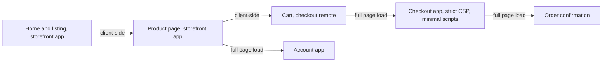
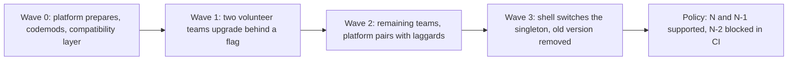
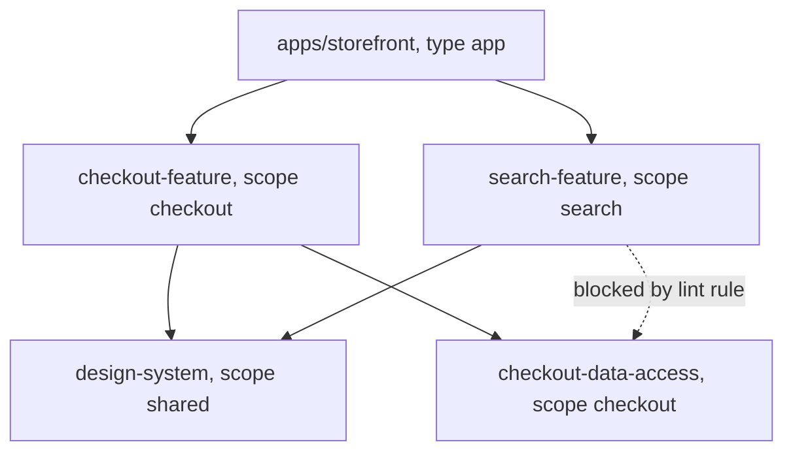

## 86.7 Routing and navigation across apps

#### Concept

When a site is made of several applications or remotes, **routing** decides which application handles a URL, and **navigation** is what happens when the user moves between URLs owned by different applications. There are two levels: **top-level routing** (which app owns `/checkout/*`), done at the edge, the server or the shell; and **in-app routing** (which screen inside checkout), done by each app's own router.

#### Why does it exist?

Users do not see team boundaries; they click links. A link from a product page (Catalog's app) to the cart (Checkout's app) must work, keep the header stable if possible, preserve scroll and history behaviour, and not reload more than necessary. If two routers both think they own the URL, the result is double renders, broken back buttons and 404s that only happen on refresh.

#### Mental model

Imagine a large hospital. The main reception (top-level routing) sends you to the right department. Inside the department, its own staff direct you to a room (in-app routing). Reception never tells you which room; departments never redirect you to another department's rooms directly, they send you back through the corridor signs everyone shares.

#### How it works

**Option 1: route-level split with full page loads.** The CDN or reverse proxy maps path prefixes to applications. Navigating between areas is a normal page load. This is the simplest model and, with server rendering, HTTP caching and a shared, cached shell bundle, often fast enough: a cross-area navigation on a good connection costs a few hundred milliseconds.

```nginx
# Edge routing by path prefix (nginx syntax as an example; CDNs offer equivalent rules)
location /checkout/ { proxy_pass http://checkout-web; }
location /account/  { proxy_pass http://accounts-web; }
location /search    { proxy_pass http://discovery-web; }
location /          { proxy_pass http://storefront-web; }   # product pages, home, content
```

**Option 2: shell router with run-time remotes.** The shell owns the top-level route table and mounts the right remote; each remote owns routes under its prefix with its own router configured with a base path. Navigation between remotes is client-side and keeps the header mounted.

```ts
// shell/src/routes.ts: the shell owns only prefixes; each remote owns everything below its prefix
export const routeTable = [
  { prefix: '/search',   remote: 'discovery', module: './SearchApp' },
  { prefix: '/p/',       remote: 'catalog',   module: './ProductApp' },
  { prefix: '/cart',     remote: 'checkout',  module: './CartApp' },
  { prefix: '/checkout', remote: 'checkout',  module: './CheckoutApp' },
  { prefix: '/account',  remote: 'accounts',  module: './AccountApp' },
] as const;
```

Rules that keep option 2 sane:

1. **One history.** Only the browser's History API is the source of truth; remotes use routers that read and write it (React Router's `basename`, for example), never a separate in-memory history.
2. **Links across areas go through a shell helper** (`navigate('/cart')`), which decides between a client-side transition and a full load, so remotes do not import each other.
3. **Each app handles a cold load of any of its URLs.** Every deep link must work on refresh, which means the server or CDN must serve the shell for every prefix.
4. **404 ownership.** Unknown paths under a prefix are the remote's 404; unknown prefixes are the shell's.

**Option 3: hybrid.** Client-side transitions within a journey (browse to product to cart) and full loads between journeys that share little (to checkout, to account). Checkout in particular benefits from a clean page: fewer scripts, a stricter Content Security Policy (86.13), and isolation from whatever the browsing pages have loaded.



#### Edge cases & failure modes

- **Two routers react to one URL change** and both render, causing flicker or duplicate data requests.
- **Scroll restoration** differs between client-side and full-page navigations; test back-button behaviour across every boundary.
- **Prefix collisions.** `/cart` and `/cartography-guide` both match a naive prefix check; match on path segments.
- **Old remote, new route.** A remote cached in a user's browser expects routes the new shell no longer serves; keep redirects for removed routes for at least as long as assets are cached (see Part 84 — Shipping and Operating Frontends, 84.4).

#### How a Senior Backend Engineer thinks about this

A senior starts with edge routing and full page loads, because it is simple, robust and cacheable, and adds client-side transitions only between areas where measurement shows the full load hurts. They give the shell sole ownership of top-level routes and treat the route table as a contract with owners, reviewed like an API.

#### Common mistakes

- Remotes importing each other's routers or link components to navigate across areas, which couples their release cycles again.
- Testing only client-side navigation, so deep links and refreshes on remote-owned URLs return the shell's 404 in production.
- Moving checkout into a client-side transition from browsing pages to save one page load, and inheriting every browsing script and a weaker CSP.

## 86.8 Dependency and version governance

#### Concept

**Dependency governance** is the set of rules for which third-party and shared packages the frontend uses, which versions are allowed, which must be shared as a single instance, and how upgrades roll across many teams. In a frontend, unlike a backend, every duplicated dependency is downloaded and executed by every customer, and some libraries (React, a router, a state library, the design system) break outright when two copies load on one page.

#### Why does it exist?

With fifteen teams, each adding packages and choosing versions, you get version sprawl: four date libraries, two major versions of the design system, three minor versions of React in different remotes. The cost is bytes (each copy of React and React DOM is on the order of 40 to 50 KB compressed), bugs (hooks fail with "Invalid hook call" when two React copies meet), security exposure (an old vulnerable copy hiding in one remote) and upgrade paralysis (nobody can move because someone cannot).

#### How it works

**1. Classify dependencies.**

| Class | Examples | Rule |
|---|---|---|
| Singletons | React, React DOM, router, design system, shell contracts, i18n runtime | Exactly one version per page; provided by the shell or pinned centrally |
| Shared, aligned | Data-fetching library, date library, validation library | One approved choice per need; versions aligned across the repo |
| Team-local | A charting library used by seller tools only | Team's choice within the security and licence policy |
| Banned | Libraries with known problems or duplicates of approved ones | Lint rule blocks the import |

**2. Single version policy.** In a monorepo, enforce one version of each shared dependency across all packages. pnpm **catalogs** let the workspace file define versions once and packages refer to them with `catalog:`; tools such as syncpack or Nx's dependency checks detect drift.

```yaml
# pnpm-workspace.yaml: one place for shared versions
packages:
  - "apps/*"
  - "packages/*"
catalog:
  react: ^18.3.1
  react-dom: ^18.3.1
  "@tanstack/react-query": ^5.59.0
  zod: ^3.23.8
```

```json
{
  "name": "@shop/checkout-cart",
  "dependencies": {
    "@tanstack/react-query": "catalog:",
    "zod": "catalog:"
  },
  "peerDependencies": {
    "react": "catalog:",
    "react-dom": "catalog:"
  }
}
```

Libraries and remotes declare singletons as **peer dependencies**, so they use the host's copy instead of bringing their own; with Module Federation, the same singletons are marked `singleton: true` with a `requiredVersion`. A singleton never loads a second copy: if the provided version does not satisfy the range, webpack only warns at run time, and `strictVersion: true` turns that warning into a run-time load error. A shared module **without** `singleton: true` behaves differently: when the host's version does not satisfy the range, the remote quietly loads its own bundled fallback copy. Neither problem is caught at build time, so a pre-deploy CI check should compare every remote's ranges for singletons with the versions the shell provides.

**3. Upgrade waves.** Major upgrades of singletons (a new React major, a design-system major) cannot be done by fifteen teams independently, because the page can hold only one copy. Run them as waves:



Automated update tools (Renovate, Dependabot) keep minors and patches flowing continuously with grouped pull requests and automerge for low-risk updates that pass CI, so majors are the only upgrades that need a programme.

**4. Measure.** Track, per production route: number of copies of each singleton loaded (from bundle analysis or a run-time check), total third-party JavaScript bytes, and age of the oldest version of each shared dependency. Fail CI when a second copy of a singleton appears in any bundle.

#### Production scenario: an incident story

At 19:40 on a Friday, the product page started showing a blank "reviews" block for about 30% of users, and the error tracker filled with "Invalid hook call". The Reviews team had deployed their remote an hour earlier after upgrading their data-fetching library, whose new version declared a peer dependency on a newer React minor. Their build listed React in `shared` with a `requiredVersion` but without `singleton: true`, so when the shell's React did not satisfy the new range, the remote loaded its own bundled fallback copy. Users whose browsers had the new remote got two Reacts on the page; hooks in the reviews block ran against the wrong copy. The Reviews team rolled back their remote in eight minutes using the manifest (86.12). The follow-ups: `singleton: true` with `strictVersion: true` for every singleton, so a mismatch can never mean a second copy and fails loudly instead of quietly; a pre-deploy CI check that the shell's versions satisfy every remote's singleton ranges; and the rule that singleton versions change only through the shell team's upgrade wave.

#### How a Senior Backend Engineer thinks about this

A senior treats singletons like a shared database schema: one version at a time, changed only through a coordinated migration with an owner. They automate the boring upgrades so they never pile up, run majors as funded programmes with codemods and waves, and measure duplicates in production bundles because the customer pays for every copy.

#### Common mistakes

- "Autonomy" that lets each remote choose its React version.
- Letting minor and patch updates pile up for a year, so every upgrade becomes a major project.
- Declaring React as a regular dependency in a shared library, guaranteeing duplicates.
- Discovering duplicate copies from customers' error reports instead of from CI.

## 86.9 Monorepo governance at scale

#### Concept

Part 76 — Frontend Tooling, 76.9, explained monorepo mechanics: workspaces, task graphs, caching and a shared contracts package. At fifteen teams and several hundred packages, the question becomes **governance**: who reviews what, how CI stays fast as the repository grows, and how you stop the dependency graph from turning into a tangle where everything imports everything.

#### Why does it exist?

A monorepo makes cross-team changes easy, which is its strength and its risk. Without rules, a checkout package imports a private helper from search, search imports from checkout, and soon a change anywhere rebuilds and retests everything, and nobody can move a package without breaking five others. Reviews become either a bottleneck (one platform team approves everything) or a free-for-all.

#### How it works

**Ownership and review.** CODEOWNERS (86.4) maps every path to a team; branch protection requires an approving review from the owners of every touched path. Shared, high-blast-radius paths (shell, design system, contracts, build configuration) require their owners plus one reviewer from a consuming team for breaking changes. Keep owner groups as teams, not individuals.

**Boundary rules.** Tag every package by **scope** (which domain) and **type** (app, feature, ui, data-access, util), and enforce allowed dependencies with a lint rule. Nx provides `@nx/enforce-module-boundaries` for this; in other setups, `eslint-plugin-boundaries` or dependency-cruiser does the same job.

```json
{
  "rules": {
    "@nx/enforce-module-boundaries": ["error", {
      "depConstraints": [
        { "sourceTag": "type:app",      "onlyDependOnLibsWithTags": ["type:feature", "type:ui", "type:util", "type:data-access"] },
        { "sourceTag": "type:feature",  "onlyDependOnLibsWithTags": ["type:ui", "type:util", "type:data-access"] },
        { "sourceTag": "type:ui",       "onlyDependOnLibsWithTags": ["type:ui", "type:util"] },
        { "sourceTag": "scope:checkout","onlyDependOnLibsWithTags": ["scope:checkout", "scope:shared"] },
        { "sourceTag": "scope:search",  "onlyDependOnLibsWithTags": ["scope:search", "scope:shared"] }
      ]
    }]
  }
}
```

Each package exposes a public entry point (`index.ts`); deep imports into another package's internals are a lint error. Cross-domain needs go through `scope:shared` packages or through the cross-app contracts (86.6).



**Affected builds and caching.** CI computes which packages a change touches (the diff against the main branch, through the dependency graph) and runs tasks only for those packages and their dependents (`nx affected -t lint test build`, or Turborepo's `--filter=...[origin/main]`). **Remote caching** shares task outputs between CI runs and developers' machines (Nx Cloud, Turborepo remote cache, or a self-hosted cache), so a package built once on main is not rebuilt anywhere until it changes. Two practices keep the cache honest: declare all inputs (environment variables, config files) so a cache hit is never wrong, and keep tasks deterministic.

**Numbers to watch.**

| Metric | Healthy range for a large repo | If it is worse |
|---|---|---|
| Median CI time for a typical pull request | Under about 10 to 15 minutes | Check affected detection, cache hit rate, test splitting |
| Remote cache hit rate on CI | Above about 70% | Find undeclared inputs or non-deterministic tasks |
| Packages rebuilt by an average change | A small fraction of the repo | A widely imported package is changing too often; split it |
| Time to first review | Under a working day | Owner groups too small or too broad |

**Distributed task execution.** Past a certain size, a single CI machine is the bottleneck even with caching; distribute tasks across several agents (Nx Agents, or your CI's own parallelism with test sharding).

#### Failure scenario

A `utils` package grew to 400 exports used by every other package. Every change to it, many times a day, invalidated the cache for the entire repository, and median CI time rose from 9 to 34 minutes over six months. The platform team split it into eleven focused packages by concern (formatting, dates, money, URLs), each with an owner, and added a rule that no package may be imported by more than a set number of packages without a platform review. CI time fell back to 11 minutes.

#### How a Senior Backend Engineer thinks about this

A senior manages the monorepo's dependency graph as architecture, because it is: boundaries are enforced by lint, not by convention; widely imported packages are kept small and stable; CI time and cache hit rate are tracked like service SLOs. They prefer a monorepo with strong boundaries over many repositories with weak contracts, and they know that the governance, not the repository layout, is what keeps fifteen teams fast.

#### Interview questions

1. **How do you keep CI fast in a monorepo with 300 packages?** Affected builds through the dependency graph, remote caching with declared inputs, distributed execution, and keeping widely shared packages small and stable.
2. **How do you stop teams importing each other's internals?** Public entry points plus lint-enforced boundary rules by scope and type.
3. **Who should review a change to the shared shell?** The shell owners, plus a consuming team for breaking changes, enforced through CODEOWNERS and branch protection.
4. **What does a low cache hit rate usually mean?** Undeclared inputs, non-deterministic outputs, or a hot shared package invalidating everything.
