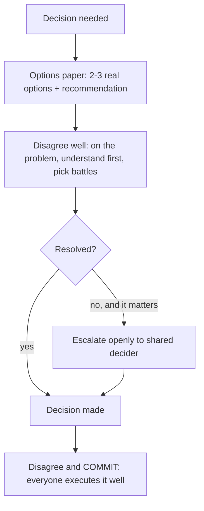

## 86.4 Making tradeoffs visible, and disagreeing well

#### Concept

Two skills at the heart of good technical decision-making in a group. **Making tradeoffs visible** means presenting a decision as an options paper — two or three real options, each with its tradeoffs laid out, plus a clear recommendation — rather than as a single preordained answer or an overwhelming menu. **Disagreeing well** is the discipline of disagreement that strengthens decisions rather than poisoning relationships: how to disagree constructively, when and how to escalate, and the "disagree and commit" principle that lets a team move forward after a decision even when not everyone agreed.

#### Why does it exist?

Imagine a decision presented as a single option: "we should do X". The audience can only say yes or no, and if they have concerns, the conversation becomes a fight over X rather than a comparison of alternatives. Or imagine the opposite: a decision presented as ten options with no recommendation, leaving the audience overwhelmed and the decision-maker abdicating their judgement. Both fail. The options-paper format exists because good decisions come from comparing a small number of real alternatives with their tradeoffs visible, guided by a recommendation from someone who did the analysis — it gives the decision-maker a real choice without drowning them, and it surfaces the tradeoffs so the decision is informed.

Disagreeing well exists because disagreement is essential to good decisions (unchallenged decisions are often wrong) but destructive when done badly (it poisons trust, creates enemies, and makes the next disagreement worse). The disciplines — disagreeing constructively, escalating properly, and disagree-and-commit — let an organisation extract the value of disagreement (better decisions) while avoiding its cost (broken relationships and paralysis).

#### Mental model

For options papers, imagine a good financial advisor. They do not say "buy this one stock" (a single option, no context), nor do they dump a thousand-page market report on you (an overwhelming menu with no guidance). They present two or three suitable options with their risk/return tradeoffs and say "given your goals, I recommend this one, because...". You make an informed choice with their expertise guiding you. An options paper is the financial advisor's approach to a technical decision.

For disagreeing well, imagine two surgeons disagreeing about an approach during an operation. They disagree hard, because the stakes demand it and the patient benefits from the challenge — but they disagree about the *approach*, not the person; they escalate to the senior surgeon if unresolved; and once a decision is made, both commit fully to executing it well, because a half-committed surgeon is dangerous. Good technical disagreement is the same: hard on the problem, soft on the person, escalate when stuck, and commit fully once decided.

#### How it works

**The options paper.** Structure a decision as:

```text
1. The decision to be made (one clear question).
2. 2-3 real options (each genuinely viable — no strawmen, per Part 81.4).
3. For each option: how it works, pros, cons, cost, risk (a comparison table).
4. A clear RECOMMENDATION with reasoning.
5. The decision-maker decides, informed.
```

Two or three options, not one (which is not a choice) and not ten (which is overwhelming). Each must be real (a strawman option, like in design-doc alternatives, destroys trust). The recommendation is essential — you did the analysis, so you owe the decision-maker your judgement; presenting options with no recommendation is abdicating.

**Disagreeing well:**

- **Disagree on the problem, not the person.** "I think this approach risks data loss because..." not "you clearly don't understand consistency". Attack ideas, respect people.
- **Seek to understand first.** Often the disagreement dissolves when you understand the other person's constraint, which you did not know. Ask why they think what they think before arguing against it.
- **Pick your battles.** Disagree about things that matter (data loss, a wrong strategic direction), let the small stuff go. Fighting everything equally makes you tiresome and dilutes your voice on what matters (Part 86.1).
- **Escalate properly when stuck.** If two people genuinely cannot agree and the decision matters, escalate to a shared decision-maker — not as "going over someone's head" in a hostile way, but openly: "we disagree, we've each made our case, we need you to decide". Escalation is a legitimate tool, not a betrayal, when done transparently.

**Disagree and commit.** Once a decision is made (by consensus, or by the decider after an escalation), everyone commits to executing it well, even those who argued against it. This is the principle that lets a team move forward: you argue hard before the decision, but once it is made, you do not undermine it — you commit to making it succeed. Disagree-and-commit prevents the two failure modes of decided-but-not-committed (passive sabotage and endless re-litigation) and of never-deciding (paralysis from seeking unanimity).



#### Practical example

A team must choose a message broker. An engineer frames it as an options paper, not "we should use Kafka". Three real options: (1) RabbitMQ + Postgres outbox (current), (2) Kafka, (3) a managed cloud queue. For each: how it works, pros, cons, operational cost, risk — in a comparison table. Recommendation: stay with RabbitMQ + outbox, because the measured need does not justify Kafka's operational cost (per Part 82.5), with a falsifiable trigger for revisiting. A colleague disagrees, favouring Kafka. They disagree well: the engineer first asks *why* the colleague wants Kafka (understand first) and learns the colleague anticipates a multi-consumer future; the engineer acknowledges this is the real crux and they debate it on the merits (on the problem, not the person). They cannot fully agree, but the decision matters, so they escalate openly to their tech lead, each having made their case. The tech lead decides to stay with RabbitMQ with the documented trigger. The colleague, having disagreed, now commits — he does not re-litigate it next month or passively undermine it; he helps make RabbitMQ + outbox work well. The options paper made the tradeoffs visible, the good disagreement surfaced the real crux (multi-consumer future), and disagree-and-commit let the team move forward united after the decision.

#### Artifact example

An options paper — the artifact that makes a decision's tradeoffs visible and guides it with a recommendation.

```markdown
# Options paper: message broker for order events

## Decision
Which message transport for order events, given our current and likely needs?

## Options (all real — no strawmen)
| | A: RabbitMQ + outbox (current) | B: Kafka | C: Managed cloud queue |
|---|---|---|---|
| How it works | We already run it; outbox for durability | New cluster; log-based streaming | Vendor-managed |
| Pros | We operate it well; fits at-least-once; low cost | Multi-consumer replay; scales huge | No ops burden |
| Cons | Not ideal for many-consumer replay | A cluster to operate (+~0.5 eng) | Vendor lock-in; cost at volume |
| Op cost | Low (existing) | Medium-high (new cluster) | Low ops, higher $ |
| Risk | Low | Medium (new skill, new failure modes) | Vendor risk |
| Fit for TODAY's need (1 consumer) | Excellent | Overkill | Good |

## Recommendation
STAY with A (RabbitMQ + outbox). Our measured need is one consumer; B's
operational cost isn't justified yet (Part 82.5). Falsifiable trigger to
revisit B: 3+ independent consumers of order events planned.

## Why not B now
Kafka is the right answer IF the multi-consumer future materialises. It
hasn't yet. Adopting it now pays a real ops cost for a benefit we don't
need. We'll adopt it when the trigger fires — a disciplined "not yet".
```

The options paper's power is that it presents real, comparable options (no strawman to make the favourite look good), lays out the tradeoffs in a table the decision-maker can scan, and — crucially — ends with a clear recommendation and reasoning rather than abdicating the judgement. It even encodes a falsifiable trigger for revisiting, turning the decision into a disciplined "not yet" rather than a dogmatic "no". This is how you make a tradeoff visible and guide a decision without either dictating it or drowning the decider in options.

#### Real-world scenario

A team has a culture of healthy disagreement, deliberately cultivated by a principal engineer. In design reviews, people disagree hard — challenging assumptions, pushing on failure modes, arguing for alternatives — but always on the problem, never on the person, and always with genuine curiosity about why the other person thinks what they think. When disagreements cannot be resolved and the decision matters, they escalate openly to the tech lead without anyone treating it as a betrayal. And once a decision is made, everyone commits, including those who argued against it — there is no passive sabotage, no re-litigating settled decisions. The result is a team that makes noticeably better decisions than teams where disagreement is suppressed (because the challenge surfaces flaws) and that moves faster than teams where disagreement is destructive (because disagree-and-commit prevents paralysis and re-litigation). The principal cultivated this by modelling it: disagreeing hard and kindly, admitting when others changed his mind, and visibly committing to decisions he argued against. The team learned that disagreement is safe and valuable because it is done well, which is a cultural achievement that compounds into better decisions indefinitely.

#### Failure scenario

A team suppresses disagreement in the name of harmony. Challenging a senior person's proposal is seen as rude, so people stay quiet even when they see problems. A staff engineer proposes an architecture with a serious flaw — a dual write that will lose data under load — and several people privately notice it but nobody says anything in the review, because disagreeing would be "difficult". The design ships, the flaw causes a data-loss incident months later, and in the retro it emerges that three people had seen the problem and said nothing. The suppression of disagreement, meant to preserve harmony, cost a production incident that an uncomfortable five-minute challenge would have prevented. The team optimised for the comfort of not disagreeing and paid for it in a worse decision. The opposite failure also exists: a team where disagreement is destructive (personal, endless, never committing to decisions) is paralysed and toxic, re-litigating every settled question and making enemies. Both extremes — suppressed disagreement and destructive disagreement — produce worse outcomes than the discipline of disagreeing well: hard on the problem, soft on the person, escalate when stuck, commit once decided. Disagreement is not the enemy of good decisions; badly-handled disagreement (in either direction) is.

#### Edge cases & failure modes

- **Presenting one option instead of a choice.** The audience can only accept or fight it; no tradeoffs are visible.
- **Presenting ten options with no recommendation.** Overwhelming and abdicating; the decider is drowned and gets no benefit of your analysis.
- **Strawman options.** A real option plus weak alternatives destroys trust (Part 81.4).
- **Suppressing disagreement for harmony.** Flaws go unchallenged, producing worse decisions (the data-loss incident nobody raised).
- **Destructive disagreement.** Personal, endless, never committing — paralyses the team and poisons relationships.
- **Never committing after a decision.** Passive sabotage or endless re-litigation of settled questions, which is as damaging as never deciding.
- **Escalating as a weapon.** Going over someone's head hostilely rather than openly, which breaks trust; escalation must be transparent.

#### How a Principal Engineer thinks about this

They frame consequential decisions as options papers — two or three real options with visible tradeoffs and a clear recommendation — because they know a single option is not a choice, a menu of ten is an abdication, and a recommendation is what they owe the decider in return for having done the analysis. They present real alternatives, never strawmen, because they understand trust in the whole paper collapses if the options are rigged.

On disagreement, they cultivate it as essential to good decisions while insisting it be done well: hard on the problem, soft on the person, understanding the other's constraint before arguing, and picking battles so their voice carries weight on what matters. They escalate openly and without rancour when genuinely stuck on something that matters, treating escalation as a legitimate tool rather than a betrayal. And they practise disagree-and-commit rigorously — arguing hard before a decision and committing fully after, including to decisions they argued against — because they know a decided-but-uncommitted organisation is as broken as an undecided one. The principal models all of this, because a team's disagreement culture is learned from how its senior people disagree, and a healthy one compounds into better decisions indefinitely.

#### Common mistakes

- **Presenting a single option** (not a choice) or **ten options with no recommendation** (abdication).
- **Rigging the options with strawmen** to make the favourite win.
- **Suppressing disagreement for harmony,** letting flaws go unchallenged.
- **Disagreeing destructively** (personal, endless, uncommitting), poisoning the team.
- **Not committing after a decision,** re-litigating settled questions or passively undermining them.

#### Interview questions

1. **How do you present a technical decision to get a good outcome?**
   *Expected answer:* as an options paper — two or three real (non-strawman) options with their tradeoffs laid out in a comparison table, plus a clear recommendation and reasoning. Not a single option (not a choice), not ten options (overwhelming and abdicating). The recommendation is owed to the decider in return for your analysis. *Follow-up:* why include a recommendation rather than staying neutral.

2. **What does "disagree and commit" mean and why is it important?**
   *Expected answer:* argue hard before a decision, but once it is made (by consensus or by the decider), everyone commits to executing it well, including those who argued against it. It is important because it prevents both paralysis (never deciding in search of unanimity) and the damage of decided-but-uncommitted (passive sabotage, endless re-litigation). *Why it matters:* tests whether they can move forward united after losing an argument.

3. **A team suppresses disagreement to keep harmony. What's the risk, and what's the healthy alternative?**
   *Expected answer:* flaws go unchallenged, producing worse decisions (e.g. a known design flaw nobody raised causing an incident); the healthy alternative is disagreeing well — hard on the problem, soft on the person, understanding first, escalating openly when stuck, and committing once decided — which surfaces flaws without poisoning relationships. Both suppressed and destructive disagreement are worse than disagreeing well. *Why it matters:* tests understanding that disagreement is valuable when done well.

#### Practical exercise

Take a decision your team faces. Write it as an options paper: two or three real, viable options (no strawmen), a comparison table of their tradeoffs (pros, cons, cost, risk, fit for your actual need), and a clear recommendation with reasoning. Then reflect on a recent disagreement you were part of: did you disagree on the problem or the person, did you seek to understand first, and did everyone commit after the decision — and if not, what would disagreeing well have changed.

**Acceptance criteria:** your options paper presents at least two genuinely viable options (each could reasonably be chosen), lays out their tradeoffs comparably, and ends with a clear recommendation and reasoning rather than staying neutral; and your disagreement reflection identifies at least one way the disagreement could have been handled better (on the problem not the person, understanding first, or committing after) to produce a better outcome or preserve the relationship.
