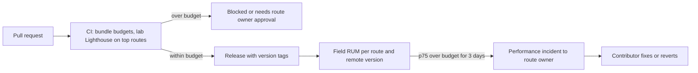
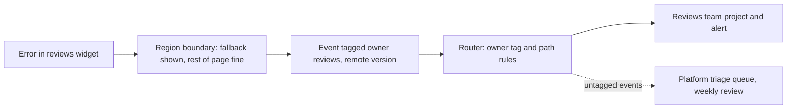
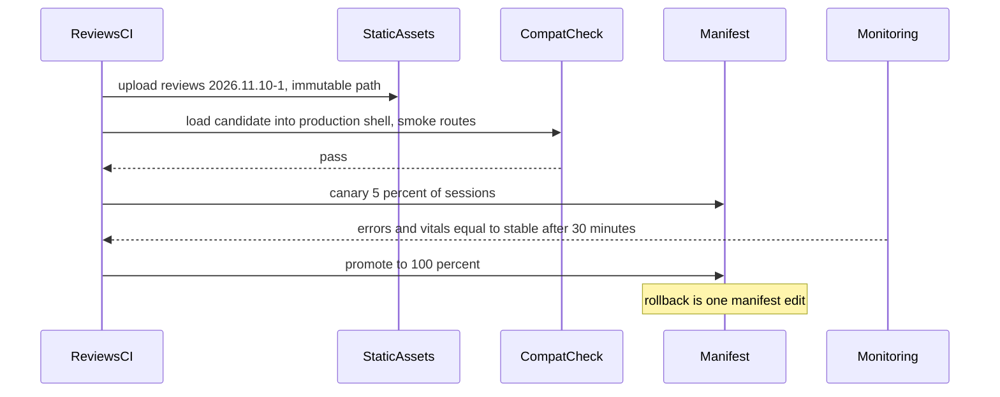
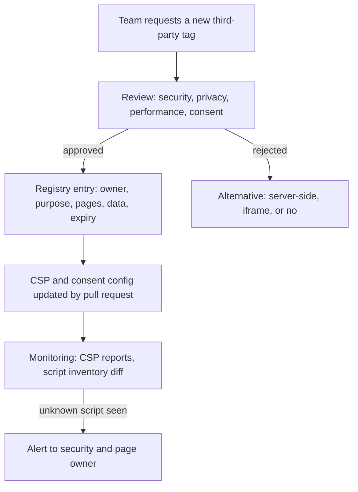

## 86.10 Organisation-wide performance budgets and Core Web Vitals governance

#### Concept

Part 82 — Web Performance taught how to measure and improve Core Web Vitals on a page: Largest Contentful Paint (LCP), Interaction to Next Paint (INP) and Cumulative Layout Shift (CLS), with "good" thresholds at the 75th percentile of real users of 2.5 seconds, 200 milliseconds and 0.1 respectively (82.2). At organisation scale the problem is not knowing how; it is **governance**: every route has an owner, a budget and a dashboard; regressions are caught before release; and shared costs (the shell, the design system, third-party tags) are budgeted like any other team's.

#### Why does it exist?

Performance is a commons. No single team's change makes the product page slow; fifteen teams each adding 20 KB and one more request over a year does. The cost is real (slower pages convert worse, and Core Web Vitals feed into search ranking signals) but diffuse, so without explicit budgets and owners it is always someone else's problem. The tragedy of the commons applies exactly.

#### Mental model

Imagine a household electricity budget shared by flatmates. Everyone plugs in "just one more" device; the bill doubles; nobody did it. The fix is a meter per room, an agreed allowance per room, and a rule that a new heater needs someone to unplug something. Per-route and per-team performance budgets are the meters and allowances.

#### How it works

**1. Budgets per route and per contributor.** Set budgets on what teams control (bytes, requests, long tasks) as leading indicators, and on field Core Web Vitals per route as the outcome.

| Route (owner) | JS budget, compressed | LCP p75 field | INP p75 field | CLS p75 field | Third-party JS |
|---|---|---|---|---|---|
| Home (Storefront) | 170 KB | 2.2 s | 180 ms | 0.05 | 40 KB |
| Product page (Catalog) | 200 KB, of which shell 60, design system 45, Catalog 60, Reviews 15, Recs 20 | 2.3 s | 180 ms | 0.05 | 40 KB |
| Search results (Discovery) | 190 KB | 2.4 s | 200 ms | 0.08 | 30 KB |
| Checkout (Checkout) | 140 KB | 2.0 s | 150 ms | 0.02 | 0 KB, payment iframe only |

The numbers here are illustrative; set yours from your current field data and business targets. The important part is the split: the product page budget is allocated between the teams that contribute to it, so a team that wants more must negotiate with the route owner.

**2. Enforce leading indicators in CI.** Every pull request reports bundle size changes per route and fails when a budget is exceeded (size-limit, bundle analysers, or Lighthouse CI with a budget file; see Part 82 — Web Performance, 82.11). Lab Lighthouse runs on the top routes catch obvious regressions before release.

```json
[
  {
    "path": "/p/*",
    "resourceSizes": [
      { "resourceType": "script", "budget": 200 },
      { "resourceType": "third-party", "budget": 40 },
      { "resourceType": "total", "budget": 900 }
    ],
    "resourceCounts": [
      { "resourceType": "third-party", "budget": 6 }
    ]
  }
]
```

**3. Watch outcomes in the field.** Real-user monitoring (see Part 84 — Shipping and Operating Frontends, 84.8) reports Core Web Vitals per route, per device class and per release, with attribution (the `web-vitals` library's attribution build tells you which element was the LCP and which interaction was slow), so a regression can be traced to a team's region and a release.

```ts
// shell/src/vitals.ts: report field vitals tagged with route owner and the remote versions on the page
import {
  onCLS, onINP, onLCP,
  type CLSMetricWithAttribution, type INPMetricWithAttribution, type LCPMetricWithAttribution,
} from 'web-vitals/attribution';
import { currentRouteOwner, loadedRemoteVersions } from './runtime';

type VitalWithAttribution = LCPMetricWithAttribution | INPMetricWithAttribution | CLSMetricWithAttribution;

function send(metric: VitalWithAttribution): void {
  const body = JSON.stringify({
    name: metric.name, value: metric.value, rating: metric.rating, id: metric.id,
    route: location.pathname.split('/')[1] || 'home',
    owner: currentRouteOwner(),            // from the same ownership map as CODEOWNERS
    remotes: loadedRemoteVersions(),       // e.g. { catalog: '2026.11.10-3', reviews: '2026.11.09-1' }
    attribution: metric.attribution,       // LCP element, slow interaction target, shifted nodes
  });
  navigator.sendBeacon('/rum', body);      // survives page unload
}

onLCP(send);
onINP(send);
onCLS(send);
```

**4. A regression process.** When a route's field metric crosses its budget for several days, the route owner opens a performance incident at low severity, uses attribution and release tags to find the contributor, and the contributor fixes or reverts. Budgets are reviewed quarterly; raising a budget requires the route owner and a product owner to agree that the feature is worth the cost.



#### Failure scenario

A personalisation team added a recommendations carousel to the product page, lazy-loaded below the fold and within its 20 KB budget. In the field, INP on the product page rose from 170 ms to 260 ms on mid-range Android phones. Attribution showed the slow interactions were taps on the size selector, and the long task was the carousel's hydration, which ran on the main thread exactly when users interacted after the page became visible. The bytes budget had been met; the main-thread budget had not existed. The team deferred hydration until the carousel scrolled into view and broke the work into smaller tasks; INP returned to 175 ms. The governance change: budgets now include long-task time per region measured in a lab run on a throttled device profile.

#### How a Senior Backend Engineer thinks about this

A senior makes performance a budgeted, owned resource, like an error budget for a service. They allocate shared pages' budgets between contributors, enforce leading indicators in CI, watch field outcomes per route and release, and run regressions through a lightweight incident process. They also budget the platform's own cost: the shell and design system are often the largest contributors, and they should meet budgets first.

## 86.11 Observability and error ownership across teams

#### Concept

Part 84 — Shipping and Operating Frontends showed error tracking with source maps (84.6), correlating browser errors with backend traces (84.7) and frontend SLOs (84.8) for one app. With fifteen teams on one page, the new problem is **routing**: every error, slow interaction and failed request must reach the team that can fix it, with the context to fix it, without one shared inbox of thousands of unowned issues.

#### Why does it exist?

A single shared error-tracking project on a large site accumulates thousands of issues. Nobody knows which are theirs; alert fatigue sets in; real regressions hide among old noise. Meanwhile, the stack trace for an error thrown in the reviews widget might point into the shell's error boundary, so naive ownership by "where it was caught" assigns it to the wrong team.

#### How it works

1. **Tag everything with owner and version.** Each remote or package registers metadata (team, remote name, version) at build time. Error events, RUM beacons and frontend traces carry it. Error tracking tools support this pattern; for example, Sentry documents a micro-frontend setup that attaches module metadata at build time and routes events to the owning team's project with a multiplexed transport.
2. **Ownership by code location, not by catch location.** Map the top in-app stack frame's file path to an owner using the same ownership map as CODEOWNERS. Several tools support ownership rules based on paths.
3. **Error boundaries per region.** Each team's region is wrapped in its own React error boundary provided by the shell, which renders a fallback for that region only, reports with the region's owner tag, and keeps the rest of the page working.
4. **SLOs per journey, alerts to owners.** Define frontend SLOs on journeys (product page load success, add-to-cart success, checkout completion without client error) and route their alerts to the journey owner. Alert on SLO burn rate, not on individual error counts (see Part 53 — Site Reliability Engineering, 53.5).
5. **One trace across teams.** Propagate W3C `traceparent` from browser requests to the backend so a slow add-to-cart can be followed from the click, through the BFF, to the database.

```tsx
// shell/src/RegionBoundary.tsx: every team's region is isolated and reported with its owner
import { Component, type ReactNode } from 'react';
import { reportError } from './telemetry';

interface Props { owner: string; region: string; fallback: ReactNode; children: ReactNode }
interface State { failed: boolean }

export class RegionBoundary extends Component<Props, State> {
  state: State = { failed: false };

  static getDerivedStateFromError(): State {
    return { failed: true };
  }

  componentDidCatch(error: Error, info: { componentStack?: string | null }): void {
    reportError(error, {
      tags: { owner: this.props.owner, region: this.props.region },
      extra: { componentStack: info.componentStack ?? '' },
    });
  }

  render(): ReactNode {
    return this.state.failed ? this.props.fallback : this.props.children;
  }
}

// usage on the product page:
// <RegionBoundary owner="reviews" region="pdp-reviews" fallback={<ReviewsUnavailable />}>
//   <ReviewsWidget sku={sku} />
// </RegionBoundary>
```



**Hygiene.** Untagged events go to a platform triage queue reviewed weekly, and the volume of untagged events is itself a metric. Known noise (browser extensions, bots, cancelled requests) is filtered at the SDK, not muted in the UI, so it does not consume quota. Releases and source maps are uploaded per remote, so a stack trace resolves against the exact version that threw it.

#### Production scenario

After moving to per-team routing, a storefront went from one project with roughly 3,800 open issues to fourteen team projects with a median of about 60 each, plus a triage queue. The checkout team's alert on "client errors per checkout attempt" became trusted enough to page on, and caught a broken address autocomplete in a single browser version within 20 minutes of a release.

#### How a Senior Backend Engineer thinks about this

A senior applies the service-ownership model to the browser: every error has an owner, every owner has SLOs and alerts on their journeys, and failures are contained to the region that failed. They invest in tagging at build time because ownership that depends on someone triaging by hand does not survive the first busy month.

## 86.12 Release orchestration

#### Concept

**Release orchestration** is how many teams ship their parts of a frontend independently without breaking the whole: each team deploys on its own schedule, **feature flags** separate deploy from release, **compatibility contracts** between the shell and its parts are tested before rollout, and a **manifest** records which version of each part is live so that rollback is one change.

#### Why does it exist?

Independent deploys are the main reason to split a frontend. But independence without compatibility is just a faster way to break production: the shell expects a remote to export `ProductApp`, the remote renames it, and the page goes blank. And frontends add a twist backends lack: users keep old code in open tabs and caches for hours or days (see Part 84 — Shipping and Operating Frontends, 84.4), so at any moment several versions of each part are running against your APIs and against each other.

#### How it works

**1. A deployment manifest.** For run-time composition, the shell does not hard-code remote URLs. It reads a small manifest, served with a short cache lifetime, that maps each remote to an immutable, versioned asset URL. Deploying a remote uploads its assets and then updates its entry in the manifest; rolling back is pointing the entry back.

```json
{
  "schemaVersion": 1,
  "generatedAt": "2026-11-10T14:05:11Z",
  "remotes": {
    "catalog":  { "version": "2026.11.10-3", "entry": "https://static.example.com/catalog/2026.11.10-3/remoteEntry.js",  "contract": "shell@4" },
    "checkout": { "version": "2026.11.09-7", "entry": "https://static.example.com/checkout/2026.11.09-7/remoteEntry.js", "contract": "shell@4" },
    "reviews":  { "version": "2026.11.10-1", "entry": "https://static.example.com/reviews/2026.11.10-1/remoteEntry.js",  "contract": "shell@4" }
  }
}
```

**2. Compatibility contracts.** The shell publishes a versioned contract package (`@shop/shell-contracts`): the exposed module names and their props, the shell context interface, the event types. Each remote declares which contract major it implements. Before a remote's manifest entry changes, CI runs a **compatibility check**: load the candidate remote into the current production shell in a headless browser and run smoke tests on the routes it serves; and, for a shell release, load every current production remote into the candidate shell. The idea is the same as consumer-driven contract testing for APIs (see Part 80 — Frontend–Backend Contracts, 80.10).

**3. Progressive rollout per part.** The manifest can carry a canary entry: a percentage of sessions (sticky per user) get the new version of one remote, with error rates and Core Web Vitals compared against the stable version before promotion (see Part 84 — Shipping and Operating Frontends, 84.5).

**4. Feature flags for release, owned per team.** New behaviour ships dark and is turned on by flag, per team, with a flag platform shared by all. Cross-team features (a new checkout step that also changes the cart) are coordinated through flags that both sides read, not through synchronised deploys.

**5. Expand and contract for shell changes.** A breaking shell change follows the same pattern as a database migration (see Part 27 — Database Migrations and Zero-Downtime Schema Changes): the shell first supports old and new contracts, remotes migrate one by one, and only when the manifest shows no remote on the old contract (and cached old remotes have aged out) is the old path removed.



#### Failure scenario

The catalog team renamed an exposed module from `./ProductApp` to `./ProductPage` as part of a refactor, updated the shell's route table in the same week, and deployed the remote first. For 40 minutes, until the shell deployed, every product page showed the shell's generic error fallback. There was no compatibility check; the rename looked internal to the catalog team. The postmortem added the candidate-in-production-shell check to every remote's pipeline and a rule that exposed module names are part of the shell contract: renames are expand-and-contract (expose both names, then remove the old one after the shell moves).

#### How a Senior Backend Engineer thinks about this

A senior treats the shell-to-remote interface exactly like a service API: versioned, contract-tested before deploy, changed by expand and contract, with old clients (cached bundles) assumed to exist. They want rollback to be a data change (a manifest entry), not a rebuild, and they keep release decisions in flags owned by the team whose feature it is.

## 86.13 Security at scale: CSP across apps and third-party script governance

#### Concept

Part 81 — Auth and Security in the Browser covered XSS defences, Content Security Policy and Trusted Types (81.7), and third-party scripts with Subresource Integrity (81.8), for one application. At scale, two things change. **CSP becomes a shared resource:** when several teams' code runs on one origin and one page, one policy must allow all of them and still be strict. **Third-party scripts become an organisational risk:** marketing, analytics, experimentation, chat and advertising tags are requested by many teams, often added through a tag manager without engineering review, and each one runs with the full power of your page.

#### Why does it exist?

A page is only as secure as the least careful script on it. A single compromised analytics library on a product page can read form fields, rewrite links or skim card numbers if they ever touch the DOM. With fifteen teams and a marketing department, the number of scripts grows unless someone governs it. Payment rules have made this explicit: PCI DSS v4.0 requirements 6.4.3 and 11.6.1 require merchants to inventory, authorise and integrity-check scripts on payment pages and to detect unauthorised changes to those pages.

#### How it works

**One CSP strategy, owned by the platform.** The shell team owns the CSP header for every page it serves (or the edge sets it), with a **nonce-based, `strict-dynamic`** policy so scripts loaded by trusted scripts are allowed without listing every remote host, plus explicit allow-lists for connections and frames. Each team's needs (an API host, an image CDN) are added through a reviewed configuration file, not by editing the header directly.

```text
Content-Security-Policy:
  default-src 'self';
  script-src 'nonce-{per-response}' 'strict-dynamic' https:;
  connect-src 'self' https://api.example.com https://rum.example.com;
  img-src 'self' https://images.example.com data:;
  frame-src https://payments.provider.example;
  object-src 'none'; base-uri 'none'; frame-ancestors 'self';
  require-trusted-types-for 'script';
  report-to csp-endpoint
```

(Line breaks added for readability; the real header is one line. The `https:` in `script-src` is a fallback for old browsers that ignore `strict-dynamic`.)

**Different policies for different journeys.** Browsing pages need marketing and analytics; checkout should have almost nothing. A route-level split (86.7) makes this easy: checkout is a separate application with its own, much stricter policy and no tag manager. Composing checkout into a page full of third-party tags makes it impossible.

**Roll out with report-only.** Introduce or tighten the policy as `Content-Security-Policy-Report-Only` first, collect violation reports per route and per team for a few weeks, fix the violations, then enforce.

**Third-party script governance.**

1. **Inventory.** A registry of every third-party script: owner team, business purpose, data it can see, pages it runs on, review date. Scripts not in the registry are blocked by CSP.
2. **Review before adding.** Security, privacy and performance review for new scripts, with a budget (86.10) and a data-protection check (does it receive personal data; is consent required?).
3. **Isolate what you can.** Payment entry in the provider's hosted fields or iframe (81.8); untrusted widgets in sandboxed iframes; analytics through a server-side or first-party collection endpoint where practical, so fewer vendor scripts run in the page at all.
4. **Consent gating.** Non-essential tags load only after consent, through one consent component owned by the shell.
5. **Monitor.** CSP violation reports, a scheduled job that loads key pages and records every script and its hash, and alerts on new or changed scripts on payment pages.



#### Edge cases & failure modes

- **Tag managers bypass review.** A tag manager is a way for non-engineers to deploy JavaScript to production. Restrict who can publish, require review for new tags, and keep it off checkout entirely.
- **`unsafe-inline` creep.** One team's inline script leads to `'unsafe-inline'` being added "temporarily", disabling most of the XSS protection for every team. Nonces and Trusted Types make the strict path workable.
- **Remotes from many origins.** Allow-listing every team's asset host in `script-src` grows without limit; serve all first-party remotes from one static origin and rely on `strict-dynamic`.
- **Shared origin, shared risk.** All apps on one origin share cookies and storage; an XSS in a low-value marketing page can act as the user anywhere on the origin. Keep high-value journeys strict, or on a separate origin when the risk justifies it.

#### How a Senior Backend Engineer thinks about this

A senior treats CSP as platform infrastructure with one owner and a reviewed configuration, not as a header each team edits. They treat every third-party script as a production dependency with full page access and no code review, so it needs an owner, a purpose, a budget, consent handling and monitoring. They use the architecture itself as a security control: a separate, minimal checkout application is worth more than any amount of policy tuning on a crowded page. Part 96 — Security Architecture takes these ideas to the organisation level.

#### Interview questions

1. **How do you run one CSP for fifteen teams?** Platform-owned, nonce-based with `strict-dynamic`, reviewed config for per-team hosts, report-only first, stricter policies for sensitive routes.
2. **Why split checkout into its own application?** It can have its own strict CSP, no tag manager and minimal scripts, which reduces both attack surface and PCI scope.
3. **What does a third-party script registry contain?** Owner, purpose, pages, data access, consent category, performance budget, review and expiry dates.
4. **How do you detect an unauthorised script change on a payment page?** CSP violation reports plus a scheduled job that records script inventory and hashes and alerts on any change.
