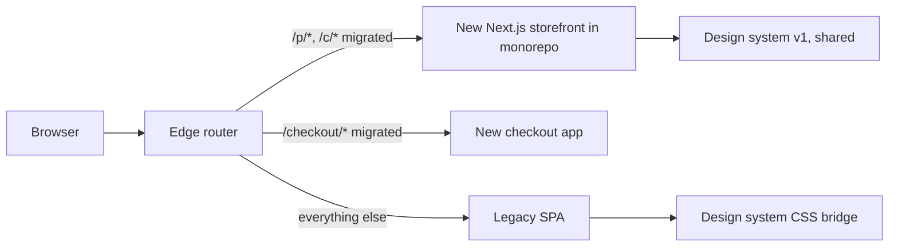
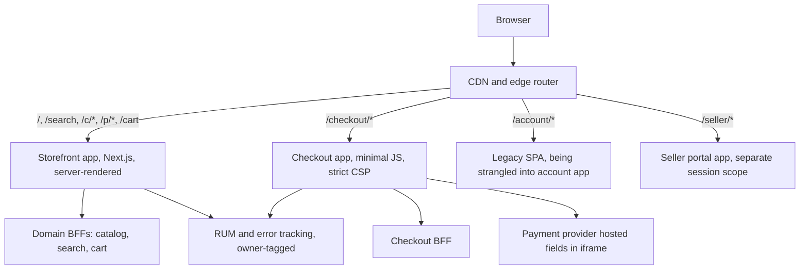
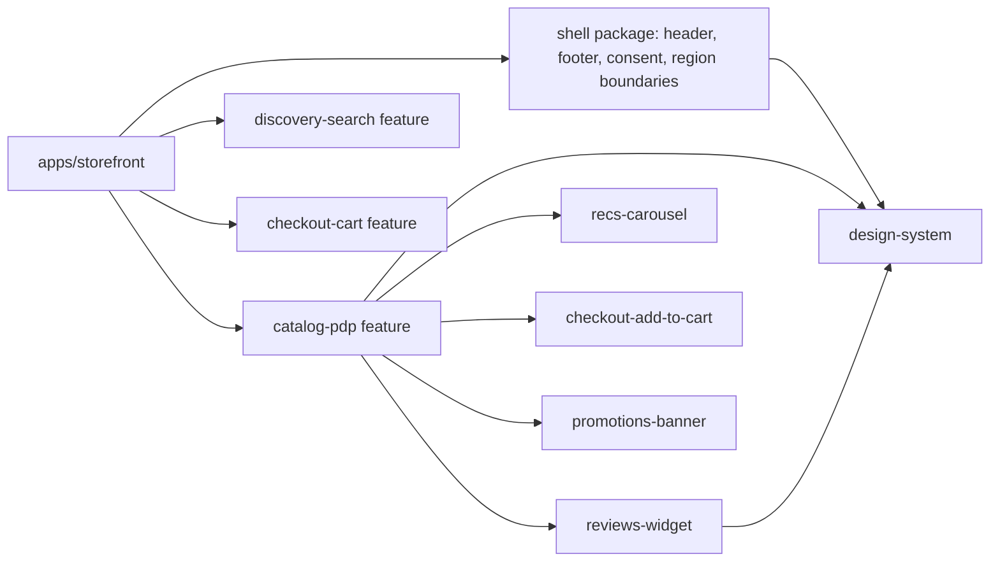

## 86.14 Migration stories

Most frontend architecture work is migration: from what exists to something better, without stopping feature work. Two stories cover the common directions. The general method for large migrations (programme management, strangler fig, deprecation) is in Part 91 — Large-Scale Migrations and Legacy Modernization; here is what is specific to frontends.

### 86.14.1 Strangling a legacy single-page app

#### Concept

The **strangler fig** approach replaces a legacy system piece by piece: new functionality is built in the new system, existing functionality is moved route by route, and a routing layer in front decides which system serves each request, until the old system serves nothing and is removed. For a frontend, the routing layer is usually the edge or a reverse proxy, and the unit of migration is a **route**.

#### How it works

The starting point: a seven-year-old single-page app (an older framework, a custom webpack configuration, one repository, a 2.1 MB JavaScript bundle, client-side rendering only) serving the whole storefront. Twelve teams commit to it; releases are weekly; LCP on mobile is around 4 seconds at p75.

1. **Put a router in front.** Route all traffic through the edge with every path going to the legacy app. Nothing changes for users; you now control where each path goes.
2. **Build the new platform's skeleton.** Monorepo, design system tokens and core components, shell (header and footer), authentication via the shared session cookie, RUM and error tracking with owner tags, and CI with budgets. Ship one low-risk route first (a static content page) to prove the pipeline.
3. **Make the two worlds look like one.** The design system exports its tokens as CSS custom properties, which the legacy app also loads, so colours and typography match across the boundary. The header is rebuilt once in the new world and embedded into the legacy app (as a web component or a server-included fragment) so both share one header implementation.
4. **Move routes in order of value and isolation.** Product and category pages first (largest SEO and performance gain from server rendering), then checkout (isolation and security, its own application), then account pages; leave rarely used admin-like pages for last, or retire them.
5. **Share session, not state.** Both apps read the same HttpOnly session cookie and call the same APIs; the cart lives on the server, so a user adding to cart in the new product page sees it in the legacy cart page.
6. **Freeze and delete.** Each migrated route is deleted from the legacy codebase immediately, so the old app shrinks and nobody fixes bugs twice. When the last route moves, remove the legacy app and its pipeline.

#### Failure scenario

Halfway through, the analytics team noticed conversion attribution had broken for users who moved from new product pages to legacy cart pages: the two apps initialised the analytics library differently, and the session identifier was regenerated at the boundary. A month of marketing data was partly unusable. The fix was to move analytics bootstrap into the shared header (one implementation in both worlds) and to add "cross-boundary journeys" (product page to cart, cart to checkout) to the end-to-end test suite. The lesson: during a strangler migration, every cross-cutting concern (analytics, consent, authentication, error tracking, feature flags) must have exactly one implementation used by both worlds.

### 86.14.2 Consolidating micro-frontends back

#### Concept

Sometimes the right migration goes the other way: from many run-time micro-frontends back to fewer applications, usually a monorepo with a few route-level apps. This is not failure; it is adjusting the architecture to the actual team structure and the costs observed.

#### How it works

This is the retailer from 86.3: four teams, eleven micro-frontends in eleven repositories, duplicate dependencies, LCP of 3.9 s on mobile.

1. **Measure and agree on the goal.** Bundle duplication per route, CI and local-setup time, incidents caused by version skew, and LCP and conversion on mobile. The goal stated in one sentence: "keep independent releases per journey; remove run-time composition inside pages".
2. **Create the monorepo and move code without changing it.** Import each repository with history into `packages/` (Git can preserve history with subtree merges or a filter-repo rewrite), so blame still works.
3. **Align dependencies.** One version of React, the router, the data library and the design system across all packages (86.8), with codemods where needed. This alone removed most of the duplicated bytes.
4. **Recompose at build time per journey.** Three apps: browse (home, listing, product), checkout, and account. Former remotes become packages imported by the app that serves their route. Within each app, one build, one deploy.
5. **Keep release independence with flags and per-app pipelines.** Each app deploys on its own; within an app, teams ship behind flags, and trunk-based development replaces the "my remote, my schedule" model.
6. **Delete the composition runtime.** The manifest service, the remote loading code and the shared-dependency negotiation go away.

The result in this story: LCP back to 2.3 s, CI for a typical change from 25 minutes across several repositories to 9 minutes, local development from six running services to one command, and no version-skew incidents in the following year.

#### How a Senior Backend Engineer thinks about this

A senior is willing to reverse an architecture when the evidence says so, and frames it as a change in context ("we have four teams, not fifteen") rather than a failure. In both directions, they migrate in small steps that ship value, keep one implementation of every cross-cutting concern, and delete old code as soon as each piece moves.

## 86.15 Worked architecture: the frontend of a large e-commerce site

> **Try it first** · Level: Advanced · About 60 minutes
>
> **Build:** the frontend architecture for a large e-commerce marketplace.
>
> **Requirements:**
> - Storefront (home, search, listing, product), cart, checkout, customer account, and a seller portal.
> - Sixteen product teams plus a frontend platform team and a design platform team; most teams want to release daily.
> - Product page shared by five teams (catalog, reviews, recommendations, checkout's add-to-cart, promotions).
> - Mobile LCP p75 under 2.5 s and INP p75 under 200 ms on product and listing pages; checkout in PCI scope reduction.
> - Two languages, two currencies; marketing needs analytics and experimentation tags on browsing pages.
>
> **Scale and constraints:** about 3 million sessions a day, 70% mobile, peaks of 8x during sales; one primary domain; existing NestJS BFFs per domain; an older SPA still serving account pages.
>
> **Your task:** choose the architecture style per area, draw the composition, name the ownership and governance mechanisms, and explain how a team ships a change to the product page on a Tuesday afternoon.
>
> Spend the time on paper before you read on. The model design follows.

### 86.15.1 The architecture

Inside the storefront app, which lives in the monorepo:

### 86.15.2 The main decisions

| Decision | Choice | Reason |
|---|---|---|
| Top-level style | Route-level split into four apps at the edge | Journeys are distinct; checkout and seller need isolation; each app deploys independently |
| Inside the storefront | Monorepo packages composed at build time, one Next.js app | Five teams share the product page; build-time composition keeps one React, one design system, typed contracts and the best performance |
| Run-time micro-frontends | Not used | Release independence inside the storefront comes from trunk-based development, flags and fast affected CI; the performance target leaves no room for duplicate runtimes |
| Checkout | Separate app, no tag manager, payment iframe, strict CSP | PCI scope reduction and attack surface |
| Account pages | Legacy SPA strangled route by route into a new account app | 86.14.1 |
| Design system | Product with tokens, components, codemods, two supported majors | 86.5 |
| Shared dependencies | pnpm catalog, singletons as peers, CI fails on duplicate copies | 86.8 |
| Ownership | CODEOWNERS, owner tags in builds, region boundaries | 86.4, 86.11 |
| Performance | Per-route budgets split by contributor; RUM per route and release | 86.10 |

The storefront deploys many times a day. With affected builds and caching, a change to the reviews widget runs the reviews package's tests and the storefront's integration and visual checks in roughly ten minutes, and ships behind a flag. That is the answer to "how does the reviews team ship on a Tuesday": merge to main, the storefront pipeline deploys within the hour (or the team triggers a deploy), and the flag turns the change on for a canary percentage.

### 86.15.3 Budgets and SLOs

| Journey | Owner | SLO | Performance budget |
|---|---|---|---|
| Product page load | Catalog | 99.5% of loads render main content without client error | LCP p75 2.3 s, INP p75 180 ms, JS 200 KB split by contributor |
| Add to cart | Checkout | 99.9% success | INP on the button under 150 ms |
| Checkout completion | Checkout | 99.9% of attempts without client error | LCP p75 2.0 s, JS 140 KB, third-party 0 |
| Search results | Discovery | 99.5% render without error | LCP p75 2.4 s |

### 86.15.4 Failure drill: a 10x sale and a broken widget

During a sale, the recommendations service slows to 4 seconds per request. The carousel is lazy-loaded with a client timeout of 800 ms and a region boundary; it renders a static "popular items" fallback from the CDN, the product page LCP is unaffected because the carousel is below the fold and never blocks main content, and the Personalisation team's SLO alert fires, not Catalog's. If the reviews widget throws on a malformed review, its boundary shows "Reviews are unavailable right now", the error goes to the Reviews project, and add-to-cart keeps working.

## 86.16 Exercises with worked answers

#### Practical exercise

**Exercise 1.** A company with five frontend teams and one React SPA has a weekly release train and 30-minute CI. The CTO proposes micro-frontends. What do you recommend, and what would make you change your mind?

**Exercise 2.** The product page's mobile LCP has risen from 2.2 s to 2.9 s over six months. Five teams contribute to it. Design the process that finds the causes and prevents recurrence.

**Exercise 3.** The design system is on major 9. Production contains majors 6, 7, 8 and 9. Plan how to get to at most two majors within two quarters.

**Exercise 4.** Marketing wants to add a session-replay tool to every page, including checkout. Respond as the frontend architect.

#### Worked answer to the exercise

**Exercise 1.** The problems named are release coupling and slow CI, both solvable without run-time composition. Recommend: move to a monorepo (or restructure the existing repo) with packages per domain, affected builds and remote caching to bring CI under about ten minutes; replace the weekly train with trunk-based development and feature flags so any team can deploy daily; enforce module boundaries with lint; consider a route-level split for checkout if it needs isolation. Change your mind if, after this, several teams still need to ship to the same page on different cadences and the coupling is measured as the main cost, and a platform team exists to own the shell, the dependency policy and budgets.

**Exercise 2.** Allocate the product page's budgets between contributors (shell, design system, each team's region), including bytes, requests and main-thread time. Tag RUM beacons with remote or package versions and use LCP attribution to find which element is the LCP and which phase grew (TTFB, resource load delay, load time or render delay; see Part 82 — Web Performance, 82.3). Correlate the trend with releases per contributor. Fix the largest causes first, then add CI budget checks per contributor and a field-regression process: when p75 exceeds the route budget for three days, the route owner opens a low-severity performance incident and the contributor owning the regression fixes or reverts. Review budgets quarterly with product.

**Exercise 3.** Find who is on which major and why (scan imports and lockfiles per package; interview the lagging teams). Ship codemods for every breaking change from 6 to 9, plus a compatibility layer where codemods cannot help. Run visual regression on the lagging teams' top routes against major 9 to show the real breakage. Schedule two upgrade waves with the design platform team pairing with each lagging team, in priority order of traffic. Announce the support policy (9 and 8 supported, 7 and older blocked in CI from a published date). Measure version spread monthly and publish it per team. Going forward, keep majors to one or two a year, always with codemods.

**Exercise 4.** Treat it as a third-party script request (86.13). Ask for the purpose and the questions it should answer. Then: not on checkout (PCI scope, form data exposure, strict CSP); on browsing pages only after security and privacy review, with input masking on by default for all form fields, consent gating, a performance budget allocation from the route owners, a registry entry with an owner and an expiry date, and sampling (for example 5% of sessions) rather than all sessions. Offer alternatives for checkout questions: funnel analytics and RUM on checkout steps, which answer most "where do users drop off" questions without recording sessions.

## 86.17 Interview questions

1. **When are micro-frontends the right choice?** Expected answer: when several teams must ship to the same page on different cadences, the coupling is the measured main cost, and a platform team can own the shell, dependency policy and budgets; otherwise monorepo packages, flags and route-level splits. Follow-up: how would you prevent duplicate React copies.
2. **Compare build-time and run-time composition.** Build-time gives one bundle, one React, type-checked contracts and better performance, but teams ship together per app; run-time gives independent deploys at the cost of run-time failures, dependency negotiation and performance risk.
3. **How do you structure ownership of a product page that five teams contribute to?** Route owner for the page; regions with contracts and space reservations; region error boundaries; budgets split by contributor; CODEOWNERS and owner tags driving reviews, errors and RUM.
4. **How do you run a design system for sixteen teams?** As a product: tokens, accessible components, semantic versioning with codemods, contribution model, visual regression on consumer routes, adoption and version-spread metrics.
5. **How do you upgrade React across the whole frontend?** Upgrade waves: platform prepares codemods and compatibility, volunteers first behind flags, then everyone with pairing, then the shell switches the singleton; CI blocks old versions afterwards.
6. **How do you make sure a frontend error reaches the right team?** Build-time owner and version metadata, path-based ownership rules, region boundaries, per-team projects and journey SLO alerts, triage queue for untagged events.
7. **How do you release a breaking change to the shell's contract?** Expand and contract: support both, migrate remotes, verify via manifest and telemetry, remove the old path after cached versions expire; compatibility tests in both directions before each deploy.
8. **How do you keep checkout secure on a site full of marketing tags?** Separate checkout app with a strict CSP, no tag manager, payment provider iframe, script inventory and change monitoring.

## Senior Checklist — Part 86

- [ ] I understand the concept
- [ ] I can explain it simply
- [ ] I can implement it
- [ ] I understand its failure modes
- [ ] I understand its scaling limitations
- [ ] I understand its security implications
- [ ] I understand its operational implications
- [ ] I can choose between alternatives
- [ ] I can explain the tradeoffs
- [ ] I can answer senior-level interview questions
- [ ] I can name the coordination problem before proposing a frontend architecture
- [ ] I can compare modular monolith, monorepo packages, run-time micro-frontends, route-level split and fragment composition
- [ ] I can argue against micro-frontends when the evidence does not support them
- [ ] I draw boundaries by route and domain, and encode ownership in CODEOWNERS, telemetry and budgets
- [ ] I can run a design system as a product with tokens, versioning, codemods and adoption metrics
- [ ] I share state through the server, a small shell context and versioned events, never a shared mutable store
- [ ] I govern singletons and run major upgrades as waves
- [ ] I keep a large monorepo fast with boundaries, affected builds and remote caching
- [ ] I can set per-route performance budgets split by contributor and enforce them
- [ ] I can orchestrate independent releases with a manifest, compatibility checks and expand and contract
- [ ] I can govern CSP and third-party scripts across many teams

## Part 86 — Key Takeaways

- Frontend architecture at scale is about coordination: who changes what, who waits for whom, who owns failures.
- The customer sees one product, so every step towards team independence needs a matching step for coherence.
- Start with a monorepo, module boundaries, flags and route-level splits; reach for run-time composition last.
- Micro-frontends solve release coupling on shared pages, and nothing else; they cost performance and complexity every day.
- Draw boundaries by route and domain, and let one ownership map drive reviews, errors and budgets.
- A design system is a product with customers, versions, codemods and adoption metrics, with accessibility built into components.
- Share as little state as possible: the URL, the server, a tiny shell context and versioned events.
- Singleton dependencies are a shared schema: one version per page, upgraded in coordinated waves.
- Performance is a commons; allocate budgets per route and per contributor and watch them in the field.
- Treat the shell-to-remote interface like an API: versioned, contract-tested, changed by expand and contract.
- Make checkout a separate, minimal application with a strict CSP, and govern every third-party script as a production dependency.
- Migrations go in both directions; strangle legacy apps route by route, and consolidate micro-frontends when the context changes.
