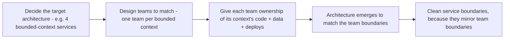

# Part 87 — Org Design, Conway's Law and Platform Engineering

Here is a claim that sounds like management fluff until you have seen it happen three times: the shape of your software is determined by the shape of your organisation, whether you intend it or not. The boundaries between your services will end up matching the boundaries between your teams. The APIs between components will be as clean or as messy as the communication between the people who own them. If you want to change your architecture, you often have to change your org, and if you change your org without thinking about architecture, your architecture will change anyway, usually for the worse.

This is Conway's Law, and it is the most important idea a principal engineer holds about org design. It means architecture and organisation are the same problem viewed from two angles, and that designing teams *is* designing systems. Part 47.12 covered DORA metrics; Part 49.8 covered on-call. This Part is about the org side of architecture: Conway's Law and how to use it deliberately, team topologies, cognitive load as a design constraint, service ownership, platform engineering and the internal developer platform, measuring and improving developer experience, and when a reorg is actually the right architectural change.

The reader this Part assumes is a staff or principal engineer who has noticed that their architecture problems are often really org problems in disguise, and wants to learn to design the org as deliberately as they design the system.

## 87.1 Conway's Law and the inverse Conway maneuver

#### Concept

Conway's Law, stated by Melvin Conway in 1967, is: organisations design systems that mirror their own communication structure. In plain terms: the way your teams are divided and the way they talk to each other will be reflected in the way your software is divided and the way its parts talk to each other. If you have four teams, you will tend to get four major components, with interfaces between them that mirror how those teams communicate. The **inverse Conway maneuver** is the deliberate use of this law: instead of letting your org accidentally shape your architecture, you design your org to *produce* the architecture you want.

#### Why does it exist?

Imagine you want a clean, modular architecture with four well-separated services, but your org is one big undifferentiated team of forty engineers who all work on everything. No matter how hard you try to keep the services separate, they will blur together, because the people have no boundaries between them — anyone can change anything, so everything ends up coupled to everything. The architecture cannot be cleaner than the org, because the people build what their communication structure allows them to build.

Conway's Law exists as an observation because this pattern is nearly universal and nearly inescapable. It exists as a *tool* (the inverse maneuver) because once you know architecture mirrors org, you can stop fighting the current and start using it: shape the teams to shape the software. Trying to impose an architecture that fights the org structure is swimming upstream; aligning the org to the desired architecture makes the architecture emerge naturally.

#### Mental model

Imagine water flowing down a hillside. It does not flow where you wish it would; it flows along the contours of the land. If you want the water to reach a particular place, you do not stand there shouting at it — you reshape the land so the water flows where you want. Conway's Law says software flows along the contours of the organisation. The communication paths between teams are the contours, and the software flows along them. The inverse Conway maneuver is reshaping the land (the org) so the software flows into the shape you want. Fighting Conway's Law by imposing an architecture against the org's contours is like trying to make water flow uphill; it is exhausting and it does not hold.

#### How it works

The mechanism of Conway's Law:

1. **Communication cost shapes design.** It is easy to coordinate within a team (you sit together, you talk constantly) and hard across teams (meetings, docs, waiting). So engineers naturally put tightly-coupled things inside one team's boundary (cheap to coordinate) and loosely-coupled things across boundaries (expensive to coordinate). The architecture's coupling mirrors the org's communication cost.
2. **Ownership shapes boundaries.** A component owned by one team gets a clean boundary because that team controls it. A component owned by no one, or by everyone, gets no clean boundary because no one defends it. Service boundaries form where ownership boundaries are.
3. **The accidental version.** If you do not design the org deliberately, the architecture still mirrors it — just accidentally. An org that grew haphazardly produces software that is shaped haphazardly, because the software followed the accidental org contours.

The inverse Conway maneuver, done deliberately:



You decide the architecture you want, you organise teams so that each team owns one piece of that architecture, and then the architecture emerges to match, because the teams build along their own boundaries. The org becomes the mould that shapes the software.

#### Practical example

A food-delivery company wants to move from a tangled monolith to four clean services: ordering, restaurant management, delivery logistics, and payments. The naive approach is to keep the existing one big team and ask them to build four clean services — which fails, because one undifferentiated team produces one tangled thing regardless of intent (there are no team boundaries for the service boundaries to mirror). The inverse Conway approach: first reorganise into four teams, one per intended service, each owning its context's code, data, and deploys. Now, when the ordering team builds, they build the ordering service, with a clean boundary to the others, because crossing to another team's code is expensive (Conway's communication cost) so they naturally minimise it and define a clear API instead. The four clean services emerge because four clean teams exist. The org change produced the architecture change; trying to produce the architecture without the org change would have failed.

#### Artifact example

An inverse Conway plan — the artifact that documents the target architecture and the org design that will produce it, side by side.

```markdown
# Inverse Conway plan: monolith -> 4 bounded-context services

## Target architecture (what we want the software to be)
Four services with clean boundaries, each owning its data:
- Ordering (cart, checkout, order lifecycle)
- Restaurant (menus, availability, restaurant onboarding)
- Delivery (driver assignment, routing, tracking)
- Payments (charges, refunds, payouts)

## Target org (the mould that produces it)
| Team | Owns (code + data + deploys) | Interfaces to |
|---|---|---|
| Ordering team | Ordering service + order tables | Restaurant (menu API), Payments (charge API), Delivery (events) |
| Restaurant team | Restaurant service + restaurant tables | Ordering (menu API) |
| Delivery team | Delivery service + delivery tables | Ordering (order events) |
| Payments team | Payments service + payment tables | Ordering (charge API) |

## The principle
We organise the TEAMS first, to match the architecture we want. The service
boundaries will emerge to mirror the team boundaries (Conway's Law). Trying
to build 4 clean services with 1 undifferentiated team would fail — there'd be
no team boundaries for the service boundaries to form along.

## Team interactions (deliberately designed, not accidental)
Interfaces between teams = interfaces between services. We design them: each
cross-team interaction is a versioned API or an event contract, NOT shared
code or a shared database. Cheap-to-coordinate things stay within a team.
```

The plan's insight is making the org design and the architecture design the *same* document, because they are the same decision. It names each team's ownership (which becomes a service boundary) and each team interaction (which becomes an API or event contract). The architecture is produced by the org, deliberately, rather than fought for against an org that would prevent it.

#### Real-world scenario

A company's architects spend a year trying to refactor a monolith into clean modules, fighting a constant losing battle: every time they establish a clean boundary, engineers from across the one big team erode it, because within one team crossing a boundary is cheap and nobody owns defending it. The architecture refuses to stay clean because the org has no boundaries for it to mirror. A principal engineer finally applies the inverse Conway maneuver: the org is split into teams aligned to the intended module boundaries, each team owning its module. Within two quarters, the boundaries that the architects could not maintain by willpower hold effortlessly — because now crossing a boundary means crossing a team boundary, which is expensive, so engineers naturally respect it. The year of architectural willpower achieved less than one quarter of org alignment, because Conway's Law was working against the architects the whole time and with them the moment the org matched the target. The lesson: an architecture that fights the org loses; align the org and the architecture comes for free.

#### Failure scenario

A company decides to adopt microservices and splits its monolith into fifteen services — but it does *not* change the org, which remains a few large, broadly-scoped teams where everyone works across all the services. The result is a distributed monolith produced by Conway's Law: because the teams span all the services, the services are coupled across team-less boundaries, deployed together (since a feature touches many services owned by the same broad team), and changed in lockstep. The company has fifteen services that must be deployed together, which is strictly worse than one monolith — they got the operational cost of microservices (network calls, fifteen deploy targets, distributed debugging) with none of the independence, because the org structure produced coupling across the service boundaries. Conway's Law shaped the architecture to mirror the broad-team org, overriding the intended microservices design. The architecture diagram said fifteen independent services; the org structure said a few broad teams; and Conway's Law ensured the org won. Splitting services without splitting teams is fighting Conway's Law, and Conway's Law always wins.

#### Edge cases & failure modes

- **Fighting Conway's Law.** Trying to impose an architecture that does not match the org, which erodes constantly because the org structure keeps reshaping it.
- **Splitting services without splitting teams.** Produces a distributed monolith, because broad teams span the service boundaries and couple them.
- **One undifferentiated team expecting clean modularity.** No team boundaries means no boundaries for the architecture to mirror; everything blurs together.
- **Accidental org shaping accidental architecture.** An org that grew haphazardly produces haphazard software; not using Conway deliberately does not escape it.
- **Reorganising without a target architecture.** Changing the org randomly produces a random architecture; the inverse maneuver needs a target architecture to aim the org at.
- **Ignoring the data boundary.** Teams that share a database stay coupled regardless of team boundaries; ownership must include data (Part 86.4).

#### How a Principal Engineer thinks about this

They hold architecture and org design as *the same problem*, and they never design one without the other, because they know Conway's Law means the org will shape the architecture whether they plan for it or not. When they want an architecture change, their first question is often "what org change produces this", because they have learned that fighting the org to impose an architecture is a losing battle, while aligning the org makes the architecture emerge for free. They use the inverse Conway maneuver deliberately: decide the target architecture, then design the teams as the mould that produces it.

They are especially alert to the trap of splitting services without splitting teams, because they have seen it produce the distributed monolith — the worst of both worlds — over and over. And they insist that team ownership includes *data*, not just code, because teams that share a database stay coupled through it regardless of how clean the team boundaries look on paper (the Part 86.4 lesson). The principal's distinctive move is to treat the org chart as an architecture diagram, because Conway's Law guarantees that is what it will become.

#### Common mistakes

- **Trying to achieve a clean architecture by willpower against an org that fights it,** instead of aligning the org.
- **Splitting services without splitting teams,** producing a distributed monolith.
- **Expecting one big team to produce cleanly-separated modules,** when there are no team boundaries for them to mirror.
- **Reorganising with no target architecture in mind,** producing a random architecture.
- **Aligning teams by code but not by data,** leaving them coupled through a shared database.

#### Interview questions

1. **What is Conway's Law and why does it matter for architecture?**
   *Expected answer:* organisations produce systems that mirror their communication structure — team boundaries become service boundaries, and the coupling between components mirrors the communication cost between teams. It matters because you cannot achieve an architecture cleaner than your org allows; architecture and org are the same problem. *Follow-up:* what is the inverse Conway maneuver.

2. **A company split its monolith into fifteen services but kept its few broad teams. What happened?**
   *Expected answer:* a distributed monolith — because the broad teams span all the services, the services are coupled across the (team-less) boundaries and deployed together, giving the operational cost of microservices with none of the independence. Conway's Law shaped the architecture to the broad-team org, overriding the intended design. You must split teams to split services. *Why it matters:* this is the most common and most expensive Conway failure.

3. **You want to change your architecture. Why might your first move be an org change?**
   *Expected answer:* because of Conway's Law — the org shapes the architecture, so imposing an architecture against the org is a losing battle while aligning the org makes the architecture emerge naturally (the inverse Conway maneuver). Decide the target architecture, then design teams as the mould that produces it, including data ownership. *Why it matters:* tests whether they see org and architecture as one problem.

#### Practical exercise

Look at your current architecture and your current org chart side by side. Map which team owns which component, and identify where the architecture does *not* match the org — components owned by nobody, components owned by multiple teams, or team boundaries that cut through what should be one component. Then pick an architecture change you want and design the org change (team boundaries and data ownership) that would produce it via the inverse Conway maneuver.

**Acceptance criteria:** you can point to at least one place where Conway's Law explains a current architecture problem (a coupling that mirrors a team structure, or a blurred boundary that mirrors shared ownership); and your proposed org change assigns each team a clear ownership of code *and* data for one piece of the target architecture, so that the architecture would emerge to mirror the teams rather than being fought for against them.
