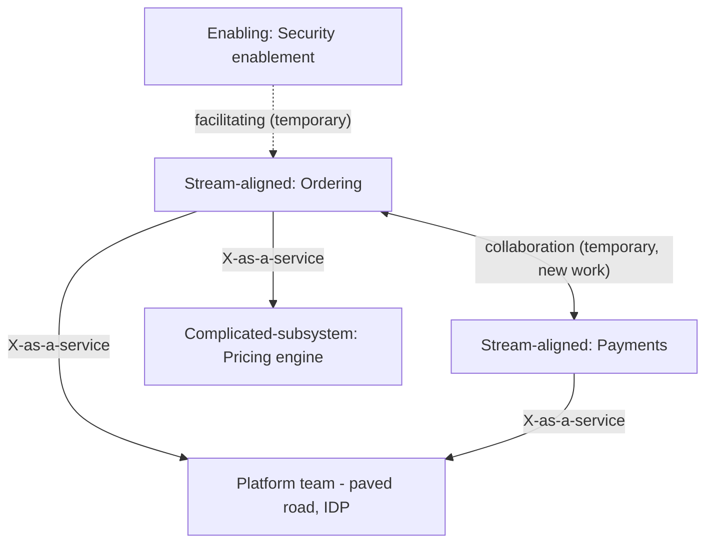

## 87.2 Team topologies: the four team types and interaction modes

#### Concept

Team Topologies, from the book of the same name by Matthew Skelton and Manuel Pais, gives a vocabulary for designing teams deliberately. It says there are really only four fundamental team types you need — **stream-aligned**, **platform**, **enabling**, and **complicated-subsystem** — and three ways teams should interact — **collaboration**, **X-as-a-service**, and **facilitating**. Most teams should be stream-aligned (owning a flow of work for part of the product), supported by a small number of platform, enabling, and complicated-subsystem teams. Having a shared vocabulary for team types turns org design from vibes into deliberate engineering.

#### Why does it exist?

Imagine an org that has grown into a zoo of ad-hoc teams: a "backend team", a "frontend team", a "DevOps team", a "database team", a "tools team", a "special projects team", each defined by technology or by historical accident rather than by a clear purpose and interaction model. Nobody is sure who owns what end to end, work constantly crosses team boundaries (a single feature needs the backend team, the frontend team, and the DevOps team to coordinate), and handoffs between technology-layer teams create delay and finger-pointing. The org has teams, but no coherent design.

Team Topologies exists to replace this zoo with four well-defined types, each with a clear purpose and a defined way of interacting, so that work flows within a team wherever possible (fast) rather than across teams (slow). It exists because "we have some teams" is not org design; deliberately choosing team types and interaction modes is.

#### Mental model

Imagine a well-run hospital. Most of the work is done by ward teams (stream-aligned) — each ward owns a flow of patients end to end, from admission to discharge, and a patient's care happens mostly within one ward. Supporting them are shared services: the pathology lab and the pharmacy (platform teams) that any ward can use as a service without coordinating care; specialist consultants (enabling teams) who come in to help a ward build a new capability and then leave; and highly specialised units like the cardiac surgery team (complicated-subsystem) that owns one deeply complex thing everyone else relies on but nobody else could run. The hospital works because each unit has a clear type and a clear way of interacting — wards do not hand patients back and forth through technology layers; they own the flow and pull in support as a service. Team Topologies is this hospital design applied to software.

#### How it works

The four team types:

| Team type | Purpose | Example | How many |
|---|---|---|---|
| **Stream-aligned** | Owns a flow of work for part of the product, end to end | Ordering team, Payments team | The large majority of teams |
| **Platform** | Provides internal services that make stream-aligned teams faster, as a product | The paved-road / IDP team (Part 85) | A few |
| **Enabling** | Helps stream-aligned teams adopt a new capability, then leaves | A testing or security enablement team | Few, small |
| **Complicated-subsystem** | Owns one deeply complex component others depend on but could not build | A pricing-optimisation or ML-ranking team | Rare, only where truly justified |

The three interaction modes:

- **Collaboration.** Two teams work closely together for a limited time on something new, accepting the high coordination cost because the discovery is worth it. Temporary by design — long-term collaboration means the boundary is wrong.
- **X-as-a-service.** One team consumes another's output as a service, with minimal coordination (just a clear API or contract). This is the goal for most interactions — it is low-friction and scalable. A stream-aligned team consumes the platform as a service.
- **Facilitating.** One team (usually enabling) helps another team learn or adopt something, then the interaction ends. The enabling team facilitates, it does not do the work for the other team.



The design principle: **maximise X-as-a-service interactions** (low friction, scalable) and **minimise and time-box collaboration** (high friction, only for genuine discovery). An org where teams are permanently collaborating across boundaries has drawn its boundaries wrong — the collaboration should either be internalised (one team) or turned into a service interface.

#### Practical example

A ride-booking company designs its org with Team Topologies. The bulk are stream-aligned teams, each owning a product flow end to end: the rider-app team (booking a ride), the driver-app team (accepting and completing rides), the pricing-display team. A single platform team provides the paved road and internal developer platform (Part 87.4) that all the stream-aligned teams consume as a service — they self-serve service creation, deployment, and observability without coordinating with the platform team. A small enabling team helps stream-aligned teams adopt a new observability standard, pairing with each for a sprint, then moving on. And one complicated-subsystem team owns the surge-pricing optimisation engine — a genuinely complex piece of applied math that the stream-aligned teams consume as a service (they call it for a price) but could not build or maintain themselves. Each team has a clear type, and the interactions are mostly X-as-a-service, so work flows within teams and friction is low. The pricing-display team gets a price from the pricing engine as a service, builds its display within its own boundary, and ships without coordinating with three other teams.

#### Artifact example

A team topology design for an org — the artifact that assigns every team a type and an interaction mode, replacing the ad-hoc zoo.

```markdown
# Team topology: ride-booking engineering (18 teams)

## Stream-aligned teams (14 — the majority, own product flows end to end)
- Rider app, Driver app, Pricing display, Trip history, Ratings, Promotions,
  Onboarding, Support tooling, ... (each owns its flow + data + deploys)

## Platform team (1 — provides internal services as a product)
- Developer Platform: paved-road template, CI/CD, observability, deploy
  self-service. Interaction with all stream-aligned teams: X-AS-A-SERVICE.
  Measured on stream-aligned teams' speed, not on tickets closed.

## Enabling teams (2 — help others adopt, then leave)
- Reliability enablement: pairs with a stream team for ~1 sprint to improve
  their SLOs/alerts, then moves on. Interaction: FACILITATING, temporary.
- Security enablement: helps teams adopt secure defaults. FACILITATING.

## Complicated-subsystem team (1 — owns one deeply complex thing)
- Surge-pricing engine: applied optimisation; other teams consume a price
  via API. Justified because it needs specialist skills + is used by many.
  Interaction: X-AS-A-SERVICE.

## Design rules
- Default team type is stream-aligned. We justify every non-stream team.
- Default interaction is X-as-a-service. Collaboration is temporary and
  time-boxed; permanent cross-team collaboration means a boundary is wrong.
- A complicated-subsystem team must clear a high bar (genuine complexity +
  broad reuse); otherwise the work belongs in a stream-aligned team.
```

The design's power is that it assigns every team a *type* with a clear purpose and a *defined interaction mode*, and it states the rules (default to stream-aligned, default to X-as-a-service, time-box collaboration, high bar for complicated-subsystem). This turns the org from an accidental collection of technology-layer teams into a deliberate design where work flows within teams and friction between them is minimised. It is architecture, applied to people.

#### Real-world scenario

An org restructures from technology-layer teams (backend team, frontend team, DevOps team, QA team) to stream-aligned teams (each owning a product area full-stack, from database to UI to deploy). The change is dramatic. Before, a single feature required coordination across four technology teams, with handoffs and queues at each boundary — the feature waited in the backend team's queue, then the frontend team's queue, then DevOps for deployment, then QA. Lead time was weeks of mostly waiting. After, one stream-aligned team owns the feature end to end — it does the backend, frontend, and deployment itself, pulling the platform in as a service — and ships in days with no cross-team handoffs. The technology-layer org had maximised cross-team handoffs (every feature crossed every layer); the stream-aligned org minimised them (features stay within one team). The lead-time improvement came almost entirely from eliminating the handoff queues between technology layers, which is exactly what stream-aligned teams are designed to do. This is the single most common and most valuable Team Topologies transformation: from technology-layer teams with handoff queues to stream-aligned teams that own a flow.

#### Failure scenario

An org adopts the Team Topologies vocabulary but misuses it: it declares nearly every team a "platform team" because platform sounds important and senior. Now there are eight "platform teams" and only a few stream-aligned teams, which inverts the intended ratio. The eight platform teams each build internal tools, but there are too few stream-aligned teams actually consuming them, so the platform teams build speculative infrastructure for demand that does not exist, while the overloaded handful of stream-aligned teams drown in product work. Worse, the platform teams, lacking real stream-aligned customers, start collaborating heavily with each other and with the stream teams on everything, so the org is permanent cross-team collaboration — the high-friction mode that was supposed to be rare. The vocabulary was adopted but the principles were not: the default should be stream-aligned (most teams), platform teams should be few and measured on stream-team speed, and interactions should default to X-as-a-service. Misapplying the types — too many platform teams, permanent collaboration — recreates the ad-hoc zoo with fancier labels. The types are only valuable if the *ratios and interaction principles* are respected, not just the names.

#### Edge cases & failure modes

- **Too many platform or complicated-subsystem teams.** Inverts the intended ratio; most teams should be stream-aligned, and the others justified against a high bar.
- **Technology-layer teams disguised with new names.** Calling the backend team a "platform team" does not change that features still cross every layer.
- **Permanent collaboration.** Teams collaborating long-term across a boundary means the boundary is wrong; collaboration should be temporary and time-boxed.
- **Enabling teams that do the work instead of facilitating.** An enabling team that takes over a stream team's work creates dependency instead of capability.
- **Complicated-subsystem teams for things that are not actually complicated.** Carving out a specialist team for ordinary work fragments ownership without justification.
- **Platform team measured on tickets, not on stream-team speed.** A platform team optimised for closing tickets builds what is easy to ticket, not what makes teams faster.

#### How a Principal Engineer thinks about this

They default every team to stream-aligned and treat every non-stream team as something to be justified, because they know the value of the model is work flowing *within* teams, which requires most teams to own a flow end to end. They keep platform, enabling, and complicated-subsystem teams few and purposeful, and they measure a platform team on the speed of the stream-aligned teams it serves, not on its own output, because a platform team exists to make others faster and will build the wrong things if measured on tickets.

They design interactions to default to X-as-a-service and they time-box collaboration ruthlessly, because they read permanent cross-team collaboration as a signal that a boundary is drawn wrong — the collaborating work should be internalised into one team or turned into a clean service interface. And they are wary of the vocabulary being adopted without the principles, because they have seen orgs relabel their technology-layer teams with Team Topologies names and change nothing. The principal uses the four types as a precise design language, respecting the ratios and interaction principles, not as a set of fashionable labels.

#### Common mistakes

- **Too many platform/complicated-subsystem teams,** inverting the ratio and starving stream-aligned teams.
- **Relabelling technology-layer teams** without changing that work crosses every layer.
- **Permanent cross-team collaboration,** which signals a wrong boundary.
- **Enabling teams doing the work** instead of building the other team's capability.
- **Measuring a platform team on its own output** rather than on the speed of the teams it serves.

#### Interview questions

1. **What are the four team types in Team Topologies, and which should be most common?**
   *Expected answer:* stream-aligned (owns a product flow end to end — should be the large majority), platform (internal services as a product — a few), enabling (helps others adopt a capability then leaves — few), complicated-subsystem (owns one genuinely complex component — rare). Most teams should be stream-aligned so work flows within teams. *Follow-up:* how do you justify a non-stream-aligned team.

2. **What does permanent collaboration between two teams tell you?**
   *Expected answer:* that the boundary between them is probably drawn wrong — collaboration is the high-friction mode and should be temporary and time-boxed for genuine discovery; permanent collaboration means the work should either be internalised into one team or turned into a clean X-as-a-service interface. *Why it matters:* tests whether they can read org friction as a boundary signal.

3. **How should a platform team be measured, and why does it matter?**
   *Expected answer:* on the speed and success of the stream-aligned teams it serves (lead time, self-service adoption, developer satisfaction), not on its own ticket throughput — because a platform team exists to make others faster and, if measured on tickets, will build what is easy to ticket rather than what actually unblocks teams. *Why it matters:* tests understanding of platform-as-product.

#### Practical exercise

Map your org's teams onto the four Team Topologies types. For each team, assign a type and note whether the assignment fits (does the stream-aligned team actually own a flow end to end, or is it a disguised technology-layer team). Count the ratio of stream-aligned to other types. Then map the interactions: which are X-as-a-service, which are collaboration, and flag any permanent collaboration as a possible boundary problem.

**Acceptance criteria:** most teams are (or should be) stream-aligned owning a flow end to end; each non-stream team is justified against its purpose; you identify at least one disguised technology-layer team or one permanent collaboration that signals a boundary problem; and you can state how your platform team is measured and whether that measurement drives it to make stream teams faster.
