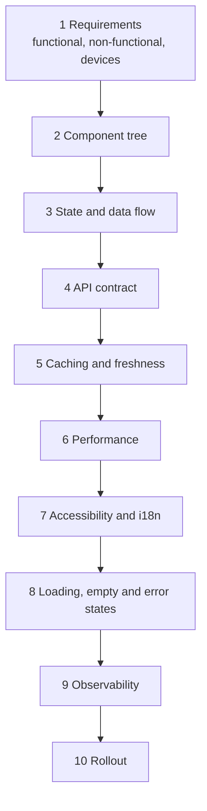
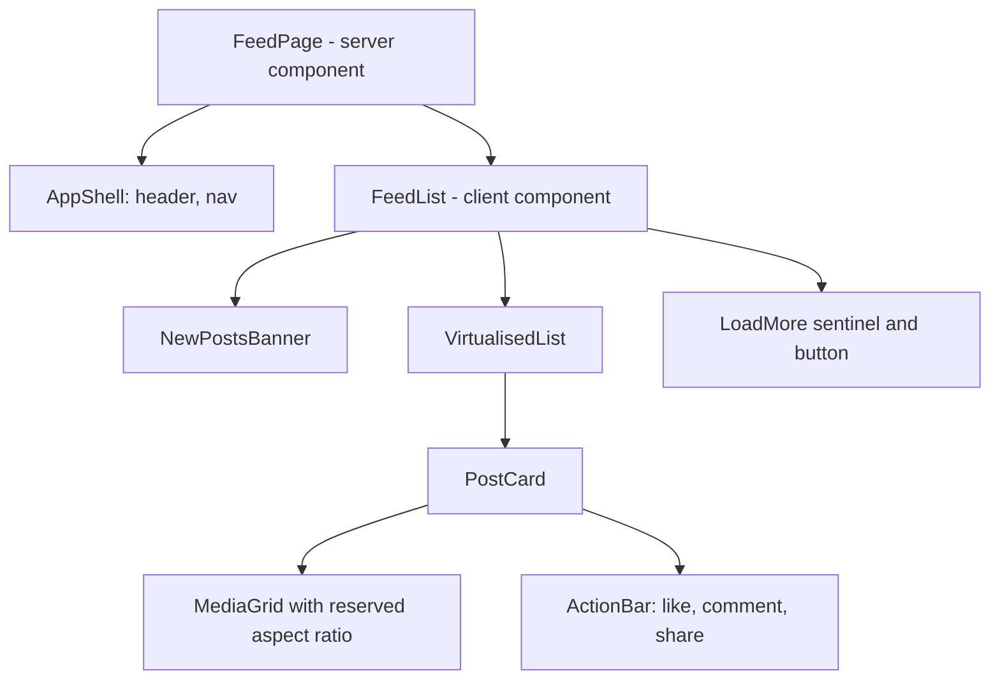
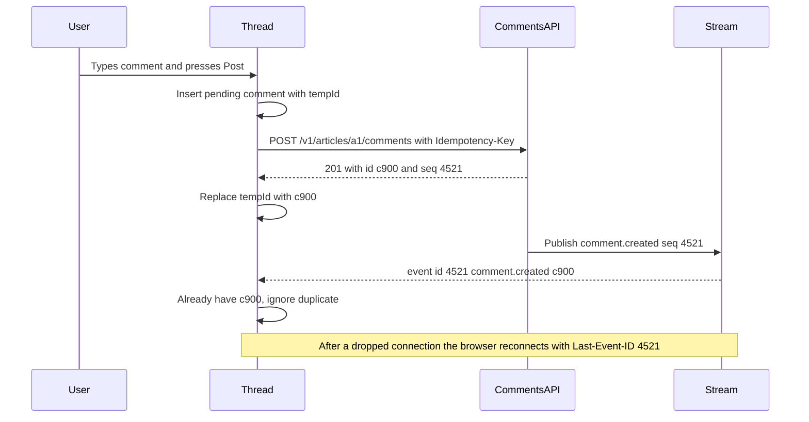
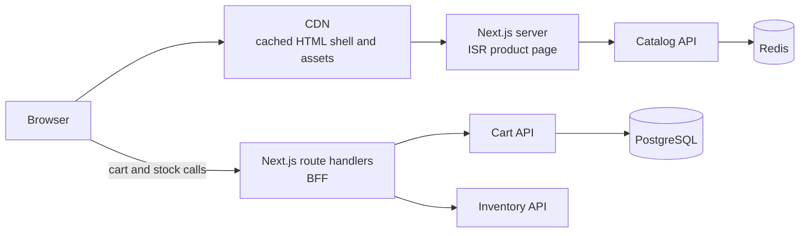
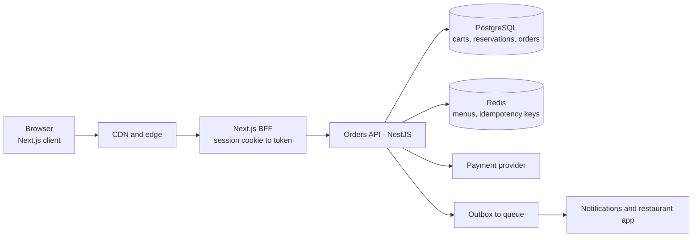
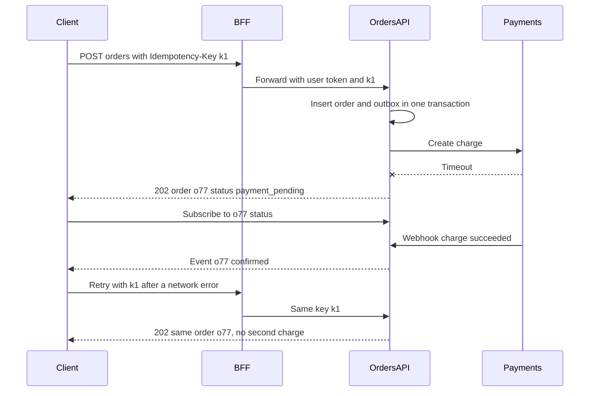

## 87.6 Frontend system design

### 87.6.1 A framework for the round

#### Concept

A frontend system design round asks you to design the client side of a product: "Design the news feed", "Design a comment thread with live updates", "Design a product page with a cart." The backend is a box you talk to through an API you define. The 45-minute procedure from Part 74 (74.3) still applies (clarify, estimate, design, deep dive, trade-offs), but the content of each step is different.

#### Why does it exist?

Large frontends fail in ways that are architectural, not syntactic: state duplicated in three stores, a page that ships 900 KB of JavaScript, a feed that janks on a mid-range phone, a real-time view that shows a message twice, a design that cannot be translated. The round checks that you can see those problems before they are built.

#### Mental model

Imagine designing a restaurant's dining room rather than its kitchen. The kitchen (backend) exists; your job is the flow of guests: where they wait, how orders reach the pass, what happens when a dish is late, how a guest in a wheelchair gets to a table. Same discipline, different room.

#### How it works

Walk through ten areas, spending most time on the two or three that matter for this product.



| Area | Questions you answer out loud |
|---|---|
| Requirements | Who uses it, on what devices and networks? Which features are in v1? Is SEO needed? What are the latency and size budgets? |
| Component tree | What are the main components, which are server-rendered, which are interactive? Where are the boundaries for loading and errors? |
| State and data flow | What is server state, URL state, local UI state, global state? Where does each live (87.4 Q24)? |
| API contract | Which endpoints, with what shapes, pagination, errors and real-time channel? Does a BFF aggregate them? |
| Caching | Which caches exist (CDN, HTTP, query cache), what are their keys and how is each invalidated? |
| Performance | Rendering strategy per region, bundle budget, images, virtualisation, Core Web Vitals targets |
| Accessibility and i18n | Keyboard model, screen reader announcements, focus, right-to-left layouts, number, date and currency formatting |
| States | Loading, empty, partial, error, offline, stale; what the user sees in each |
| Observability | RUM for Web Vitals, error tracking with source maps, a trace ID from click to database |
| Rollout | Feature flags, canary, old-bundle compatibility, kill switch |

#### How a Senior Full-Stack Engineer thinks about this

They anchor on numbers early ("a feed on a 4G phone; budget 170 KB of compressed JavaScript for the route; LCP under 2.5 s at p75"), pick a rendering strategy per region of the page rather than per app, and spend their deep-dive minutes on the part that is genuinely hard for this product: for a feed it is list performance, for a comment thread it is real-time consistency, for a product page it is caching and the cart.

#### Common mistakes

- Designing the backend in depth and never drawing a component.
- Naming libraries instead of decisions ("Redux and React Query") without saying what each holds.
- No error, empty or offline states.
- Treating accessibility and internationalisation as a closing sentence rather than a constraint that shapes components.

### 87.6.2 Worked design: a news feed

**Requirements.** Infinite feed of posts (text, up to four images, link previews); like and comment counts; like a post; see "new posts" without losing your place. Mobile-first web; 60% of users on mid-range Android over 4G. v1 excludes post creation. Targets: LCP 2.5 s, INP 200 ms, CLS 0.1 at p75.

**Component tree and rendering.** The shell and the first page of posts are server-rendered for fast LCP; the list is a client component because it scrolls, paginates and updates.



**State and data flow.** Pages of posts live in a query cache (`useInfiniteQuery` under the key `['feed']`). Posts are stored once by ID so a like on a post that appears twice (a share and the original) updates both. The like toggle is an optimistic mutation with rollback and an idempotency key. The scroll position and loaded pages survive navigation to a post and back because they live in the cache, not in component state.

**API contract.**

```ts
// GET /v1/feed?cursor=<opaque>&limit=20
type FeedPage = {
  items: Post[];
  nextCursor: string | null;   // opaque: encodes (rank, postId) so inserts never cause skips or repeats
};
type Post = {
  id: string;
  author: { id: string; name: string; avatarUrl: string };
  text: string;                // plain text; links detected on the client, never HTML from the server
  media: { url: string; width: number; height: number; alt: string }[];
  likeCount: number;
  likedByMe: boolean;
  createdAt: string;           // ISO 8601 UTC
};
// POST /v1/posts/:id/like and DELETE /v1/posts/:id/like are idempotent by design (PUT-like semantics)
// GET /v1/feed/new-count?since=<postId> for the banner, polled every 60 s while the tab is visible
```

**Performance deep dive.** The feed is the hard part:

- **Virtualisation** keeps about 15 cards in the DOM instead of 600 after ten minutes of scrolling. Variable-height cards need measurement; the library measures on render and caches heights by post ID.
- **Images** carry `width` and `height` from the API, so space is reserved (no CLS); the first card's image is `fetchpriority="high"`, the rest `loading="lazy"`, in responsive sizes from an image CDN (82.8).
- **New posts** go into a banner ("12 new posts") that the user clicks, rather than being inserted above the reading position. Inserting rows above the viewport is the most common feed CLS bug.
- **JavaScript budget**: the like animation, share sheet and comment drawer are lazy-loaded on first interaction (82.7).

**Accessibility.** The ARIA `feed` pattern: a container with `role="feed"` and `aria-busy` while loading, each post an `<article>` with `aria-posinset` and `aria-setsize` (use `-1` when the total is unknown), keyboard shortcuts to move between posts, and a visible "Load more" button as an alternative to scrolling.

**States, observability, rollout.** Skeleton cards of fixed height for the first load; an inline retry row when a page fails; "You are offline, showing saved posts" when `navigator.onLine` is false and the cache has data. RUM reports INP and CLS for the feed route separately; a long-animation-frame or long-task metric during scroll flags jank. The new feed ships behind a flag to 5% of users, compared on scroll depth and INP before widening.

**What a strong answer adds.** Ranking is a backend concern, but cursor design is shared: a ranked feed cannot use `created_at` alone as a cursor. Server-side, a feed is a fan-out problem (59.12); the frontend's job is to never ask for more than it shows.

### 87.6.3 Worked design: a comment thread with live updates

**Requirements.** Comments under an article, one level of replies, newest first; post, edit within 10 minutes, delete own comments; new comments from others appear live; 2,000 concurrent readers on a popular article, about 5 new comments per second at peak.

**Transport.** The client only receives updates and sends occasional writes through normal POST requests, so **Server-Sent Events** fit better than WebSockets: plain HTTP, automatic reconnection, and `Last-Event-ID` for resume (38.1.1, 38.3.1). Writes stay as REST calls with idempotency keys.



**State.** A normalised map `commentsById` plus an ordered list of top-level IDs and, per parent, a list of reply IDs. Every event carries the article's monotonically increasing `seq`. The client applies an event only if `seq` is greater than the last applied one for that comment, so duplicates and replays are harmless. Optimistic inserts carry a client-generated `tempId`; the POST response or the stream event, whichever arrives first, reconciles it to the real ID.

**API contract.**

```ts
type Comment = {
  id: string;
  parentId: string | null;
  author: { id: string; name: string };
  body: string;                 // plain text; rendered with React escaping, never as HTML
  status: 'visible' | 'deleted' | 'hidden_by_moderator';
  editedAt: string | null;
  createdAt: string;
  version: number;              // for edit conflicts: PATCH sends If-Match with this version
};
type CommentEvent =
  | { type: 'comment.created'; seq: number; comment: Comment }
  | { type: 'comment.updated'; seq: number; comment: Comment }
  | { type: 'comment.deleted'; seq: number; id: string };
// GET /v1/articles/:id/comments?cursor=   (newest first, 20 per page; replies collapsed with a count)
// GET /v1/articles/:id/comments/stream    (SSE; supports Last-Event-ID)
```

**Deep dives.**

- **Live insertion without disruption.** If the reader is at the top, new comments slide in; if they are reading further down, show "3 new comments" instead of shifting the page.
- **Edit conflicts.** Two tabs editing the same comment: `PATCH` with `If-Match: <version>` returns 412 for the stale one, and the UI offers to reload the latest text (optimistic concurrency, Part 24 — Database Transactions and Concurrency Control).
- **Moderation and deletion.** A deleted comment with replies becomes a tombstone ("This comment was deleted") so replies keep their context.
- **Security.** User text is rendered as text; links become anchors only after scheme validation; rate limits on POST are enforced by the server and surfaced as a clear 429 message with a retry time (18.13).
- **Scale.** 2,000 readers is 2,000 idle SSE connections per article, which the backend fans out through pub/sub across pods (38.5); the frontend keeps one stream per tab and closes it when the tab is hidden for more than a few minutes, catching up with `Last-Event-ID` on return.

**Accessibility and i18n.** New comments are announced politely and in batches ("3 new comments"), not one by one; relative times ("2 minutes ago") use `Intl.RelativeTimeFormat` and update at most once a minute; the reply form returns focus to the new reply after posting.

**What a strong answer adds.** At-least-once delivery plus idempotent application is the whole consistency model, and the same `seq` makes resume, deduplication and ordering one mechanism. For collaborative editing of one document (not a thread), the problem becomes operational transforms or CRDTs (71.2.10), which is a different design.

### 87.6.4 Worked design: an e-commerce product page with a cart

**Requirements.** Product details, images, price, stock status, variant picker (size, colour), reviews summary, "Add to cart" with a mini-cart. SEO matters. 50,000 products; prices change a few times a day; stock changes constantly during sales. LCP under 2.5 s at p75 on mobile.

**Rendering per region**, because one page mixes data with very different freshness and personalisation:

| Region | Freshness need | Personal? | Strategy |
|---|---|---|---|
| Title, description, images, specs | Hours | No | Static or ISR, cached at the CDN, revalidated by tag on publish |
| Price | Minutes, must be correct at checkout | Sometimes (member pricing) | Server-rendered per request or streamed; re-checked at checkout |
| Stock status | Seconds during sales | No | Client fetch with a short `staleTime`, or streamed |
| Reviews summary | Hours | No | ISR, streamed below the fold |
| Cart and mini-cart | Immediate | Yes | Client component; server is the source of truth |
| Recommendations | Minutes | Yes | Client-rendered after load, lazily |



**State and data flow.** Product data arrives from the server render. The selected variant lives in the URL (`?variant=blue-m`) so it can be shared and survives reload; changing it swaps images and price without a navigation. The cart is server state: `useQuery(['cart'])` with optimistic "Add to cart" that bumps the mini-cart count at once, sends `POST /v1/cart/items` with an idempotency key, and rolls back with a message if stock ran out.

**Contract decisions.** Money in minor units with a currency code (80.7); availability as an enum (`in_stock`, `low_stock`, `out_of_stock`, `preorder`) with a display message chosen by the client; the cart response returns the full recalculated cart (totals, discounts, line errors) so the client never computes totals itself.

**Performance.** The hero image is the LCP element: preloaded, correctly sized with `srcset`, not lazy. The variant picker and Add to cart button are the only client components above the fold (79.4). Third-party tags (analytics, chat widget) load after interaction or idle (81.8, 76.7). Space is reserved for the price and stock line so streaming them in does not shift layout. Part 82's worked example (82.12) takes a page like this from LCP 4.8 s to under 2.5 s; Part 79's (79.13) builds the ISR listing with a client cart.

**Accessibility and i18n.** The variant picker is a radio group (one Tab stop, arrow keys within); out-of-stock variants are announced as unavailable rather than hidden; the price uses `Intl.NumberFormat` with the user's locale and the product's currency; "Added to cart" is announced in a live region and focus stays on the button.

**What a strong answer adds.** The price on the page is a display, the price at checkout is a contract: the order API recalculates it, and the page must handle "price changed since you added this" gracefully. Cache invalidation is the real design: a price change must purge the CDN page by tag and update the Redis entry, or two caches disagree for an hour.

## 87.7 Full-stack system design: the contract is the design

### 87.7.1 Worked design: checkout with stock reservation

#### Concept

In a full-stack design round, the interviewer wants one feature end to end: browser, BFF or API, database, cache. The best candidates spend the most time on the **contract between frontend and backend**, because that is where full-stack engineers add value that neither a pure frontend nor a pure backend engineer brings. Part 80 — Frontend–Backend Contracts is the toolkit; Part 85 — Full-Stack Worked Project: Live Order Tracking is a complete worked build. This section shows how to present one in 45 minutes.

**The prompt.** "Design checkout for a food-delivery app: the user reviews the cart, applies a coupon, picks an address, pays, and sees the order confirmed. Restaurants have limited stock of some dishes."

#### How it works

**Requirements and numbers.** 2 million daily users, 150,000 orders a day, peak 15 orders per second at dinner (about 3x average), checkout p95 under 800 ms excluding the payment provider. A dish must not be sold beyond its stock. Payments can time out.



**The contract first.** Write the shapes before drawing boxes; they decide the rest.

```ts
// Shared in @shop/contracts as zod schemas; validated in the BFF, the API and the client (80.3)
type Money = { amountMinor: number; currency: 'INR' | 'USD' };

type CheckoutSession = {
  id: string;
  version: number;                         // optimistic concurrency: every PATCH sends If-Match
  lines: { dishId: string; name: string; qty: number; unitPrice: Money; issue?: 'out_of_stock' | 'price_changed' }[];
  coupon: { code: string; discount: Money } | null;
  addressId: string | null;
  totals: { subtotal: Money; delivery: Money; discount: Money; total: Money };  // always computed by the server
  reservationExpiresAt: string;            // stock held for 10 minutes
};

// POST  /v1/checkout-sessions                      create from cart; reserves stock
// PATCH /v1/checkout-sessions/:id   If-Match: 7    coupon or address; returns the full recalculated session
// POST  /v1/checkout-sessions/:id/orders  Idempotency-Key: <uuid>   place the order and start payment
// Errors: application/problem+json with code, issues[], requestId (80.6)
//   409 OUT_OF_STOCK (issues point at lines[i]), 412 VERSION_MISMATCH, 422 COUPON_INVALID, 402 PAYMENT_DECLINED
```

Why each choice matters:

- **The server computes every total.** The client renders `totals` and never adds prices, so coupon rules live in one place.
- **Full-object responses** to every PATCH remove a class of bugs where the client patches local state differently from the server.
- **`If-Match` with `version`** stops two tabs from applying conflicting coupons silently; the stale tab gets 412 and refetches.
- **The idempotency key on order placement** is created when the user lands on the pay step and reused on every retry, so a double click, a refresh or a timeout retry cannot create two orders or two charges (33.12, 71.8).
- **Typed error codes with `issues` paths** let the UI put "Paneer tikka is sold out" on the right line instead of a toast (80.6).

**Data and consistency.** Reservations are rows with an expiry: `UPDATE dish_stock SET reserved = reserved + $qty WHERE dish_id = $id AND available - reserved >= $qty` in the same transaction that inserts the reservation; zero rows updated means out of stock (Part 24). A scheduled job releases expired reservations. Order placement writes the order and an outbox row in one transaction (33.10), then calls the payment provider; an unknown payment outcome leaves the order in `payment_pending`, resolved by the provider's webhook or a reconciliation job (33.13). The user-visible states are designed, not accidental (33.14): "Confirming payment" is a real screen.

**Caching.** Menus and dish details are cached in Redis and at the CDN (public, minutes). Checkout sessions are never cached by shared caches (`private, no-store`). The client query cache holds the session under `['checkout', id]` and replaces it with each server response.

**Frontend behaviour.** The pay button is disabled while a submission is in flight and the idempotency key is reused on retry; on `payment_pending` the page subscribes to the order's status (SSE, as in 85.2) instead of polling every second; on 409 the cart page highlights the affected line and offers alternatives.

**Rollout and observability.** The new checkout ships behind a flag per city. A trace ID travels from the browser click through the BFF to the API and database (84.7, 79.11). Dashboards: checkout conversion, p95 latency per step, 409 and 412 rates, `payment_pending` older than 5 minutes.



#### How a Senior Full-Stack Engineer thinks about this

They draw the contract before the boxes, design the error and pending states as carefully as the happy path, and make sure every retry anywhere in the chain is safe. They name what they would not build in v1 (split payments, scheduled orders) and why that is safe to defer.

#### Common mistakes

- Letting the client compute totals or decide stock.
- A generic `{ error: "Something went wrong" }` contract that the UI cannot map to fields.
- Treating a payment timeout as a failure and letting the user pay again.
- Designing the database in detail and never saying what the user sees during each state.

#### Interview questions

1. Why return the full session from every PATCH instead of a diff? Expected: one source of truth, no client-side recalculation drift, simpler caching; the cost is a slightly larger payload, which is trivial here.
2. Where do you generate the idempotency key and when do you reset it? Expected: on the client, once per placement attempt; reset only after a definitive result or a meaningful change to the session.
3. How does a breaking change to `CheckoutSession` reach production safely? Expected: additive changes first, both versions supported while old bundles are in the wild, contract tests in CI (80.9, 80.10, 78.4).
4. What happens if the reservation expires while the user is on the payment page? Expected: the order endpoint re-checks stock atomically and returns 409; the UI shows the affected lines; the timer is shown to the user so it is not a surprise.

#### Practical exercise

Pick one feature from your current job and write its contract in the style above: shapes, endpoints, error codes with `issues` paths, idempotency and concurrency rules, and the user-visible states for each failure. Acceptance criteria: a frontend engineer could build the UI against MSW mocks from your contract alone (83.6), and every retry in your design is safe.
