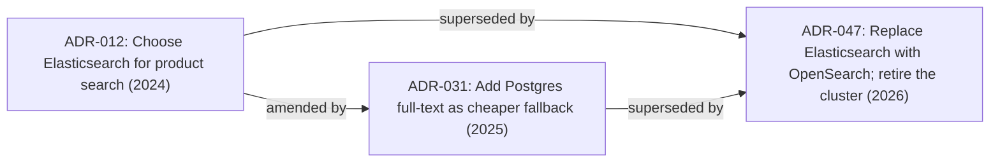

## 88.7 ADR chains, keeping docs alive, and the anti-patterns

#### Concept

Three final threads that separate people who write documents from people whose documents still matter years later. The first is the **ADR chain**: how a sequence of decision records tells the story of a choice made, lived with, and eventually replaced — because decisions have a life, and the record should show it. The second is **keeping docs alive**: fighting doc rot by linking documents to the code and tickets they describe, and superseding decisions rather than letting them quietly become lies. The third is the catalogue of **doc anti-patterns** — the predictable ways documents fail — so you can recognise and avoid them.

#### Why does it exist?

Imagine joining a team and finding an ADR that says "we chose Elasticsearch for search". You build on that assumption. Then you discover, by accident, that the team actually moved to a different engine a year ago, and the ADR was never updated. The record did not just fail to help you; it actively misled you into wrong decisions. One stale document can cost more than ten missing ones, because a missing document makes you ask and a stale one makes you confidently wrong.

ADR chains and superseding exist because decisions are not permanent, and a record that pretends they are will eventually lie. Linking docs to code and tickets exists because a document disconnected from the thing it describes drifts away from reality the moment the code changes. And naming the anti-patterns exists because they are so common that you will produce them by default unless you can see them coming.

#### Mental model

Imagine a legal system where a new law can repeal an old one, but the old law stays in the books marked "repealed by Act of 2026", with a pointer to what replaced it. You can always see what the law *was*, when it changed, and why. You never have to guess whether a law is current, because its status is explicit. An ADR chain is exactly this: each decision stays on the record, and when a later decision replaces it, the old one is marked "Superseded by ADR-N" rather than deleted. The history is the point.

#### How it works

**ADR chains.** An ADR is immutable once accepted. When the decision changes, you write a *new* ADR that references and supersedes the old one. Over years, this produces a chain that tells a story.



Each ADR in the chain records what was true at the time, so a new engineer reading ADR-047 can follow the links back and understand not just what search engine they run today, but the whole arc: why Elasticsearch was chosen, what problem drove the Postgres fallback, and what finally forced the move to OpenSearch. The chain is institutional memory.

**Keeping docs alive.** Three practices fight rot:

1. **Link docs to code and tickets.** The design doc links to the pull requests that implemented it; the code links back to the design doc and the ADR (a comment or a `// see ADR-047` reference); the RFC links to the Jira epic. When any one changes, the links lead you to the others.
2. **Supersede, do not edit.** Accepted ADRs and RFCs are immutable. A changed decision is a new document that supersedes the old, with the old marked superseded. Living documents (like a current-architecture overview) are explicitly marked as living and dated.
3. **Date everything and mark status.** Every document has a visible status (Draft, Accepted, Superseded, Living) and a last-reviewed date. A reader can tell at a glance whether to trust it.

**The anti-patterns.** The predictable failure shapes:

```text
Solution looking for a problem -> thin problem section, lavish solution
The 40-page doc nobody reads   -> no summary, no clear ask, buried decision
The decision already made       -> fake consultation; reviewers sense it, disengage
The strawman alternatives       -> rejected options described weakly (see 88.4)
Doc rot                         -> stale doc trusted as current
The template filled with blanks -> sections present but empty or "TODO"
```

#### Practical example

A new engineer joins the search team and needs to understand why the system is shaped the way it is. Instead of interrupting three people, they open the current-architecture doc, which is marked "Living, last reviewed 2026-09". It links to ADR-047 as the current search decision. ADR-047 opens with "Supersedes ADR-012 and ADR-031" and a paragraph on the arc. Fifteen minutes of reading replaces half a day of interruptions and produces a more accurate understanding than any single person could have given, because no single person remembered the whole two-year story. That is what a maintained ADR chain buys.

#### Artifact example

The worked ADR chain for choosing and then replacing a search engine over two years — the second worked example the outline asks for. Shown as three linked records, abbreviated to their decision-bearing parts.

```markdown
# ADR-012: Use Elasticsearch for product search
Status: Superseded by ADR-047 (2026-05)
Date: 2024-03
Context: PostgreSQL LIKE queries on 2M products are slow (>900 ms) and
  cannot do relevance ranking or faceting. Product wants typo tolerance
  and facets.
Decision: Adopt a managed Elasticsearch cluster. Index products via an
  outbox-driven sync from PostgreSQL.
Consequences: New cluster to operate. Relevance and facets solved.
  Eventual consistency between PG and the index (acceptable, ~seconds).

---

# ADR-031: Add PostgreSQL full-text search as a fallback tier
Status: Superseded by ADR-047 (2026-05)
Date: 2025-02
Context: Elasticsearch cluster is our single most expensive service
  ($3,400/mo) and causes 60% of search-feature incidents. Many queries
  are simple prefix lookups that do not need ES.
Decision: Route simple autocomplete/prefix queries to PostgreSQL
  full-text (tsvector + GIN). Keep ES for relevance/faceted search.
Consequences: ES load drops ~40%. Two search paths to maintain. This is
  a bridge, not a destination.

---

# ADR-047: Replace Elasticsearch with OpenSearch; retire the ES cluster
Status: Accepted
Date: 2026-05
Supersedes: ADR-012, ADR-031
Context: Our Elasticsearch version reached end of support; the licence
  terms changed; cost rose to $4,100/mo. OpenSearch is API-compatible
  for our usage, cheaper on our cloud, and the platform team already
  runs one for logs.
Decision: Migrate the product index to the shared OpenSearch cluster
  using a parallel-run (Part 91): dual-index, compare results on 100%
  of queries for 2 weeks, cut reads over behind a flag, retire ES.
  Keep the PostgreSQL full-text tier from ADR-031 unchanged.
Consequences: ~$2,000/mo saved. One fewer cluster we operate alone.
  Migration risk managed by parallel run. ADR-031's PG tier survives.
```

Read as a chain, these three records tell the full two-year story: a search engine chosen for good reasons, a pragmatic cost-cutting bridge added when it got expensive, and a clean replacement when the version and licence forced the issue — with the useful part of the bridge (the Postgres tier) deliberately kept. A single engineer rarely holds all of this; the chain does.

#### Real-world scenario

A company runs an architecture wiki with hundreds of pages. Over three years, most of it rots — pages describe systems that no longer exist, decisions that were reversed, services that were deleted. New engineers learn to distrust the wiki entirely, which means the good pages are wasted too. A principal engineer fixes this not by rewriting everything but by introducing two rules: every page must carry a status and a last-reviewed date, and any decision page must be either immutable-and-superseded or explicitly marked living. Pages past a review date without a refresh get an automatic "possibly stale" banner. Within a quarter, engineers trust the wiki again, because they can now tell at a glance which pages to believe. The content barely changed; the *trustworthiness signals* changed, and trust is what makes documentation worth having.

#### Failure scenario

A team keeps all its decisions in a single "Architecture" wiki page that everyone edits in place. Over two years it is edited hundreds of times. A dispute arises: did we or did we not decide to drop support for the legacy API in 2025? Nobody can tell, because the page only ever shows its current state, and the current state has been overwritten dozens of times. There is no record of what was decided when, or why. The team spends a week reconstructing the history from Slack and memory, reaches no firm answer, and makes a worse decision than they would have if the original reasoning had survived. Editing decisions in place destroyed exactly the thing decision records exist to preserve: the history.

#### Edge cases & failure modes

- **Editing an ADR in place.** The history is destroyed; you can no longer tell what you believed or why. Supersede instead.
- **Doc rot trusted as current.** A stale document actively misleads. Status and dates let readers calibrate trust.
- **Links that break.** A design doc links to a ticket that was deleted; the chain of context snaps. Link to durable identifiers, and link bidirectionally.
- **The "living" document that nobody reviews.** Marked living but last touched eighteen months ago. Living means someone owns reviewing it on a cadence; without that, it is just rot with a nicer label.
- **Superseding without linking.** A new ADR replaces an old one but does not reference it, so a reader of the old one never learns it was replaced. Always mark the old one superseded, with a pointer.
- **Anti-patterns combined.** The 40-page doc that is also a solution looking for a problem with strawman alternatives — common, and fatal to any chance of the idea landing.

#### How a Principal Engineer thinks about this

They treat the historical record as an asset the organisation owns, not as clutter. They never edit an accepted decision; they supersede it, because they know a future engineer's correct decision depends on understanding the arc, not just the current state. They design documentation so that trust is legible — status, dates, ownership — because a body of docs is only worth maintaining if people believe it, and belief depends on being able to tell the fresh from the stale at a glance.

They are allergic to the anti-patterns because they have been burned by all of them. They can smell a solution-looking-for-a-problem from the shape of the document — thin problem, lavish solution — and they will send it back regardless of how good the solution is, because a solution to a problem you have not established is a liability. And they keep documents short and linked, because a document disconnected from the code and tickets it describes is a document that will drift into fiction.

#### Common mistakes

- **Editing decisions in place.** Destroys the history that is the whole point.
- **No status or date on documents.** Readers cannot tell the current from the obsolete, so they distrust all of it.
- **"Living" documents with no owner or review cadence.** Rot wearing a respectable label.
- **Superseding silently.** The old document never points to its replacement, so readers of it are misled.
- **Not recognising the anti-patterns in your own drafts.** Everyone writes a solution-looking-for-a-problem occasionally; the skill is catching it before others do.

#### Interview questions

1. **Why are ADRs immutable, and what do you do when a decision changes?**
   *Expected answer:* immutability preserves the historical record of what you believed and why at a point in time; when a decision changes you write a new ADR that supersedes the old, mark the old one superseded with a pointer, and the chain tells the story. *Why it matters:* tests whether they value institutional memory over tidiness.

2. **How do you fight doc rot across a large architecture wiki?**
   *Expected answer:* make trust legible with status and last-reviewed dates, distinguish immutable/superseded decisions from explicitly-owned living docs, link docs to code and tickets bidirectionally, and flag stale pages automatically. You cannot keep everything fresh, but you can make freshness visible. *Follow-up:* why is a stale doc worse than a missing one.

3. **Name three document anti-patterns and how you would catch each.**
   *Expected answer:* solution looking for a problem (thin problem section — send back for a real problem statement), the 40-pager nobody reads (no summary/ask — demand a standalone summary), strawman alternatives (rejected options with no real advantages — demand a steelman). *Why it matters:* tests whether they can review documents, not just write them.

#### Practical exercise

Find a decision your team made and reversed at some point. Write the two ADRs that should exist: the original decision (with its real context and consequences at the time) and the superseding decision (referencing the first, with the reason the original stopped being right). Then audit three documents your team relies on and add a status and last-reviewed date to each, marking any that are actually stale.

**Acceptance criteria:** the two ADRs together let a new engineer understand the full arc of the decision without talking to anyone, the superseding ADR explicitly points back to the original, and your three audited documents now each carry a status that tells a reader whether to trust them.

## 88.9 The post-incident review as a document, and writing at scale

#### Concept

Two topics that extend the Part's craft. The **post-incident review (PIR)** is a document type with its own discipline: a blameless account of what broke, a precise timeline, the real root cause, and tracked actions — written so the organisation learns rather than assigns blame. And **writing at scale** is what changes when an organisation has hundreds of documents and dozens of authors: the need for discoverability, templates that enforce quality, a culture that reads and comments, and metrics for whether the documentation is actually healthy. Both are where the individual craft of writing meets the organisational reality of many documents and many readers.

#### Why does it exist?

Imagine an incident handled well operationally but never written up, or written up as a blame exercise ("the on-call engineer made a mistake"). In the first case, the lesson evaporates and the same incident recurs next quarter. In the second, people learn to hide their involvement in incidents, so the information needed to prevent recurrence dries up. The blameless PIR exists to capture the lesson and to do so in a way that keeps people sharing, so the organisation actually learns from its failures (Part 53 covers the operational side; here we focus on the document).

Writing at scale exists as a distinct concern because the problems change with volume. One author writing ten documents can keep them findable and current by memory. Fifty authors writing hundreds of documents cannot — without deliberate discoverability, templates, a reading culture, and health metrics, the documentation becomes an unnavigable, rotting pile that nobody trusts, wasting all the individual writing effort. Writing at scale is about the systems that keep a large body of documents valuable.

#### Mental model

For the PIR, imagine an aviation accident investigation. It is meticulous (a precise timeline), it seeks the systemic root cause (not "the pilot erred" but "why did the system let a tired pilot make that error"), and it is explicitly blameless, because the goal is preventing the next crash, not punishing this one — and punishment would make people hide information, making flying less safe. A PIR is the aviation investigation of a software incident: blameless, precise, systemic, aimed at prevention.

For writing at scale, imagine a library. One person's bookshelf needs no system — they know where everything is. A library with a million books needs a catalogue (discoverability), acquisition standards (templates/quality), librarians who weed outdated books (fighting rot), and usage statistics (health metrics). Writing at scale is running a library, not a bookshelf: the systems that keep a large collection findable, current, and trusted.

#### How it works

**The post-incident review as a document:**

```text
A good PIR contains:
- Summary: what happened, impact (users affected, duration, $), in 2-3 lines.
- Timeline: precise, timestamped sequence (detection -> diagnosis -> mitigation
  -> resolution). The timeline often reveals the real improvement areas (e.g.
  detection took 40 min -> the lesson is faster detection).
- Root cause: the SYSTEMIC cause, blamelessly. Not "X forgot" but "the system
  allowed X to happen because there was no guardrail." Five-whys to get there.
- What went well: what limited the damage (so you keep doing it).
- Action items: specific, owned, dated, tracked to completion. A PIR whose
  actions are never done is theatre.
- Blameless throughout: no names-as-causes; systemic framing only.
```

The blameless framing is the load-bearing discipline: the moment a PIR assigns personal blame, people stop contributing honestly to future ones, and the organisation stops learning. The goal is a better system, not a culprit.

**Writing at scale:**

- **Discoverability.** A large body of documents is worthless if nobody can find the relevant one. Needs search, consistent naming, linking, and an index or catalogue. The best document is useless if the reader cannot find it.
- **Templates that enforce quality.** At scale, you cannot rely on every author knowing the craft; templates (Part 88.8) bake in the structure so every design doc, RFC, and PIR has the sections it needs, raising the floor across all authors.
- **A reading and commenting culture.** Documents only work if people read and engage with them; this is cultural (Part 94.6) — norms that reviewing a doc is real work, that comments get resolved, that the author gets feedback.
- **Health metrics.** Signals that the documentation is actually working: are docs being read (view counts), are they current (last-reviewed dates, Part 88.7), are decisions findable, are PIR actions completed. Metrics turn "we have docs" into "our docs are healthy or not".

#### Artifact example

A post-incident review, filled in blamelessly — the artifact that turns an incident into an organisational lesson.

```markdown
# PIR: order placement outage, 2026-10-14

## Summary
Order placement failed for ~22 minutes (14:02-14:24 UTC), ~4,100 orders
delayed, ~$180k in delayed revenue (recovered). Cause: the notification
service saturated and, because order placement called it synchronously, order
placement saturated too. (This incident motivated RFC-114, §88.6.)

## Timeline (precise, timestamped)
- 14:02 notification DB hit connection limit; notification calls slowed.
- 14:02 order placement p99 spiked (it awaits the notification call).
- 14:09 first alert fired (order error rate). DETECTION TOOK 7 MIN — a lesson.
- 14:14 on-call identified the coupling to notifications.
- 14:18 mitigated: feature-flagged the notification call to fire-and-forget.
- 14:24 order placement recovered.

## Root cause (systemic, blameless)
Order placement was SYNCHRONOUSLY coupled to the notification service, so the
notification service's saturation propagated to order placement. The system
ALLOWED a non-critical dependency to fail a critical path. This is an
architectural coupling, not a person's error.

## What went well
- The feature flag let us mitigate in 4 minutes once diagnosed. Keep using flags.

## Action items (owned, dated, tracked)
1. Decouple notifications from order placement via outbox+events (RFC-114).
   Owner: [you]. Due: Q1. [THIS IS THE REAL FIX — removes the coupling.]
2. Add an alert on notification-DB connection saturation (detection was 7 min).
   Owner: notifications team. Due: 2 weeks.
3. Add a circuit breaker as interim protection until #1 ships.
   Owner: order team. Due: 1 week.

## Blameless note
No individual caused this. The architecture coupled a critical path to a
non-critical dependency. We fix the architecture.
```

The PIR's power is that it is precise (a timestamped timeline that itself reveals a lesson — 7-minute detection), systemic and blameless (the root cause is an architectural coupling, explicitly "not a person's error"), and action-oriented (specific, owned, dated actions tracked to completion, with the real fix identified). It turns an incident into a durable organisational lesson and a concrete improvement plan, and it does so in a way that keeps people contributing honestly to future PIRs — which is what makes an organisation learn from failure rather than repeat it.

#### Real-world scenario

An organisation treats PIRs as blameless learning documents and tracks their actions to completion. Over time, this produces a visible effect: classes of incidents stop recurring, because each PIR's actions actually address the systemic cause and get done. The PIR for the notification-coupling outage, for instance, drives the RFC-114 decoupling (§88.6), after which that entire class of incident (a non-critical dependency failing a critical path via synchronous coupling) becomes impossible. Because the PIRs are blameless, people contribute honestly — the on-call engineer who mitigated describes exactly what happened without fear, so the timeline is accurate and the lesson is real. And because the documents are discoverable, a new engineer facing a similar situation can find the PIR and learn from it. The PIRs, as documents, are the mechanism by which the organisation's hard-won incident lessons become permanent, findable, and acted-upon — which is the whole point of writing them down rather than just resolving the incident and moving on.

#### How a Principal Engineer thinks about this

They treat the PIR as a learning document whose blamelessness is non-negotiable, because they know that the moment blame enters, honest contribution stops and the organisation stops learning from its failures. They insist the root cause be systemic (what the system allowed, not who erred) and the actions be specific, owned, dated, and tracked to completion, because a PIR whose actions are never done is theatre that produces the same incident again. They read the timeline for the lessons it reveals (slow detection, slow mitigation) beyond the immediate cause.

On writing at scale, they understand that the problems change with volume: a large body of documents needs discoverability (or the best document is unfindable and useless), templates (to raise quality across many authors), a reading culture (or documents are written and never engaged with), and health metrics (to know whether the documentation is actually working). They treat the organisation's documentation as a system to be maintained — a library, not a bookshelf — because they know that without those systems, the collective writing effort rots into an untrusted, unnavigable pile. The principal's view is that writing is high-leverage only if the documents are findable, current, read, and (for PIRs) acted upon — so they invest in the systems that keep a large body of documents genuinely valuable.

#### Common mistakes

- **PIRs that assign blame,** which stops honest contribution and kills organisational learning.
- **PIRs with a shallow root cause** ("X forgot") instead of the systemic cause the five-whys reveals.
- **PIR actions that are never tracked to completion,** so the same incident recurs.
- **Writing many documents with no discoverability,** so they cannot be found and the effort is wasted.
- **No reading culture,** so documents are written but never engaged with or acted on.

#### Interview questions

1. **What makes a post-incident review effective, and why is blamelessness essential?**
   *Expected answer:* a precise timestamped timeline, a systemic root cause (what the system allowed, not who erred), what went well, and specific owned dated actions tracked to completion; blamelessness is essential because the moment a PIR assigns personal blame, people hide their involvement in future incidents, the information needed to prevent recurrence dries up, and the organisation stops learning. *Why it matters:* tests whether they understand the PIR's purpose is learning, not blame.

2. **What changes about writing when an organisation has hundreds of documents and many authors?**
   *Expected answer:* the problems shift from individual craft to systems: discoverability (search, naming, indexing — an unfindable document is useless), templates (to raise quality across many authors), a reading-and-commenting culture (so documents are engaged with), and health metrics (reads, currency, action completion) to know if the documentation is working. It becomes running a library, not a bookshelf. *Why it matters:* tests whether they can think about documentation at organisational scale.

3. **A PIR identified "the on-call engineer made a mistake" as the root cause. What's wrong with that?**
   *Expected answer:* it is a blameful, shallow root cause — it stops at a person instead of asking why the system allowed the error (no guardrail, bad tooling, a coupling); it discourages honest future contribution; and it produces no systemic fix, so the incident recurs. The real root cause is what the system allowed, found via the five-whys, and the fix addresses the system. *Why it matters:* tests understanding of systemic, blameless root-cause analysis.

#### Practical exercise

Take a recent incident (or near-miss) and write its PIR: a summary with impact, a precise timestamped timeline, a systemic and blameless root cause (use the five-whys to get past the surface), what went well, and specific owned dated actions. Then assess your organisation's documentation at scale: can people find the relevant documents, are there templates, is there a reading culture, and are PIR actions tracked to completion.

**Acceptance criteria:** your PIR's root cause is systemic and blameless (what the system allowed, not who erred), its timeline is precise enough to reveal secondary lessons (like detection time), and its actions are specific, owned, dated, and framed as tracked to completion; and your scale assessment identifies at least one gap in discoverability, templates, reading culture, or action tracking that is reducing the value of your organisation's documents.

## 88.10 A quick-reference for the architect's writing

This closing section is a compact reference you can return to — a distillation of the Part into the few decisions and checks that matter most when you sit down to write.

#### The document-choice decision

```text
Tiny, reversible, one team        -> a one-pager or a Slack message
A single decision worth remembering -> an ADR (immutable; supersede, don't edit)
A system one team will build        -> a design doc (13 sections; never skip
                                       non-goals, rollback, observability)
A change many teams must agree to   -> an RFC (pre-wire -> async review ->
                                       decision meeting; resolve every comment)
Direction for a year or more        -> a strategy memo (Part 89)
Something broke                     -> a blameless PIR (systemic cause, tracked
                                       actions)
```

#### The pre-write checklist

Before writing any document, answer these four questions, because they determine everything that follows:

```text
1. WHO is the audience? (Engineers? Executives? Many teams? A future joiner?)
2. WHAT do I want them to DO differently after reading? (The ask.)
3. What is the SHORTEST document that achieves that? (Respect their time.)
4. What is my own position, and am I willing to let writing CHANGE it?
   (Writing is thinking, not transcription of a prejudice.)
```

#### The pre-publish checklist

Before sharing a design doc or RFC, verify:

```text
[ ] The summary and the ask are FIRST and stand alone (busy readers stop early).
[ ] Every goal has a NUMBER (so success is checkable).
[ ] Non-goals are written (so scope arguments are pre-empted).
[ ] The alternatives are STEELMANNED, with contextual rejection reasons (trust).
[ ] The rollback is specific and actually possible (an on-call can run it at 2am).
[ ] Observability is named (specific metrics + alert thresholds).
[ ] A container diagram (C4 L2) shows the system's shape (align before detail).
[ ] The key reviewers have been PRE-WIRED (no public ambush).
[ ] It's the shortest version that does the job.
```

#### The reviewer's probe list

When reviewing someone else's design, probe systematically rather than by vibe:

```text
Reliability: can it timeout, fail, partially succeed? Blast radius? Dependency down?
Data:        dual-write? Can data be lost/duplicated? Reversible migration? Unbounded growth?
Security:    authn/authz on every path? Injection? Secrets? Tenant/user isolation?
Cost:        cost at peak? Surprising scaling? Unbounded query/fan-out?
Operability: how do we know it's healthy? How do we roll back? Who's paged?
Scaling:     what breaks first at 10x? Hot key, hot partition, single-writer?
```

#### The enduring principles

Six things to remember when the specifics fade:

- Writing is the architect's highest-leverage tool: one-to-many, persistent, async, and it forces your own clarity.
- Match the document's weight to the decision's size and reversibility.
- The most-skipped sections — non-goals, rollback, observability — are the ones that save you from incidents and scope wars.
- Steelman what you reject; strawmen destroy trust in the whole document.
- The RFC process, not the document alone, creates alignment: pre-wire, resolve every comment, force a decision date.
- Keep decisions immutable and superseded, not edited; the chain is institutional memory no one person holds.

Return to this reference whenever you sit down to write as an architect; the deeper reasoning behind each line is in the sections above.

## Senior Checklist — Part 88

- [ ] I understand the concept
- [ ] I can explain it simply
- [ ] I can implement it
- [ ] I understand its failure modes
- [ ] I understand its scaling limitations
- [ ] I understand its security implications
- [ ] I understand its operational implications
- [ ] I can choose between alternatives
- [ ] I can explain the tradeoffs
- [ ] I can answer senior-level interview questions
- [ ] I can pick the right document type for the size and reversibility of a decision
- [ ] I write a design doc with all thirteen sections, and I never skip non-goals, rollback or observability
- [ ] Every goal I write has a number, so success is checkable
- [ ] I steelman the alternatives I reject, with contextual reasons, not strawmen
- [ ] I pre-wire the key reviewers one-on-one before opening an RFC for review
- [ ] I resolve every review comment visibly, so reviewers know they were heard
- [ ] I force a decision date rather than letting an RFC drift forever
- [ ] I draw C4 diagrams at the level the reader needs, and keep them small and honest
- [ ] I supersede decisions rather than editing them in place, and my ADRs form a readable chain
- [ ] I can recognise the doc anti-patterns in my own drafts before anyone else does

## Part 88 — Key Takeaways

- Writing is the architect's primary tool because it is one-to-many, persistent, asynchronous, and it forces clarity in your own thinking before anyone else wastes time on your idea.
- Match the document to the decision: a one-pager for small reversible choices, an ADR for a single durable decision, a design doc to work out how, an RFC for cross-team agreement, a strategy memo for direction.
- A strong design doc has a skeleton for a reason; each section answers a reviewer's question in advance, and the most-skipped sections — non-goals, rollback, observability — are the ones that save you from incidents and scope wars.
- Every goal needs a number, or you will never know whether the project succeeded.
- Write alternatives honestly; steelman the options you reject, because strawmen destroy trust in the entire document.
- The RFC process, not the document alone, creates alignment: pre-wire the key reviewers privately, collect comments async, resolve every one visibly, and force a decision date.
- Run design reviews as a cheap attempt to break the design on paper; require reading beforehand, include an outside reviewer, and probe reliability, data, security, cost and operability systematically.
- Diagrams earn their place when they replace prose; use the C4 levels for the right zoom, keep diagrams small, and never let them rot into fiction.
- Decisions have a life: keep ADRs immutable, supersede rather than edit, and let the chain preserve the institutional memory no single person holds.
- Fight doc rot by making trust legible — status, dates, ownership — because one stale document trusted as current costs more than ten missing ones.
- The best architecture writing is the plainest: lead with the ask, respect the reader's time, and keep it the shortest length that does the job.
