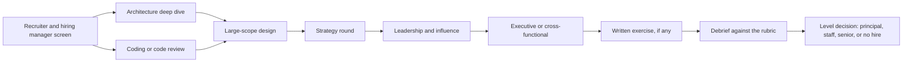

# Part 89 — Staff and Principal Interview Preparation

A senior interview asks: can you build this system well? A staff or principal interview asks a different question: have you changed how many people build systems, and can you do it again here, starting in a place you do not know, with people who do not report to you? The rounds look familiar on the calendar invite (a design round, a behavioural round, a deep dive), but the bar inside each one has moved. Candidates who prepare for a staff loop the way they prepared for their senior loop usually perform well, and get a senior offer.

Part 59 prepared you for senior backend loops, question by question. Part 68 gave you the whole interview playbook, including a one-section overview of staff loops (68.5). Part 87 taught the interviewer's side: how loops, questions and rubrics are designed. This Part is the candidate's side of staff, principal and architect loops, in depth: how the rounds differ and what each is scoring, how to build the stories that carry the loop, how to present your own past system for 45 minutes and survive the probes, how to design at organisational scale, how to answer strategy, leadership and executive rounds, how to write under time pressure, how to interview the company back, and how to prepare in six to eight weeks.

The reader this Part assumes is a senior engineer who already operates at staff scope, or a staff engineer going for principal. Everything here rests on Parts 81–88. The interview is not where you learn those skills; it is where you prove, with evidence, that you have used them.

## 89.1 How staff, principal and architect loops differ from senior loops

#### Concept

A staff-plus loop is a set of interviews designed to find evidence of **leverage**: decisions, designs, standards and people that made several teams better over one to five years (Part 58 — Junior to Principal: What Is Expected at Each Level, section 58.1). It keeps some senior rounds, usually at lower weight, and adds rounds that a senior loop does not have: a deep dive on a system you built, an ambiguous design problem at organisational scale, a strategy round, a leadership and influence round, a cross-functional or executive conversation, and sometimes a written exercise.

The biggest difference is not the round list. It is what counts as a good answer. In a senior system design round, a clean design with failure modes and numbers is strong. In a staff round on the same prompt, that design is the entry ticket; the signal is whether you also handle the migration from today, the teams that must change, the cost, and what you would refuse to do.

#### Why does it exist?

A wrong staff hire is expensive in a way a wrong senior hire is not. A weak senior engineer slows one team. A weak staff engineer with a staff title sends several teams in a wrong direction with authority, and the damage shows up a year later as a half-finished migration or a platform nobody uses. Companies know a coding round cannot detect that risk, so they built rounds that look for the specific evidence: scope you held, direction you set, people who changed what they did because of you.

There is a second reason. Staff-plus candidates have fifteen years of material and good communication skills, so they can sound impressive while saying little. The deep dive and the probes exist to separate people who did the work from people who were near it.

#### Mental model

Imagine a restaurant hiring a line cook versus a head chef. The line cook is tested by cooking a dish in front of the chef. The head chef is asked about a menu they designed, a kitchen they ran, what happened the Saturday a supplier failed, and how they would change this restaurant's menu given its budget and staff. Nobody asks the head chef to prove they can dice an onion; it is assumed, and if they cannot, it shows in everything else. A staff loop is the head chef interview.

#### How it works

**The rounds and the signal each one seeks.** Loops vary by company, but most staff and principal loops are built from these rounds. Not every loop has all of them; four to six is typical.

| Round | Typical length | What you do | Signal the interviewer seeks | Where the book teaches it |
|---|---|---|---|---|
| Hiring manager screen | 30–45 min | Walk through your scope and why this role | Level fit, archetype fit, motivation | 89.1, 58.5 |
| Coding or code review | 45–60 min | A practical problem or a pull request to review | Still technical; judgment about quality, not speed | Part 67, 68.2, 68.4 |
| Architecture deep dive | 45–60 min | Present a system you led; answer probes | Depth, ownership, decisions with alternatives, honesty about failure | 89.3, Part 84 |
| Large-scope system design | 60 min | An ambiguous, multi-team problem | Diagnosis, options, migration path, org and cost reasoning | 89.4, Parts 83, 84, 85 |
| Strategy and vision | 45–60 min | "What would you do in 90 days?", critique a strategy, prioritise | Diagnosis before solutions, saying no, sequencing | 89.5, Part 82 |
| Leadership and influence | 45–60 min | Behavioural stories about conflict, influence, growing people | Influence without authority, commitment after disagreement, multiplying others | 89.6, Parts 86, 87 |
| Cross-functional or executive | 30–45 min | A conversation with a product leader, director or VP | Business framing, brevity, trust | 89.6, 86.2 |
| Written exercise or take-home RFC | 60–90 min, or a few hours at home | Write a design or strategy document | Structured argument, honest alternatives, clarity | 89.7, Part 81 |

The same loop seen as a flow, with the decision at the end that matters most for you: the level.



**The bar moves inside each signal.** The table below uses the definitions from 58.1 and 58.5. Read it as "what a strong answer contains at each level"; interviewers score the same prompt against a different column.

| Signal | Strong at senior | Strong at staff | Strong at principal |
|---|---|---|---|
| Scope of your stories | One system or service you owned | Three to eight teams, one domain or platform | The engineering organisation or a company-critical domain |
| Time horizon | A quarter or two | One to two years, with a sequence | Two to five years, with bets and exit points |
| Design | Correct, scalable, failure modes covered | Plus migration path, team boundaries, cost | Plus what the company should and should not build, and why |
| Ambiguity | Defines what to build from a problem | Finds the problem worth solving | Decides which problems the organisation should have |
| Influence | Sets the bar on one team | Aligns teams without authority, in writing | Changes how the organisation decides; executives act on your framing |
| People | Mentors | Grows seniors into leads of cross-team work | Shapes hiring and promotion standards |
| Failure | Fixed an incident | Turned a class of incidents into a programme | Prevented a large, expensive mistake before it happened |

**The level is decided in the debrief.** Many companies interview for a role "at staff or senior" and decide the level from the evidence. A common outcome for a strong senior candidate is a senior offer, not a rejection, so treat every round as a chance to produce staff evidence, not just to avoid mistakes. Some companies also run the decision through a hiring committee that reads the written feedback without meeting you, which is why concrete, quotable details in your answers matter: a number or a named decision survives being written down by an interviewer; "I drove alignment" does not.

**Principal and architect variants.** Principal loops usually add a longer conversation with a senior director, VP or CTO, more weight on strategy, and questions about bets you made over several years. The word "architect" covers very different jobs, so find out which one before you prepare:

| Title you see | What the job usually is | What the loop emphasises |
|---|---|---|
| Software or principal architect (product company) | Design authority for a domain or the platform | Deep dive, large-scope design, governance (Part 83) |
| Enterprise architect | Portfolio of systems, standards, vendor choices across a large organisation | Strategy, build versus buy (63.19, 82.6), governance, executive communication |
| Solutions architect (vendor or consultancy) | Customer-facing design, often part of pre-sales | Customer scenarios, presentation, breadth over depth |
| Staff engineer with "architect" duties | A staff archetype (see below) | Same as the staff loop |

**Internal promotion packets versus external hiring.** Both decide the same question, with different evidence.

| | Internal promotion to staff or principal | External staff or principal loop |
|---|---|---|
| Evidence | Two to four quarters of work at the level, already visible | Five to seven hours of conversation |
| Main artefact | A written packet: impact summary, project documents, peer and partner feedback, a sponsor's statement | Your stories, your deep dive, your design reasoning |
| Who decides | Usually a committee of senior people who read the packet | Interviewers write feedback; a debrief or committee decides |
| What sinks it | No sponsor; impact that nobody outside your team can name; work at the level for one quarter only | Stories without numbers or "I"; senior-scope answers; no trade-offs |
| What you control | Choosing staff-scope work early and making it visible in writing (58.4.4, 58.4.5) | Preparation: the story bank, the deep dive, mock loops |

The overlap is the useful part. A promotion packet is a story bank written down, and a story bank is a packet you can speak. If you build one, you have most of the other. A packet skeleton:

```markdown
# Promotion case: Asha R., Senior to Staff Engineer, Payments group

## Summary (5 lines)
Led the payments platform migration across 4 teams over 14 months; set the
idempotency standard now used by 9 services; grew two seniors into project leads.

## Impact, with evidence
1. Payments migration: payment-change lead time 11 days -> 1.5 days; checkout
   payment errors 0.9% -> 0.2%. RFC, migration dashboard, postmortems linked.
2. Idempotency standard: duplicate-charge incidents 7 per quarter -> 0 in the
   three quarters since rollout. Standard doc and adoption tracker linked.
3. People: R. and M. each now lead a cross-team project (their managers' notes linked).

## Scope beyond my team
Teams changed by this work: Checkout, Orders, Fraud, Finance Engineering.

## Feedback from partners (quoted, with names)
## Sponsor statement (director, 1 paragraph)
## Gaps and what I am doing about them
```

**Staff archetypes and choosing the roles that fit you.** Section 58.5.2 describes four archetypes (popularised by Will Larson's book *Staff Engineer*): the Tech Lead, the Architect, the Solver and the Right Hand. Loops are often written for one archetype without saying so. Read the job description and the hiring manager's answers for clues, and prepare the evidence that archetype is scored on.

| Archetype | Clues in the role description | Rounds that weigh most | Evidence you need ready |
|---|---|---|---|
| Tech Lead | "Lead the technical direction of a team or group", delivery dates, a named product area | Leadership, deep dive, design | Plans you sequenced, quality you held, delivery you landed with several engineers |
| Architect | "Own the architecture of", "domain", "long-term design", "standards" | Deep dive, large-scope design, written exercise | Designs that held for years, migrations, interfaces and boundaries you set |
| Solver | "Hardest technical problems", "performance", "reliability", "turnaround" | Deep dive, design, debugging-flavoured probes | Incidents and walls you broke through, and what became structural afterwards |
| Right Hand | "Partner with the VP or CTO", "cross-organisation initiatives" | Strategy, executive, leadership | Due diligence, reorganisation input, rescued programmes, executive trust |

Choosing well matters more at this level than at senior, because the archetype decides what your first year is measured on. A strong Solver placed in a Tech Lead role spends a year being judged on delivery plans, and both sides feel the mismatch. Ask the hiring manager directly: "Twelve months from now, what would make you say this hire was a success?" The answer tells you the archetype faster than the job title.

#### Practical example

Two candidates interview for the same "Staff Backend Engineer, Orders" role. Both are excellent senior engineers.

The first prepares as for a senior loop: 40 hours of system design practice on standard prompts, a refresher on PostgreSQL locking, and six behavioural stories. In the design round, asked to "design order management for our marketplace", he produces a clean service design with an outbox, idempotent APIs and a capacity estimate. In the deep dive he presents a service he built alone. Feedback: strong senior, no evidence of scope beyond one team. Offer: senior.

The second spends half her time on the same technical refresh and half on staff evidence. She asks the recruiter which archetype the role is (Tech Lead for three teams), builds a story bank around cross-team work, and rehearses a deep dive on a payments migration across four teams. In the design round she produces a similar service design in 25 minutes, then spends the rest on how three teams would migrate onto it, what she would not build in year one, and how she would measure progress. Offer: staff.

#### Failure scenario

A principal candidate with an impressive background reached the VP conversation at the end of a strong loop. The VP asked, "If you joined and found our platform team was building the wrong thing, what would you do?" He answered with a twelve-minute technical description of the right platform. The VP's written feedback: "Clearly very capable. Did not ask a single question about why the team is building what it builds, who decided, or what it costs us. I would worry about him telling teams what to do." The loop came back as "staff, not principal". The technical content was correct; the signal the round sought (diagnosis, curiosity, working through people) was missing.

#### Edge cases & failure modes

- **"Staff" titles at small companies.** A staff title at a 40-person company may carry senior scope at a large one. Interviewers level by scope, so describe scope in teams, engineers, systems and money, not titles (68.8.1 covers the levelling map).
- **Manager returning to IC.** Your stories will be about people and delivery. Add evidence of technical judgment: designs you shaped, decisions you made and why, a prototype you built.
- **A loop with no deep dive.** Bring the deep-dive material into the behavioural and design rounds as short, specific references.
- **Interviewers below your level.** Common in staff loops. Teach without lecturing; a staff engineer who makes a senior interviewer feel small is showing exactly the wrong signal.
- **A "staff or senior" opening.** Ask early how the level is decided and what evidence moves it.

#### How a Principal Engineer thinks about this

A principal treats the loop as a design problem with known requirements: each round has a signal, a rubric and a bar, and the job is to put the right evidence in front of each one. They find out the archetype and the level before preparing, because preparation for an Architect role and a Right Hand role differ. They prepare their evidence like a promotion packet, with numbers and documents they could show. And they interview the company as hard as it interviews them (89.8), because at this level a bad fit costs a year.

#### Common mistakes

- Preparing only technical content, because it feels like progress.
- Describing title instead of scope ("I was a staff engineer") with no teams, numbers or horizon.
- Not asking which archetype and level the loop targets, then preparing for the wrong one.
- Treating the executive conversation as a formality.
- Assuming a senior offer means failure; it may mean the evidence was not presented, which is fixable before the next loop.

#### Interview questions

1. **"Why staff, and not engineering management?"** Expected: a concrete answer about the material you want to work with (designs, standards, technical bets versus people and delivery), with an example of your best recent day. Follow-up: "Have you managed? Would you go back?"
2. **"What kind of staff engineer are you?"** Expected: name your archetype with evidence and say which work drains you. Follow-up: "This role needs some Right Hand work. How do you feel about that?"
3. **"Describe your current scope."** Expected: teams, engineers, systems, traffic or money, horizon, and what you decide versus influence. Why it matters: it is the first levelling signal.
4. **"What is the largest technical decision you made in the last year?"** Expected: one decision, its alternatives, its cost, and who disagreed.

#### Practical exercise

Pick one staff or principal role you would apply for. From its description, identify the archetype and the two rounds likely to weigh most. Write your scope in five lines (teams, engineers, systems, horizon, what you decide). Acceptance criteria: the archetype is supported by at least two phrases from the description, and every line of your scope contains a number.
